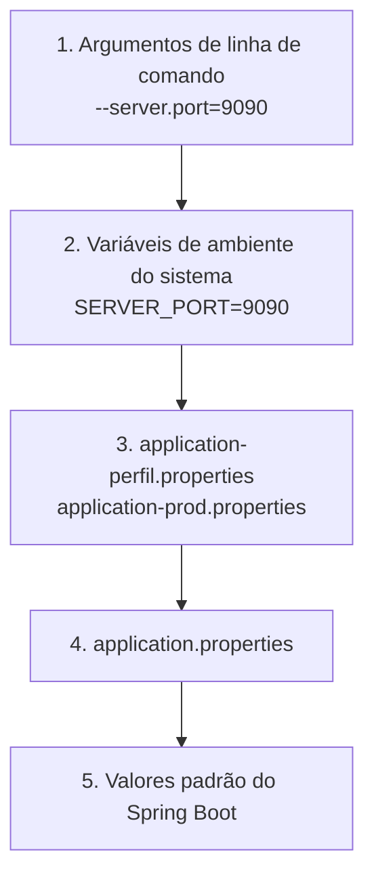
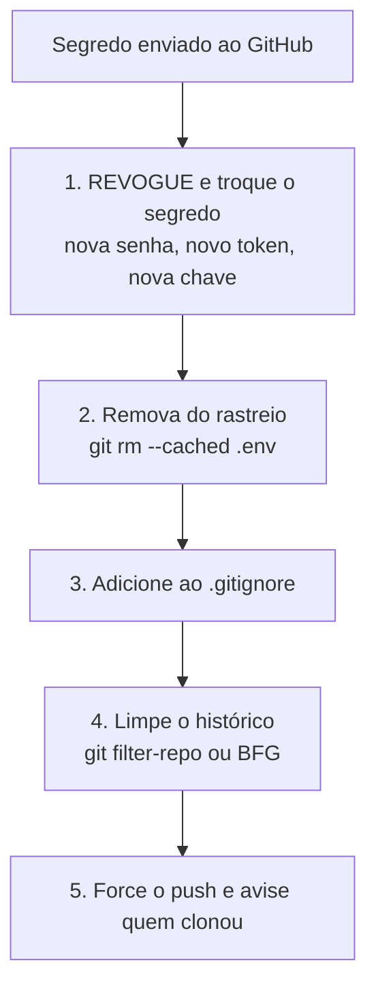

# Arquivos importantes de um projeto Spring Boot


## Sumário

- [Visão geral da estrutura](#visão-geral-da-estrutura)
- [Resumo: o que vai para o GitHub e o que não vai](#resumo-o-que-vai-para-o-github-e-o-que-não-vai)
- [pom.xml e build.gradle](#pomxml-e-buildgradle)
- [Maven Wrapper e Gradle Wrapper](#maven-wrapper-e-gradle-wrapper)
- [application.properties e application.yml](#applicationproperties-e-applicationyml)
- [Profiles: um arquivo por ambiente](#profiles-um-arquivo-por-ambiente)
- [Lendo as configurações no código](#lendo-as-configurações-no-código)
- [.env: variáveis de ambiente e segredos](#env-variáveis-de-ambiente-e-segredos)
- [.gitignore](#gitignore)
- [.gitattributes e .editorconfig](#gitattributes-e-editorconfig)
- [Outros arquivos em src/main/resources](#outros-arquivos-em-srcmainresources)
- [Dockerfile, .dockerignore e docker-compose.yml](#dockerfile-dockerignore-e-docker-composeyml)
- [README.md](#readmemd)
- [LICENSE e HELP.md](#license-e-helpmd)
- [.github: automações do GitHub](#github-automações-do-github)
- [Se um segredo foi parar no GitHub](#se-um-segredo-foi-parar-no-github)
- [Boas práticas](#boas-práticas)
- [Referências](#referências)

---

## Visão geral da estrutura

Um projeto Spring Boot com Maven, criado pelo [Spring Initializr](https://start.spring.io), costuma ficar assim:

```text
meu-projeto/
├── .github/
│   ├── workflows/ci.yml          ← automação (build e testes no GitHub)
│   └── dependabot.yml            ← atualização automática de dependências
├── .mvn/wrapper/                 ← configuração do Maven Wrapper
├── src/
│   ├── main/
│   │   ├── java/br/com/exemplo/demo/
│   │   │   └── DemoApplication.java      ← classe principal (@SpringBootApplication)
│   │   └── resources/
│   │       ├── application.properties    ← configurações
│   │       ├── application-dev.properties
│   │       ├── application-prod.properties
│   │       ├── static/                   ← arquivos estáticos (CSS, JS, imagens)
│   │       ├── templates/                ← páginas HTML (Thymeleaf)
│   │       └── db/migration/             ← scripts do Flyway
│   └── test/
│       └── java/br/com/exemplo/demo/
│           └── DemoApplicationTests.java
├── .env                          ← segredos locais (NÃO vai para o GitHub)
├── .env.example                  ← modelo do .env (vai para o GitHub)
├── .gitattributes
├── .gitignore
├── docker-compose.yml
├── Dockerfile
├── HELP.md
├── LICENSE
├── mvnw                          ← Maven Wrapper (Linux/Mac)
├── mvnw.cmd                      ← Maven Wrapper (Windows)
├── pom.xml                       ← dependências e build
├── README.md                     ← "cartão de visitas" do projeto
└── target/                       ← arquivos gerados pelo build (NÃO vai para o GitHub)
```

---

## Resumo: o que vai para o GitHub e o que não vai

| Arquivo / pasta | Versionar? | Contém segredo? | Para que serve |
|---|---|---|---|
| `pom.xml` / `build.gradle` | ✅ Sim | Não | Dependências e build |
| `mvnw`, `mvnw.cmd`, `.mvn/wrapper/` | ✅ Sim | Não | Rodar o Maven sem instalá-lo |
| `application.properties` | ✅ Sim | **Não pode ter** | Configurações comuns |
| `application-dev.properties`, `application-prod.properties` | ✅ Sim | **Não pode ter** | Configurações por ambiente |
| `application-local.properties` | ❌ **Não** | Pode ter | Configurações só da sua máquina |
| **`.env`** | ❌ **Não** | **Sim** | Senhas, tokens e chaves locais |
| `.env.example` | ✅ Sim | Não (valores falsos) | Modelo do `.env` |
| `.gitignore`, `.gitattributes` | ✅ Sim | Não | Regras do Git |
| `Dockerfile`, `docker-compose.yml` | ✅ Sim | **Não pode ter** | Execução em contêiner |
| `README.md`, `LICENSE` | ✅ Sim | Não | Documentação e licença |
| `.github/workflows/` | ✅ Sim | Não | Automações |
| `src/` | ✅ Sim | Não | Código-fonte |
| `target/` ou `build/` | ❌ **Não** | Não | Arquivos gerados |
| `.idea/`, `.vscode/`, `*.iml` | ❌ **Não** | Não | Configuração da sua IDE |
| `HELP.md` | ⚠️ Opcional | Não | Links gerados pelo Initializr |
| `*.log`, `logs/` | ❌ **Não** | Pode ter | Registros de execução |

> [!IMPORTANT]
> A regra de ouro: **tudo que é segredo ou gerado automaticamente fica de fora do GitHub**. Todo o resto entra.

---

## pom.xml e build.gradle

É o **coração do projeto**. Define a versão do Java, as dependências (*starters*) e como construir o projeto. O `pom.xml` é do **Maven**; o `build.gradle` é do **Gradle**.

```xml
<?xml version="1.0" encoding="UTF-8"?>
<project xmlns="http://maven.apache.org/POM/4.0.0" ...>
    <modelVersion>4.0.0</modelVersion>

    <parent>                                                    <!-- herda versões compatíveis de todas as dependências -->
        <groupId>org.springframework.boot</groupId>
        <artifactId>spring-boot-starter-parent</artifactId>
        <version>X.Y.Z</version>                                <!-- versão do Spring Boot -->
        <relativePath/>
    </parent>

    <groupId>br.com.exemplo</groupId>                           <!-- identificação do projeto -->
    <artifactId>demo</artifactId>
    <version>0.0.1-SNAPSHOT</version>

    <properties>
        <java.version>21</java.version>                         <!-- versão do Java usada -->
    </properties>

    <dependencies>                                              <!-- as bibliotecas que o projeto usa -->
        <dependency>
            <groupId>org.springframework.boot</groupId>
            <artifactId>spring-boot-starter-validation</artifactId>   <!-- sem <version>: o parent já define -->
        </dependency>
        <dependency>
            <groupId>org.springframework.boot</groupId>
            <artifactId>spring-boot-starter-test</artifactId>
            <scope>test</scope>                                 <!-- só existe na hora dos testes -->
        </dependency>
    </dependencies>

    <build>
        <plugins>
            <plugin>
                <groupId>org.springframework.boot</groupId>
                <artifactId>spring-boot-maven-plugin</artifactId>   <!-- gera o .jar executável -->
            </plugin>
        </plugins>
    </build>
</project>
```

| Trecho | O que faz |
|---|---|
| `<parent>` | Traz um "catálogo" de versões testadas juntas, então você quase nunca informa `<version>` nas dependências |
| `<dependencies>` | Lista os *starters* e bibliotecas |
| `<scope>test</scope>` | A dependência só é usada nos testes |
| `spring-boot-maven-plugin` | Empacota a aplicação em um `.jar` que roda com `java -jar` |

> [!NOTE]
> Os nomes dos *starters* mudaram entre versões do Spring Boot. No Spring Boot 4, por exemplo, o `spring-boot-starter-web` foi renomeado para `spring-boot-starter-webmvc`. Confira a documentação da versão que você usa.

---

## Maven Wrapper e Gradle Wrapper

Os arquivos `mvnw`, `mvnw.cmd` e a pasta `.mvn/wrapper/` (no Gradle: `gradlew`, `gradlew.bat` e `gradle/wrapper/`) formam o **Wrapper**: um script que **baixa e usa a versão exata do Maven (ou Gradle)** que o projeto precisa. Assim, quem clona o repositório **não precisa instalar o Maven**.

| Sistema | Comando para rodar |
|---|---|
| Linux / Mac | `./mvnw spring-boot:run` |
| Windows | `mvnw.cmd spring-boot:run` |

| Comando | O que faz |
|---|---|
| `./mvnw spring-boot:run` | Sobe a aplicação |
| `./mvnw clean package` | Apaga o `target/`, compila, testa e gera o `.jar` |
| `./mvnw test` | Roda os testes |
| `./mvnw clean verify` | Compila e roda todos os testes e verificações |

> [!IMPORTANT]
> **Versione o Wrapper** (`mvnw`, `mvnw.cmd`, `.mvn/wrapper/`). Sem ele, cada pessoa precisa instalar o Maven na versão certa.

> [!TIP]
> Se aparecer `Permission denied` ao rodar `./mvnw` no Linux ou no GitHub Actions, o arquivo perdeu a permissão de execução. Corrija com:
>
> ```bash
> git update-index --chmod=+x mvnw
> ```

---

## application.properties e application.yml

É o arquivo de **configuração da aplicação**, na pasta `src/main/resources`. O Spring Boot o lê sozinho na inicialização. Você pode usar **`.properties`** ou **`.yml`**; o resultado é o mesmo.

### Exemplo em `application.properties`

```properties
# Nome e porta da aplicação
spring.application.name=demo
server.port=8080

# Banco de dados: os valores vêm de variáveis de ambiente (com valor padrão depois dos dois pontos)
spring.datasource.url=${DB_URL:jdbc:postgresql://localhost:5432/meubanco}
spring.datasource.username=${DB_USER:postgres}
spring.datasource.password=${DB_PASSWORD}

# JPA / Hibernate
spring.jpa.hibernate.ddl-auto=validate
spring.jpa.show-sql=false
spring.jpa.open-in-view=false

# Paginação (Spring Data web)
spring.data.web.pageable.default-page-size=10
spring.data.web.pageable.max-page-size=100

# Logs
logging.level.root=INFO
logging.level.br.com.exemplo=DEBUG
```

### O mesmo em `application.yml`

```yaml
spring:
  application:
    name: demo
  datasource:
    url: ${DB_URL:jdbc:postgresql://localhost:5432/meubanco}
    username: ${DB_USER:postgres}
    password: ${DB_PASSWORD}
  jpa:
    hibernate:
      ddl-auto: validate
    show-sql: false
    open-in-view: false
  data:
    web:
      pageable:
        default-page-size: 10
        max-page-size: 100

server:
  port: 8080

logging:
  level:
    root: INFO
    br.com.exemplo: DEBUG
```

| | `.properties` | `.yml` |
|---|---|---|
| Formato | `chave.completa=valor` | Hierarquia por indentação |
| Repetição | Repete o prefixo em cada linha | Agrupa por nível |
| Risco | Poucos | **Indentação errada quebra o arquivo** |
| Comentário | `#` | `#` |
| Lista | `lista[0]=a` | `- a` |

> [!TIP]
> Escolha **um** formato e use em todo o projeto. Misturar `.properties` e `.yml` confunde, e o `.properties` tem prioridade quando o mesmo valor aparece nos dois.

### Propriedades mais comuns

| Propriedade | O que faz |
|---|---|
| `server.port` | Porta HTTP da aplicação (padrão `8080`) |
| `spring.application.name` | Nome da aplicação |
| `spring.datasource.url / username / password` | Conexão com o banco |
| `spring.jpa.hibernate.ddl-auto` | O que o Hibernate faz com as tabelas (veja abaixo) |
| `spring.jpa.show-sql` | Mostra o SQL no console (só em desenvolvimento) |
| `spring.jpa.open-in-view` | Mantém a sessão do banco aberta durante a requisição. **Prefira `false`** |
| `logging.level.<pacote>` | Nível de log de um pacote (`TRACE`, `DEBUG`, `INFO`, `WARN`, `ERROR`) |
| `spring.profiles.active` | Qual perfil usar (`dev`, `prod`...) |

### Valores de `spring.jpa.hibernate.ddl-auto`

| Valor | O que faz | Onde usar |
|---|---|---|
| `none` | Não mexe nas tabelas | Produção |
| `validate` | Só confere se o banco bate com as entidades | **Produção** (com Flyway ou Liquibase) |
| `update` | Tenta ajustar as tabelas automaticamente | Só estudo (pode gerar surpresas) |
| `create` | Apaga e recria tudo ao iniciar | Só testes |
| `create-drop` | Cria ao iniciar e apaga ao encerrar | Só testes |

> [!WARNING]
> **Nunca use `create`, `create-drop` ou `update` em produção.** Um deploy pode apagar ou alterar dados reais.

### Substituição de valores: `${...}`

```properties
spring.datasource.password=${DB_PASSWORD}                  # obrigatório: se faltar, a aplicação falha ao iniciar
spring.datasource.username=${DB_USER:postgres}             # com padrão: se DB_USER não existir, usa "postgres"
```

Os valores vêm de **variáveis de ambiente**, **argumentos de linha de comando** e outras propriedades.

### Ordem de prioridade (da mais forte para a mais fraca)



Se a mesma propriedade aparece em dois lugares, **vence a de cima**. Por isso uma variável de ambiente na produção sobrescreve o que está no `application.properties`.

### Variáveis de ambiente viram propriedades

O Spring converte nomes automaticamente (*relaxed binding*):

| Propriedade | Variável de ambiente equivalente |
|---|---|
| `server.port` | `SERVER_PORT` |
| `spring.datasource.url` | `SPRING_DATASOURCE_URL` |
| `spring.profiles.active` | `SPRING_PROFILES_ACTIVE` |

Regra: tudo em **maiúsculas**, e pontos e hífens viram **sublinhado**.

---

## Profiles: um arquivo por ambiente

Um **profile** (perfil) permite ter **configurações diferentes** para cada ambiente: desenvolvimento, testes, produção.

```text
src/main/resources/
├── application.properties           ← vale para TODOS os ambientes
├── application-dev.properties       ← só quando o perfil "dev" está ativo
└── application-prod.properties      ← só quando o perfil "prod" está ativo
```

`application.properties` (comum):

```properties
spring.application.name=demo
spring.profiles.active=dev          # perfil padrão ao rodar localmente
```

`application-dev.properties` (desenvolvimento):

```properties
spring.datasource.url=jdbc:h2:mem:testdb
spring.jpa.hibernate.ddl-auto=create-drop
spring.jpa.show-sql=true
logging.level.br.com.exemplo=DEBUG
```

`application-prod.properties` (produção):

```properties
spring.datasource.url=${DB_URL}
spring.datasource.username=${DB_USER}
spring.datasource.password=${DB_PASSWORD}
spring.jpa.hibernate.ddl-auto=validate
spring.jpa.show-sql=false
logging.level.root=WARN
```

### Como ativar um perfil

| Forma | Exemplo |
|---|---|
| No `application.properties` | `spring.profiles.active=dev` |
| Variável de ambiente | `SPRING_PROFILES_ACTIVE=prod` |
| Linha de comando | `java -jar app.jar --spring.profiles.active=prod` |
| Maven | `./mvnw spring-boot:run -Dspring-boot.run.profiles=dev` |

> [!TIP]
> Em produção, ative o perfil por **variável de ambiente** (`SPRING_PROFILES_ACTIVE=prod`) e remova o `spring.profiles.active` fixo do arquivo comum.

### Beans por perfil

```java
@Configuration
@Profile("dev")                            // este bean só existe quando o perfil "dev" está ativo
public class DadosDeTesteConfig { ... }
```

### Arquivo só da sua máquina

Crie o `application-local.properties`, ative com `spring.profiles.active=local` e **coloque no `.gitignore`**. Assim, ajustes pessoais e senhas locais não vão para o GitHub.

---

## Lendo as configurações no código

### `@Value`: para um valor isolado

```java
@Service
public class EmailService {

    @Value("${app.email.remetente}")                      // lê a propriedade app.email.remetente
    private String remetente;

    @Value("${app.email.tentativas:3}")                   // com valor padrão: 3
    private int tentativas;
}
```

### `@ConfigurationProperties`: para um grupo de valores (recomendado)

No `application.properties`:

```properties
app.email.remetente=nao-responda@exemplo.com
app.email.tentativas=5
app.email.timeout=10s
```

No código, um `record` fortemente tipado:

```java
@ConfigurationProperties(prefix = "app.email")            // pega tudo que começa com "app.email"
public record EmailProperties(
        String remetente,
        int tentativas,
        Duration timeout                                  // "10s" vira Duration automaticamente
) {}
```

Registre na classe principal:

```java
@SpringBootApplication
@ConfigurationPropertiesScan                              // encontra automaticamente as classes @ConfigurationProperties
public class DemoApplication { ... }
```

Use como qualquer bean:

```java
@Service
public class EmailService {

    private final EmailProperties props;

    public EmailService(EmailProperties props) {          // o Spring injeta já preenchido
        this.props = props;
    }
}
```

| | `@Value` | `@ConfigurationProperties` |
|---|---|---|
| Ideal para | 1 ou 2 valores soltos | Grupos de valores relacionados |
| Tipagem | Manual | Automática (`Duration`, `int`, listas, objetos) |
| Validação | Difícil | Com `@Validated` + `@NotBlank` etc. |
| Testes | Mais trabalhoso | Fácil de instanciar |

---

## .env: variáveis de ambiente e segredos

O arquivo **`.env`** guarda **valores sensíveis e específicos da sua máquina** (senhas, tokens, chaves de API) em linhas simples `CHAVE=valor`. **Ele nunca vai para o GitHub.**

```dotenv
# .env  (NÃO versionar)
DB_URL=jdbc:postgresql://localhost:5432/meubanco
DB_USER=postgres
DB_PASSWORD=minha-senha-super-secreta
JWT_SECRET=troque-por-uma-chave-longa-e-aleatoria
API_TOKEN=abc123
```

E o **`.env.example`**, que **vai para o GitHub**, mostra quais variáveis o projeto precisa, **sem os valores reais**:

```dotenv
# .env.example  (versionar)
DB_URL=jdbc:postgresql://localhost:5432/meubanco
DB_USER=postgres
DB_PASSWORD=
JWT_SECRET=
API_TOKEN=
```

Quem clonar o projeto faz `cp .env.example .env` e preenche os valores.

```mermaid
flowchart LR
    A[.env<br/>DB_PASSWORD=123] --> B[Variáveis de ambiente<br/>do processo]
    B --> C[application.properties<br/>password=$&#123;DB_PASSWORD&#125;]
    C --> D[Bean DataSource<br/>conecta no banco]
```



### Como o Spring Boot lê o `.env`

> [!NOTE]
> O Spring Boot **não** lê o `.env` sozinho. Ele só enxerga **variáveis de ambiente** reais. Há algumas formas de levar o conteúdo do `.env` até ele:

| Forma | Como |
|---|---|
| **Importar no próprio Spring** | `spring.config.import=optional:file:.env[.properties]` no `application.properties` |
| **Variáveis na IDE** | Cadastre no *Run Configuration* (IntelliJ: *Environment variables*, que também aceita carregar um arquivo `.env`) |
| **No terminal** | `export DB_PASSWORD=123` antes de rodar (Linux/Mac) |
| **Docker Compose** | `env_file: .env` no serviço |
| **Biblioteca** | Pacotes como `dotenv-java` leem o `.env` no código |

A primeira opção é **nativa** e a mais simples:

```properties
# application.properties
spring.config.import=optional:file:.env[.properties]     # lê o .env como se fosse um arquivo de propriedades; "optional" = não falha se não existir
```

> [!WARNING]
> O `.env` é para **desenvolvimento local**. Em produção, defina as variáveis **no servidor ou na plataforma** (Docker, Kubernetes, Render, Railway, AWS...) e não copie o arquivo `.env` para lá.

### O que deve ir para o `.env`

| ✅ Vai para o `.env` | ❌ Fica no `application.properties` |
|---|---|
| Senhas de banco | Porta do servidor |
| Chaves de API e tokens | Nome da aplicação |
| Segredo do JWT | Níveis de log |
| Credenciais de serviços externos | Paginação e outras configurações não secretas |
| URLs que mudam por ambiente | Padrões que servem para todos |

---

## .gitignore

O **`.gitignore`** diz ao Git **quais arquivos e pastas ignorar**. Arquivos ignorados não aparecem no `git status`, não entram no `git add .` e não vão para o GitHub.

### Exemplo recomendado para Spring Boot + Maven

```gitignore
### Maven ###
target/
!.mvn/wrapper/maven-wrapper.properties

### Gradle ###
.gradle/
build/
!gradle/wrapper/gradle-wrapper.jar

### Segredos e configurações locais ###
.env
.env.*
!.env.example
application-local.properties
application-local.yml
*.pem
*.key
*.p12
*.jks

### Logs ###
*.log
logs/

### Gerados pelo Initializr ###
HELP.md

### IntelliJ IDEA ###
.idea/
*.iws
*.iml
*.ipr
out/

### Eclipse / STS ###
.apt_generated
.classpath
.factorypath
.project
.settings
.springBeans
.sts4-cache
bin/

### VS Code ###
.vscode/

### Sistema operacional ###
.DS_Store
Thumbs.db
```

### Como ler as regras

| Padrão | Significado | Exemplo |
|---|---|---|
| `# texto` | Comentário | `### Maven ###` |
| `arquivo.txt` | Ignora esse arquivo em qualquer pasta | `.env` |
| `pasta/` | Ignora uma pasta inteira (a barra no final indica pasta) | `target/` |
| `*` | Qualquer sequência de caracteres | `*.log` |
| `**` | Qualquer nível de pastas | `**/temp/` |
| `/arquivo` | Só na raiz do repositório | `/config.local` |
| `!padrão` | **Exceção**: volta a versionar | `!.env.example` |

> [!IMPORTANT]
> A ordem importa: a exceção `!.env.example` precisa vir **depois** da regra `.env.*`. Do contrário, a regra ignora o arquivo de novo.

### O `.gitignore` só vale para arquivos que **ainda não foram** versionados

Se você já fez `git add` ou `git commit` de um arquivo, adicioná-lo ao `.gitignore` **não o remove** do repositório. Para parar de rastreá-lo (mantendo-o no seu computador):

```bash
git rm --cached .env                  # remove do controle do Git, mas não apaga o arquivo local
git commit -m "Remove .env do repositório"
```

Para pastas: `git rm -r --cached .idea`.

> [!WARNING]
> Isso **não apaga o que já está no histórico**. Se o arquivo continha um segredo, veja [Se um segredo foi parar no GitHub](#se-um-segredo-foi-parar-no-github).

### Comandos úteis

| Comando | O que faz |
|---|---|
| `git status` | Mostra o que mudou (ignorados não aparecem) |
| `git check-ignore -v .env` | Mostra **qual regra** do `.gitignore` está ignorando o arquivo |
| `git status --ignored` | Lista também os arquivos ignorados |
| `git ls-files` | Lista tudo que o Git está rastreando |

### `.gitignore` global (para o seu computador)

Para arquivos da **sua IDE e do seu sistema**, que valem para todos os projetos, use um `.gitignore` global:

```bash
git config --global core.excludesfile ~/.gitignore_global
```

Assim, você não precisa repetir `.idea/` e `.DS_Store` em cada repositório.

---

## .gitattributes e .editorconfig

### `.gitattributes`

Controla **como o Git trata os arquivos**, principalmente a **quebra de linha** (Windows usa CRLF; Linux e Mac usam LF). Isso evita o erro clássico em que o `mvnw` quebra no Linux ou no Docker por vir com CRLF.

```gitattributes
# Detecta texto e normaliza as quebras de linha automaticamente
* text=auto

# Scripts de shell SEMPRE com LF (senão quebram no Linux e no Docker)
mvnw       text eol=lf
gradlew    text eol=lf
*.sh       text eol=lf

# Scripts do Windows SEMPRE com CRLF
*.cmd      text eol=crlf
*.bat      text eol=crlf

# Arquivos binários: não mexer
*.jar      binary
*.png      binary
```

### `.editorconfig`

Padroniza **indentação e formatação** entre IDEs e pessoas diferentes:

```editorconfig
root = true

[*]
charset = utf-8
end_of_line = lf
insert_final_newline = true
trim_trailing_whitespace = true
indent_style = space
indent_size = 4

[*.{yml,yaml,json}]
indent_size = 2

[*.md]
trim_trailing_whitespace = false
```

---

## Outros arquivos em src/main/resources

| Arquivo / pasta | Para que serve |
|---|---|
| `static/` | Arquivos servidos direto pelo navegador (CSS, JS, imagens) |
| `templates/` | Páginas HTML renderizadas no servidor (Thymeleaf) |
| `db/migration/` | Scripts SQL versionados do **Flyway** |
| `schema.sql` / `data.sql` | Criação de tabelas e carga inicial (simples, mais usados em estudo) |
| `messages.properties` | Textos para internacionalização (i18n) e mensagens de validação |
| `logback-spring.xml` | Configuração avançada de logs |

### Migrations com Flyway (versionamento do banco)

Em vez de deixar o Hibernate alterar o banco (`ddl-auto=update`), o **Flyway** executa scripts SQL **em ordem**, uma única vez cada, e registra o que já rodou. O nome do arquivo segue um padrão:

```text
db/migration/
├── V1__criar_tabela_usuarios.sql         ← V + número + dois sublinhados + descrição
├── V2__adicionar_coluna_ativo.sql
└── V3__criar_tabela_pedidos.sql
```

```sql
-- V1__criar_tabela_usuarios.sql
CREATE TABLE usuarios (
    id          BIGSERIAL PRIMARY KEY,
    nome        VARCHAR(100) NOT NULL,
    email       VARCHAR(150) NOT NULL UNIQUE,
    criado_em   TIMESTAMP NOT NULL DEFAULT NOW()
);
```

> [!IMPORTANT]
> **Nunca edite uma migration que já foi executada.** Para mudar algo, crie uma **nova** (`V4__...`). O Flyway guarda um *checksum* e reclama se o arquivo antigo mudar.

Com o Flyway cuidando do banco, use `spring.jpa.hibernate.ddl-auto=validate`. Para usar o Flyway, adicione a dependência `flyway-core` (e a do seu banco). Confira o *starter* correto na versão do Spring Boot que você usa.

---

## Dockerfile, .dockerignore e docker-compose.yml

### Dockerfile: empacota a aplicação em uma imagem

```dockerfile
FROM eclipse-temurin:21-jre         # imagem base, só com o Java para EXECUTAR
WORKDIR /app                        # pasta de trabalho dentro do contêiner
COPY target/*.jar app.jar           # copia o .jar gerado pelo ./mvnw clean package
EXPOSE 8080                         # documenta a porta usada
ENTRYPOINT ["java", "-jar", "app.jar"]   # comando que inicia a aplicação
```

### .dockerignore: o que não enviar para o build da imagem

```dockerignore
.git
.idea
.vscode
.env
*.log
```

> [!WARNING]
> Sem `.env` no `.dockerignore`, o arquivo de segredos pode **parar dentro da imagem**. Passe as variáveis na execução, e não "embutidas" na imagem.

### docker-compose.yml: aplicação + banco juntos

```yaml
services:
  banco:
    image: postgres:16
    environment:
      POSTGRES_DB: meubanco
      POSTGRES_USER: ${DB_USER}                 # o Compose lê o arquivo .env automaticamente
      POSTGRES_PASSWORD: ${DB_PASSWORD}
    ports:
      - "5432:5432"
    volumes:
      - dados-banco:/var/lib/postgresql/data    # guarda os dados mesmo se o contêiner for recriado

  app:
    build: .                                    # usa o Dockerfile desta pasta
    depends_on:
      - banco
    ports:
      - "8080:8080"
    environment:
      SPRING_PROFILES_ACTIVE: prod
      DB_URL: jdbc:postgresql://banco:5432/meubanco   # "banco" é o nome do serviço acima
      DB_USER: ${DB_USER}
      DB_PASSWORD: ${DB_PASSWORD}

volumes:
  dados-banco:
```

Para subir tudo:

```bash
./mvnw clean package -DskipTests
docker compose up --build
```

> [!NOTE]
> O Docker Compose lê o `.env` da pasta do projeto para substituir `${DB_USER}` e `${DB_PASSWORD}`. Por isso o mesmo `.env` serve ao Compose e (com o `spring.config.import`) ao Spring.

---

## README.md

É a **primeira coisa que as pessoas veem** na página do repositório no GitHub. Um bom README responde: *o que é, como rodar e como usar*.

````markdown
# Nome do Projeto

Descrição curta do que o projeto faz.


## Tecnologias

- Java 21
- Spring Boot
- Spring Data JPA
- PostgreSQL
- Maven

## Pré-requisitos

- JDK 21 instalado
- PostgreSQL (ou Docker)

## Como rodar

1. Clone o repositório
   ```bash
   git clone https://github.com/usuario/projeto.git
   cd projeto
   ```
2. Crie o arquivo de variáveis a partir do modelo
   ```bash
   cp .env.example .env
   ```
3. Preencha o `.env` com os seus valores
4. Rode a aplicação
   ```bash
   ./mvnw spring-boot:run
   ```

A API estará em `http://localhost:8080`.

## Variáveis de ambiente

| Variável | Descrição | Exemplo |
|---|---|---|
| `DB_URL` | URL do banco | `jdbc:postgresql://localhost:5432/meubanco` |
| `DB_USER` | Usuário do banco | `postgres` |
| `DB_PASSWORD` | Senha do banco | |

## Endpoints

| Método | Rota | Descrição |
|---|---|---|
| GET | `/api/usuarios` | Lista usuários (paginado) |
| POST | `/api/usuarios` | Cria um usuário |

## Testes

```bash
./mvnw test
```

## Licença

Distribuído sob a licença MIT. Veja o arquivo `LICENSE`.
````

> [!TIP]
> O `README.md` na **raiz** do repositório aparece automaticamente na página inicial do GitHub. Um `README.md` dentro de uma pasta aparece quando alguém abre aquela pasta.

---

## LICENSE e HELP.md

### LICENSE

Define **o que os outros podem fazer** com o seu código. Sem licença, o código é, por padrão, **todos os direitos reservados**: outras pessoas podem ver, mas não têm permissão para usar ou copiar.

| Licença | Resumo |
|---|---|
| **MIT** | Muito permissiva: pode usar, copiar e modificar, mantendo o aviso de autoria |
| **Apache 2.0** | Permissiva, com concessão explícita de patentes |
| **GPL 3.0** | Quem usar e distribuir precisa manter o código aberto sob a mesma licença |

No GitHub, ao criar o repositório (ou em *Add file → Create new file → LICENSE*), há um seletor de licenças que já preenche o texto.

### HELP.md

Arquivo gerado pelo Spring Initializr com links de documentação das dependências escolhidas. Pode ser mantido, apagado ou colocado no `.gitignore`: não afeta o funcionamento.

---

## .github: automações do GitHub

### CI: compilar e testar a cada push

`.github/workflows/ci.yml`:

```yaml
name: CI

on:
  push:
    branches: [ main ]
  pull_request:
    branches: [ main ]

jobs:
  build:
    runs-on: ubuntu-latest
    steps:
      - uses: actions/checkout@v4                 # baixa o código do repositório
      - uses: actions/setup-java@v4               # instala o Java
        with:
          distribution: temurin
          java-version: '21'
          cache: maven                            # guarda as dependências para acelerar os próximos builds
      - name: Build e testes
        run: ./mvnw -B verify                     # -B: modo "batch" (sem cores nem barras de progresso)
```

> [!NOTE]
> Use a versão mais recente de cada *action*. Confira no Marketplace do GitHub.

### Dependabot: atualizações automáticas

`.github/dependabot.yml`:

```yaml
version: 2
updates:
  - package-ecosystem: "maven"          # use "gradle" se for o seu caso
    directory: "/"
    schedule:
      interval: "weekly"
```

O Dependabot abre *pull requests* sozinho quando há versões novas das suas dependências, inclusive correções de segurança.

### Segredos no GitHub Actions

Se o pipeline precisar de senhas ou tokens, **não coloque no YAML**. Cadastre em *Settings → Secrets and variables → Actions* e use assim:

```yaml
env:
  DB_PASSWORD: ${{ secrets.DB_PASSWORD }}
```

---

## Se um segredo foi parar no GitHub

Se uma senha, token ou chave foi enviada ao repositório, **mesmo que por alguns segundos**, considere-a **comprometida**: existem robôs que varrem o GitHub procurando exatamente isso.



| Passo | Por quê |
|---|---|
| **1. Trocar o segredo** | É o **único passo que realmente resolve**. Apagar o arquivo não "des-vaza" a senha |
| 2 e 3. Remover e ignorar | Evita que volte a acontecer |
| 4. Limpar o histórico | O segredo continua nos *commits* antigos. Ferramentas como `git filter-repo` ou o BFG Repo-Cleaner reescrevem o histórico |
| 5. Avisar | Quem já clonou ou fez *fork* ainda tem o segredo |

> [!WARNING]
> **A ordem importa: troque o segredo primeiro.** Limpar o histórico é um complemento, e não substitui a troca.

> [!TIP]
> O GitHub tem o *Secret scanning* e o *Push protection*, que **detectam e bloqueiam** o envio de chaves conhecidas. Ative em *Settings → Code security*.

---

## Boas práticas

- [x] **Nunca** versionar `.env`, senhas, tokens, chaves (`.pem`, `.key`) ou certificados
- [x] Manter um **`.env.example`** atualizado, com os nomes das variáveis e sem valores reais
- [x] Ler segredos por **variáveis de ambiente** (`${DB_PASSWORD}`) no `application.properties`
- [x] Criar o `.gitignore` **no início do projeto**, antes do primeiro `commit`
- [x] Usar **profiles** (`dev`, `prod`) em vez de editar o `application.properties` a cada ambiente
- [x] Usar `@ConfigurationProperties` para grupos de configurações
- [x] **Versionar o Wrapper** (`mvnw`, `.mvn/wrapper/`)
- [x] Usar `ddl-auto=validate` (ou `none`) em produção, com **Flyway** cuidando do banco
- [x] Configurar `.gitattributes` para evitar problemas de quebra de linha
- [x] Escrever um **README** que permita a qualquer pessoa rodar o projeto em poucos minutos
- [x] Escolher uma **licença**
- [x] Ativar **Dependabot** e **Secret scanning** no GitHub
- [x] **Nunca** colocar `.env` dentro da imagem Docker

<details>
<summary>Exemplo do que <b>não</b> fazer</summary>

```properties
# ❌ application.properties com segredo escrito direto e enviado ao GitHub
spring.datasource.url=jdbc:postgresql://meu-servidor.com:5432/producao
spring.datasource.username=admin
spring.datasource.password=Senha@123
jwt.secret=minhachavesecreta

# ❌ ddl-auto perigoso em produção
spring.jpa.hibernate.ddl-auto=create-drop
```

```text
# ❌ Repositório sem .gitignore, com pastas que não deveriam estar lá
target/
.idea/
.env
logs/app.log
```

</details>

---

## Referências

- [Spring Boot: Externalized Configuration](https://docs.spring.io/spring-boot/reference/features/external-config.html)
- [Spring Boot: Profiles](https://docs.spring.io/spring-boot/reference/features/profiles.html)
- [Documentação do Git: gitignore](https://git-scm.com/docs/gitignore)
- [GitHub: Ignoring files](https://docs.github.com/pt/get-started/git-basics/ignoring-files)
- [GitHub: Secret scanning](https://docs.github.com/pt/code-security/secret-scanning/introduction/about-secret-scanning)
- [Flyway: documentação](https://documentation.red-gate.com/flyway)
- [Spring Initializr](https://start.spring.io)
- [Guia de Markdown do GitHub (GFM)](https://docs.github.com/pt/get-started/writing-on-github)
