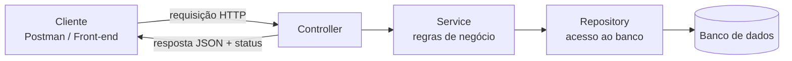
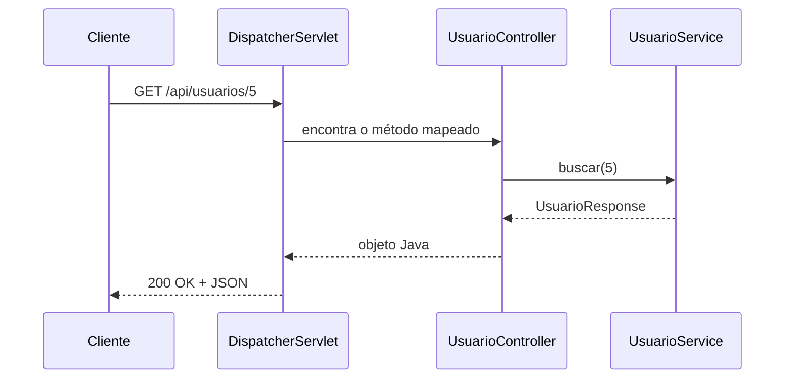
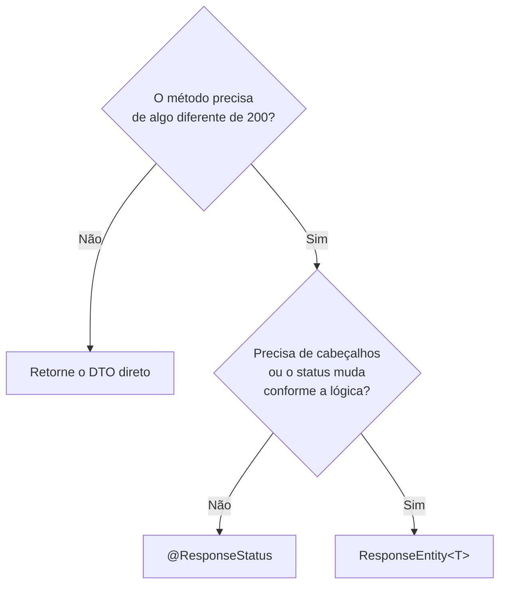
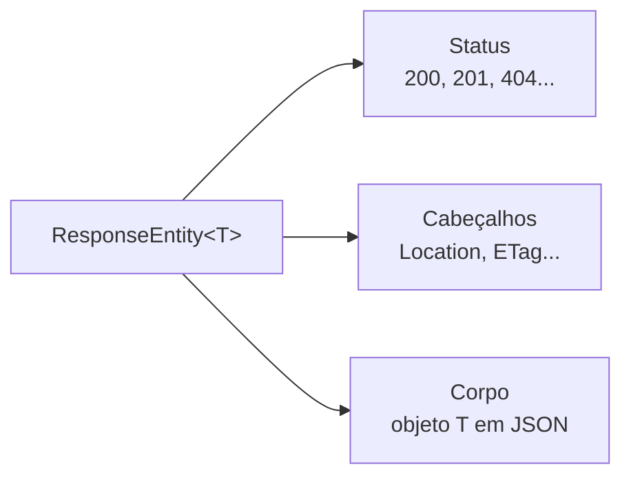

# Controller no Spring Boot


## Sumário

- [O que é um Controller](#o-que-é-um-controller)
- [Para que serve](#para-que-serve)
- [Onde ele se encaixa na aplicação](#onde-ele-se-encaixa-na-aplicação)
- [O caminho de uma requisição](#o-caminho-de-uma-requisição)
- [Métodos HTTP e seus parâmetros](#métodos-http-e-seus-parâmetros)
- [Códigos de status HTTP](#códigos-de-status-http)
- [A melhor forma de retornar dados](#a-melhor-forma-de-retornar-dados)
- [Exemplo completo explicado linha por linha](#exemplo-completo-explicado-linha-por-linha)
- [Principais anotações](#principais-anotações)
- [Controller vs RestController](#controller-vs-restcontroller)
- [Tratamento de erros](#tratamento-de-erros)
- [Como testar](#como-testar)
- [Boas práticas](#boas-práticas)
- [Referências](#referências)

---

## O que é um Controller

O **Controller** é a classe responsável por **receber as requisições HTTP** (*request*), vindas do navegador, Postman, Swagger, um front-end ou outro sistema, e **devolver uma resposta** (*response*).

Ele é a **porta de entrada** da aplicação: tudo o que o mundo externo quer fazer com o seu sistema (listar, criar, atualizar, apagar) passa primeiro por ele.

> [!NOTE]
> O nome vem do padrão **MVC** (*Model-View-Controller*), em que o Controller faz a ponte entre o que o usuário pede e o que o sistema executa.

## Para que serve

Um Controller bem escrito tem **responsabilidades pequenas e claras**:

| Responsabilidade | Exemplo |
|---|---|
| Mapear URLs e métodos HTTP | `GET /api/usuarios/5` chama o método `buscar` |
| Extrair dados da requisição | Corpo (JSON), parâmetros da URL, query string, cabeçalhos |
| Validar a entrada | Campos obrigatórios, formato de e-mail |
| Delegar o trabalho | Chamar o `Service`, que contém a regra de negócio |
| Montar a resposta | Status HTTP correto (`200`, `201`, `404`...) e corpo em JSON |

> [!IMPORTANT]
> O Controller **não** deve ter regra de negócio nem acessar o banco de dados diretamente. Ele só **recebe, delega e responde**.

## Onde ele se encaixa na aplicação



| Camada | Pergunta que ela responde |
|---|---|
| **Controller** | "Quem está pedindo e o que ele quer?" |
| **Service** | "O que o sistema deve fazer com isso?" |
| **Repository** | "Como guardo ou busco esses dados?" |

## O caminho de uma requisição



O **DispatcherServlet** (criado automaticamente pelo Spring Boot) recebe todas as requisições e **escolhe qual método de qual Controller** deve atendê-las. Depois, o Jackson converte o objeto retornado em JSON.

---

## Métodos HTTP e seus parâmetros

Cada método HTTP tem uma **intenção** diferente. Escolher o método certo e saber **de onde vêm os dados** (URL, query string, corpo ou cabeçalho) é a base de qualquer API REST.

### De onde vêm os dados

| Origem | Anotação | Aparece na requisição como | Usado em |
|---|---|---|---|
| **Caminho da URL** | `@PathVariable` | `/api/usuarios/5` | GET (um item), PUT, PATCH, DELETE |
| **Query string** | `@RequestParam` | `/api/usuarios?nome=Ana&pagina=0` | GET (filtros, paginação, ordenação) |
| **Corpo (body) em JSON** | `@RequestBody` | `{ "nome": "Ana" }` | POST, PUT, PATCH |
| **Cabeçalho (header)** | `@RequestHeader` | `Authorization: Bearer ...` | Qualquer método |

### Resumo dos métodos

| Método | Para que serve | Tem corpo (body)? | Seguro¹ | Idempotente² |
|---|---|---|---|---|
| `GET` | Buscar/consultar dados | Não | Sim | Sim |
| `POST` | Criar um recurso novo | Sim | Não | Não |
| `PUT` | Substituir um recurso inteiro | Sim | Não | Sim |
| `PATCH` | Atualizar parte de um recurso | Sim | Não | Depende |
| `DELETE` | Remover um recurso | Normalmente não | Não | Sim |

¹ **Seguro:** não altera nada no servidor.
² **Idempotente:** repetir a mesma requisição várias vezes deixa o sistema no mesmo estado final (ex.: apagar o mesmo usuário duas vezes resulta em "usuário não existe" nas duas).

---

### GET: buscar dados

O `GET` **não envia corpo**. Tudo o que o servidor precisa vai na **URL**.

| Parâmetro | Anotação | Exemplo | Obrigatório? |
|---|---|---|---|
| `id` | `@PathVariable` | `/api/usuarios/5` | Sim (faz parte do caminho) |
| `nome` | `@RequestParam` | `/api/usuarios?nome=Ana` | Não, se `required = false` |
| `pagina`, `tamanho` | `@RequestParam` | `?pagina=0&tamanho=10` | Não, se tiver `defaultValue` |

```http
### Buscar um usuário pelo id
GET /api/usuarios/5

### Listar com filtro e paginação
GET /api/usuarios?nome=Ana&pagina=0&tamanho=10
```

```java
// Um item: o id vem do caminho
@GetMapping("/{id}")
public UsuarioResponse buscar(@PathVariable Long id) { ... }

// Lista: filtros opcionais vêm da query string
@GetMapping
public List<UsuarioResponse> listar(
        @RequestParam(required = false) String nome,
        @RequestParam(defaultValue = "0") int pagina,
        @RequestParam(defaultValue = "10") int tamanho) { ... }
```

> [!TIP]
> Com **Spring Data**, você pode receber um objeto `Pageable` direto no método. O Spring converte `?page=0&size=10&sort=nome,asc` nele automaticamente.

---

### POST: criar um recurso

O `POST` envia os dados no **corpo** da requisição, em JSON. O servidor decide o `id` do novo recurso.

| Parâmetro | Anotação | Exemplo |
|---|---|---|
| Dados do novo recurso | `@RequestBody` (+ `@Valid`) | `{ "nome": "Ana", "email": "ana@email.com" }` |
| Tipo do corpo | Cabeçalho `Content-Type` | `application/json` |

```http
POST /api/usuarios
Content-Type: application/json

{
  "nome": "Ana",
  "email": "ana@email.com"
}
```

```java
@PostMapping
public ResponseEntity<UsuarioResponse> criar(@Valid @RequestBody UsuarioRequest request) { ... }
```

**Resposta esperada:** `201 Created`, com o recurso criado no corpo e o cabeçalho `Location` apontando para ele (`/api/usuarios/6`).

---

### PUT: substituir um recurso

O `PUT` recebe o **id no caminho** (quem será alterado) e o **corpo completo** (como ele deve ficar).

| Parâmetro | Anotação | Exemplo |
|---|---|---|
| Qual recurso alterar | `@PathVariable` | `/api/usuarios/5` |
| Novos dados (completos) | `@RequestBody` (+ `@Valid`) | `{ "nome": "Ana Souza", "email": "ana@email.com" }` |

```http
PUT /api/usuarios/5
Content-Type: application/json

{
  "nome": "Ana Souza",
  "email": "ana@email.com"
}
```

```java
@PutMapping("/{id}")
public UsuarioResponse atualizar(@PathVariable Long id,
                                 @Valid @RequestBody UsuarioRequest request) { ... }
```

> [!NOTE]
> **PUT vs PATCH:** o `PUT` substitui o recurso **inteiro** (todos os campos). Para alterar só um campo, como o e-mail, o correto é o `PATCH`.

---

### DELETE: remover um recurso

O `DELETE` só precisa saber **qual** recurso apagar. Não tem corpo.

| Parâmetro | Anotação | Exemplo |
|---|---|---|
| Qual recurso remover | `@PathVariable` | `/api/usuarios/5` |

```http
DELETE /api/usuarios/5
```

```java
@DeleteMapping("/{id}")
@ResponseStatus(HttpStatus.NO_CONTENT)
public void deletar(@PathVariable Long id) { ... }
```

**Resposta esperada:** `204 No Content` (deu certo e não há nada para devolver).

---

## Códigos de status HTTP

O **status** diz ao cliente, em um número, o que aconteceu com a requisição. Eles são agrupados por centena:

| Faixa | Significado |
|---|---|
| `1xx` | Informativo (raramente usado em APIs) |
| `2xx` | **Sucesso** |
| `3xx` | Redirecionamento |
| `4xx` | **Erro do cliente** (a requisição está errada) |
| `5xx` | **Erro do servidor** (o problema é do lado da aplicação) |

### Sucesso (2xx)

| Código | Nome | Quando usar | Como retornar no Spring |
|---|---|---|---|
| `200` | OK | Deu certo e há corpo na resposta (GET, PUT) | `ResponseEntity.ok(corpo)` |
| `201` | Created | Recurso criado (POST) | `ResponseEntity.created(uri).body(corpo)` |
| `202` | Accepted | Pedido aceito, mas processado depois (assíncrono) | `ResponseEntity.accepted().build()` |
| `204` | No Content | Deu certo e não há corpo (DELETE, às vezes PUT) | `ResponseEntity.noContent().build()` |

### Redirecionamento (3xx)

| Código | Nome | Quando usar | Como retornar no Spring |
|---|---|---|---|
| `301` | Moved Permanently | O recurso mudou de endereço para sempre | `ResponseEntity.status(HttpStatus.MOVED_PERMANENTLY).location(uri).build()` |
| `304` | Not Modified | O cache do cliente ainda é válido | Tratado automaticamente com `ETag` |

### Erro do cliente (4xx)

| Código | Nome | Quando usar | Exemplo |
|---|---|---|---|
| `400` | Bad Request | Requisição malformada ou dados inválidos | JSON quebrado, `@Valid` falhou |
| `401` | Unauthorized | **Não autenticado** (não enviou login/token válido) | Token ausente ou expirado |
| `403` | Forbidden | Autenticado, mas **sem permissão** | Usuário comum acessando área de admin |
| `404` | Not Found | Recurso não existe | `GET /api/usuarios/999` |
| `405` | Method Not Allowed | O método não é aceito nessa URL | `DELETE` em um endpoint que só tem `GET` |
| `409` | Conflict | Conflito com o estado atual | E-mail já cadastrado |
| `415` | Unsupported Media Type | `Content-Type` não aceito | Enviar XML para um endpoint que só aceita JSON |
| `422` | Unprocessable Content | JSON válido, mas regra de negócio violada | Data de fim anterior à data de início |
| `429` | Too Many Requests | Limite de requisições excedido (*rate limit*) | Muitas chamadas em pouco tempo |

### Erro do servidor (5xx)

| Código | Nome | Quando usar |
|---|---|---|
| `500` | Internal Server Error | Erro inesperado na aplicação (bug, exceção não tratada) |
| `502` | Bad Gateway | Um serviço do qual você depende devolveu uma resposta inválida |
| `503` | Service Unavailable | Servidor sobrecarregado ou em manutenção |
| `504` | Gateway Timeout | Um serviço do qual você depende demorou demais |

### Qual status usar em cada operação CRUD

| Operação | Sucesso | Possíveis erros |
|---|---|---|
| **Listar** (`GET /usuarios`) | `200` (mesmo se a lista vier vazia) | `401`, `403` |
| **Buscar um** (`GET /usuarios/5`) | `200` | `404`, `401`, `403` |
| **Criar** (`POST /usuarios`) | `201` + `Location` | `400`, `409`, `401`, `403` |
| **Atualizar** (`PUT /usuarios/5`) | `200` (ou `204`) | `400`, `404`, `409`, `401`, `403` |
| **Remover** (`DELETE /usuarios/5`) | `204` | `404`, `401`, `403` |

> [!WARNING]
> Não devolva `200` com uma mensagem de erro no corpo. O cliente e as ferramentas de monitoramento leem o **status**, então ele precisa refletir o que realmente aconteceu.

---

## Controlando a resposta: @ResponseStatus e ResponseEntity

Por padrão, o Spring responde `200 OK` quando o método termina sem erro. Quando você precisa de outro status, ou de cabeçalhos na resposta, existem **duas ferramentas**:

| Ferramenta | O que faz | Nível de controle |
|---|---|---|
| `@ResponseStatus` | Define um **status fixo** por anotação | Só o status |
| `ResponseEntity<T>` | Monta a **resposta inteira** no código | Status, cabeçalhos e corpo |

### Como escolher



| | Retorno direto | `@ResponseStatus` | `ResponseEntity<T>` |
|---|---|---|---|
| Status | Sempre `200` | **Fixo** | **Dinâmico** |
| Cabeçalhos (ex.: `Location`) | Não | Não | Sim |
| Código | Mais curto | Curto | Mais verboso |
| Ideal para | GET simples | `204` no DELETE, `201` simples | `201` com `Location`, status condicional |

---

### 1. `@ResponseStatus`: status fixo

A anotação diz ao Spring qual status usar quando o método termina com sucesso. O corpo continua sendo o valor retornado.

```java
@DeleteMapping("/{id}")
@ResponseStatus(HttpStatus.NO_CONTENT)      // sempre 204, sem corpo
public void deletar(@PathVariable Long id) {
    service.deletar(id);
}

@PostMapping
@ResponseStatus(HttpStatus.CREATED)         // 201, com o DTO retornado no corpo
public UsuarioResponse criar(@Valid @RequestBody UsuarioRequest request) {
    return service.criar(request);
}
```

Ela pode ser colocada em três lugares:

| Onde | Efeito |
|---|---|
| **Método** | Define o status daquele endpoint |
| **Classe do Controller** | Vale para todos os métodos que não definirem outro status |
| **Classe de exceção** | Lançar a exceção resulta naquele status |

```java
// Em uma exceção: lançar esta classe resulta em 404
@ResponseStatus(HttpStatus.NOT_FOUND)
public class UsuarioNaoEncontradoException extends RuntimeException {
    public UsuarioNaoEncontradoException(Long id) {
        super("Não existe usuário com id " + id);
    }
}
```

> [!NOTE]
> Se o método **lançar uma exceção**, o `@ResponseStatus` do método não é aplicado. O status passa a ser definido pelo [tratamento de erros](#tratamento-de-erros).

> [!TIP]
> Em exceções, o `@ResponseStatus` é um atalho simples. Com `@RestControllerAdvice` e `ProblemDetail`, o formato do erro fica padronizado e você pode incluir título e campos extras.

> [!WARNING]
> Evite o atributo `reason` (`@ResponseStatus(value = HttpStatus.NOT_FOUND, reason = "...")`). Ele faz o Spring enviar a página de erro padrão do servidor em vez do seu JSON. Para mensagens de erro, use `ProblemDetail`.

---

### 2. `ResponseEntity<T>`: resposta completa

O `ResponseEntity<T>` representa a **resposta HTTP inteira**: **status**, **cabeçalhos** (*headers*) e **corpo** (*body*). O `<T>` é o tipo do corpo; quando não há corpo, use `ResponseEntity<Void>`.



#### Atalhos prontos

| Atalho | Status | Uso típico |
|---|---|---|
| `ResponseEntity.ok(corpo)` | `200 OK` | GET, PUT com corpo |
| `ResponseEntity.created(uri).body(corpo)` | `201 Created` | POST, com cabeçalho `Location` |
| `ResponseEntity.accepted().build()` | `202 Accepted` | Processamento assíncrono |
| `ResponseEntity.noContent().build()` | `204 No Content` | DELETE, PUT sem corpo |
| `ResponseEntity.badRequest().body(corpo)` | `400 Bad Request` | Dados inválidos |
| `ResponseEntity.notFound().build()` | `404 Not Found` | Recurso não existe |
| `ResponseEntity.status(HttpStatus.CONFLICT).body(corpo)` | Qualquer status | `409`, `422`, etc. |

> [!TIP]
> Use `.build()` quando **não** há corpo e `.body(objeto)` quando há.

#### Exemplo 1: `201 Created` com `Location`

O caso mais comum. O cliente recebe o recurso criado **e** o endereço dele:

```java
@PostMapping
public ResponseEntity<UsuarioResponse> criar(@Valid @RequestBody UsuarioRequest request) {
    UsuarioResponse criado = service.criar(request);

    URI location = ServletUriComponentsBuilder.fromCurrentRequest()
            .path("/{id}")
            .buildAndExpand(criado.id())
            .toUri();                                       // http://localhost:8080/api/usuarios/6

    return ResponseEntity.created(location).body(criado);   // 201 + Location + corpo
}
```

```http
HTTP/1.1 201 Created
Location: http://localhost:8080/api/usuarios/6
Content-Type: application/json

{ "id": 6, "nome": "Ana", "email": "ana@email.com" }
```

> [!IMPORTANT]
> É o exemplo em que o `@ResponseStatus(HttpStatus.CREATED)` **não basta**: ele consegue o `201`, mas não adiciona o cabeçalho `Location`.

#### Exemplo 2: status decidido pela lógica

O status depende do resultado: `200` se encontrou, `404` se não:

```java
@GetMapping("/{id}")
public ResponseEntity<UsuarioResponse> buscar(@PathVariable Long id) {
    return service.buscarOpcional(id)                              // Optional<UsuarioResponse>
            .map(ResponseEntity::ok)                               // existe: 200 + corpo
            .orElseGet(() -> ResponseEntity.notFound().build());   // não existe: 404
}
```

> [!NOTE]
> Funciona, mas na maioria dos casos é melhor o **Service lançar uma exceção** e o `@RestControllerAdvice` devolver o `404`. O Controller fica sem lógica de status e o erro segue o formato `ProblemDetail`.

#### Exemplo 3: `204 No Content` em um PUT

```java
@PutMapping("/{id}")
public ResponseEntity<Void> atualizar(@PathVariable Long id,
                                      @Valid @RequestBody UsuarioRequest request) {
    service.atualizar(id, request);
    return ResponseEntity.noContent().build();   // 204, sem corpo
}
```

#### Exemplo 4: cabeçalhos personalizados

```java
@GetMapping("/{id}/exportar")
public ResponseEntity<byte[]> exportar(@PathVariable Long id) {
    byte[] arquivo = service.exportar(id);

    return ResponseEntity.ok()
            .header(HttpHeaders.CONTENT_DISPOSITION, "attachment; filename=usuario.csv")
            .contentType(MediaType.parseMediaType("text/csv"))
            .body(arquivo);                      // 200 + cabeçalhos + arquivo
}
```

Para vários cabeçalhos de uma vez, use o `HttpHeaders`:

```java
HttpHeaders headers = new HttpHeaders();
headers.add("X-Total-Count", String.valueOf(total));

return ResponseEntity.ok().headers(headers).body(lista);
```

---

### Regras para não errar

> [!WARNING]
> Não use `@ResponseStatus` e `ResponseEntity` **no mesmo método**. Se o método retorna `ResponseEntity`, o status dele **prevalece** e a anotação é ignorada, o que só gera confusão.

> [!IMPORTANT]
> Não use `ResponseEntity` em **tudo** por hábito. Se basta devolver o DTO ou usar `@ResponseStatus`, o código fica mais limpo. Reserve o `ResponseEntity` para quando você realmente precisa de cabeçalhos ou de um status dinâmico.

### Resumo por operação

| Operação | Opção simples | Quando precisar de mais controle |
|---|---|---|
| **GET** (listar/buscar) | Retorno direto (`200`) | `ResponseEntity` para `ETag` ou cabeçalhos de paginação |
| **POST** (criar) | `@ResponseStatus(CREATED)` | `ResponseEntity.created(uri)` com `Location` (**recomendado**) |
| **PUT** (atualizar) | Retorno direto (`200`) | `ResponseEntity.noContent()` se não devolver corpo |
| **DELETE** (remover) | `@ResponseStatus(NO_CONTENT)` | Raramente necessário |
## A melhor forma de retornar dados

Estas são as práticas mais atuais para o Controller devolver dados no Spring Boot moderno.

### 1. Retorne DTOs (`record`), nunca a entidade do banco

```java
// ✅ Bom: só expõe o que o cliente precisa
public record UsuarioResponse(Long id, String nome, String email) {}

// ❌ Ruim: expõe a entidade inteira (senha, campos internos, relacionamentos)
public Usuario buscar(Long id) { ... }
```

### 2. Escolha a forma de retorno conforme a necessidade

| Situação | Forma recomendada |
|---|---|
| Resposta simples, status padrão `200` | Retornar o DTO direto |
| Status fixo diferente de `200` e sem corpo | `@ResponseStatus` + `void` |
| Precisa controlar status **e/ou** cabeçalhos | `ResponseEntity<T>` |

```java
// Simples: o Spring responde 200 automaticamente
@GetMapping("/{id}")
public UsuarioResponse buscar(@PathVariable Long id) { ... }

// Status fixo, sem corpo
@DeleteMapping("/{id}")
@ResponseStatus(HttpStatus.NO_CONTENT)
public void deletar(@PathVariable Long id) { ... }

// Controle total: 201 + cabeçalho Location
@PostMapping
public ResponseEntity<UsuarioResponse> criar(...) { ... }
```

### 3. Não trate "não encontrado" com `null` nem `Optional` no Controller

Deixe o **Service lançar uma exceção** e deixe o `@RestControllerAdvice` transformá-la em `404`. O Controller fica limpo, sem `if`:

```java
// No Service
public UsuarioResponse buscar(Long id) {
    return repository.findById(id)
            .map(mapper::toResponse)
            .orElseThrow(() -> new UsuarioNaoEncontradoException(id));
}
```

### 4. Padronize os erros com `ProblemDetail` (RFC 9457)

Todos os erros da API seguem o **mesmo formato**, o que facilita a vida de quem consome. Veja a seção [Tratamento de erros](#tratamento-de-erros).

### 5. Ao paginar, não devolva `Page` direto

Em versões recentes do Spring Data, serializar o `Page` diretamente gera um aviso, porque o formato do JSON não é estável. Prefira um **DTO próprio** ou o `PagedModel`:

```java
public record PaginaResponse<T>(List<T> conteudo, int pagina, int tamanho, long total) {}
```

### 6. Versione a API na URL

```
/api/v1/usuarios
```

Assim, quando precisar mudar o contrato no futuro, você cria `/api/v2/usuarios` sem quebrar quem ainda usa a `v1`.

---

## Exemplo completo explicado linha por linha

### 1. DTOs (objetos de entrada e saída)

Hoje o padrão é usar `record` (Java 16+) para DTOs, em vez de expor a entidade do banco.

O **DTO** (*Data Transfer Object*) serve apenas para **transportar dados**: um recebe os dados da requisição (*request*) e outro envia os dados na resposta (*response*). Por isso é comum criar pelo menos dois, um de entrada e um de saída, já que eles costumam ter campos diferentes. O `id`, por exemplo, só aparece na resposta.

O DTO de entrada usa anotações de **Bean Validation** (`@NotBlank`, `@Email`) para validar os dados. Para entender melhor essa dependência, consulte o arquivo sobre validação neste repositório.

```java
import jakarta.validation.constraints.Email;       // anotação que valida formato de e-mail
import jakarta.validation.constraints.NotBlank;    // anotação que proíbe vazio, nulo ou só espaços

// DTO de ENTRADA: representa o JSON que o cliente envia
public record UsuarioRequest(                      // "record": classe imutável; já gera construtor, getters, equals e toString
        @NotBlank(message = "O nome é obrigatório")    // valida: nome não pode ser vazio; se falhar, usa esta mensagem
        String nome,                                   // campo "nome" do JSON

        @NotBlank @Email(message = "E-mail inválido")  // valida: não vazio E com formato de e-mail
        String email                                   // campo "email" do JSON
) {}                                               // corpo vazio: o record não precisa de mais nada

// DTO de SAÍDA: representa o JSON que o servidor devolve
public record UsuarioResponse(Long id, String nome, String email) {}  // inclui o "id", que só existe depois de salvar
```

### 2. O Controller

#### Cabeçalho da classe

```java
import jakarta.validation.Valid;                                   // ativa a validação dos DTOs
import org.springframework.http.HttpStatus;                        // constantes de status (200, 201, 404...)
import org.springframework.http.ResponseEntity;                    // permite controlar status, cabeçalhos e corpo
import org.springframework.web.bind.annotation.*;                  // @RestController, @GetMapping, @PathVariable etc.
import org.springframework.web.servlet.support.ServletUriComponentsBuilder;  // monta URLs a partir da requisição atual
import java.net.URI;                                               // representa um endereço (usado no cabeçalho Location)
import java.util.List;                                             // lista de resultados

@RestController                      // diz ao Spring: "esta classe é um Controller de API; os retornos viram JSON"
@RequestMapping("/api/usuarios")     // prefixo de URL de TODOS os métodos desta classe
public class UsuarioController {

    private final UsuarioService service;   // dependência: o Controller delega o trabalho ao Service ("final" = não muda depois de criado)

    // Injeção de dependência pelo construtor (não precisa de @Autowired)
    public UsuarioController(UsuarioService service) {   // o Spring cria o UsuarioService e entrega aqui
        this.service = service;                          // guarda a referência para usar nos métodos
    }
```

#### GET: listar

```java
    @GetMapping                                            // responde a GET /api/usuarios
    public List<UsuarioResponse> listar(                   // devolve uma lista de DTOs; o Spring converte para JSON
            @RequestParam(required = false) String nome) { // lê "?nome=Ana" da URL; é opcional (pode ser null)
        return service.listar(nome);                       // delega ao Service; status padrão: 200 OK
    }
```

#### GET: buscar por id

```java
    @GetMapping("/{id}")                                   // responde a GET /api/usuarios/5 ({id} é uma variável)
    public UsuarioResponse buscar(@PathVariable Long id) { // @PathVariable pega o "5" da URL e converte para Long
        return service.buscar(id);                         // se não existir, o Service lança exceção e o handler devolve 404
    }
```

#### POST: criar

```java
    @PostMapping                                           // responde a POST /api/usuarios
    public ResponseEntity<UsuarioResponse> criar(          // ResponseEntity: precisamos controlar o status e o cabeçalho
            @Valid @RequestBody UsuarioRequest request) {  // @RequestBody: converte o JSON em objeto; @Valid: roda as validações (falhou = 400)
        UsuarioResponse criado = service.criar(request);   // o Service salva e devolve o usuário já com id

        // 201 Created + cabeçalho Location apontando para o novo recurso
        URI location = ServletUriComponentsBuilder.fromCurrentRequest() // parte da URL atual: http://.../api/usuarios
                .path("/{id}")                                          // acrescenta "/{id}"
                .buildAndExpand(criado.id())                            // troca {id} pelo id real (ex.: 6)
                .toUri();                                               // resultado: http://.../api/usuarios/6

        return ResponseEntity.created(location).body(criado); // status 201 + cabeçalho Location + corpo com o usuário criado
    }
```

#### PUT: atualizar

```java
    @PutMapping("/{id}")                                   // responde a PUT /api/usuarios/5
    public UsuarioResponse atualizar(@PathVariable Long id,           // qual usuário alterar (vem da URL)
                                     @Valid @RequestBody UsuarioRequest request) {  // novos dados (vêm do JSON) já validados
        return service.atualizar(id, request);             // delega ao Service; status padrão: 200 OK
    }
```

#### DELETE: remover

```java
    @DeleteMapping("/{id}")                                // responde a DELETE /api/usuarios/5
    @ResponseStatus(HttpStatus.NO_CONTENT)                 // força o status 204 (sucesso, sem corpo)
    public void deletar(@PathVariable Long id) {           // void: não há nada para devolver; id vem da URL
        service.deletar(id);                               // delega ao Service
    }
}                                                          // fim da classe
```

> [!TIP]
> Para usar `@Valid`, adicione a dependência `spring-boot-starter-validation` no seu `pom.xml` ou `build.gradle`.

<details>
<summary>Como isso fica no <code>pom.xml</code></summary>

```xml
<dependency>
    <groupId>org.springframework.boot</groupId>
    <artifactId>spring-boot-starter-web</artifactId>
</dependency>
<dependency>
    <groupId>org.springframework.boot</groupId>
    <artifactId>spring-boot-starter-validation</artifactId>
</dependency>
```

</details>

### 3. O Service lança a exceção

```java
public UsuarioResponse buscar(Long id) {                   // recebe o id vindo do Controller
    return repository.findById(id)                         // busca no banco; devolve um Optional (pode estar vazio)
            .map(mapper::toResponse)                       // se encontrou, converte a entidade em DTO de resposta
            .orElseThrow(() -> new UsuarioNaoEncontradoException(id)); // se está vazio, lança a exceção (vira 404 no handler)
}
```

### 4. O handler global de erros

```java
@RestControllerAdvice                                      // "observa" TODOS os Controllers e captura as exceções deles
public class GlobalExceptionHandler {

    @ExceptionHandler(UsuarioNaoEncontradoException.class) // este método trata especificamente esta exceção
    public ProblemDetail naoEncontrado(UsuarioNaoEncontradoException ex) {   // ProblemDetail: formato padrão de erro (RFC 9457)
        ProblemDetail problema = ProblemDetail.forStatusAndDetail(           // cria o erro com status e mensagem
                HttpStatus.NOT_FOUND, ex.getMessage());                      // status 404 + texto da exceção
        problema.setTitle("Usuário não encontrado");                         // título curto do erro
        return problema;                                                     // o Spring devolve como JSON, com status 404
    }
}
```

---

## Principais anotações

| Anotação | Para que serve |
|---|---|
| `@RestController` | Marca a classe como Controller de API: o retorno vira JSON direto no corpo da resposta |
| `@Controller` | Controller "clássico", usado para devolver páginas HTML (ex.: Thymeleaf) |
| `@RequestMapping("/caminho")` | Define o caminho base de todos os endpoints da classe |
| `@GetMapping` | Mapeia **GET** (buscar dados) |
| `@PostMapping` | Mapeia **POST** (criar dados) |
| `@PutMapping` | Mapeia **PUT** (substituir/atualizar dados) |
| `@PatchMapping` | Mapeia **PATCH** (atualização parcial) |
| `@DeleteMapping` | Mapeia **DELETE** (remover dados) |
| `@PathVariable` | Pega um valor da URL (`/usuarios/5`) |
| `@RequestParam` | Pega um parâmetro de consulta (`/usuarios?nome=Ana`) |
| `@RequestBody` | Converte o JSON do corpo da requisição em objeto Java |
| `@RequestHeader` | Pega o valor de um cabeçalho da requisição |
| `@Valid` | Dispara as validações (`@NotBlank`, `@Email`...) do objeto recebido |
| `@ResponseStatus` | Define o status HTTP de retorno de um método |

## Controller vs RestController

| | `@Controller` | `@RestController` |
|---|---|---|
| Retorno padrão | Nome de uma **view** (página HTML) | **Dados** (JSON) |
| Equivale a | — | `@Controller` + `@ResponseBody` |
| Uso típico | Sites renderizados no servidor | APIs REST |

## Tratamento de erros

Em vez de usar `try/catch` em cada método, centralize o tratamento de erros com `@RestControllerAdvice`. O Spring (6+) já oferece o `ProblemDetail`, que segue o padrão **RFC 9457** para respostas de erro.

Se a sua classe estender `ResponseEntityExceptionHandler`, o Spring já devolve no mesmo formato os erros comuns do MVC, como JSON inválido (`400`), método não permitido (`405`) e tipo de conteúdo não suportado (`415`):

```java
@RestControllerAdvice
public class GlobalExceptionHandler extends ResponseEntityExceptionHandler {

    @ExceptionHandler(UsuarioNaoEncontradoException.class)
    public ProblemDetail naoEncontrado(UsuarioNaoEncontradoException ex) {
        ProblemDetail problema = ProblemDetail.forStatusAndDetail(
                HttpStatus.NOT_FOUND, ex.getMessage());
        problema.setTitle("Usuário não encontrado");
        return problema;
    }

    // Erros do @Valid: devolve 400 listando cada campo inválido
    @Override
    protected ResponseEntity<Object> handleMethodArgumentNotValid(
            MethodArgumentNotValidException ex, HttpHeaders headers,
            HttpStatusCode status, WebRequest request) {

        Map<String, String> erros = new HashMap<>();
        ex.getBindingResult().getFieldErrors()
                .forEach(e -> erros.put(e.getField(), e.getDefaultMessage()));

        ProblemDetail problema = ex.getBody();
        problema.setTitle("Dados inválidos");
        problema.setProperty("erros", erros);

        return handleExceptionInternal(ex, problema, headers, status, request);
    }
}
```

Resposta devolvida ao cliente em um `404`:

```json
{
  "type": "about:blank",
  "title": "Usuário não encontrado",
  "status": 404,
  "detail": "Não existe usuário com id 99",
  "instance": "/api/usuarios/99"
}
```

Resposta devolvida ao cliente em um `400` de validação:

```json
{
  "type": "about:blank",
  "title": "Dados inválidos",
  "status": 400,
  "detail": "Invalid request content.",
  "instance": "/api/usuarios",
  "erros": {
    "nome": "O nome é obrigatório",
    "email": "E-mail inválido"
  }
}
```

## Como testar

**Postman / Swagger:** com a aplicação rodando, acesse `http://localhost:8080/api/usuarios`.

**Arquivo `.http`** (IntelliJ ou VS Code com a extensão REST Client):

```http
### Listar usuários
GET http://localhost:8080/api/usuarios

### Buscar um usuário
GET http://localhost:8080/api/usuarios/1

### Criar usuário
POST http://localhost:8080/api/usuarios
Content-Type: application/json

{
  "nome": "Ana",
  "email": "ana@email.com"
}

### Atualizar usuário
PUT http://localhost:8080/api/usuarios/1
Content-Type: application/json

{
  "nome": "Ana Souza",
  "email": "ana@email.com"
}

### Remover usuário
DELETE http://localhost:8080/api/usuarios/1
```

**Teste automatizado** da camada web (sem subir o servidor inteiro):

```java
@WebMvcTest(UsuarioController.class)
class UsuarioControllerTest {

    @Autowired
    MockMvc mockMvc;

    @MockitoBean
    UsuarioService service;

    @Test
    void deveListarUsuarios() throws Exception {
        mockMvc.perform(get("/api/usuarios"))
               .andExpect(status().isOk());
    }
}
```

> [!NOTE]
> Imports omitidos de propósito. Os pacotes de algumas classes de teste mudaram entre versões do Spring Boot, então confira os imports na versão que você usa. Em versões recentes, `@MockitoBean` substitui o antigo `@MockBean`.

## Boas práticas

- [x] Manter o Controller **enxuto**: sem regra de negócio e sem acesso direto ao banco
- [x] Usar **DTOs** (`record`) em vez de expor entidades
- [x] Usar **injeção de dependência por construtor**
- [x] Validar a entrada com **`@Valid`**
- [x] Devolver **status HTTP corretos** (`201` ao criar, `204` ao deletar, `404` quando não existe)
- [x] Devolver o cabeçalho **`Location`** ao criar um recurso
- [x] Centralizar erros em **`@RestControllerAdvice`** com **`ProblemDetail`**
- [x] Deixar o **Service lançar exceções** em vez de devolver `null`
- [x] Prefixar rotas com `/api` (e, se possível, a versão: `/api/v1`) e usar **substantivos no plural** (`/usuarios`, não `/buscarUsuarios`)
- [x] Não devolver `Page` direto: usar um DTO de paginação

<details>
<summary>Exemplo do que <b>não</b> fazer</summary>

```java
@RestController
public class UsuarioController {

    @Autowired
    private UsuarioRepository repository; // ❌ Controller acessando o banco direto

    @PostMapping("/criarUsuario") // ❌ verbo na URL
    public Usuario criar(@RequestBody Usuario usuario) { // ❌ expõe a entidade
        if (usuario.getEmail() == null) { // ❌ regra/validação misturada
            throw new RuntimeException("erro");
        }
        return repository.save(usuario); // ❌ devolve 200 em vez de 201
    }
}
```

</details>

## Referências

- [Documentação oficial: Annotated Controllers](https://docs.spring.io/spring-framework/reference/web/webmvc/mvc-controller.html)
- [Spring Boot: guias oficiais](https://spring.io/guides)
- [Guia de Markdown do GitHub (GFM)](https://docs.github.com/pt/get-started/writing-on-github)
- [RFC 9457: Problem Details for HTTP APIs](https://www.rfc-editor.org/rfc/rfc9457.html)
- [MDN: Códigos de status de resposta HTTP](https://developer.mozilla.org/pt-BR/docs/Web/HTTP/Status)
