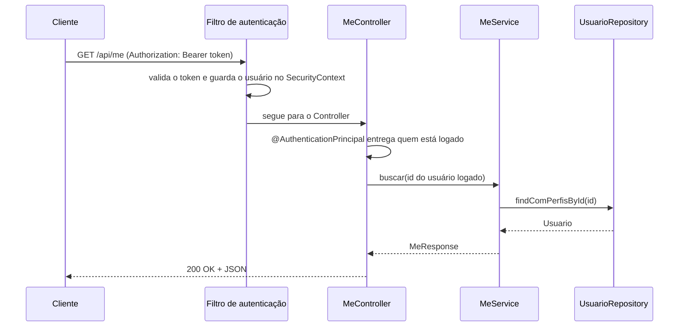
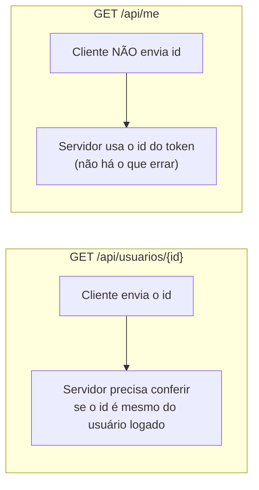

# MeController: o endpoint do usuário logado


Continuação do arquivo sobre **Controller**. Lá vimos como um Controller recebe requisições, devolve DTOs e controla a resposta. Aqui aplicamos tudo isso em um Controller muito comum em APIs com login: o **`MeController`**, que trabalha **sempre com o usuário que está autenticado**.

## Sumário

- [O que é o MeController](#o-que-é-o-mecontroller)
- [Por que ele existe](#por-que-ele-existe)
- [Rotas do próprio usuário](#rotas-do-próprio-usuário)
- [Onde ele se encaixa na segurança](#onde-ele-se-encaixa-na-segurança)
- [Como obter o usuário logado](#como-obter-o-usuário-logado)
- [O DTO de resposta: record, e não Map](#o-dto-de-resposta-record-e-não-map)
- [Exemplo completo explicado linha por linha](#exemplo-completo-explicado-linha-por-linha)
- [Variante com Resource Server e provedor externo](#variante-com-resource-server-e-provedor-externo)
- [Erros e ProblemDetail](#erros-e-problemdetail)
- [Cache e respostas pessoais](#cache-e-respostas-pessoais)
- [Como testar](#como-testar)
- [Boas práticas](#boas-práticas)
- [Referências](#referências)

---

## O que é o MeController

O **`MeController`** expõe rotas que respondem à pergunta **"quem sou eu?"**. A diferença para o `UsuarioController` do arquivo anterior é que ele **nunca recebe o `id` do usuário**: o usuário vem **da autenticação** (o token, a sessão ou o Basic Auth).

| | `UsuarioController` | `MeController` |
|---|---|---|
| Rota | `GET /api/usuarios/{id}` | `GET /api/me` |
| Quem informa o usuário | **O cliente**, pelo `id` na URL | **O servidor**, pelo usuário autenticado |
| Serve para | Gerenciar **qualquer** usuário (geralmente, só administradores) | O usuário cuidar dos **seus próprios** dados |
| Risco de acessar dados de outra pessoa | Existe (é preciso conferir o `id`) | **Não existe**: não há `id` para trocar |

O nome `me` é uma **convenção** muito usada: `/api/me`, `/users/me`, `/v1/me`. Algumas APIs usam `/api/perfil` ou `/api/conta`, mas o princípio é o mesmo.



---

## Por que ele existe

| Motivo | Explicação |
|---|---|
| **O front-end precisa saber quem logou** | Depois do login, o aplicativo chama `/api/me` para exibir nome, foto e menus conforme os perfis |
| **Evita o IDOR** | Como não há `id` na rota, ninguém consegue trocar o número para ver os dados de outra pessoa (veja o arquivo de **Entities**, seção sobre dono do recurso) |
| **O cliente não precisa conhecer o próprio `id`** | O aplicativo móvel só tem o token |
| **Teste rápido da autenticação** | Sem token deve dar `401`, com token deve dar `200` |
| **Ponto único para dados da conta** | Perfil, troca de senha e preferências ficam agrupados |



> [!IMPORTANT]
> A regra que vale para **toda** rota "do próprio usuário": **nunca receba o id do usuário (nem o "dono" do recurso) do corpo, da URL ou de um cabeçalho**. Ele sempre vem do usuário **autenticado**.

---

## Rotas do próprio usuário

O prefixo `/api/me` também serve de "pasta" para tudo que pertence ao usuário logado:

| Método | Rota | O que faz | Status de sucesso |
|---|---|---|---|
| `GET` | `/api/me` | Devolve os dados do usuário logado | `200` |
| `PATCH` | `/api/me` | Atualiza **parte** dos seus dados (nome, telefone...) | `200` |
| `PUT` | `/api/me/senha` | Troca a própria senha | `204` |
| `GET` | `/api/me/pedidos` | Lista **os seus** pedidos, paginados | `200` |
| `GET` | `/api/me/pedidos/{id}` | Detalha **um dos seus** pedidos | `200` (ou `404`) |
| `DELETE` | `/api/me` | Encerra a própria conta | `204` |

> [!NOTE]
> Repare que `PATCH /api/me` altera **parte** dos dados, como vimos em **PUT vs PATCH** no arquivo do Controller. E `PUT /api/me/senha` usa `PUT` porque **substitui** o valor da senha.

---

## Onde ele se encaixa na segurança

As rotas `/api/me/**` precisam de **login**. Basta **não** liberar essa rota no `SecurityConfig`:

```java
.authorizeHttpRequests(auth -> auth
        .requestMatchers("/api/auth/**").permitAll()        // register, login, refresh: públicas
        .requestMatchers("/api/admin/**").hasRole("ADMIN")
        .anyRequest().authenticated())                      // /api/me cai aqui: exige login
```

| Situação | Resultado |
|---|---|
| Sem token | `401 Unauthorized` (tratado pelo `AuthenticationEntryPoint`) |
| Token válido | `200 OK` com os dados do dono do token |
| Token expirado ou inválido | `401 Unauthorized` |

> [!WARNING]
> Um erro comum é colocar o `me` **dentro** de `/api/auth/**` (por exemplo, `/api/auth/me`). Como essa pasta está liberada com `permitAll()`, a rota ficaria **pública**, e o `@AuthenticationPrincipal` chegaria `null`. Mantenha o `/api/me` **fora** das rotas públicas.

---

## Como obter o usuário logado

O `MeController` precisa **descobrir quem está logado**. A forma depende de **como a autenticação foi configurada**:

| Como o usuário é autenticado | O que é o `principal` | Como receber no Controller |
|---|---|---|
| Basic Auth, sessão ou JWT próprio com filtro que carrega o `UserDetails` | Seu `UsuarioAutenticado` | `@AuthenticationPrincipal UsuarioAutenticado logado` |
| JWT próprio, montando o usuário **só com as claims** | Seu `PrincipalJwt` (record) | `@AuthenticationPrincipal PrincipalJwt logado` |
| **Resource Server** nativo do Spring (JWT próprio ou de provedor) | Um `Jwt` | `@AuthenticationPrincipal Jwt jwt` |
| Qualquer um (só o nome) | `Authentication` ou `Principal` | `Authentication authentication` |

```java
// 1) O seu UserDetails (o caso deste arquivo)
@GetMapping
public MeResponse buscar(@AuthenticationPrincipal UsuarioAutenticado logado) { ... }

// 2) Só o id, usando SpEL (chama getId() do principal)
@GetMapping
public MeResponse buscar(@AuthenticationPrincipal(expression = "id") Long usuarioId) { ... }

// 3) Resource Server: o principal é o Jwt
@GetMapping
public MeResponse buscar(@AuthenticationPrincipal Jwt jwt) { ... }

// 4) Só o login (username)
@GetMapping
public String quemSou(Authentication authentication) {
    return authentication.getName();
}
```

### Uma anotação própria, mais legível

O `@AuthenticationPrincipal` pode ser "embrulhado" em uma anotação sua. Assim o Controller diz exatamente o que quer:

```java
@Target({ElementType.PARAMETER, ElementType.TYPE})
@Retention(RetentionPolicy.RUNTIME)
@AuthenticationPrincipal                                   // a anotação do Spring vira "meta-anotação"
public @interface UsuarioLogado { }
```

```java
@GetMapping
public MeResponse buscar(@UsuarioLogado UsuarioAutenticado logado) { ... }   // mais claro, e a troca de tipo fica em um lugar só
```

### O principal é uma "foto" do momento do login

| Origem do principal | Quando ele é atualizado |
|---|---|
| **Sessão** (`HttpSession`) | Só no próximo login |
| **JWT só com claims** | Quando o token expira e é renovado |
| **Filtro que recarrega o usuário a cada requisição** | A cada requisição |

Por isso, **para mostrar dados atuais** (nome, perfis), o `MeController` usa o `principal` **só para pegar o `id`** e busca o resto **no banco**. Se o usuário mudou de nome há cinco minutos, o `principal` ainda pode ter o nome antigo.

> [!TIP]
> Para operações **sensíveis** (trocar a senha, encerrar a conta), nunca confie nos dados do `principal` além do `id`: confira tudo no banco, no mesmo momento.

---

## O DTO de resposta: record, e não Map

Em exemplos curtos, é comum devolver `Map.of("id", ..., "nome", ...)`. Para uma API de verdade, use um **`record`**:

| | `Map.of(...)` | `record` (DTO) |
|---|---|---|
| Tipos | Tudo vira `Object`: erros só aparecem em execução | O compilador confere cada campo |
| Ordem dos campos no JSON | Não garantida | A ordem em que você declarou |
| Valor `null` | `Map.of` lança `NullPointerException` | Aceita |
| Limite | No máximo 10 pares | Sem limite |
| Documentação (Swagger/OpenAPI) | Aparece como `object` genérico | Mostra cada campo e tipo |
| Renomear um campo | Esquece-se uma string em algum lugar | O IDE renomeia tudo |
| Testes | Acesso por `"chave"` | `resposta.email()` |

```java
public record MeResponse(
        Long id,
        String nome,
        String email,
        List<String> perfis,
        Instant criadoEm
) {

    public static MeResponse de(Usuario usuario) {          // converte a entidade no DTO
        return new MeResponse(
                usuario.getId(),
                usuario.getNome(),
                usuario.getEmail(),
                usuario.getPerfis().stream()
                        .map(perfil -> perfil.getNome().name())   // ROLE_USER, ROLE_ADMIN...
                        .sorted()
                        .toList(),
                usuario.getCriadoEm());
    }
}
```

O que **entra** e o que **nunca entra** no DTO:

| ✅ Pode entrar | ❌ Nunca entra |
|---|---|
| `id`, `nome`, `email` | `senha` (nem o hash) |
| Perfis (`ROLE_USER`) para o front-end montar o menu | Campos internos (`contaBloqueada`, `senhaExpiraEm`, `versao`) |
| Datas de criação | Dados de outros usuários |
| Preferências do usuário | Tokens (de acesso ou de renovação) |

> [!NOTE]
> Os perfis no `MeResponse` servem **apenas para a interface** decidir o que mostrar. A autorização de verdade continua sendo feita **no servidor** (`hasRole`, `@PreAuthorize`). Esconder um botão não protege uma rota.

---

## Exemplo completo explicado linha por linha

Estrutura de arquivos deste arquivo (junto do projeto dos guias de Security):

```text
src/main/java/br/com/exemplo/demo/
├── controller/
│   └── MeController.java
├── dto/
│   ├── MeResponse.java
│   ├── AtualizarPerfilRequest.java
│   ├── AlterarSenhaRequest.java
│   └── PedidoResumoResponse.java
├── exception/
│   ├── SessaoInvalidaException.java
│   └── SenhaAtualIncorretaException.java
├── repository/
│   └── UsuarioRepository.java          (um método novo)
├── security/
│   └── UsuarioLogado.java
└── service/
    └── MeService.java
```

### 1. DTOs de entrada

```java
import jakarta.validation.constraints.NotBlank;     // proíbe vazio, nulo ou só espaços
import jakarta.validation.constraints.Size;         // limita o tamanho do texto

// PATCH /api/me: só os campos que o PRÓPRIO usuário pode alterar
public record AtualizarPerfilRequest(
        @Size(min = 2, max = 100, message = "O nome deve ter entre 2 e 100 caracteres")
        String nome                                 // pode vir null: significa "não alterar"
) {}                                                // sem "perfis", "ativo" ou "email": o cliente NÃO consegue mexer neles

// PUT /api/me/senha
public record AlterarSenhaRequest(
        @NotBlank(message = "Informe a senha atual")
        String senhaAtual,

        @NotBlank(message = "Informe a nova senha")
        @Size(min = 8, max = 64, message = "A nova senha deve ter entre 8 e 64 caracteres")   // 64: respeita o limite de 72 bytes do BCrypt
        String novaSenha
) {}
```

| Escolha | Por quê |
|---|---|
| DTO **só com campos editáveis** | Evita o *mass assignment*: o cliente não consegue enviar `perfis` ou `ativo` |
| `nome` pode ser `null` no PATCH | No `PATCH`, campo ausente significa "não mexer" |
| `senhaAtual` obrigatória | Quem roubou um token **não** consegue trocar a senha sem saber a atual |
| `max = 64` na senha | O BCrypt só considera os primeiros 72 bytes |

### 2. O Controller

```java
import jakarta.validation.Valid;                                   // ativa a validação dos DTOs de entrada
import org.springframework.data.domain.Pageable;                   // paginação (veja o arquivo de Pageable e Sort)
import org.springframework.data.domain.Sort;
import org.springframework.data.web.PageableDefault;               // valores padrão da página
import org.springframework.http.HttpStatus;
import org.springframework.web.bind.annotation.*;                  // @RestController, @GetMapping, @PatchMapping...

@RestController                                                    // Controller de API: os retornos viram JSON
@RequestMapping("/api/me")                                         // TODAS as rotas desta classe começam com /api/me
public class MeController {

    private final MeService service;                               // o Controller só delega: a regra fica no Service

    public MeController(MeService service) {                       // injeção de dependência pelo construtor
        this.service = service;
    }
```

#### GET: os meus dados

```java
    @GetMapping                                                    // GET /api/me
    public MeResponse buscar(@UsuarioLogado UsuarioAutenticado logado) {   // o Spring entrega QUEM está logado
        return service.buscar(logado.getId());                     // só o id vai adiante: o resto vem do banco
    }
```

#### PATCH: atualizar os meus dados

```java
    @PatchMapping                                                  // PATCH /api/me
    public MeResponse atualizar(@UsuarioLogado UsuarioAutenticado logado,
                                @Valid @RequestBody AtualizarPerfilRequest request) {   // @Valid: roda as validações do DTO
        return service.atualizar(logado.getId(), request);         // devolve os dados já atualizados (200 OK)
    }
```

#### PUT: trocar a minha senha

```java
    @PutMapping("/senha")                                          // PUT /api/me/senha
    @ResponseStatus(HttpStatus.NO_CONTENT)                         // 204: deu certo e não há corpo para devolver
    public void alterarSenha(@UsuarioLogado UsuarioAutenticado logado,
                             @Valid @RequestBody AlterarSenhaRequest request) {
        service.alterarSenha(logado.getId(), request);             // sem retorno (void): a senha NUNCA volta na resposta
    }
```

#### GET: os meus pedidos

```java
    @GetMapping("/pedidos")                                        // GET /api/me/pedidos?page=0&size=10
    public PaginaResponse<PedidoResumoResponse> meusPedidos(
            @UsuarioLogado UsuarioAutenticado logado,
            @PageableDefault(size = 10, sort = "criadoEm", direction = Sort.Direction.DESC) Pageable pageable) {
        return service.listarPedidos(logado.getId(), pageable);    // o filtro é SEMPRE pelo usuário logado
    }

    @GetMapping("/pedidos/{id}")                                   // GET /api/me/pedidos/7
    public PedidoResponse meuPedido(@UsuarioLogado UsuarioAutenticado logado,
                                    @PathVariable Long id) {
        return service.buscarPedido(logado.getId(), id);           // se o pedido não for DESTE usuário: 404
    }
```

#### DELETE: encerrar a minha conta

```java
    @DeleteMapping                                                 // DELETE /api/me
    @ResponseStatus(HttpStatus.NO_CONTENT)                         // 204
    public void encerrarConta(@UsuarioLogado UsuarioAutenticado logado) {
        service.encerrarConta(logado.getId());
    }
}                                                                  // fim da classe
```

> [!NOTE]
> Nenhum método do Controller recebe `usuarioId` como parâmetro de rota, de corpo ou de cabeçalho. O `id` **sempre** vem do `@UsuarioLogado`.

### 3. O Repository: um método novo

```java
public interface UsuarioRepository extends JpaRepository<Usuario, Long> {

    @EntityGraph(attributePaths = "perfis")                        // traz os perfis NA MESMA consulta
    Optional<Usuario> findComPerfisById(Long id);                  // "findComPerfisById": o texto entre find e By é ignorado
}
```

> [!TIP]
> O `findById` padrão **não** carrega os perfis (a relação é *lazy*). Para o `MeResponse`, que lista os perfis, use o método com `@EntityGraph`, senão haverá erro de carregamento fora da transação ou uma consulta extra.

### 4. O Service

```java
@Service
public class MeService {

    private final UsuarioRepository usuarioRepository;             // dependências, injetadas pelo construtor
    private final PedidoRepository pedidoRepository;
    private final RefreshTokenRepository refreshTokenRepository;   // do arquivo de JWT
    private final PasswordEncoder passwordEncoder;                 // o mesmo bean do SecurityConfig

    public MeService(UsuarioRepository usuarioRepository,
                     PedidoRepository pedidoRepository,
                     RefreshTokenRepository refreshTokenRepository,
                     PasswordEncoder passwordEncoder) {
        this.usuarioRepository = usuarioRepository;
        this.pedidoRepository = pedidoRepository;
        this.refreshTokenRepository = refreshTokenRepository;
        this.passwordEncoder = passwordEncoder;
    }

    // --- GET /api/me ---
    @Transactional(readOnly = true)                                // só leitura
    public MeResponse buscar(Long usuarioId) {
        return MeResponse.de(carregar(usuarioId));                 // entidade -> DTO (sem senha)
    }

    // --- PATCH /api/me ---
    @Transactional                                                 // o Hibernate grava as alterações ao final (dirty checking)
    public MeResponse atualizar(Long usuarioId, AtualizarPerfilRequest request) {
        Usuario usuario = carregar(usuarioId);

        if (request.nome() != null) {                              // campo ausente = não alterar
            usuario.atualizarNome(request.nome().trim());
        }

        return MeResponse.de(usuario);                             // sem save(): a entidade já está "gerenciada"
    }

    // --- PUT /api/me/senha ---
    @Transactional
    public void alterarSenha(Long usuarioId, AlterarSenhaRequest request) {
        Usuario usuario = carregar(usuarioId);

        if (!passwordEncoder.matches(request.senhaAtual(), usuario.getSenha())) {   // 1) confere a senha atual
            throw new SenhaAtualIncorretaException();
        }

        usuario.definirSenhaHash(passwordEncoder.encode(request.novaSenha()));      // 2) grava o HASH da nova senha

        refreshTokenRepository.revogarTodosDoUsuario(usuarioId);   // 3) derruba as outras sessões (refresh tokens)
    }

    // --- GET /api/me/pedidos ---
    @Transactional(readOnly = true)
    public PaginaResponse<PedidoResumoResponse> listarPedidos(Long usuarioId, Pageable pageable) {
        return PaginaResponse.de(
                pedidoRepository.findByUsuarioId(usuarioId, pageable)   // WHERE usuario_id = ?  (sempre o usuário logado)
                        .map(PedidoResumoResponse::de));
    }

    // --- GET /api/me/pedidos/{id} ---
    @Transactional(readOnly = true)
    public PedidoResponse buscarPedido(Long usuarioId, Long pedidoId) {
        return pedidoRepository.findByIdAndUsuarioId(pedidoId, usuarioId)   // só encontra se o pedido for DESTE usuário
                .map(PedidoResponse::de)
                .orElseThrow(() -> new PedidoNaoEncontradoException(pedidoId));   // de outra pessoa = 404 (não revela que existe)
    }

    // --- DELETE /api/me ---
    @Transactional
    public void encerrarConta(Long usuarioId) {
        Usuario usuario = carregar(usuarioId);
        usuario.desativar();                                       // "exclusão lógica": ativo = false
        refreshTokenRepository.revogarTodosDoUsuario(usuarioId);   // derruba todas as sessões
    }

    // --- Método auxiliar (fica no fim da classe) ---
    private Usuario carregar(Long usuarioId) {
        return usuarioRepository.findComPerfisById(usuarioId)
                .orElseThrow(SessaoInvalidaException::new);        // token válido, mas o usuário não existe mais: 401
    }
}
```

| Trecho | O que faz |
|---|---|
| `carregar(usuarioId)` | Busca o usuário **sempre pelo `id` do autenticado**. É a base de todas as operações |
| `usuario.atualizarNome(...)` | Método da **entidade** (sem *setters* soltos): o `trim()` evita nomes só com espaços |
| Sem `save()` no PATCH | Dentro de `@Transactional`, o Hibernate detecta a alteração e grava sozinho |
| `passwordEncoder.matches(...)` | Compara a senha digitada com o hash. **Nunca** use `equals` |
| `revogarTodosDoUsuario(...)` | Depois de trocar a senha, os refresh tokens antigos deixam de valer |
| `findByIdAndUsuarioId(...)` | A consulta **já inclui o dono**: um pedido de outra pessoa simplesmente não é encontrado |
| `usuario.desativar()` | Marca `ativo = false`: o `isEnabled()` do `UserDetails` passa a barrar o login |

Métodos que o `MeService` espera na entidade `Usuario` (comportamento na entidade, em vez de *setters* abertos):

```java
public void atualizarNome(String nome) { this.nome = nome; }
public void definirSenhaHash(String senhaHash) { this.senha = senhaHash; }
public void desativar() { this.ativo = false; }
```

### 5. As exceções

```java
// Token válido, mas o usuário não existe mais: tratado como "não autenticado" (401)
public class SessaoInvalidaException extends AuthenticationException {
    public SessaoInvalidaException() {
        super("Sessão inválida");
    }
}

// A senha atual informada está errada: regra de negócio (422), e NÃO falta de autenticação
public class SenhaAtualIncorretaException extends RegraDeNegocioException {
    public SenhaAtualIncorretaException() {
        super("SENHA_ATUAL_INCORRETA", "A senha atual está incorreta");
    }
}
```

> [!IMPORTANT]
> A senha atual errada **não deve** devolver `401`. A pessoa **está autenticada**: o `401` faria o front-end achar que a sessão acabou e deslogar o usuário. Use `422` (ou `400`) com uma mensagem clara. A hierarquia `RegraDeNegocioException` e o handler global estão no arquivo de **Exceções**.

Como a `SessaoInvalidaException` estende `AuthenticationException`, o `@RestControllerAdvice` do arquivo de exceções já a devolve como `401` genérico, sem nenhum código a mais.

---

## Variante com Resource Server e provedor externo

Com o **Resource Server** do Spring (JWT próprio nativo ou de um provedor como a Auth0), o `principal` é um `Jwt`. O `MeController` muda **só na origem do usuário**:

```java
@GetMapping
public MeResponse buscar(@AuthenticationPrincipal Jwt jwt) {
    return service.buscarPorProvedor(jwt);                        // o "sub" do token identifica o usuário
}
```

```java
@Transactional
public MeResponse buscarPorProvedor(Jwt jwt) {
    Usuario usuario = provisionamentoService.obterOuCriar(jwt);   // acha pelo "sub" ou cria no primeiro acesso
    return MeResponse.de(usuario);
}
```

| | Login próprio (este arquivo) | Provedor externo (Auth0, Keycloak...) |
|---|---|---|
| Como achar o usuário | Pelo `id` do `UsuarioAutenticado` | Pelo **`sub`** do `Jwt` (`auth0\|65a1b2...`) |
| `PUT /api/me/senha` | ✅ Faz parte do sistema | ❌ **Não existe**: a senha é do provedor (use a tela dele) |
| `DELETE /api/me` | Desativa a conta local | Desativa a conta local **e** pede a exclusão no provedor |
| `PATCH /api/me` | Altera nome, telefone... | Só os dados **locais** (os do provedor ficam lá) |
| Nome e e-mail | Estão no seu banco | Não vêm no access token por padrão: coloque-os como claims ou consulte o `/userinfo` uma vez |
| Perfis | Do seu banco | Das claims (`permissions`, `roles`) ou do seu banco |

O `MeResponse` pode combinar as duas fontes: os dados do **provedor** (identidade) e os do **seu banco** (preferências, pedidos).

---

## Erros e ProblemDetail

Todos os erros do `MeController` saem no formato **`ProblemDetail`** do arquivo anterior (e do de **Exceções**):

| Situação | Status | Quem trata |
|---|---|---|
| Sem token, token expirado ou inválido | `401` | `AuthenticationEntryPoint` (na cadeia de filtros) |
| Token válido, mas o usuário foi removido | `401` | `SessaoInvalidaException` → `@RestControllerAdvice` |
| `PATCH` com nome inválido (`@Valid`) | `400` | `MethodArgumentNotValidException` → `ResponseEntityExceptionHandler` |
| Senha atual incorreta | `422` | `SenhaAtualIncorretaException` → `@RestControllerAdvice` |
| Pedido que não é do usuário | `404` | `PedidoNaoEncontradoException` → `@RestControllerAdvice` |
| Rota que exige role e o usuário não tem | `403` | `AccessDeniedHandler` ou `@RestControllerAdvice` |

Resposta de uma senha atual incorreta:

```json
{
  "type": "about:blank",
  "title": "Regra de negócio violada",
  "status": 422,
  "detail": "A senha atual está incorreta",
  "instance": "/api/me/senha",
  "codigo": "SENHA_ATUAL_INCORRETA"
}
```

> [!NOTE]
> Para o pedido de outra pessoa, devolva `404`, e **não** `403`. Assim o atacante não descobre **quais ids existem**. O `findByIdAndUsuarioId` já produz esse comportamento.

---

## Cache e respostas pessoais

O `GET /api/me` costuma ser chamado **a cada carregamento de página**. Como a resposta é **pessoal**, o cache precisa de cuidado:

| Cuidado | Por quê |
|---|---|
| **Nunca** permita que proxies ou CDNs guardem a resposta | Um cache compartilhado poderia entregar os dados de um usuário para outro |
| Envie `Cache-Control: no-store` (ou `private`) | Diz ao navegador e aos intermediários o que não guardar |
| Se usar **Spring Cache** no Service, inclua o **id do usuário na chave** | Sem isso, o cache misturaria usuários |
| Invalide o cache ao alterar os dados | Depois do `PATCH`, o `GET` precisa mostrar o novo valor |

```java
@GetMapping
public ResponseEntity<MeResponse> buscar(@UsuarioLogado UsuarioAutenticado logado) {
    return ResponseEntity.ok()
            .cacheControl(CacheControl.noStore())                  // Cache-Control: no-store
            .body(service.buscar(logado.getId()));
}
```

```java
// Cache no Service: a chave leva o id do usuário
@Cacheable(cacheNames = "me", key = "#usuarioId")
public MeResponse buscar(Long usuarioId) { ... }

@CacheEvict(cacheNames = "me", key = "#usuarioId")               // limpa ao alterar
public MeResponse atualizar(Long usuarioId, AtualizarPerfilRequest request) { ... }
```

> [!TIP]
> Para a maioria dos sistemas pequenos, **não cacheie** o `/me`: é uma consulta simples pela chave primária. Só considere cache se medir um problema real.

---

## Como testar

### Postman ou arquivo `.http`

```http
### Login: guarda o token em uma variável
POST http://localhost:8080/api/auth/login
Content-Type: application/json

{
  "email": "ana@email.com",
  "senha": "Senha@12345"
}

> 

### Sem token: deve devolver 401
GET http://localhost:8080/api/me

### Meus dados: 200
GET http://localhost:8080/api/me
Authorization: Bearer {{accessToken}}

### Atualizar o nome
PATCH http://localhost:8080/api/me
Authorization: Bearer {{accessToken}}
Content-Type: application/json

{
  "nome": "Ana Souza"
}

### Trocar a senha: 204
PUT http://localhost:8080/api/me/senha
Authorization: Bearer {{accessToken}}
Content-Type: application/json

{
  "senhaAtual": "Senha@12345",
  "novaSenha": "NovaSenha@6789"
}

### Meus pedidos, paginados
GET http://localhost:8080/api/me/pedidos?page=0&size=5
Authorization: Bearer {{accessToken}}
```

### Teste automatizado

```java
@WebMvcTest(MeController.class)
@Import(SecurityConfig.class)
class MeControllerTest {

    @Autowired
    MockMvc mockMvc;

    @MockitoBean
    MeService service;

    // Mocke também os beans que o seu SecurityConfig exige (por exemplo, JwtService e UsuarioDetailsService)

    private UsuarioAutenticado logado(Long id, String email) {
        Usuario usuario = new Usuario("Ana", email, "hash");
        ReflectionTestUtils.setField(usuario, "id", id);                 // define o id na entidade
        return new UsuarioAutenticado(usuario);
    }

    @Test
    void semTokenDeveRetornar401() throws Exception {
        mockMvc.perform(get("/api/me"))
               .andExpect(status().isUnauthorized());
    }

    @Test
    void deveRetornarOsDadosDoUsuarioLogado() throws Exception {
        when(service.buscar(42L)).thenReturn(new MeResponse(
                42L, "Ana", "ana@email.com", List.of("ROLE_USER"), Instant.parse("2026-01-01T00:00:00Z")));

        mockMvc.perform(get("/api/me").with(user(logado(42L, "ana@email.com"))))   // simula o seu UserDetails
               .andExpect(status().isOk())
               .andExpect(jsonPath("$.id").value(42))
               .andExpect(jsonPath("$.email").value("ana@email.com"))
               .andExpect(jsonPath("$.senha").doesNotExist());               // a senha NUNCA aparece
    }

    @Test
    void senhaAtualIncorretaDeveRetornar422() throws Exception {
        doThrow(new SenhaAtualIncorretaException()).when(service).alterarSenha(eq(42L), any());

        mockMvc.perform(put("/api/me/senha")
                        .with(user(logado(42L, "ana@email.com")))
                        .contentType(MediaType.APPLICATION_JSON)
                        .content("""
                                { "senhaAtual": "errada", "novaSenha": "NovaSenha@6789" }
                                """))
               .andExpect(status().isUnprocessableEntity())
               .andExpect(jsonPath("$.codigo").value("SENHA_ATUAL_INCORRETA"));
    }
}
```

> [!WARNING]
> Cuidado com o `@WithMockUser`: ele cria um usuário do tipo **`User` do Spring**, e **não** o seu `UsuarioAutenticado`. Com `@UsuarioLogado UsuarioAutenticado`, o parâmetro chegaria `null`. Use `.with(user(seuUserDetails))`, como acima, ou `@WithUserDetails` em testes de integração (que carrega o usuário pelo seu `UserDetailsService`).

> [!NOTE]
> Imports omitidos de propósito. Os pacotes de algumas classes de teste (como `@WebMvcTest`) mudaram entre versões do Spring Boot, então confira os imports na versão que você usa.

---

## Boas práticas

- [x] **Nunca receber o `id` do usuário** (ou o "dono") de URL, corpo ou cabeçalho: ele vem do usuário autenticado
- [x] Manter `/api/me` **fora** das rotas públicas (`permitAll`)
- [x] Devolver um **DTO (`record`)**, nunca a entidade nem um `Map`
- [x] **Nunca** devolver senha, hash, tokens ou campos internos
- [x] Usar o `principal` **só para pegar o `id`** e buscar os dados atuais no banco
- [x] DTO de entrada **só com os campos editáveis** (nada de `perfis`, `ativo` ou `id`)
- [x] Exigir a **senha atual** para trocar a senha, e **revogar os refresh tokens** depois
- [x] Devolver **`422` ou `400`** (e não `401`) para senha atual incorreta
- [x] Filtrar listas **sempre pelo usuário logado** (`findByUsuarioId`) e responder **`404`** para recurso de outra pessoa
- [x] Para **encerrar a conta**, preferir a **exclusão lógica** (`ativo = false`) e revogar as sessões
- [x] Enviar **`Cache-Control: no-store`** em respostas pessoais
- [x] Criar uma anotação como **`@UsuarioLogado`** para deixar o Controller mais legível
- [x] **Testar** o caminho sem token, com token, e confirmar que a senha não aparece

<details>
<summary>Exemplo do que <b>não</b> fazer</summary>

```java
@RestController
@RequestMapping("/api/auth")                                       // ❌ dentro da pasta pública (permitAll)
public class MeController {

    @GetMapping("/me/{id}")                                        // ❌ recebe o id na URL: qualquer um troca o número
    public Usuario me(@PathVariable Long id) {                     // ❌ devolve a entidade (senha em hash, campos internos)
        return repository.findById(id).orElseThrow();              // ❌ exceção genérica: vira 500
    }

    @PatchMapping("/me")
    public Usuario atualizar(@RequestBody Usuario usuario) {       // ❌ o cliente envia perfis, ativo, id...
        return repository.save(usuario);                           // ❌ mass assignment: qualquer um vira ADMIN
    }

    @PutMapping("/me/senha")
    public Map<String, String> senha(@RequestParam Long usuarioId, @RequestParam String novaSenha) {
        Usuario u = repository.findById(usuarioId).orElseThrow();  // ❌ o id vem do cliente
        u.setSenha(novaSenha);                                     // ❌ senha em texto puro, sem confirmar a atual
        repository.save(u);
        return Map.of("ok", "true");                               // ❌ Map no lugar de DTO e 200 sem necessidade
    }

    @GetMapping("/me")
    public ResponseEntity<Usuario> eu(@RequestHeader("X-User-Id") Long id) {   // ❌ confia em um cabeçalho que o cliente escreve
        return ResponseEntity.ok(repository.findById(id).orElse(null));        // ❌ devolve 200 com corpo nulo
    }
}
```

</details>

---

## Referências

- [Spring Security: `@AuthenticationPrincipal`](https://docs.spring.io/spring-security/reference/servlet/integrations/mvc.html#mvc-authentication-principal)
- [Spring Security: Authorize HttpServletRequests](https://docs.spring.io/spring-security/reference/servlet/authorization/authorize-http-requests.html)
- [Spring Security: OAuth 2.0 Resource Server (JWT)](https://docs.spring.io/spring-security/reference/servlet/oauth2/resource-server/jwt.html)
- [Spring Security: Testing (`@WithUserDetails` e `user()`)](https://docs.spring.io/spring-security/reference/servlet/test/index.html)
- [Spring Framework: Error Responses (`ProblemDetail`)](https://docs.spring.io/spring-framework/reference/web/webmvc/mvc-ann-rest-exceptions.html)
- [Spring Framework: HTTP Caching (`CacheControl`)](https://docs.spring.io/spring-framework/reference/web/webmvc/mvc-caching.html)
- [OWASP: Insecure Direct Object Reference](https://owasp.org/www-community/attacks/Insecure_Direct_Object_Reference)
- [OWASP: API Security, Broken Object Level Authorization](https://owasp.org/API-Security/editions/2023/en/0xa1-broken-object-level-authorization/)
- [RFC 9457: Problem Details for HTTP APIs](https://www.rfc-editor.org/rfc/rfc9457.html)
- [Guia de Markdown do GitHub (GFM)](https://docs.github.com/pt/get-started/writing-on-github)
