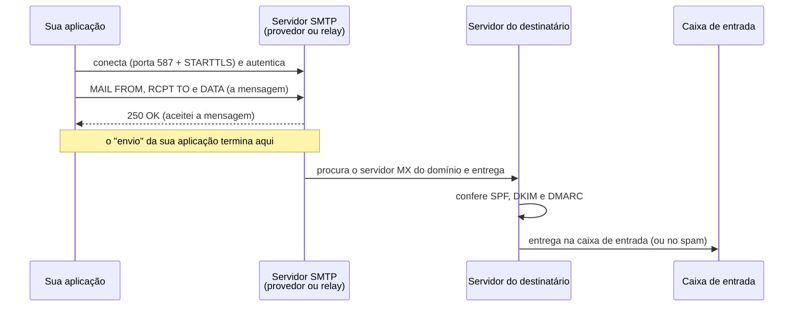
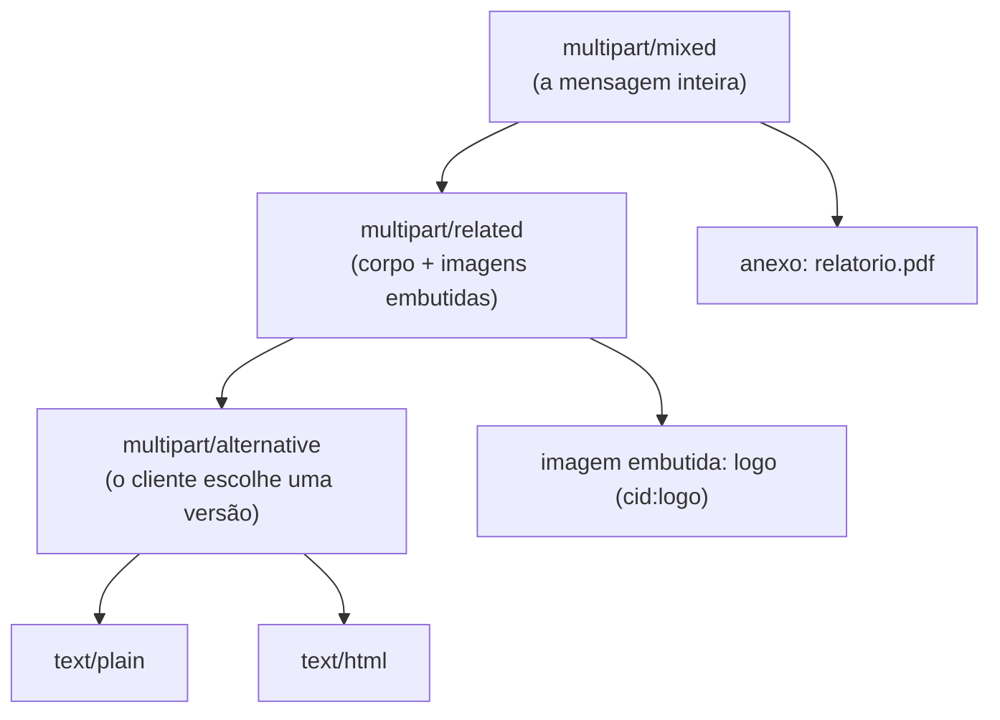
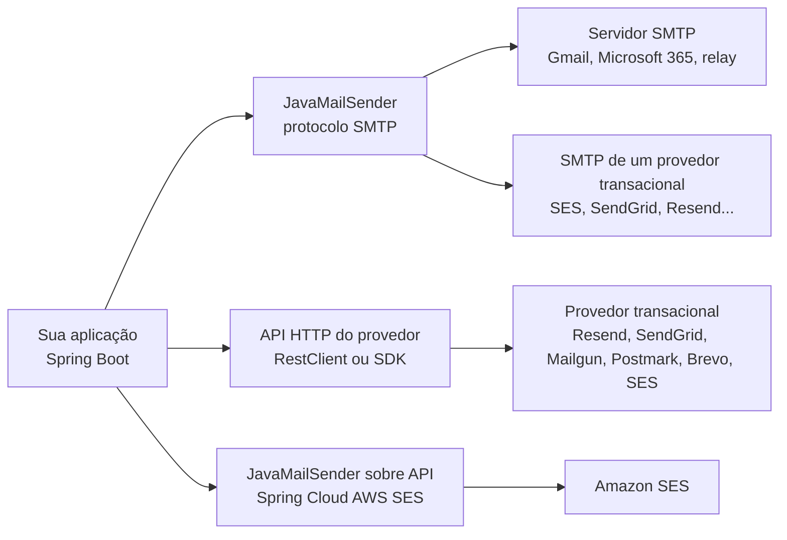
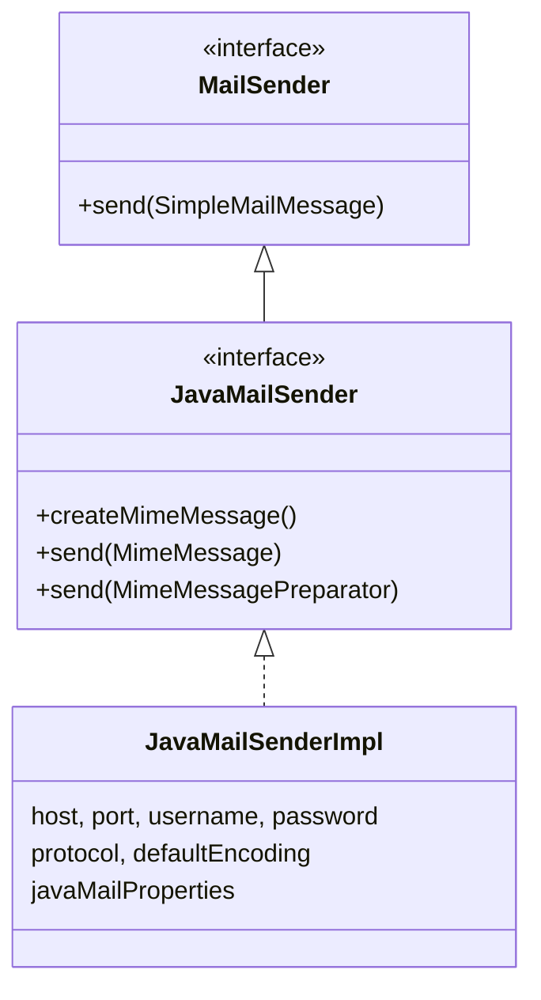
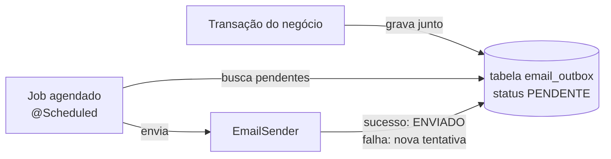
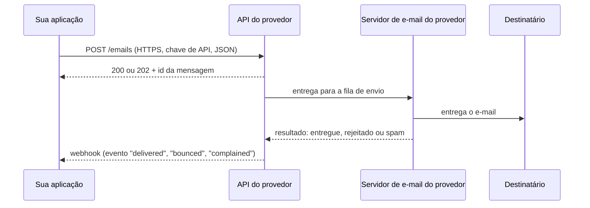
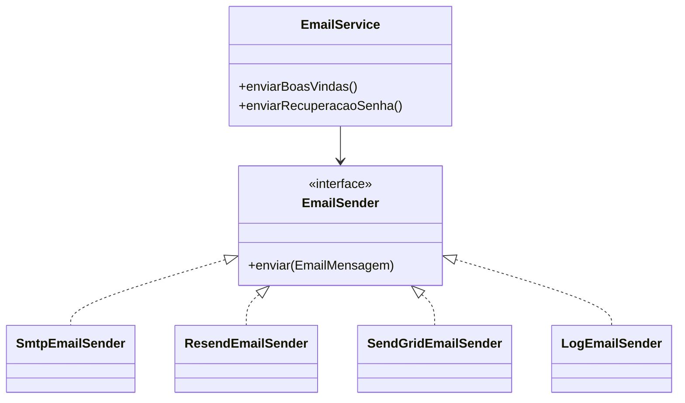
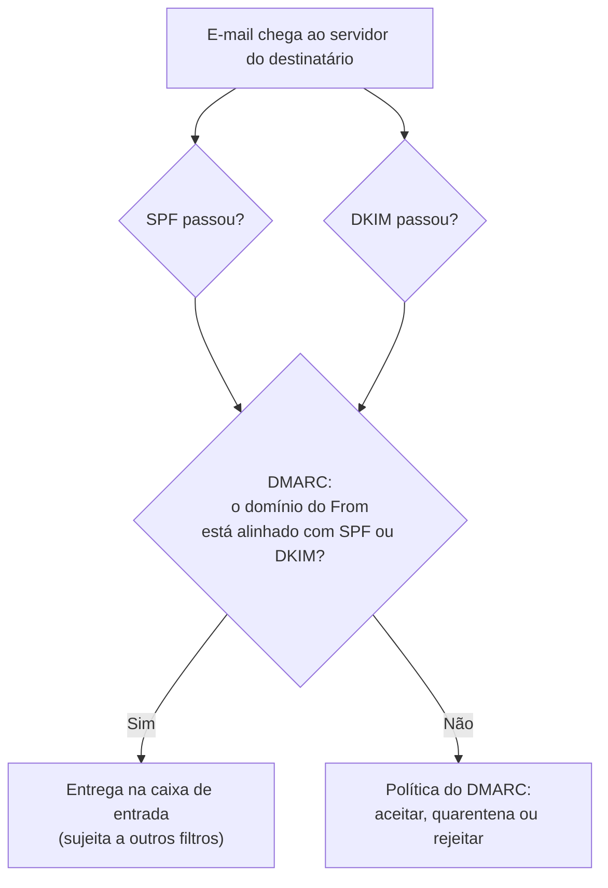

# Envio de e-mails no Spring Boot


## Sumário

- [Como o e-mail funciona](#como-o-e-mail-funciona)
- [As formas de enviar e-mail em uma aplicação Spring](#as-formas-de-enviar-e-mail-em-uma-aplicação-spring)
- [JavaMailSender: o que é e como funciona](#javamailsender-o-que-é-e-como-funciona)
- [Configuração: starter e application.properties](#configuração-starter-e-applicationproperties)
- [Provedores SMTP e seus limites](#provedores-smtp-e-seus-limites)
- [Enviando um e-mail de texto com SimpleMailMessage](#enviando-um-e-mail-de-texto-com-simplemailmessage)
- [HTML, anexos e imagens com MimeMessage](#html-anexos-e-imagens-com-mimemessage)
- [Templates HTML com Thymeleaf](#templates-html-com-thymeleaf)
- [Envio assíncrono e depois do commit](#envio-assíncrono-e-depois-do-commit)
- [Enviando e-mails por API](#enviando-e-mails-por-api)
- [Provedores de e-mail por API](#provedores-de-e-mail-por-api)
- [Usando as APIs no código](#usando-as-apis-no-código)
- [Padrão recomendado: uma interface e vários adaptadores](#padrão-recomendado-uma-interface-e-vários-adaptadores)
- [Exemplo completo: esqueci minha senha](#exemplo-completo-esqueci-minha-senha)
- [Entregabilidade: SPF, DKIM e DMARC](#entregabilidade-spf-dkim-e-dmarc)
- [Erros e retentativas](#erros-e-retentativas)
- [Como testar](#como-testar)
- [Boas práticas](#boas-práticas)
- [Referências](#referências)

---

## Como o e-mail funciona

Enviar um e-mail **não é** entregá-lo. A sua aplicação entrega a mensagem a **um servidor de e-mail**, e é ele quem leva até a caixa do destinatário.



| Protocolo | Para que serve | O Spring Mail usa? |
|---|---|---|
| **SMTP** | **Enviar** e-mails | ✅ Sim |
| IMAP e POP3 | **Ler** e-mails de uma caixa | ❌ Não (o Spring Mail só envia) |

### Portas do SMTP

| Porta | Uso | Observação |
|---|---|---|
| `587` | **Submissão** (aplicação → servidor) com **STARTTLS** | ✅ O padrão atual |
| `465` | Submissão com **TLS desde o início** (SMTPS) | Também aceita pela maioria dos provedores |
| `25` | Entre servidores de e-mail | Muitos provedores de nuvem **bloqueiam** a saída pela 25 |
| `2525` | Alternativa de alguns provedores | Quando a 587 está bloqueada |

### Anatomia de uma mensagem

Um e-mail é um texto no formato **MIME**, com **cabeçalhos** e **corpo**:

| Parte | Exemplo | Observação |
|---|---|---|
| `From` | `Meu Sistema <nao-responda@meusistema.com>` | Quem aparece como remetente |
| `To`, `Cc`, `Bcc` | `ana@email.com` | O `Bcc` **não vai** nos cabeçalhos: só no envelope |
| `Reply-To` | `suporte@meusistema.com` | Para onde vai a resposta |
| `Subject` | `Redefinição de senha` | Assunto |
| `Message-ID`, `Date` | Gerados automaticamente | Identificam a mensagem |
| **Corpo** | `text/plain`, `text/html` | Pode ter **várias versões** e **anexos** |



> [!NOTE]
> Existem dois "remetentes": o do **envelope** (`MAIL FROM`, usado pelos servidores e pelo SPF) e o do **cabeçalho** `From` (o que a pessoa vê). Os provedores de e-mail exigem que os dois pertençam ao **seu domínio autenticado** (veja [Entregabilidade](#entregabilidade-spf-dkim-e-dmarc)).

---

## As formas de enviar e-mail em uma aplicação Spring



| Forma | Como funciona | Dependência | Quando usar |
|---|---|---|---|
| **SMTP com `JavaMailSender`** | Fala o protocolo SMTP com qualquer servidor | `spring-boot-starter-mail` | O caminho **nativo do Spring**. Simples e portátil |
| **SMTP de um provedor transacional** | O mesmo `JavaMailSender`, apontando para o SMTP do provedor | `spring-boot-starter-mail` | Trocar de provedor **sem mudar o código** |
| **API HTTP com `RestClient`** | `POST` em JSON para o provedor | Starter web (`RestClient`) | Controle total, sem SDK |
| **SDK do provedor** | Classes prontas do fornecedor | Ex.: `com.resend:resend-java`, AWS SDK | Praticidade |
| **`JavaMailSender` sobre API** | Você usa a interface do Spring e ela chama a API do provedor | `spring-cloud-aws-starter-ses` (SES) | AWS SES mantendo o código do Spring Mail |
| **API do e-mail do usuário** | Gmail API ou Microsoft Graph, com OAuth 2.0 | SDK do Google ou chamadas ao Graph | Enviar **como a própria pessoa** |

> [!TIP]
> No mercado atual, é comum **combinar**: usar o **`JavaMailSender`** em desenvolvimento (com um servidor de teste local) e um **provedor por API** em produção, escondendo a diferença atrás de uma **interface** (veja [Padrão recomendado](#padrão-recomendado-uma-interface-e-vários-adaptadores)).

---

## JavaMailSender: o que é e como funciona

O **`JavaMailSender`** é a interface do Spring para enviar e-mails por SMTP. Por baixo, ele usa o **Jakarta Mail** (pacote `jakarta.mail`, antes `javax.mail`), com a implementação **Eclipse Angus Mail**, que o `spring-boot-starter-mail` já traz.



| Classe | Para que serve |
|---|---|
| **`JavaMailSender`** | A interface que você injeta |
| **`JavaMailSenderImpl`** | A implementação: guarda host, porta, credenciais e a `Session` do Jakarta Mail |
| **`SimpleMailMessage`** | E-mail **simples**, só texto |
| **`MimeMessage`** | E-mail **completo** (HTML, anexos, imagens): classe do Jakarta Mail |
| **`MimeMessageHelper`** | Ajudante do Spring que **monta** um `MimeMessage` sem dor de cabeça |
| **`MimeMessagePreparator`** | Interface funcional para montar o e-mail dentro de uma lambda |

### O que acontece em um `send(...)`

1. Você monta a mensagem (`SimpleMailMessage` ou `MimeMessage`).
2. O `JavaMailSenderImpl` obtém a `Session` do Jakarta Mail (criada na primeira vez, com as propriedades `mail.*`).
3. Ele abre uma **conexão** (`Transport`) com o servidor SMTP (host e porta), faz o **STARTTLS** (se configurado) e **autentica**.
4. Envia a mensagem e **aguarda a resposta** do servidor (`250 OK` ou um erro).
5. **Fecha a conexão.**

> [!IMPORTANT]
> O `send` é **síncrono e bloqueante**: a thread fica esperando o servidor SMTP. E o `250 OK` significa apenas que o servidor **aceitou** a mensagem, e **não** que ela chegou à caixa do destinatário (isso pode falhar depois, com um *bounce*).

| Ponto | Detalhe |
|---|---|
| Uma conexão por chamada | Cada chamada de `send` abre e fecha uma conexão. Para **vários e-mails de uma vez**, use `send(MimeMessage...)`, que **reaproveita** a conexão |
| O bean é **reutilizável** | Injete o `JavaMailSender` e use em qualquer thread: não crie um novo a cada envio |
| Exceções | O Spring converte as falhas em `MailException` (não verificadas) |

| Exceção do Spring | Quando acontece |
|---|---|
| `MailAuthenticationException` | Usuário ou senha do SMTP recusados |
| `MailSendException` | Falha de rede ou mensagem recusada (`getFailedMessages()` mostra quais) |
| `MailParseException` | Erro ao interpretar a mensagem |
| `MailPreparationException` | Erro ao preparar o e-mail (por exemplo, dentro do `MimeMessagePreparator`) |

---

## Configuração: starter e application.properties

### 1. Dependência

```xml
<dependency>
    <groupId>org.springframework.boot</groupId>
    <artifactId>spring-boot-starter-mail</artifactId>
</dependency>
```

Com a dependência no projeto e a propriedade `spring.mail.host` definida, o Spring Boot **cria o bean `JavaMailSender`** sozinho.

### 2. Propriedades

```properties
# Servidor SMTP
spring.mail.host=smtp.exemplo.com
spring.mail.port=587
spring.mail.username=${MAIL_USERNAME}
spring.mail.password=${MAIL_PASSWORD}
spring.mail.default-encoding=UTF-8

# Autenticação e criptografia (porta 587: STARTTLS)
spring.mail.properties.mail.smtp.auth=true
spring.mail.properties.mail.smtp.starttls.enable=true
spring.mail.properties.mail.smtp.starttls.required=true

# TIMEOUTS (em milissegundos): ESSENCIAIS
spring.mail.properties.mail.smtp.connectiontimeout=5000
spring.mail.properties.mail.smtp.timeout=10000
spring.mail.properties.mail.smtp.writetimeout=10000
```

| Propriedade | O que controla |
|---|---|
| `spring.mail.host` e `port` | Endereço do servidor SMTP |
| `spring.mail.username` e `password` | Credenciais (**sempre em variável de ambiente**) |
| `spring.mail.protocol` | Protocolo (padrão: `smtp`) |
| `spring.mail.default-encoding` | Codificação das mensagens (use `UTF-8`, para acentos) |
| `spring.mail.test-connection` | Se `true`, testa a conexão **ao iniciar** a aplicação (padrão: `false`) |
| `spring.mail.properties.mail.*` | Qualquer propriedade do Jakarta Mail |
| `mail.smtp.auth` | Exige autenticação |
| `mail.smtp.starttls.enable` e `required` | Habilita o STARTTLS e **proíbe** seguir sem ele |
| `mail.smtp.ssl.enable` | TLS desde o início (para a **porta 465**) |
| `mail.smtp.connectiontimeout`, `timeout`, `writetimeout` | Tempo máximo para conectar, ler e escrever |

> [!WARNING]
> No Jakarta Mail, os **timeouts são infinitos por padrão**. Sem eles, um servidor SMTP lento ou fora do ar **trava a thread para sempre**. Defina sempre os três.

Para a **porta 465**, troque o STARTTLS por TLS direto:

```properties
spring.mail.port=465
spring.mail.properties.mail.smtp.ssl.enable=true
```

> [!NOTE]
> As versões recentes do Spring Boot também aceitam configurar o TLS com **SSL bundles** (`spring.mail.ssl.enabled` e `spring.mail.ssl.bundle`), úteis para certificados próprios. Confira na documentação da sua versão.

### 3. Um perfil para cada ambiente

`application-dev.properties` (servidor de teste local, que **não envia nada de verdade**):

```properties
spring.mail.host=localhost
spring.mail.port=1025
spring.mail.properties.mail.smtp.auth=false
spring.mail.properties.mail.smtp.starttls.enable=false
```

`application-prod.properties`:

```properties
spring.mail.host=${MAIL_HOST}
spring.mail.port=587
spring.mail.username=${MAIL_USERNAME}
spring.mail.password=${MAIL_PASSWORD}
spring.mail.properties.mail.smtp.auth=true
spring.mail.properties.mail.smtp.starttls.required=true
spring.mail.properties.mail.smtp.connectiontimeout=5000
spring.mail.properties.mail.smtp.timeout=10000
spring.mail.properties.mail.smtp.writetimeout=10000
```

### 4. Propriedades da sua aplicação

Crie uma classe só para os dados de e-mail **do seu sistema** (o nome `MailProperties` já existe no Spring Boot, por isso o `App` no começo):

```java
@ConfigurationProperties(prefix = "app.mail")
@Validated
public record AppMailProperties(
        @NotBlank String provider,          // smtp, resend, sendgrid ou log (veja mais adiante)
        @NotBlank @Email String from,       // remetente: precisa ser do SEU domínio autenticado
        @NotBlank String fromName,          // nome que aparece: "Meu Sistema"
        @NotBlank String frontUrl,          // endereço do front-end, para montar links
        Resend resend,
        SendGrid sendgrid
) {
    public record Resend(String apiKey) { }
    public record SendGrid(String apiKey) { }
}
```

```properties
app.mail.provider=smtp
app.mail.from=nao-responda@meusistema.com
app.mail.from-name=Meu Sistema
app.mail.front-url=https://app.meusistema.com
```

> [!TIP]
> Duas ferramentas úteis durante o desenvolvimento:
> - `spring.mail.properties.mail.debug=true` mostra no log **toda a conversa SMTP**. Use **só em desenvolvimento**: ela revela as credenciais (em Base64).
> - Com o **Actuator**, o Spring Boot inclui um *health check* de e-mail que **abre uma conexão SMTP** a cada verificação. Se isso incomodar, desligue com `management.health.mail.enabled=false`.

---

## Provedores SMTP e seus limites

O mesmo `JavaMailSender` funciona com **qualquer** servidor SMTP. Muda só o `host`, a porta e as credenciais:

| Servidor | Host (exemplo) | Porta | Credenciais |
|---|---|---|---|
| **Gmail** (conta pessoal ou Workspace) | `smtp.gmail.com` | 587 (STARTTLS) ou 465 | E-mail + **senha de app** (exige verificação em duas etapas) |
| **Microsoft 365 / Outlook** | `smtp.office365.com` | 587 (STARTTLS) | Conta + **OAuth 2.0** (veja o aviso abaixo) |
| **Amazon SES** | `email-smtp.{regiao}.amazonaws.com` | 587 ou 465 | **Credenciais SMTP** geradas no SES (não são as chaves da AWS) |
| **SendGrid** | `smtp.sendgrid.net` | 587 | Usuário `apikey` e a **chave de API** como senha |
| **Resend** | `smtp.resend.com` | 465 ou 587 | Usuário `resend` e a **chave de API** como senha |
| **Postmark** | `smtp.postmarkapp.com` | 587 | O token do servidor como usuário e senha |
| **Brevo** | `smtp-relay.brevo.com` | 587 | Usuário da conta e a **chave SMTP** |
| **Mailgun** | `smtp.mailgun.org` | 587 | Credenciais SMTP do domínio |
| **Mailpit** (teste local) | `localhost` | 1025 | Nenhuma |

> [!NOTE]
> Os hosts e as formas de autenticação mudam de vez em quando. **Confira sempre no painel do provedor.**

> [!WARNING]
> **Gmail e Outlook pessoais não são para produção.** São contas com limite diário baixo e regras anti-abuso rígidas: a conta pode ser **bloqueada**. O Gmail deixou de aceitar a senha normal em apps (exige **senha de app**), e o remetente fica preso ao endereço da própria conta. Para um sistema, use um **provedor transacional** com o seu domínio.

> [!WARNING]
> **Microsoft 365:** a autenticação **básica** (usuário e senha) no SMTP AUTH está sendo aposentada. Segundo o cronograma atualizado em 2026, ela **continua funcionando até dezembro de 2026**. Depois disso, passa a vir **desativada por padrão** nos tenants existentes (o administrador ainda pode ligá-la), e a data final de remoção seria divulgada depois. A Microsoft indica **OAuth 2.0** (e, como alternativas, High Volume Email ou Azure Communication Services Email). O prazo já foi adiado antes: confira o aviso mais recente.

---

## Enviando um e-mail de texto com SimpleMailMessage

O caso mais simples: **apenas texto, sem HTML e sem anexo**.

```java
import org.springframework.mail.SimpleMailMessage;
import org.springframework.mail.javamail.JavaMailSender;
import org.springframework.stereotype.Service;

@Service
public class EmailTextoService {

    private final JavaMailSender mailSender;                       // o Spring Boot cria este bean a partir de spring.mail.*
    private final AppMailProperties props;

    public EmailTextoService(JavaMailSender mailSender, AppMailProperties props) {
        this.mailSender = mailSender;
        this.props = props;
    }

    public void enviar(String para, String assunto, String texto) {
        SimpleMailMessage mensagem = new SimpleMailMessage();      // e-mail "puro texto"

        mensagem.setFrom(props.from());                            // remetente (do SEU domínio)
        mensagem.setTo(para);                                      // destinatário(s)
        mensagem.setSubject(assunto);                              // assunto
        mensagem.setText(texto);                                   // corpo em texto simples

        mailSender.send(mensagem);                                 // abre a conexão, envia e fecha (bloqueante)
    }
}
```

| Método de `SimpleMailMessage` | O que define |
|---|---|
| `setFrom(String)` | Remetente |
| `setTo(String...)` | Destinatários |
| `setCc(String...)` e `setBcc(String...)` | Cópia e cópia oculta |
| `setReplyTo(String)` | Para onde vai a resposta |
| `setSubject(String)` | Assunto |
| `setText(String)` | Corpo (texto simples) |
| `setSentDate(Date)` | Data de envio |

> [!NOTE]
> O `SimpleMailMessage` **não** envia HTML nem anexos, e não define o nome ao lado do endereço (`Meu Sistema <...>`). Para qualquer coisa além de texto, use o `MimeMessage`.

---

## HTML, anexos e imagens com MimeMessage

```java
import jakarta.mail.MessagingException;
import jakarta.mail.internet.InternetAddress;
import jakarta.mail.internet.MimeMessage;
import org.springframework.core.io.ByteArrayResource;
import org.springframework.core.io.ClassPathResource;
import org.springframework.mail.javamail.JavaMailSender;
import org.springframework.mail.javamail.MimeMessageHelper;

import java.io.UnsupportedEncodingException;

@Service
public class EmailHtmlService {

    private final JavaMailSender mailSender;
    private final AppMailProperties props;

    public EmailHtmlService(JavaMailSender mailSender, AppMailProperties props) {
        this.mailSender = mailSender;
        this.props = props;
    }

    public void enviarComAnexo(String para, String assunto, String html, byte[] pdf) {
        try {
            MimeMessage mensagem = mailSender.createMimeMessage();               // mensagem vazia, ligada à Session do mailSender

            MimeMessageHelper helper = new MimeMessageHelper(
                    mensagem,
                    true,                                                        // multipart: permite anexos e imagens embutidas
                    "UTF-8");                                                    // codificação (acentos)

            helper.setFrom(new InternetAddress(props.from(), props.fromName(), "UTF-8"));   // "Meu Sistema <nao-responda@...>"
            helper.setTo(para);                                                  // destinatário
            helper.setReplyTo("suporte@meusistema.com");                         // as respostas vão para o suporte
            helper.setSubject(assunto);                                          // assunto

            helper.setText("Seu cliente de e-mail não exibe HTML.", html);       // (versão em texto, versão em HTML)

            helper.addInline("logo", new ClassPathResource("static/logo.png"));  // imagem embutida: use  no HTML
            helper.addAttachment("relatorio.pdf",                                // anexo: nome que a pessoa vê
                    new ByteArrayResource(pdf),                                  // conteúdo
                    "application/pdf");                                          // tipo do arquivo

            mailSender.send(mensagem);                                           // envia

        } catch (MessagingException | UnsupportedEncodingException e) {
            throw new EmailException("Não foi possível montar o e-mail", e);     // exceção sua, com a causa preservada
        }
    }
}
```

| Linha | O que faz |
|---|---|
| `createMimeMessage()` | Cria a mensagem vazia |
| `new MimeMessageHelper(mensagem, true, "UTF-8")` | `true` liga o modo **multipart** (necessário para anexos e imagens) |
| `new InternetAddress(email, nome, "UTF-8")` | Endereço com **nome de exibição**, aceitando acentos |
| `setText(texto, html)` | Cria **duas versões** (`multipart/alternative`): o cliente de e-mail escolhe a que consegue exibir |
| `addInline("logo", recurso)` | Imagem **dentro** do corpo, referenciada por `cid:logo` |
| `addAttachment(nome, recurso, tipo)` | Anexo |

> [!IMPORTANT]
> Chame `setText(...)` **antes** de `addInline(...)`: o Spring precisa do corpo HTML montado para depois anexar as imagens a ele.

### Montando dentro de uma lambda (`MimeMessagePreparator`)

Uma forma mais curta, em que o Spring cuida das exceções verificadas:

```java
mailSender.send(mimeMessage -> {                                  // MimeMessagePreparator: pode lançar Exception
    MimeMessageHelper helper = new MimeMessageHelper(mimeMessage, true, "UTF-8");
    helper.setFrom(props.from());
    helper.setTo(para);
    helper.setSubject(assunto);
    helper.setText(texto, html);
});
```

### Vários e-mails de uma vez

```java
MimeMessage[] mensagens = destinatarios.stream()
        .map(this::montar)                                        // monta um MimeMessage por pessoa
        .toArray(MimeMessage[]::new);

mailSender.send(mensagens);                                       // UMA conexão para todas as mensagens
```

| Situação | O que fazer |
|---|---|
| Notificação **individual** (cada um recebe a sua) | Um e-mail por pessoa, de preferência em lote (`send(MimeMessage...)`) |
| **Nunca** coloque vários destinatários no `To` ou `Cc` | Todos veriam os endereços uns dos outros |
| Campanhas e *newsletters* | Use o recurso de **campanhas** ou de **envio em lote** do provedor: ele cuida de limites, descadastro e métricas |

> [!WARNING]
> **Injeção de cabeçalhos:** se o assunto ou o destinatário vierem de um formulário, nunca os use sem validar. Um texto com quebra de linha (`\r\n`) pode **injetar** cabeçalhos extras (como `Bcc:`) e transformar o seu servidor em **disparador de spam**. Valide os e-mails, rejeite quebras de linha nos campos de cabeçalho e **nunca** deixe o cliente definir o `From`.

---

## Templates HTML com Thymeleaf

Montar HTML concatenando `String` é frágil e inseguro. O padrão é usar um **motor de templates**. O Thymeleaf já se integra ao Spring Boot.

```xml
<dependency>
    <groupId>org.springframework.boot</groupId>
    <artifactId>spring-boot-starter-thymeleaf</artifactId>
</dependency>
```

`src/main/resources/templates/email/boas-vindas.html`:

```html
<!DOCTYPE html>
<html xmlns:th="http://www.thymeleaf.org" lang="pt-BR">
<head>
    <meta charset="UTF-8">
    <meta name="viewport" content="width=device-width, initial-scale=1">
    <title>Bem-vindo(a)</title>
</head>
<body style="margin:0;padding:0;background:#f4f5f7;font-family:Arial,Helvetica,sans-serif;">
<table role="presentation" width="100%" cellspacing="0" cellpadding="0" style="background:#f4f5f7;padding:24px 0;">
    <tr>
        <td align="center">
            <table role="presentation" width="600" cellspacing="0" cellpadding="0"
                   style="background:#ffffff;border-radius:8px;padding:32px;max-width:600px;">
                <tr>
                    <td>
                        <h1 style="font-size:22px;margin:0 0 16px;color:#111827;">
                            Olá, <span th:text="${nome}">Ana</span>!
                        </h1>
                        <p style="font-size:15px;line-height:1.5;color:#374151;">
                            Sua conta foi criada com sucesso.
                        </p>
                        <p style="margin:24px 0;">
                            <a th:href="${urlApp}" href="#"
                               style="background:#2563eb;color:#ffffff;text-decoration:none;
                                      padding:12px 20px;border-radius:6px;display:inline-block;">
                                Acessar o sistema
                            </a>
                        </p>
                        <p style="font-size:12px;color:#6b7280;">
                            Você recebeu este e-mail porque se cadastrou em Meu Sistema.
                        </p>
                    </td>
                </tr>
            </table>
        </td>
    </tr>
</table>
</body>
</html>
```

Renderizando o template em uma `String`:

```java
import org.thymeleaf.TemplateEngine;
import org.thymeleaf.context.Context;

@Service
public class EmailTemplateService {

    private final TemplateEngine templateEngine;                      // o Spring Boot configura este bean

    public EmailTemplateService(TemplateEngine templateEngine) {
        this.templateEngine = templateEngine;
    }

    public String renderizar(String template, Map<String, Object> variaveis) {
        Context contexto = new Context(Locale.forLanguageTag("pt-BR"));   // idioma do template
        contexto.setVariables(variaveis);                                 // ${nome}, ${urlApp}...
        return templateEngine.process(template, contexto);                // "email/boas-vindas" -> templates/email/boas-vindas.html
    }
}
```

| Ponto | Detalhe |
|---|---|
| `th:text="${nome}"` | **Escapa o HTML** automaticamente: um nome como `<script>` não vira código |
| Caminho do template | `email/boas-vindas` aponta para `templates/email/boas-vindas.html` |
| O texto de exemplo dentro do `<span>` | Aparece só se você abrir o arquivo no navegador, e é substituído ao renderizar |

### Dicas de HTML para e-mail

| Dica | Por quê |
|---|---|
| **CSS inline** (`style="..."`) | Muitos clientes de e-mail ignoram `<style>` e arquivos CSS |
| **Layout com tabelas** | Os clientes de e-mail não suportam bem `flex` e `grid` |
| Largura de até **600 px** | Cabe bem na maioria das telas |
| **URLs absolutas** em links e imagens | Não existe "caminho relativo" em um e-mail |
| Sempre uma **versão em texto** | Acessibilidade, filtros de spam e clientes simples |
| **Sem JavaScript** | É bloqueado |
| `alt` nas imagens | Muitos clientes bloqueiam imagens por padrão |

### Outras formas de montar o conteúdo

| Opção | Como funciona |
|---|---|
| **Thymeleaf** | Template no seu projeto, renderizado no servidor (o caminho deste arquivo) |
| **FreeMarker** ou **Mustache** | Outros motores de template, com starters do Spring Boot |
| **MJML** | Você escreve em uma linguagem de marcação própria e a **compila** para um HTML de e-mail responsivo |
| **Templates do provedor** | O modelo fica **no provedor** (SendGrid, Brevo, Resend...) e você só envia as variáveis |

---

## Envio assíncrono e depois do commit

Enviar e-mail é **lento** (de centenas de milissegundos a segundos) e pode **falhar**. Por isso, não o faça dentro da requisição nem dentro de uma transação.

| Problema | Consequência |
|---|---|
| Enviar **dentro** da requisição | O usuário espera o SMTP responder. Se ele travar, a requisição trava |
| Enviar **dentro de uma transação** (antes do commit) | O e-mail "Bem-vindo" sai, mas depois a transação sofre rollback: o usuário **não existe**, e o e-mail já foi |
| Falha no envio sem tratamento | A transação inteira pode ser desfeita por causa de um e-mail |

### 1. `@Async`: enviar em outra thread

```java
@Configuration
@EnableAsync                                                       // liga o suporte a @Async
public class EmailAsyncConfig {

    @Bean(name = "emailExecutor")                                  // um "pool" de threads só para e-mails
    Executor emailExecutor() {
        ThreadPoolTaskExecutor executor = new ThreadPoolTaskExecutor();
        executor.setCorePoolSize(2);                               // threads sempre prontas
        executor.setMaxPoolSize(5);                                // máximo de threads
        executor.setQueueCapacity(100);                            // fila de espera
        executor.setThreadNamePrefix("email-");                    // aparece nos logs
        return executor;
    }
}
```

```java
@Async("emailExecutor")                                            // este método roda no pool "emailExecutor"
public void enviarBoasVindas(String para, String nome) { ... }
```

> [!NOTE]
> O `@Async` funciona por proxy: **não funciona** se o método for chamado por outro método **da mesma classe** (`this.enviar(...)`). Se o método for `void`, as exceções se perdem: configure um `AsyncUncaughtExceptionHandler` (veja o arquivo de **Exceções**).

> [!TIP]
> No **Java 21 ou mais recente**, com `spring.threads.virtual.enabled=true`, o Spring Boot usa **threads virtuais** nas tarefas `@Async`. Como o envio de e-mail só espera a rede, é um bom uso delas.

### 2. Enviar só depois do commit

A forma correta de ligar "salvou no banco" a "mandar e-mail" é com **eventos**:

```java
// O evento: carrega só o que o e-mail precisa
public record UsuarioCadastradoEvent(String email, String nome) { }
```

```java
@Service
public class CadastroService {

    private final UsuarioRepository repository;
    private final ApplicationEventPublisher publisher;             // publica eventos dentro do Spring

    @Transactional
    public Usuario cadastrar(CadastroRequest request) {
        Usuario usuario = repository.save(...);                    // 1) grava no banco
        publisher.publishEvent(                                    // 2) avisa: "alguém se cadastrou"
                new UsuarioCadastradoEvent(usuario.getEmail(), usuario.getNome()));
        return usuario;                                            // o commit acontece AQUI, ao sair do método
    }
}
```

```java
@Component
public class EmailListener {

    private final EmailService emailService;

    public EmailListener(EmailService emailService) {
        this.emailService = emailService;
    }

    @Async("emailExecutor")                                                // em outra thread
    @TransactionalEventListener(phase = TransactionPhase.AFTER_COMMIT)     // só DEPOIS que a transação confirmar
    public void aoCadastrar(UsuarioCadastradoEvent evento) {
        emailService.enviarBoasVindas(evento.email(), evento.nome());
    }
}
```

Se a transação sofrer **rollback**, o evento **nunca** é entregue ao listener, e nenhum e-mail sai.

### 3. Outbox: para e-mails que **não podem se perder**

O `@Async` guarda a tarefa **na memória**: se a aplicação cair antes de enviar, o e-mail se perde. Para e-mails críticos, grave o pedido **no banco, na mesma transação** e deixe um **job** enviar e tentar de novo se falhar (padrão *Transactional Outbox*).



```java
@Entity
@Table(name = "email_outbox")
public class EmailOutbox {

    @Id @GeneratedValue(strategy = GenerationType.IDENTITY)
    private Long id;

    @Column(nullable = false, length = 150) private String destinatario;
    @Column(nullable = false, length = 200) private String assunto;
    @Column(nullable = false, columnDefinition = "TEXT") private String html;

    @Enumerated(EnumType.STRING)
    @Column(nullable = false, length = 20)
    private StatusEmail status = StatusEmail.PENDENTE;              // PENDENTE, ENVIADO ou FALHOU

    @Column(nullable = false) private int tentativas = 0;
    @Column(name = "proxima_tentativa_em", nullable = false) private Instant proximaTentativaEm = Instant.now();
    @Column(name = "ultimo_erro", length = 500) private String ultimoErro;
    @Column(name = "criado_em", nullable = false) private Instant criadoEm = Instant.now();

    protected EmailOutbox() { }

    public EmailOutbox(String destinatario, String assunto, String html) {
        this.destinatario = destinatario;
        this.assunto = assunto;
        this.html = html;
    }

    public void marcarEnviado() { this.status = StatusEmail.ENVIADO; }

    public void registrarFalha(String erro, int maximoTentativas) {
        this.tentativas++;
        this.ultimoErro = erro;
        if (this.tentativas >= maximoTentativas) {
            this.status = StatusEmail.FALHOU;                                            // desiste: alguém precisa olhar
        } else {
            long minutos = Math.min((long) Math.pow(2, tentativas), 60);                 // 2, 4, 8, 16... no máximo 60 minutos
            this.proximaTentativaEm = Instant.now().plus(Duration.ofMinutes(minutos));   // espera cada vez mais (backoff)
        }
    }

    // getters omitidos
}

public enum StatusEmail { PENDENTE, ENVIADO, FALHOU }
```

```java
public interface EmailOutboxRepository extends JpaRepository<EmailOutbox, Long> {

    @Query("""
            select e from EmailOutbox e
            where e.status = :status and e.proximaTentativaEm <= :agora
            order by e.criadoEm
            """)
    List<EmailOutbox> buscarParaEnviar(@Param("status") StatusEmail status,
                                       @Param("agora") Instant agora,
                                       Pageable pageable);
}
```

```java
@Component
public class EmailOutboxJob {

    private static final int MAXIMO_TENTATIVAS = 5;
    private static final Logger log = LoggerFactory.getLogger(EmailOutboxJob.class);

    private final EmailOutboxRepository repository;
    private final EmailSender sender;

    public EmailOutboxJob(EmailOutboxRepository repository, EmailSender sender) {
        this.repository = repository;
        this.sender = sender;
    }

    @Scheduled(fixedDelayString = "PT30S")                          // 30 segundos depois do fim da execução anterior
    public void processar() {
        List<EmailOutbox> pendentes = repository.buscarParaEnviar(
                StatusEmail.PENDENTE, Instant.now(), PageRequest.of(0, 50));   // no máximo 50 por rodada

        for (EmailOutbox email : pendentes) {
            try {
                sender.enviar(new EmailMensagem(List.of(email.getDestinatario()),
                        email.getAssunto(), email.getHtml(), null, null));
                email.marcarEnviado();
            } catch (EmailException e) {
                log.warn("Falha ao enviar o e-mail {} (tentativa {})", email.getId(), email.getTentativas() + 1);
                email.registrarFalha(e.getMessage(), MAXIMO_TENTATIVAS);
            }
            repository.save(email);                                 // cada e-mail confirma o seu resultado
        }
    }
}
```

> [!WARNING]
> Com **mais de uma instância** da aplicação, dois jobs podem pegar o mesmo e-mail e enviá-lo duas vezes. Resolva com uma trava distribuída (**ShedLock**) ou com leitura exclusiva das linhas (`SELECT ... FOR UPDATE SKIP LOCKED`).

| Opção | Perde e-mail se a aplicação cair? | Complexidade | Indicada para |
|---|---|---|---|
| Direto, na requisição | Não perde, mas **trava** o usuário | Baixa | Nunca em produção |
| `@Async` | **Pode perder** | Baixa | E-mails que podem se perder (um aviso) |
| `@Async` + `AFTER_COMMIT` | Pode perder, mas **não envia em rollback** | Média | **A maioria dos casos** |
| **Outbox** + job | **Não perde** (tem retentativas) | Alta | Recuperação de senha, cobrança, e-mails críticos |
| Fila de mensagens (RabbitMQ, Kafka, SQS) | Não perde | Alta | Alto volume, várias aplicações |

---

## Enviando e-mails por API

Em vez de falar **SMTP**, a aplicação faz uma **requisição HTTPS** (`POST` com JSON) para o provedor, que cuida do resto.



| | **SMTP** (`JavaMailSender`) | **API HTTP** |
|---|---|---|
| Transporte | Protocolo SMTP (portas 587, 465) | **HTTPS** (porta 443) |
| Bloqueio de portas | Alguns provedores de nuvem e PaaS **bloqueiam** o SMTP de saída | A 443 **sempre** está liberada |
| Resposta | Só "aceito" ou erro SMTP | **Id da mensagem**, erros claros em JSON |
| Recursos extras | Poucos | Templates, agendamento, *tags*, métricas, lotes |
| Eventos de entrega | Não | **Webhooks** (entregue, devolvido, spam, aberto, clicado) |
| Limite de volume | Do servidor | Com cabeçalhos de **rate limit** e código `429` |
| Portabilidade | **Alta** (mesmo código em qualquer servidor) | Cada provedor tem o **seu formato** |
| Código | `spring-boot-starter-mail` | `RestClient` ou o SDK do provedor |

> [!NOTE]
> Não há um "melhor" absoluto. O SMTP é o mais portátil e fácil de trocar. A API oferece mais recursos e informações (principalmente **webhooks** de entrega). Muitos projetos usam **os dois**, por trás de uma interface.

---

## Provedores de e-mail por API

São serviços de **e-mail transacional** (recuperação de senha, confirmações, notificações), muitos deles também com campanhas. O que eles fazem por você: operar os servidores de envio, manter a **reputação** dos IPs, assinar com **DKIM**, tratar **devoluções** (*bounces*) e **reclamações**, e mostrar métricas.

| Provedor | Perfil | Endpoint de envio (exemplo) | Autenticação | Java |
|---|---|---|---|---|
| **Resend** | Focado em desenvolvedores, API enxuta | `POST https://api.resend.com/emails` | `Authorization: Bearer <chave>` | SDK `com.resend:resend-java` |
| **SendGrid** (Twilio) | Grande e conhecido, transacional e marketing | `POST https://api.sendgrid.com/v3/mail/send` | `Authorization: Bearer <chave>` | SDK `com.sendgrid:sendgrid-java` |
| **Mailgun** | Foco em desenvolvedores, bom controle de domínios | `POST https://api.mailgun.net/v3/{dominio}/messages` | Basic: usuário `api` e a chave | Chamadas HTTP (formulário) |
| **Postmark** | Foco em e-mail transacional e entregabilidade | `POST https://api.postmarkapp.com/email` | Cabeçalho `X-Postmark-Server-Token` | Chamadas HTTP |
| **Brevo** (ex-Sendinblue) | Transacional + marketing + SMS | `POST https://api.brevo.com/v3/smtp/email` | Cabeçalho `api-key` | SDK e HTTP |
| **Mailjet** | Transacional e campanhas | `POST https://api.mailjet.com/v3.1/send` | Basic: chave e segredo | SDK e HTTP |
| **Amazon SES** | Muito barato, alto volume, parte da AWS | AWS SDK (`SesV2Client`) ou Spring Cloud AWS | **IAM** (assinatura SigV4) | AWS SDK v2 |
| **Azure Communication Services Email** | Ecossistema Microsoft/Azure | API do Azure | Chave ou Microsoft Entra ID | SDK do Azure |
| **Gmail API** e **Microsoft Graph** | Enviar **como um usuário** ou caixa específica | `.../messages/send` e `.../sendMail` | **OAuth 2.0** | SDKs do Google e da Microsoft |

> [!NOTE]
> Planos gratuitos, preços, limites e até os formatos das APIs **mudam**. Antes de escolher, confira no site do provedor. Alguns, como o Amazon SES, começam em **modo de teste** (*sandbox*), só enviando a endereços verificados, até você pedir a liberação.

| Se você... | Considere |
|---|---|
| Quer começar rápido e com pouco código | Resend, Brevo, Mailgun |
| Já usa AWS e quer custo baixo com volume | **Amazon SES** (há a região de São Paulo, `sa-east-1`) |
| Precisa de campanhas e transacional na mesma conta | SendGrid, Brevo, Mailjet |
| Dá prioridade máxima à entrega de e-mails transacionais | Postmark |
| Está no ecossistema Microsoft | Azure Communication Services Email ou Microsoft Graph |
| Precisa mandar **em nome do usuário** | Gmail API ou Microsoft Graph |

### O que todos pedem antes de enviar

1. **Criar a conta** e uma **chave de API** (guarde em variável de ambiente).
2. **Verificar o domínio** de envio (`meusistema.com`), criando os registros de **SPF, DKIM e DMARC** no DNS (veja [Entregabilidade](#entregabilidade-spf-dkim-e-dmarc)).
3. Enviar sempre com um **remetente desse domínio** (`nao-responda@meusistema.com`).

---

## Usando as APIs no código

### 1. Resend, com o SDK

```xml
<dependency>
    <groupId>com.resend</groupId>
    <artifactId>resend-java</artifactId>
    <version>4.1.1</version>   <!-- use a versão estável mais recente -->
</dependency>
```

```java
import com.resend.Resend;
import com.resend.core.exception.ResendException;
import com.resend.services.emails.model.CreateEmailOptions;
import com.resend.services.emails.model.CreateEmailResponse;

Resend resend = new Resend(System.getenv("RESEND_API_KEY"));       // a chave vem do ambiente

CreateEmailOptions pedido = CreateEmailOptions.builder()
        .from("Meu Sistema <nao-responda@meusistema.com>")         // do domínio verificado
        .to("ana@email.com")
        .subject("Bem-vinda!")
        .html("<h1>Olá, Ana</h1><p>Sua conta foi criada.</p>")
        .text("Olá, Ana. Sua conta foi criada.")
        .build();

try {
    CreateEmailResponse resposta = resend.emails().send(pedido);
    System.out.println("Enviado: " + resposta.getId());            // o id serve para rastrear no painel
} catch (ResendException e) {
    // falha: chave inválida, domínio não verificado, limite excedido...
}
```

> [!NOTE]
> Os nomes dos pacotes das classes do SDK mudam entre versões do SDK. Confira os imports na versão que você usar.

### 2. A mesma chamada, sem SDK (`RestClient`)

A API é só um `POST` em JSON. Você pode usar o `RestClient` do Spring, que já conhecemos do arquivo de **consumo de APIs externas**:

```java
RestClient resend = RestClient.builder()
        .baseUrl("https://api.resend.com")
        .defaultHeader(HttpHeaders.AUTHORIZATION, "Bearer " + apiKey)
        .build();

Map<String, Object> corpo = Map.of(
        "from", "Meu Sistema <nao-responda@meusistema.com>",
        "to", List.of("ana@email.com"),
        "subject", "Bem-vinda!",
        "html", "<h1>Olá, Ana</h1>",
        "text", "Olá, Ana");

Map<?, ?> resposta = resend.post()
        .uri("/emails")
        .contentType(MediaType.APPLICATION_JSON)
        .body(corpo)
        .retrieve()                                                // lança exceção em 4xx e 5xx
        .body(Map.class);                                          // {"id": "..."}
```

### 3. O formato de cada provedor

A ideia é a mesma, mas **cada API tem o seu JSON**:

```json
// Resend: POST /emails
{
  "from": "Meu Sistema <nao-responda@meusistema.com>",
  "to": ["ana@email.com"],
  "subject": "Bem-vinda!",
  "html": "<h1>Olá</h1>",
  "text": "Olá"
}
```

```json
// SendGrid: POST /v3/mail/send  (responde 202 Accepted, sem corpo)
{
  "personalizations": [ { "to": [ { "email": "ana@email.com" } ] } ],
  "from": { "email": "nao-responda@meusistema.com", "name": "Meu Sistema" },
  "subject": "Bem-vinda!",
  "content": [
    { "type": "text/plain", "value": "Olá" },
    { "type": "text/html",  "value": "<h1>Olá</h1>" }
  ]
}
```

```json
// Postmark: POST /email  (cabeçalho X-Postmark-Server-Token)
{
  "From": "Meu Sistema <nao-responda@meusistema.com>",
  "To": "ana@email.com",
  "Subject": "Bem-vinda!",
  "HtmlBody": "<h1>Olá</h1>",
  "TextBody": "Olá",
  "MessageStream": "outbound"
}
```

```json
// Brevo: POST /v3/smtp/email  (cabeçalho api-key)
{
  "sender": { "name": "Meu Sistema", "email": "nao-responda@meusistema.com" },
  "to": [ { "email": "ana@email.com" } ],
  "subject": "Bem-vinda!",
  "htmlContent": "<h1>Olá</h1>",
  "textContent": "Olá"
}
```

| Diferença | Exemplos |
|---|---|
| Nome dos campos | `html` (Resend), `HtmlBody` (Postmark), `htmlContent` (Brevo) |
| Destinatários | Lista de textos (Resend), lista de objetos (SendGrid, Brevo), texto (Postmark) |
| Remetente | Texto `Nome <e-mail>` ou objeto `{name, email}` |
| Autenticação | `Bearer` (Resend, SendGrid), `api-key` (Brevo), `X-Postmark-Server-Token`, Basic (Mailgun, Mailjet) |
| Resposta de sucesso | `200` com `id`, ou `202 Accepted` (SendGrid) |

### 4. Mailgun: formulário, e não JSON

```java
RestClient mailgun = RestClient.builder()
        .baseUrl("https://api.mailgun.net/v3/mg.meusistema.com")   // a região da UE usa api.eu.mailgun.net
        .defaultHeaders(h -> h.setBasicAuth("api", apiKey))        // Basic: usuário "api" e a chave
        .build();

MultiValueMap<String, String> form = new LinkedMultiValueMap<>();
form.add("from", "Meu Sistema <nao-responda@mg.meusistema.com>");
form.add("to", "ana@email.com");
form.add("subject", "Bem-vinda!");
form.add("html", "<h1>Olá</h1>");
form.add("text", "Olá");

mailgun.post()
        .uri("/messages")
        .contentType(MediaType.APPLICATION_FORM_URLENCODED)        // formulário, não JSON
        .body(form)
        .retrieve()
        .toBodilessEntity();
```

### 5. SendGrid, com o SDK oficial

```java
import com.sendgrid.*;
import com.sendgrid.helpers.mail.Mail;
import com.sendgrid.helpers.mail.objects.Content;
import com.sendgrid.helpers.mail.objects.Email;

Email de = new Email("nao-responda@meusistema.com", "Meu Sistema");
Email para = new Email("ana@email.com");
Content conteudo = new Content("text/html", "<h1>Olá, Ana</h1>");
Mail email = new Mail(de, "Bem-vinda!", para, conteudo);

SendGrid sendGrid = new SendGrid(System.getenv("SENDGRID_API_KEY"));
Request requisicao = new Request();
requisicao.setMethod(Method.POST);
requisicao.setEndpoint("mail/send");
requisicao.setBody(email.build());                                 // converte o Mail para o JSON da API

Response resposta = sendGrid.api(requisicao);                      // lança IOException em falha de rede
// resposta.getStatusCode() == 202 significa "aceito"
```

### 6. Amazon SES, com o AWS SDK v2

```xml
<dependency>
    <groupId>software.amazon.awssdk</groupId>
    <artifactId>sesv2</artifactId>
</dependency>
```

```java
import software.amazon.awssdk.regions.Region;
import software.amazon.awssdk.services.sesv2.SesV2Client;
import software.amazon.awssdk.services.sesv2.model.*;

SesV2Client ses = SesV2Client.builder()
        .region(Region.SA_EAST_1)                                  // São Paulo
        .build();                                                  // credenciais: pela cadeia padrão da AWS (variáveis, perfil, papel IAM)

SendEmailRequest pedido = SendEmailRequest.builder()
        .fromEmailAddress("Meu Sistema <nao-responda@meusistema.com>")
        .destination(Destination.builder().toAddresses("ana@email.com").build())
        .content(EmailContent.builder()
                .simple(Message.builder()
                        .subject(Content.builder().data("Bem-vinda!").charset("UTF-8").build())
                        .body(Body.builder()
                                .html(Content.builder().data("<h1>Olá, Ana</h1>").charset("UTF-8").build())
                                .text(Content.builder().data("Olá, Ana").charset("UTF-8").build())
                                .build())
                        .build())
                .build())
        .build();

SendEmailResponse resposta = ses.sendEmail(pedido);                // resposta.messageId()
```

> [!TIP]
> Na AWS, **não coloque chaves no código nem no `.env`**. Em produção, rode a aplicação com um **papel IAM** (EC2, ECS, EKS ou Lambda): o SDK encontra as credenciais sozinho, e elas são temporárias.

#### SES mantendo o `JavaMailSender` (Spring Cloud AWS)

O **Spring Cloud AWS** oferece uma implementação do `JavaMailSender` que, em vez de falar SMTP, **chama a API do SES**. O código de e-mail não muda:

```xml
<dependency>
    <groupId>io.awspring.cloud</groupId>
    <artifactId>spring-cloud-aws-starter-ses</artifactId>      <!-- ou spring-cloud-aws-starter-sesv2, para a API v2 -->
</dependency>
```

```properties
spring.cloud.aws.ses.region=sa-east-1
```

| Vantagem | Detalhe |
|---|---|
| Mesma interface | O `EmailService` continua injetando `JavaMailSender` |
| Sem credenciais SMTP | Usa a autenticação da AWS (IAM) |
| Troca fácil | Voltar para SMTP é questão de configuração |

> [!NOTE]
> O Spring Cloud AWS tem um **BOM próprio** (`io.awspring.cloud:spring-cloud-aws-dependencies`) para as versões. Use o BOM compatível com o seu Spring Boot.

### 7. Gmail API e Microsoft Graph: enviar como o usuário

Servem para quando o e-mail precisa sair **da caixa de uma pessoa ou de uma conta da empresa** (e não de um sistema). Exigem **OAuth 2.0**:

```http
### Microsoft Graph: enviar como uma caixa da organização (permissão de aplicativo "Mail.Send")
POST https://graph.microsoft.com/v1.0/users/suporte@empresa.com/sendMail
Authorization: Bearer <token OAuth 2.0>
Content-Type: application/json

{
  "message": {
    "subject": "Olá",
    "body": { "contentType": "HTML", "content": "<h1>Olá, Ana</h1>" },
    "toRecipients": [ { "emailAddress": { "address": "ana@email.com" } } ]
  },
  "saveToSentItems": false
}
```

A **Gmail API** (`POST https://gmail.googleapis.com/gmail/v1/users/me/messages/send`, escopo `gmail.send`) recebe a **mensagem MIME inteira**, em Base64URL, em um campo `raw`:

```java
MimeMessage mensagem = mailSender.createMimeMessage();             // monta como sempre
// ... preenche com o MimeMessageHelper ...

ByteArrayOutputStream saida = new ByteArrayOutputStream();
mensagem.writeTo(saida);                                           // serializa a mensagem MIME completa
String raw = Base64.getUrlEncoder().encodeToString(saida.toByteArray());
// corpo da API: { "raw": "<raw>" }
```

### 8. Webhooks: o que aconteceu depois do envio

As APIs avisam o seu sistema (por uma requisição `POST` a um endereço seu) quando um e-mail foi **entregue**, **devolvido** (*bounce*), marcado como **spam** ou **aberto**. Isso é essencial para **parar de enviar para endereços inválidos**.

```java
@RestController
@RequestMapping("/api/webhooks/email")
public class EmailWebhookController {

    private final byte[] segredo;                                  // o "signing secret" do provedor

    public EmailWebhookController(@Value("${app.mail.webhook-secret}") String segredo) {
        this.segredo = segredo.getBytes(StandardCharsets.UTF_8);
    }

    @PostMapping
    public ResponseEntity<Void> receber(@RequestBody String corpoBruto,
                                        @RequestHeader("X-Assinatura") String assinatura) throws Exception {

        // 1) confere se a requisição veio MESMO do provedor (HMAC-SHA256)
        Mac mac = Mac.getInstance("HmacSHA256");
        mac.init(new SecretKeySpec(segredo, "HmacSHA256"));
        String esperada = HexFormat.of().formatHex(mac.doFinal(corpoBruto.getBytes(StandardCharsets.UTF_8)));

        if (!MessageDigest.isEqual(esperada.getBytes(StandardCharsets.UTF_8),
                                   assinatura.getBytes(StandardCharsets.UTF_8))) {   // comparação em tempo constante
            return ResponseEntity.status(HttpStatus.UNAUTHORIZED).build();
        }

        // 2) interpreta o evento e age (ex.: se "bounced", marca o e-mail como inválido)
        return ResponseEntity.ok().build();
    }
}
```

| Cuidado | Por quê |
|---|---|
| **Confira a assinatura** | Sem isso, qualquer pessoa pode forjar "bounces" e bloquear usuários |
| Use o **corpo bruto** para o HMAC | Reserializar o JSON altera a assinatura |
| Responda **rápido** (`200`) e processe depois | O provedor repete a chamada se a resposta demorar |
| Torne o processamento **idempotente** | O mesmo evento pode chegar mais de uma vez |
| Mantenha uma **lista de supressão** | Não envie mais para endereços devolvidos ou que reclamaram de spam |

> [!NOTE]
> O nome do cabeçalho de assinatura e o algoritmo **variam de provedor para provedor** (alguns usam bibliotecas como o Svix). Siga a documentação do que você usar.

---

## Padrão recomendado: uma interface e vários adaptadores

Cada forma de envio tem uma API diferente. Para o resto do sistema **não depender de nenhuma**, esconda-as atrás de uma **interface**. É o padrão **porta e adaptador**.



| Peça | Responsabilidade |
|---|---|
| `EmailMensagem` | Os dados de um e-mail, **independentes de provedor** |
| `EmailSender` | A "porta": `enviar(EmailMensagem)` |
| `SmtpEmailSender`, `ResendEmailSender`... | Os "adaptadores": cada um fala com um provedor |
| `EmailService` | Os e-mails **do seu sistema** (boas-vindas, recuperação de senha), usando templates |
| `app.mail.provider` | A propriedade que escolhe o adaptador |

### 1. `EmailMensagem` e `EmailSender`

```java
public record EmailMensagem(
        List<String> para,
        String assunto,
        String html,
        String texto,                // se vier nulo, é derivado do HTML
        String responderPara         // opcional
) {

    public EmailMensagem {                                         // construtor compacto: valida ao criar
        if (para == null || para.isEmpty()) {
            throw new IllegalArgumentException("Informe ao menos um destinatário");
        }
        if (assunto == null || assunto.isBlank()) {
            throw new IllegalArgumentException("Informe o assunto");
        }
        if (html == null || html.isBlank()) {
            throw new IllegalArgumentException("Informe o conteúdo");
        }
        if (contemQuebraDeLinha(assunto) || para.stream().anyMatch(EmailMensagem::contemQuebraDeLinha)
                || contemQuebraDeLinha(responderPara)) {
            throw new IllegalArgumentException("Cabeçalhos não podem ter quebra de linha");   // evita a injeção de cabeçalhos
        }
        para = List.copyOf(para);
    }

    /** Versão em texto: a informada ou, se faltar, uma derivada do HTML (simplificada). */
    public String textoOuDerivado() {
        if (texto != null && !texto.isBlank()) return texto;
        return html.replaceAll("(?s)<style.*?</style>", " ")
                   .replaceAll("<[^>]+>", " ")
                   .replaceAll("\\s+", " ")
                   .trim();
    }

    private static boolean contemQuebraDeLinha(String valor) {
        return valor != null && (valor.contains("\r") || valor.contains("\n"));
    }
}
```

```java
public interface EmailSender {
    void enviar(EmailMensagem mensagem);                           // lança EmailException se não conseguir
}

public class EmailException extends RuntimeException {
    public EmailException(String mensagem, Throwable causa) { super(mensagem, causa); }
}
```

### 2. Adaptador SMTP

```java
@Component
@ConditionalOnProperty(name = "app.mail.provider", havingValue = "smtp", matchIfMissing = true)   // padrão
class SmtpEmailSender implements EmailSender {

    private final JavaMailSender mailSender;
    private final AppMailProperties props;

    SmtpEmailSender(JavaMailSender mailSender, AppMailProperties props) {
        this.mailSender = mailSender;
        this.props = props;
    }

    @Override
    public void enviar(EmailMensagem m) {
        try {
            MimeMessage mensagem = mailSender.createMimeMessage();
            MimeMessageHelper helper = new MimeMessageHelper(mensagem, true, "UTF-8");

            helper.setFrom(new InternetAddress(props.from(), props.fromName(), "UTF-8"));
            helper.setTo(m.para().toArray(String[]::new));
            if (m.responderPara() != null) helper.setReplyTo(m.responderPara());
            helper.setSubject(m.assunto());
            helper.setText(m.textoOuDerivado(), m.html());

            mailSender.send(mensagem);

        } catch (MessagingException | UnsupportedEncodingException e) {
            throw new EmailException("Falha ao montar o e-mail", e);
        } catch (MailException e) {
            throw new EmailException("Falha ao enviar o e-mail por SMTP", e);
        }
    }
}
```

### 3. Adaptador Resend (SDK)

```java
@Component
@ConditionalOnProperty(name = "app.mail.provider", havingValue = "resend")
class ResendEmailSender implements EmailSender {

    private static final Logger log = LoggerFactory.getLogger(ResendEmailSender.class);

    private final Resend resend;
    private final AppMailProperties props;

    ResendEmailSender(AppMailProperties props) {
        this.props = props;
        this.resend = new Resend(props.resend().apiKey());          // chave vinda de app.mail.resend.api-key
    }

    @Override
    public void enviar(EmailMensagem m) {
        CreateEmailOptions.Builder pedido = CreateEmailOptions.builder()
                .from(props.fromName() + " <" + props.from() + ">")
                .to(m.para().toArray(String[]::new))
                .subject(m.assunto())
                .html(m.html())
                .text(m.textoOuDerivado());

        if (m.responderPara() != null) pedido.replyTo(m.responderPara());

        try {
            CreateEmailResponse resposta = resend.emails().send(pedido.build());
            log.info("E-mail enviado pela Resend: id={}", resposta.getId());
        } catch (ResendException e) {
            throw new EmailException("Falha ao enviar o e-mail pela API da Resend", e);
        }
    }
}
```

### 4. Adaptador SendGrid (`RestClient`, sem SDK)

```java
@Component
@ConditionalOnProperty(name = "app.mail.provider", havingValue = "sendgrid")
class SendGridEmailSender implements EmailSender {

    private final RestClient restClient;
    private final AppMailProperties props;

    SendGridEmailSender(RestClient.Builder builder, AppMailProperties props) {
        this.props = props;
        this.restClient = builder
                .baseUrl("https://api.sendgrid.com")
                .defaultHeader(HttpHeaders.AUTHORIZATION, "Bearer " + props.sendgrid().apiKey())
                .build();
    }

    @Override
    public void enviar(EmailMensagem m) {
        List<Map<String, String>> destinatarios = m.para().stream()
                .map(email -> Map.of("email", email))
                .toList();

        Map<String, Object> corpo = new LinkedHashMap<>();
        corpo.put("personalizations", List.of(Map.of("to", destinatarios)));
        corpo.put("from", Map.of("email", props.from(), "name", props.fromName()));
        corpo.put("subject", m.assunto());
        corpo.put("content", List.of(                                    // a SendGrid exige o text/plain ANTES do text/html
                Map.of("type", "text/plain", "value", m.textoOuDerivado()),
                Map.of("type", "text/html", "value", m.html())));
        if (m.responderPara() != null) corpo.put("reply_to", Map.of("email", m.responderPara()));

        try {
            restClient.post()
                    .uri("/v3/mail/send")
                    .contentType(MediaType.APPLICATION_JSON)
                    .body(corpo)
                    .retrieve()                                          // lança RestClientResponseException em 4xx e 5xx
                    .toBodilessEntity();                                 // sucesso: 202 Accepted, sem corpo

        } catch (RestClientResponseException e) {
            throw new EmailException("A SendGrid recusou o e-mail (HTTP " + e.getStatusCode().value() + ")", e);
        } catch (RestClientException e) {
            throw new EmailException("Falha de rede ao chamar a SendGrid", e);
        }
    }
}
```

> [!TIP]
> Configure **timeouts** no `RestClient` (conexão e leitura), como no arquivo de **consumo de APIs externas**. Sem eles, uma API lenta trava as suas threads.

### 5. Adaptador de desenvolvimento (só registra no log)

```java
@Component
@ConditionalOnProperty(name = "app.mail.provider", havingValue = "log")
class LogEmailSender implements EmailSender {

    private static final Logger log = LoggerFactory.getLogger(LogEmailSender.class);

    @Override
    public void enviar(EmailMensagem m) {
        log.info("[E-MAIL FALSO] para={} assunto={}", m.para(), m.assunto());   // sem o corpo: pode ter links e tokens
    }
}
```

### 6. `EmailService`: os e-mails do seu sistema

```java
@Service
public class EmailService {

    private final EmailSender sender;                              // a interface: não sabe QUAL provedor é
    private final TemplateEngine templateEngine;
    private final AppMailProperties props;

    public EmailService(EmailSender sender, TemplateEngine templateEngine, AppMailProperties props) {
        this.sender = sender;
        this.templateEngine = templateEngine;
        this.props = props;
    }

    public void enviarBoasVindas(String para, String nome) {
        Context contexto = new Context(Locale.forLanguageTag("pt-BR"));
        contexto.setVariable("nome", nome);
        contexto.setVariable("urlApp", props.frontUrl());

        String html = templateEngine.process("email/boas-vindas", contexto);
        sender.enviar(new EmailMensagem(List.of(para), "Bem-vindo(a) ao Meu Sistema", html, null, null));
    }

    public void enviarRecuperacaoSenha(String para, String nome, String token) {
        String link = props.frontUrl() + "/redefinir-senha#token=" + token;     // o "#" mantém o token fora dos logs do servidor

        Context contexto = new Context(Locale.forLanguageTag("pt-BR"));
        contexto.setVariable("nome", nome);
        contexto.setVariable("link", link);
        contexto.setVariable("minutosValidade", 30);

        String html = templateEngine.process("email/recuperacao-senha", contexto);
        sender.enviar(new EmailMensagem(List.of(para), "Redefinição de senha", html, null, null));
    }
}
```

Escolha do adaptador **por configuração**, sem mudar o código:

```properties
# application-dev.properties: o Mailpit local, via SMTP
app.mail.provider=smtp

# application-prod.properties: a API da Resend
app.mail.provider=resend
app.mail.resend.api-key=${RESEND_API_KEY}
```

---

## Exemplo completo: esqueci minha senha

O fluxo de e-mail mais comum (e mais delicado) em um sistema com login.

```mermaid
sequenceDiagram
    participant U as Usuário
    participant F as Front-end
    participant A as API (AuthController)
    participant B as Banco
    participant E as EmailService

    U->>F: "Esqueci minha senha" + e-mail
    F->>A: POST /api/auth/forgot-password
    A->>B: se o e-mail existir: grava o HASH de um token (30 min)
    A-->>F: 202 Accepted (SEMPRE a mesma resposta)
    A->>E: depois do commit, em outra thread
    E->>U: e-mail com o link (token no link)
    U->>F: abre o link e digita a nova senha
    F->>A: POST /api/auth/reset-password (token + nova senha)
    A->>B: confere hash, validade e uso único; troca a senha; revoga as sessões
    A-->>F: 204 No Content
```

### 1. A tabela e a entidade

```sql
CREATE TABLE password_reset_tokens (
    id          BIGSERIAL PRIMARY KEY,
    token_hash  VARCHAR(64) NOT NULL UNIQUE,              -- SHA-256 em hexadecimal: o token original NÃO é guardado
    usuario_id  BIGINT NOT NULL REFERENCES usuarios (id),
    expira_em   TIMESTAMP NOT NULL,
    usado_em    TIMESTAMP
);

CREATE INDEX idx_reset_usuario ON password_reset_tokens (usuario_id);
```

```java
@Entity
@Table(name = "password_reset_tokens")
public class PasswordResetToken {

    @Id @GeneratedValue(strategy = GenerationType.IDENTITY)
    private Long id;

    @Column(name = "token_hash", nullable = false, unique = true, length = 64)
    private String tokenHash;

    @ManyToOne(fetch = FetchType.LAZY, optional = false)
    @JoinColumn(name = "usuario_id", nullable = false)
    private Usuario usuario;

    @Column(name = "expira_em", nullable = false)
    private Instant expiraEm;

    @Column(name = "usado_em")
    private Instant usadoEm;

    protected PasswordResetToken() { }

    public PasswordResetToken(String tokenHash, Usuario usuario, Instant expiraEm) {
        this.tokenHash = tokenHash;
        this.usuario = usuario;
        this.expiraEm = expiraEm;
    }

    public boolean estaExpirado() { return expiraEm.isBefore(Instant.now()); }
    public boolean estaUsado()    { return usadoEm != null; }
    public void marcarComoUsado() { this.usadoEm = Instant.now(); }

    public Usuario getUsuario()   { return usuario; }
}
```

```java
public interface PasswordResetTokenRepository extends JpaRepository<PasswordResetToken, Long> {
    Optional<PasswordResetToken> findByTokenHash(String tokenHash);
}
```

### 2. O evento e o listener

```java
public record RecuperacaoSenhaSolicitadaEvent(String email, String nome, String token) { }
```

```java
@Component
public class RecuperacaoSenhaListener {

    private final EmailService emailService;

    public RecuperacaoSenhaListener(EmailService emailService) {
        this.emailService = emailService;
    }

    @Async("emailExecutor")
    @TransactionalEventListener(phase = TransactionPhase.AFTER_COMMIT)     // só envia se o token foi MESMO gravado
    public void aoSolicitar(RecuperacaoSenhaSolicitadaEvent evento) {
        emailService.enviarRecuperacaoSenha(evento.email(), evento.nome(), evento.token());
    }
}
```

### 3. O Service

```java
@Service
public class RecuperacaoSenhaService {

    private static final Duration VALIDADE = Duration.ofMinutes(30);

    private final UsuarioRepository usuarioRepository;
    private final PasswordResetTokenRepository tokenRepository;
    private final RefreshTokenRepository refreshTokenRepository;       // do arquivo de JWT
    private final PasswordEncoder passwordEncoder;
    private final ApplicationEventPublisher publisher;

    // construtor omitido

    /** Passo 1: o usuário pede o link. Não devolve NADA sobre a existência do e-mail. */
    @Transactional
    public void solicitar(String email) {
        usuarioRepository.findByEmailIgnoreCase(email.trim().toLowerCase())
                .filter(usuario -> usuario.isAtivo())                              // conta desativada não recebe link
                .ifPresent(usuario -> {
                    String token = gerarTokenOpaco();                              // 256 bits aleatórios
                    tokenRepository.save(new PasswordResetToken(
                            hash(token), usuario, Instant.now().plus(VALIDADE)));

                    publisher.publishEvent(new RecuperacaoSenhaSolicitadaEvent(
                            usuario.getEmail(), usuario.getNome(), token));        // o envio acontece DEPOIS do commit
                });
        // se o e-mail não existe, nada acontece e nada é revelado
    }

    /** Passo 2: o usuário usa o link e define a nova senha. */
    @Transactional
    public void redefinir(String token, String novaSenha) {
        PasswordResetToken registro = tokenRepository.findByTokenHash(hash(token))
                .orElseThrow(TokenInvalidoException::new);                         // não existe

        if (registro.estaUsado() || registro.estaExpirado()) {
            throw new TokenInvalidoException();                                    // já usado ou vencido
        }

        Usuario usuario = registro.getUsuario();
        usuario.definirSenhaHash(passwordEncoder.encode(novaSenha));               // grava o HASH da nova senha
        registro.marcarComoUsado();                                                // uso único
        refreshTokenRepository.revogarTodosDoUsuario(usuario.getId());            // derruba todas as sessões
    }

    private static String gerarTokenOpaco() {
        byte[] bytes = new byte[32];
        new SecureRandom().nextBytes(bytes);
        return Base64.getUrlEncoder().withoutPadding().encodeToString(bytes);
    }

    private static String hash(String valor) {
        try {
            byte[] digest = MessageDigest.getInstance("SHA-256").digest(valor.getBytes(StandardCharsets.UTF_8));
            return HexFormat.of().formatHex(digest);
        } catch (NoSuchAlgorithmException e) {
            throw new IllegalStateException(e);
        }
    }
}
```

### 4. O Controller

```java
public record EsqueciSenhaRequest(@NotBlank @Email String email) { }

public record RedefinirSenhaRequest(
        @NotBlank String token,
        @NotBlank @Size(min = 8, max = 64) String novaSenha) { }

public record MensagemResponse(String mensagem) { }
```

```java
@RestController
@RequestMapping("/api/auth")                                       // pasta pública (permitAll), como o login
public class RecuperacaoSenhaController {

    private final RecuperacaoSenhaService service;

    public RecuperacaoSenhaController(RecuperacaoSenhaService service) {
        this.service = service;
    }

    @PostMapping("/forgot-password")
    @ResponseStatus(HttpStatus.ACCEPTED)                           // 202: "pedido recebido"
    public MensagemResponse esqueci(@Valid @RequestBody EsqueciSenhaRequest request) {
        service.solicitar(request.email());
        return new MensagemResponse("Se o e-mail estiver cadastrado, você receberá as instruções em instantes.");
    }

    @PostMapping("/reset-password")
    @ResponseStatus(HttpStatus.NO_CONTENT)                         // 204
    public void redefinir(@Valid @RequestBody RedefinirSenhaRequest request) {
        service.redefinir(request.token(), request.novaSenha());
    }
}
```

### 5. O template do e-mail

`src/main/resources/templates/email/recuperacao-senha.html` (o miolo; o restante segue o modelo de boas-vindas):

```html
<h1 style="font-size:22px;margin:0 0 16px;color:#111827;">
    Olá, <span th:text="${nome}">Ana</span>
</h1>
<p style="font-size:15px;line-height:1.5;color:#374151;">
    Recebemos um pedido para redefinir a senha da sua conta. O link abaixo vale por
    <strong th:text="${minutosValidade}">30</strong> minutos e só pode ser usado <strong>uma vez</strong>.
</p>
<p style="margin:24px 0;">
    <a th:href="${link}" href="#"
       style="background:#2563eb;color:#ffffff;text-decoration:none;padding:12px 20px;border-radius:6px;display:inline-block;">
        Redefinir senha
    </a>
</p>
<p style="font-size:13px;color:#6b7280;">
    Se o botão não funcionar, copie e cole este endereço no navegador:<br>
    <span th:text="${link}" style="word-break:break-all;">https://...</span>
</p>
<p style="font-size:12px;color:#6b7280;">
    Se você não fez este pedido, ignore este e-mail: sua senha continua a mesma.
</p>
```

### Por que cada decisão

| Decisão | Motivo |
|---|---|
| **Mesma resposta** (`202`) para e-mail existente ou não | Evita a **enumeração de usuários**: ninguém descobre quais e-mails têm conta |
| Envio **depois do commit**, em outra thread | O e-mail só sai se o token foi gravado, e a resposta não demora mais quando o e-mail existe (ajuda a esconder a diferença) |
| Token **aleatório de 256 bits** | Impossível de adivinhar |
| Guardar só o **hash** do token | Se o banco vazar, os links não podem ser usados |
| **Validade curta** (30 minutos) e **uso único** | Um e-mail antigo ou reencaminhado não serve |
| Token no **fragmento da URL** (`#token=...`) | O fragmento **não** é enviado ao servidor nem aparece em logs de acesso, nem no cabeçalho `Referer` |
| Revogar os **refresh tokens** ao redefinir | Quem tinha a conta invadida perde o acesso |
| **Nunca** enviar a senha (nem uma "senha temporária") | E-mail não é um canal seguro |

> [!IMPORTANT]
> Aplique **limite de requisições** (*rate limiting*) em `/forgot-password`: sem ele, o endpoint serve para **inundar a caixa de entrada de alguém** com e-mails e gasta a sua reputação de envio.

A mesma estrutura serve para **confirmar o e-mail no cadastro**: um token de uso único enviado por e-mail, que ativa a conta (`ativo = true`) quando usado.

---

## Entregabilidade: SPF, DKIM e DMARC

Mandar o e-mail é fácil. **Fazê-lo chegar à caixa de entrada**, e não ao spam, depende de provar ao servidor do destinatário que **você é quem diz ser**. São três registros no **DNS** do seu domínio:

| Registro | O que prova | Exemplo (simplificado) |
|---|---|---|
| **SPF** | Quais servidores **podem enviar** e-mail pelo seu domínio | `v=spf1 include:spf.provedor.com ~all` |
| **DKIM** | Que a mensagem **foi assinada** pelo seu domínio e não foi alterada | Uma chave pública que o provedor manda criar (`TXT` ou `CNAME`) |
| **DMARC** | O que fazer quando SPF ou DKIM **falham**, e para onde mandar os relatórios | `v=DMARC1; p=none; rua=mailto:dmarc@meusistema.com` |



> [!IMPORTANT]
> O domínio do **`From` visível** precisa estar **alinhado** com o domínio que passou no SPF ou assinou o DKIM. Um e-mail pode passar nos dois testes e **ainda assim falhar no DMARC** se os domínios não combinarem. Por isso o remetente deve ser sempre do **seu domínio verificado** no provedor.

### As exigências dos grandes provedores

O **Gmail e o Yahoo** (desde fevereiro de 2024) e o **Outlook, Hotmail e Live** (desde maio de 2025) endureceram as regras, e hoje muitas mensagens fora delas são **rejeitadas**, e não apenas mandadas para o spam:

| Exigência | Quem precisa |
|---|---|
| **SPF ou DKIM**, registros de DNS reverso válidos (PTR), TLS e mensagem no formato correto | **Todo** remetente |
| **SPF, DKIM e DMARC** alinhados com o domínio do `From` | **Remetentes em massa** (mais de **5.000** mensagens por dia para os endereços do provedor) |
| **Descadastro com um clique** (RFC 8058) em e-mails de marketing, atendido em até 2 dias | Remetentes em massa |
| Taxa de reclamações de spam **abaixo de 0,3%** | Todos (o ideal é bem menos) |

### Cabeçalhos de descadastro (para e-mails de marketing)

```java
mensagem.addHeader("List-Unsubscribe", "<https://app.meusistema.com/descadastrar?t=TOKEN>, <mailto:descadastrar@meusistema.com>");
mensagem.addHeader("List-Unsubscribe-Post", "List-Unsubscribe=One-Click");     // habilita o botão "Cancelar inscrição"
```

| E-mail | Precisa de descadastro? |
|---|---|
| **Transacional** (recuperação de senha, recibo, confirmação) | Não: a pessoa o pediu |
| **Marketing** (promoções, *newsletter*) | **Sim**, com consentimento prévio |

### Boas práticas de reputação

| Prática | Por quê |
|---|---|
| Use **o seu domínio**, nunca um `@gmail.com` como `From` | `@gmail.com` enviado por outro servidor **falha no DMARC** do Google. Use o `Reply-To` para o endereço da pessoa |
| Separe **transacional** de **marketing** (subdomínios ou fluxos diferentes) | Uma campanha ruim não prejudica a recuperação de senha |
| **Aqueça** domínios e IPs novos | Comece com volumes baixos e aumente aos poucos |
| Trate **bounces** e **reclamações** (webhooks) | Parar de enviar a endereços inválidos protege a reputação |
| Envie só a quem **autorizou** (de preferência com confirmação dupla) | Reduz reclamações |
| Mantenha o **texto** coerente com o assunto, com um link claro para descadastrar | Filtros de spam penalizam o contrário |

---

## Erros e retentativas

### O que pode dar errado

| Origem | Erro | Causa provável | Tentar de novo? |
|---|---|---|---|
| SMTP | `MailAuthenticationException` / `535` | Usuário ou senha errados, senha de app, OAuth necessário | ❌ Corrija a configuração |
| SMTP | `MailSendException` com `550` | Endereço inexistente, recusado ou bloqueado | ❌ Erro **permanente** |
| SMTP | `421`, `450`, `451`, `452` | Servidor ocupado, limite temporário | ✅ Erro **temporário** |
| SMTP | Timeout ou falha de conexão | Rede, porta bloqueada | ✅ |
| API | `400` ou `422` | JSON ou endereço inválido, domínio não verificado | ❌ |
| API | `401` ou `403` | Chave de API inválida ou sem permissão | ❌ |
| API | **`429`** | Limite de requisições excedido | ✅ Com espera (respeite `Retry-After`) |
| API | `5xx` ou timeout | Problema do provedor | ✅ |

Regra geral dos códigos SMTP: **`4xx` é temporário** (tente de novo) e **`5xx` é permanente** (não adianta).

### Como tratar no código

| Onde | O que fazer |
|---|---|
| No `EmailSender` | Capturar as exceções do provedor e relançar como a **sua** `EmailException`, **preservando a causa** |
| No envio **síncrono** | Deixar o `@RestControllerAdvice` responder (`503` se o provedor estiver fora) |
| No envio **assíncrono** | Registrar o erro no log (`ERROR`, com stack trace) e **repetir** com o Outbox |
| Em endereços que "bateram" (bounce) | Marcar o e-mail como inválido e **parar de enviar** |

```java
@ExceptionHandler(EmailException.class)
public ProblemDetail falhaNoEmail(EmailException ex) {
    log.error("Falha ao enviar e-mail", ex);                       // erro NOSSO: com stack trace
    ProblemDetail problema = ProblemDetail.forStatusAndDetail(HttpStatus.SERVICE_UNAVAILABLE,
            "Não foi possível enviar o e-mail agora. Tente novamente em instantes.");
    problema.setTitle("Serviço de e-mail indisponível");
    return problema;
}
```

| Prática de retentativa | Detalhe |
|---|---|
| **Espera crescente** (*backoff* exponencial) | 1 min, 2, 4, 8... com um teto (como no `EmailOutbox`) |
| **Limite de tentativas** | Depois de 5 falhas, marque como `FALHOU` e avise alguém |
| **Idempotência** | Alguns provedores aceitam uma chave de idempotência (por exemplo, em um cabeçalho): assim, repetir a chamada não gera **dois e-mails** |
| **Alerta** | Monitore a quantidade de e-mails `FALHOU` e a taxa de erros |

---

## Como testar

**Nunca** use um provedor real nos testes e no desenvolvimento: você enviaria e-mails de verdade a endereços reais.

### 1. Mailpit: um servidor de e-mail falso e local

O **Mailpit** recebe os e-mails por SMTP e mostra todos em uma **página web**, sem enviar nada para fora. (Ele substitui o antigo MailHog.)

```yaml
# docker-compose.yml
services:
  mailpit:
    image: axllent/mailpit
    ports:
      - "1025:1025"      # SMTP: a aplicação envia para cá
      - "8025:8025"      # interface web: http://localhost:8025
```

```properties
# application-dev.properties
spring.mail.host=localhost
spring.mail.port=1025
```

Rode `docker compose up -d`, envie um e-mail pela aplicação e abra `http://localhost:8025` para ver o resultado (HTML, texto, anexos e cabeçalhos).

| Ferramenta | O que é |
|---|---|
| **Mailpit** | Servidor SMTP local com interface web. O mais usado hoje |
| **Mailtrap** (caixa de testes) | Serviço online: a caixa de testes recebe os e-mails sem entregar a ninguém |
| **GreenMail** | Servidor de e-mail **dentro dos testes automatizados** (JUnit) |
| `LogEmailSender` | O adaptador que só registra no log (`app.mail.provider=log`) |

### 2. Teste unitário com `JavaMailSender` simulado

```java
@ExtendWith(MockitoExtension.class)
class SmtpEmailSenderTest {

    @Mock
    JavaMailSender mailSender;

    @Test
    void deveMontarEEnviarOEmail() throws Exception {
        when(mailSender.createMimeMessage()).thenReturn(new MimeMessage((Session) null));   // mensagem real, sem servidor

        AppMailProperties props = new AppMailProperties(
                "smtp", "nao-responda@meusistema.com", "Meu Sistema", "https://app.meusistema.com", null, null);
        SmtpEmailSender sender = new SmtpEmailSender(mailSender, props);

        sender.enviar(new EmailMensagem(List.of("ana@email.com"), "Olá", "<p>Oi</p>", null, null));

        ArgumentCaptor<MimeMessage> captor = ArgumentCaptor.forClass(MimeMessage.class);
        verify(mailSender).send(captor.capture());                 // capturou o que foi enviado

        MimeMessage enviado = captor.getValue();
        assertEquals("Olá", enviado.getSubject());
        assertEquals("ana@email.com", enviado.getAllRecipients()[0].toString());
    }
}
```

### 3. Teste de integração com GreenMail

```java
@SpringBootTest
class EnvioDeEmailIntegrationTest {

    @RegisterExtension
    static GreenMailExtension greenMail = new GreenMailExtension(ServerSetupTest.SMTP)
            .withPerMethodLifecycle(false);                        // um servidor SMTP de teste, na porta 3025

    @DynamicPropertySource
    static void propriedades(DynamicPropertyRegistry registry) {
        registry.add("spring.mail.host", () -> "localhost");
        registry.add("spring.mail.port", () -> 3025);
    }

    @Autowired
    EmailService emailService;

    @Test
    void deveEnviarOEmailDeBoasVindas() throws Exception {
        emailService.enviarBoasVindas("ana@email.com", "Ana");

        MimeMessage[] recebidas = greenMail.getReceivedMessages();
        assertEquals(1, recebidas.length);
        assertEquals("Bem-vindo(a) ao Meu Sistema", recebidas[0].getSubject());
        assertTrue(GreenMailUtil.getBody(recebidas[0]).contains("Ana"));
    }
}
```

### 4. Teste do fluxo de recuperação de senha

```java
@Test
void deveResponderIgualParaEmailExistenteEInexistente() throws Exception {
    mockMvc.perform(post("/api/auth/forgot-password")
                    .contentType(MediaType.APPLICATION_JSON)
                    .content("{ \"email\": \"existe@email.com\" }"))
           .andExpect(status().isAccepted());

    mockMvc.perform(post("/api/auth/forgot-password")
                    .contentType(MediaType.APPLICATION_JSON)
                    .content("{ \"email\": \"naoexiste@email.com\" }"))
           .andExpect(status().isAccepted());                      // a MESMA resposta: não revela nada

    verify(emailService, times(1))                                 // e-mail enviado SÓ para quem existe
            .enviarRecuperacaoSenha(eq("existe@email.com"), any(), any());
}
```

> [!NOTE]
> Imports omitidos de propósito. Os pacotes de algumas classes de teste mudaram entre versões do Spring Boot, então confira os imports na versão que você usa. Em versões recentes, `@MockitoBean` substitui o antigo `@MockBean`. A versão do GreenMail precisa ser compatível com o Jakarta Mail do seu projeto.

---

## Boas práticas

- [x] Usar **o seu domínio** como remetente, com **SPF, DKIM e DMARC** configurados
- [x] Guardar **credenciais e chaves de API em variáveis de ambiente** (nunca no código nem no repositório)
- [x] Definir **timeouts** de conexão e leitura (no SMTP e nas chamadas HTTP)
- [x] Enviar **de forma assíncrona** e **depois do commit** (`@TransactionalEventListener(AFTER_COMMIT)`)
- [x] Usar **Outbox** para e-mails críticos, com retentativas e espera crescente
- [x] Esconder o provedor atrás de uma **interface** (`EmailSender`), para trocar de SMTP para API sem mexer no sistema
- [x] Usar **templates** (Thymeleaf) com escape automático, e sempre enviar **HTML e texto**
- [x] **Nunca** montar HTML concatenando dados do usuário
- [x] **Validar** destinatários, assunto e `Reply-To`, e rejeitar quebras de linha (injeção de cabeçalhos)
- [x] **Nunca** deixar o cliente definir o `From` ou usar a sua API como "relé" de e-mails
- [x] Responder **igual** para e-mail existente e inexistente em recuperação de senha
- [x] Usar tokens **aleatórios, de curta duração, de uso único** e guardar só o **hash**
- [x] Aplicar **rate limiting** em endpoints que disparam e-mails
- [x] Nunca enviar **senhas** por e-mail
- [x] Tratar **bounces e reclamações** (webhooks) e manter uma lista de supressão
- [x] Incluir **descadastro com um clique** nos e-mails de marketing
- [x] Em desenvolvimento e testes, usar **Mailpit** (ou o adaptador de log), nunca um provedor real
- [x] **Não registrar** o conteúdo dos e-mails (links e tokens) nos logs
- [x] Evitar **Gmail e Outlook pessoais** em produção: use um provedor transacional

<details>
<summary>Exemplo do que <b>não</b> fazer</summary>

```java
@PostMapping("/contato")
public String contato(@RequestParam String para,                       // ❌ o cliente escolhe o destinatário:
                      @RequestParam String assunto,                    //    a sua API vira um disparador de spam
                      @RequestParam String mensagem) throws Exception {
    JavaMailSenderImpl sender = new JavaMailSenderImpl();              // ❌ cria um sender novo a cada requisição
    sender.setHost("smtp.gmail.com");
    sender.setUsername("meuemail@gmail.com");                          // ❌ credencial escrita no código...
    sender.setPassword("minhasenha123");                               // ❌ ...e enviada para o GitHub

    SimpleMailMessage m = new SimpleMailMessage();
    m.setFrom(para);                                                   // ❌ o remetente vem do cliente (falsificação)
    m.setTo(para);
    m.setSubject(assunto);                                             // ❌ assunto sem validar: injeção de cabeçalhos
    m.setText("<h1>" + mensagem + "</h1>");                            // ❌ HTML montado com texto do usuário, em um e-mail "texto"

    sender.send(m);                                                    // ❌ síncrono, sem timeout, dentro da requisição
    return "ok";                                                       // ❌ responde "ok" mesmo que o envio falhe
}

@Transactional
public void cadastrar(Usuario u) {
    repository.save(u);
    emailService.enviarBoasVindas(u.getEmail(), u.getNome());          // ❌ envia ANTES do commit: se der rollback, o e-mail já saiu
}

try {
    mailSender.send(mensagem);
} catch (Exception e) {
    // ❌ engole o erro: ninguém sabe que o e-mail não saiu
}

String corpo = "Sua nova senha é: " + novaSenha;                       // ❌ senha em texto puro, por e-mail
```

</details>

---

## Referências

- [Spring Boot: Sending Email](https://docs.spring.io/spring-boot/reference/io/email.html)
- [Spring Framework: Email (JavaMailSender)](https://docs.spring.io/spring-framework/reference/integration/email.html)
- [Eclipse Angus Mail (Jakarta Mail)](https://eclipse-ee4j.github.io/angus-mail/)
- [Thymeleaf: E-mail com Spring](https://www.thymeleaf.org/doc/articles/springmail.html)
- [Spring Cloud AWS: Amazon SES](https://docs.awspring.io/spring-cloud-aws/docs/current/reference/html/index.html)
- [Amazon SES: documentação](https://docs.aws.amazon.com/ses/)
- [Resend: Send emails with Java](https://resend.com/docs/send-with-java)
- [Resend Java SDK no GitHub](https://github.com/resend/resend-java)
- [SendGrid: API Mail Send](https://docs.sendgrid.com/api-reference/mail-send/mail-send)
- [Mailgun: documentação](https://documentation.mailgun.com/)
- [Postmark: documentação para desenvolvedores](https://postmarkapp.com/developer)
- [Brevo: documentação para desenvolvedores](https://developers.brevo.com/)
- [Microsoft: Exchange Online e a retirada da autenticação básica](https://learn.microsoft.com/en-us/exchange/clients-and-mobile-in-exchange-online/deprecation-of-basic-authentication-exchange-online)
- [Google: diretrizes para remetentes de e-mail](https://support.google.com/a/answer/81126)
- [RFC 5321: Simple Mail Transfer Protocol](https://datatracker.ietf.org/doc/html/rfc5321)
- [RFC 8058: One-Click Unsubscribe](https://datatracker.ietf.org/doc/html/rfc8058)
- [Mailpit](https://mailpit.axllent.org/)
- [GreenMail](https://greenmail-mail-test.github.io/greenmail/)
- [OWASP: Forgot Password Cheat Sheet](https://cheatsheetseries.owasp.org/cheatsheets/Forgot_Password_Cheat_Sheet.html)
- [Guia de Markdown do GitHub (GFM)](https://docs.github.com/pt/get-started/writing-on-github)
