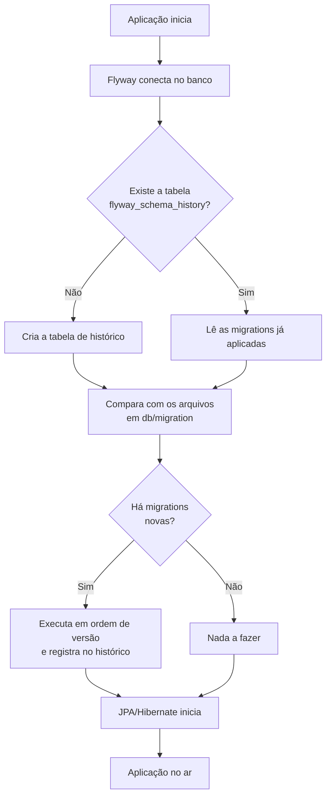

# 🛫 Flyway no Spring Boot: versionando o banco de dados


Guia prático para **controlar as mudanças do banco de dados** com arquivos SQL versionados, do mesmo jeito que você controla o código com o Git.

## 📑 Sumário

- [O que é o Flyway?](#-o-que-é-o-flyway)
- [Como funciona](#-como-funciona)
- [Passo a passo](#-passo-a-passo)
- [Nomenclatura dos arquivos](#-nomenclatura-dos-arquivos)
- [Mais exemplos de migrations](#-mais-exemplos-de-migrations)
- [Flyway com JPA/Hibernate](#-flyway-com-jpahibernate)
- [Propriedades úteis](#-propriedades-úteis)
- [Projeto que já tem banco (baseline)](#-projeto-que-já-tem-banco-baseline)
- [Regras de ouro](#-regras-de-ouro)
- [Exemplo: esquema do Spring Security com Flyway](#-exemplo-esquema-do-spring-security-com-flyway)
- [Erros comuns](#-erros-comuns)
- [Indo para produção](#-indo-para-produção)
- [Referências](#-referências)

## 📖 O que é o Flyway?

O Flyway é uma ferramenta de **migração de banco de dados**. Em vez de alterar tabelas "na mão" (ou deixar o Hibernate alterar sozinho), você escreve **arquivos SQL numerados**, e o Flyway os executa **na ordem**, **uma única vez** cada, registrando tudo em uma tabela de histórico.

| Sem Flyway | Com Flyway |
|---|---|
| Cada pessoa altera o banco do seu jeito | Todos aplicam os **mesmos** scripts |
| Ninguém sabe qual versão do banco está em produção | A tabela `flyway_schema_history` mostra **exatamente** o que foi aplicado |
| `ddl-auto=update` altera o esquema sem controle | O esquema muda **só** por migrations revisadas |
| Difícil recriar o banco do zero | Basta subir a aplicação em um banco vazio |

> [!NOTE]
> O Spring Boot já traz o Flyway integrado: basta adicionar a dependência e colocar os arquivos SQL na pasta certa. As migrations rodam **automaticamente** quando a aplicação inicia.

## Como funciona



> [!IMPORTANT]
> O Flyway roda **antes** do JPA/Hibernate. Assim, quando o Hibernate inicia, as tabelas já existem.

## Passo a passo

### 1. Adicione as dependências

São necessárias **duas coisas**: o Flyway em si e o módulo do **seu banco de dados**.

**Spring Boot 4** (Maven, exemplo com PostgreSQL)

```xml
<dependency>
    <groupId>org.springframework.boot</groupId>
    <artifactId>spring-boot-starter-flyway</artifactId>
</dependency>
<dependency>
    <groupId>org.flywaydb</groupId>
    <artifactId>flyway-database-postgresql</artifactId>
</dependency>
<dependency>
    <groupId>org.postgresql</groupId>
    <artifactId>postgresql</artifactId>
    <scope>runtime</scope>
</dependency>
```

**Spring Boot 3** (Maven)

```xml
<dependency>
    <groupId>org.flywaydb</groupId>
    <artifactId>flyway-core</artifactId>
</dependency>
<dependency>
    <groupId>org.flywaydb</groupId>
    <artifactId>flyway-database-postgresql</artifactId>
</dependency>
<dependency>
    <groupId>org.postgresql</groupId>
    <artifactId>postgresql</artifactId>
    <scope>runtime</scope>
</dependency>
```

**Gradle** (troque o primeiro item conforme a versão do Boot)

```groovy
implementation 'org.springframework.boot:spring-boot-starter-flyway'   // Boot 4
// implementation 'org.flywaydb:flyway-core'                           // Boot 3
implementation 'org.flywaydb:flyway-database-postgresql'
runtimeOnly 'org.postgresql:postgresql'
```

> [!IMPORTANT]
> No **Spring Boot 4**, a integração com o Flyway foi separada em um módulo próprio. Use o `spring-boot-starter-flyway`; somente o `flyway-core` pode não executar as migrations na inicialização.

**Módulo do banco de dados**

| Banco | Dependência extra |
|---|---|
| PostgreSQL | `org.flywaydb:flyway-database-postgresql` |
| MySQL / MariaDB | `org.flywaydb:flyway-mysql` |
| SQL Server | `org.flywaydb:flyway-sqlserver` |
| Oracle | `org.flywaydb:flyway-database-oracle` |
| H2 | Já incluso no `flyway-core` |

> [!TIP]
> Não informe a versão do Flyway: o Spring Boot já gerencia. Para conferir, o Boot 4.1.0 usa o Flyway 12.4.0, o 4.0.7 usa o 11.14.1 e o 3.5.16 usa o 11.7.2. Se você precisar de uma versão mais nova, sobrescreva a propriedade `<flyway.version>` no `pom.xml`, sabendo que o Spring Boot só testa a versão que ele mesmo gerencia.

### 2. Configure a conexão

`src/main/resources/application.properties`

```properties
spring.datasource.url=jdbc:postgresql://localhost:5432/appdb
spring.datasource.username=app
spring.datasource.password=${DB_PASSWORD}

spring.jpa.hibernate.ddl-auto=validate

spring.flyway.enabled=true
spring.flyway.locations=classpath:db/migration
```

> [!NOTE]
> O Flyway usa o **mesmo `DataSource`** da aplicação. As duas últimas linhas já são o padrão, e estão aqui apenas para deixar a configuração explícita.

### 3. Crie a pasta das migrations

```text
src/
└── main/
    └── resources/
        ├── application.properties
        └── db/
            └── migration/
                ├── V1__criar_tabela_employee.sql
                ├── V2__adicionar_email_employee.sql
                └── V3__dados_iniciais.sql
```

### 4. Escreva a primeira migration

`db/migration/V1__criar_tabela_employee.sql`

```sql
CREATE TABLE employee (
    id         BIGINT GENERATED ALWAYS AS IDENTITY PRIMARY KEY,
    name       VARCHAR(100) NOT NULL,
    role       VARCHAR(50)  NOT NULL,
    username   VARCHAR(50)  NOT NULL UNIQUE,
    created_at TIMESTAMP    NOT NULL DEFAULT CURRENT_TIMESTAMP
);
```

### 5. Suba a aplicação

Rode o projeto normalmente. Nos logs, você verá algo parecido com isto (o texto exato varia conforme a versão):

```text
Database: jdbc:postgresql://localhost:5432/appdb (PostgreSQL 16.x)
Successfully validated 1 migration
Creating Schema History table "public"."flyway_schema_history" ...
Migrating schema "public" to version "1 - criar tabela employee"
Successfully applied 1 migration to schema "public", now at version v1
```

### 6. Confira o histórico no banco

```sql
SELECT installed_rank, version, description, type, script, success
FROM flyway_schema_history
ORDER BY installed_rank;
```

| installed_rank | version | description | type | script | success |
|:---:|:---:|---|---|---|:---:|
| 1 | 1 | criar tabela employee | SQL | V1__criar_tabela_employee.sql | true |

Além da tabela `employee`, o Flyway criou a **`flyway_schema_history`**, que guarda cada migration aplicada, o *checksum* do arquivo, quem executou, quando e quanto tempo levou.

### 7. Evolua o banco com novas migrations

Precisa de uma coluna nova? **Não edite o `V1`.** Crie um novo arquivo:

`db/migration/V2__adicionar_email_employee.sql`

```sql
ALTER TABLE employee ADD COLUMN email VARCHAR(150);

CREATE UNIQUE INDEX ux_employee_email ON employee (email);
```

Reinicie a aplicação: o Flyway detecta que só a `V2` é nova e executa **apenas ela**.

##  Nomenclatura dos arquivos

O nome do arquivo **precisa** seguir um padrão, senão o Flyway o ignora ou reclama.

```text
V1__criar_tabela_employee.sql
│ │  │
│ │  └─ descrição (palavras separadas por _)
│ └──── DOIS underscores separando versão e descrição
└────── prefixo (V = versionada)
```

| Tipo | Prefixo | Quando executa | Exemplo |
|---|:---:|---|---|
| **Versionada** | `V` | **Uma vez**, na ordem da versão | `V2__adicionar_email.sql` |
| **Repetível** | `R` | **Toda vez** que o conteúdo do arquivo mudar | `R__view_employee_resumo.sql` |

**Formatos de versão aceitos**

| Estilo | Exemplos |
|---|---|
| Sequencial | `V1__`, `V2__`, `V3__` |
| Com pontos | `V1.1__`, `V1.2__` (também aceita `V1_1__`) |
| Data e hora | `V202610231030__` (evita conflito entre pessoas no mesmo projeto) |

> [!WARNING]
> Erros clássicos de nome: **um** underscore no lugar de dois (`V1_criar.sql`), prefixo em minúsculo (`v1__...`) e arquivo fora da pasta `db/migration`. Nesses casos o Flyway simplesmente **não executa** o arquivo.

## Mais exemplos de migrations

**Inserir dados iniciais** (`V3__dados_iniciais.sql`)

```sql
INSERT INTO employee (name, role, username, email) VALUES
    ('Gabriel', 'Desenvolvedor', 'Gabriel', 'gabriel@exemplo.com'),
    ('Vitoria', 'Gerente',       'Vitoria', 'vitoria@exemplo.com'),
    ('Grasi',   'Diretora',      'Grasi',   'grasi@exemplo.com');
```

**Alterar uma coluna** (`V4__aumentar_tamanho_name.sql`)

```sql
ALTER TABLE employee ALTER COLUMN name TYPE VARCHAR(200);
```

**Criar uma tabela relacionada** (`V5__criar_tabela_department.sql`)

```sql
CREATE TABLE department (
    id   BIGINT GENERATED ALWAYS AS IDENTITY PRIMARY KEY,
    name VARCHAR(100) NOT NULL UNIQUE
);

ALTER TABLE employee ADD COLUMN department_id BIGINT;

ALTER TABLE employee
    ADD CONSTRAINT fk_employee_department
    FOREIGN KEY (department_id) REFERENCES department (id);
```

**Migration repetível** (`R__view_employee_resumo.sql`)

```sql
CREATE OR REPLACE VIEW employee_resumo AS
SELECT id, name, role
FROM employee;
```

> [!TIP]
> Migrations repetíveis são ótimas para **views**, **funções** e **procedures**, que podem ser reescritas por completo a cada mudança. Elas rodam **depois** de todas as versionadas.

> [!NOTE]
> Os exemplos usam a sintaxe do **PostgreSQL**. No MySQL, por exemplo, a coluna de id seria `BIGINT AUTO_INCREMENT PRIMARY KEY`, e o `ALTER COLUMN ... TYPE` vira `MODIFY COLUMN`.

## Flyway com JPA/Hibernate

Com o Flyway cuidando do esquema, o Hibernate **não deve** criar nem alterar tabelas. Configure:

```properties
spring.jpa.hibernate.ddl-auto=validate
```

| Valor | Comportamento | Com Flyway? |
|---|---|:---:|
| `validate` | Só **confere** se as entidades batem com o banco e falha se não baterem | ✅ Recomendado |
| `none` | Não faz nada | ✅ |
| `update` | Altera o esquema sozinho | ❌ Conflita com o Flyway |
| `create` / `create-drop` | Recria o esquema a cada execução | ❌ Apaga o que o Flyway criou |

A entidade correspondente à `V1` e à `V2`:

```java
@Entity
@Table(name = "employee")
public class Employee {

    @Id
    @GeneratedValue(strategy = GenerationType.IDENTITY)
    private Long id;

    private String name;
    private String role;
    private String username;
    private String email;

    // getters e setters
}
```

> [!TIP]
> Com `validate`, se você adicionar um campo na entidade e **esquecer a migration**, a aplicação **não sobe** e aponta a coluna que está faltando. Isso protege contra esquecimentos.

## 🔧 Propriedades úteis

| Propriedade | O que faz |
|---|---|
| `spring.flyway.enabled` | Liga ou desliga o Flyway (padrão: `true`) |
| `spring.flyway.locations` | Onde ficam as migrations (padrão: `classpath:db/migration`) |
| `spring.flyway.baseline-on-migrate` | Permite adotar o Flyway em um banco que **já existe** |
| `spring.flyway.baseline-version` | Versão considerada como ponto de partida do baseline |
| `spring.flyway.validate-on-migrate` | Confere os arquivos já aplicados antes de migrar (padrão: `true`) |
| `spring.flyway.out-of-order` | Permite aplicar migrations com versão **menor** que a última aplicada |
| `spring.flyway.clean-disabled` | Bloqueia o comando `clean`, que **apaga o banco** (padrão: `true`) |
| `spring.flyway.table` | Muda o nome da tabela de histórico |
| `spring.flyway.schemas` | Define os schemas gerenciados |
| `spring.flyway.placeholders.*` | Variáveis usadas nos scripts SQL |
| `spring.flyway.connect-retries` | Tentativas de conexão (útil com Docker) |

**Usando placeholders**

```properties
spring.flyway.placeholders.admin_email=admin@exemplo.com
```

```sql
INSERT INTO employee (name, role, username, email)
VALUES ('Admin', 'Administrador', 'admin', '${admin_email}');
```

## Projeto que já tem banco (baseline)

Se o banco **já existe** com tabelas, mas o Flyway nunca rodou nele, aparece o erro `Found non-empty schema(s) ... without schema history table`. A solução é o **baseline**: dizer ao Flyway "o banco já está na versão X, comece a partir dela".

**Passo a passo**

1. Exporte o esquema atual e salve como `V1__baseline.sql`.
2. Configure o baseline:

```properties
spring.flyway.baseline-on-migrate=true
spring.flyway.baseline-version=1
```

3. Suba a aplicação **no banco existente**: o Flyway registra a versão `1` como já aplicada **sem executá-la**.
4. Em um **banco novo e vazio**, o `V1__baseline.sql` roda normalmente e cria tudo do zero.
5. A partir daí, crie as novas mudanças como `V2__...`, `V3__...`.

> [!WARNING]
> Deixe o `baseline-on-migrate` ligado só durante a adoção. Depois que o histórico existir, ele deixa de ser necessário.

## ⭐ Regras de ouro

> [!CAUTION]
> **Nunca edite uma migration que já foi aplicada.** O Flyway guarda um *checksum* de cada arquivo. Se o conteúdo mudar, a aplicação **não inicia** (`Migration checksum mismatch`).

- [x] **Uma migration aplicada é imutável.** Errou? Crie uma nova que corrige.
- [x] **Não apague** migrations antigas: o banco novo precisa de todas elas.
- [x] **Versione no Git** junto com o código que depende delas.
- [x] **Uma mudança lógica por arquivo**, com nome descritivo.
- [x] **Teste** as migrations em um banco vazio antes de publicar.
- [x] Nunca use `ddl-auto=update` junto com o Flyway.
- [x] Não use `spring.flyway.clean-disabled=false` em produção.

### Como "desfazer" uma migration?

O Spring Boot não oferece o comando de desfazer (*undo*). A prática é **criar uma nova migration que reverte** a anterior:

```sql
-- V6__remover_coluna_email.sql
ALTER TABLE employee DROP COLUMN email;
```

## Exemplo: esquema do Spring Security com Flyway

Se você usa o `JdbcUserDetailsManager`, as tabelas padrão `users` e `authorities` também podem ser criadas por uma migration:

<details>
<summary>Clique para ver a migration</summary>

`db/migration/V6__criar_tabelas_security.sql`

```sql
CREATE TABLE users (
    username VARCHAR(50)  NOT NULL PRIMARY KEY,
    password VARCHAR(500) NOT NULL,
    enabled  BOOLEAN      NOT NULL
);

CREATE TABLE authorities (
    username  VARCHAR(50) NOT NULL,
    authority VARCHAR(50) NOT NULL,
    CONSTRAINT fk_authorities_users FOREIGN KEY (username) REFERENCES users (username)
);

CREATE UNIQUE INDEX ix_auth_username ON authorities (username, authority);

-- Usuário de exemplo (gere o hash BCrypt antes; nunca coloque senha em texto puro)
INSERT INTO users (username, password, enabled)
VALUES ('Gabriel', '{bcrypt}COLE_AQUI_O_HASH_BCRYPT', true);

INSERT INTO authorities (username, authority)
VALUES ('Gabriel', 'ROLE_EMPLOYEE');
```

</details>

> [!WARNING]
> Não versione senhas reais no repositório, nem mesmo em hash, quando o projeto for público. Para estudo, use usuários de exemplo.

## Erros comuns

| Erro / sintoma | Causa provável | Solução |
|---|---|---|
| `Migration checksum mismatch` | Um arquivo já aplicado foi **editado** | Desfaça a edição e crie uma nova migration. Em desenvolvimento, dá para recriar o banco |
| `Found non-empty schema(s) without schema history table` | O banco já tinha tabelas e o Flyway nunca rodou nele | Use o [baseline](#-projeto-que-já-tem-banco-baseline) |
| `Detected resolved migration not applied to database` | Criou uma versão **menor** que a última aplicada (ex.: `V3` depois de já existir a `V5`) | Renumere para uma versão maior ou habilite `out-of-order` (com cuidado) |
| `Unsupported Database` / módulo não encontrado | Falta o módulo do banco (ex.: `flyway-database-postgresql`) | Adicione a dependência da [tabela de módulos](#1-adicione-as-dependências) |
| Nada acontece ao subir a aplicação | Pasta ou nome errado, ou starter ausente no Boot 4 | Confira `db/migration`, o padrão `V1__nome.sql` e o `spring-boot-starter-flyway` |
| `Schema-validation: missing column` | A entidade tem um campo que **não existe** no banco | Crie a migration da coluna |
| Migration falhou **no meio** | Erro de SQL em um arquivo com vários comandos | No PostgreSQL, o DDL é transacional e tudo volta atrás. No MySQL, parte pode ter sido aplicada: ajuste o banco e rode o `repair` |
| `CREATE INDEX CONCURRENTLY` falha | O comando não roda dentro de transação | Use `spring.flyway.postgresql.transactional-lock=false` |

## Indo para produção

- [x] Entender migrations versionadas e repetíveis (este guia)
- [x] Usar `ddl-auto=validate`
- [ ] Fazer **backup** antes de cada deploy com migrations
- [ ] Testar as migrations em um ambiente de homologação com dados parecidos com os reais
- [ ] Rodar as migrations em um banco vazio no CI (por exemplo, com Testcontainers)
- [ ] Manter `spring.flyway.clean-disabled=true`
- [ ] Guardar usuário e senha do banco em variáveis de ambiente, não no repositório

> [!WARNING]
> Migrations em tabelas grandes (como `ALTER TABLE` ou criação de índice) podem **bloquear a tabela** durante a execução. Em produção, planeje o horário e avalie estratégias para evitar indisponibilidade.

## 📚 Referências

- [Documentação do Flyway](https://documentation.red-gate.com/flyway)
- [Flyway no Spring Boot (docs oficiais)](https://docs.spring.io/spring-boot/how-to/data-initialization.html)
- [Repositório do Flyway no GitHub](https://github.com/flyway/flyway)
- [Módulos de banco de dados do Flyway](https://documentation.red-gate.com/flyway/reference/database-driver-reference)
