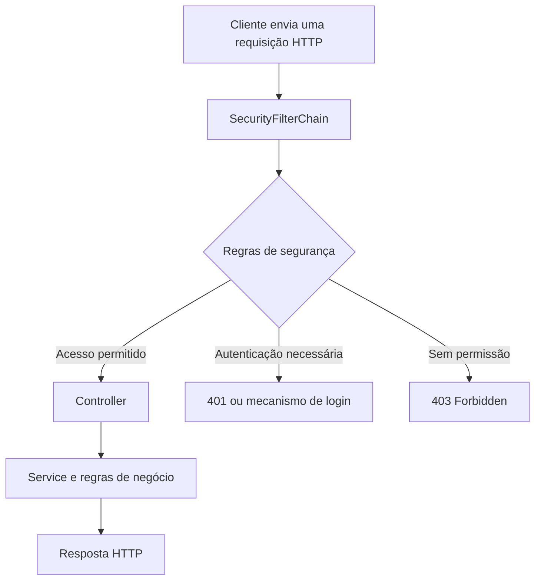

import pypandoc

markdown = r'''<div align="center">

# 🔐 Spring Security — Guia de Fundamentos

**Anotações de estudo para Java e Spring Boot**

[](https://openjdk.org/)
[](https://spring.io/projects/spring-boot)
[](https://spring.io/projects/spring-security)
[](https://docs.github.com/en/get-started/writing-on-github)

*Um guia introdutório para entender os conceitos antes de implementar autenticação com banco de dados ou JWT.*

</div>

---

## 📚 Índice

- [1. O que é Spring Security?](#1-o-que-é-spring-security)
- [2. Autenticação x autorização](#2-autenticação-x-autorização)
- [3. Como funciona o fluxo de segurança](#3-como-funciona-o-fluxo-de-segurança)
- [4. Principais componentes](#4-principais-componentes)
- [5. Adicionando a dependência](#5-adicionando-a-dependência)
- [6. Primeira configuração](#6-primeira-configuração)
- [7. Regras de acesso aos endpoints](#7-regras-de-acesso-aos-endpoints)
- [8. Roles e permissões](#8-roles-e-permissões)
- [9. Armazenamento seguro de senhas](#9-armazenamento-seguro-de-senhas)
- [10. Respostas HTTP comuns](#10-respostas-http-comuns)
- [11. Próximos passos](#11-próximos-passos)
- [12. Referências oficiais](#12-referências-oficiais)

---

## O que é Spring Security?

O **Spring Security** é um framework do ecossistema Spring que fornece mecanismos para proteger aplicações Java.

Com ele, podemos configurar:

- **Autenticação:** verificar a identidade de quem está acessando o sistema.
- **Autorização:** definir quais recursos e operações cada usuário pode acessar.
- **Proteção contra ataques:** oferecer mecanismos de segurança, incluindo proteção contra CSRF.
- **Gerenciamento de sessões:** controlar a autenticação baseada em sessão.
- **Autenticação por tokens:** proteger APIs usando mecanismos como OAuth 2.0 Resource Server com JWT.

### Exemplo genérico

Imagine uma API de gerenciamento de produtos:

1. Um usuário envia suas credenciais para entrar no sistema.
2. A aplicação verifica se as credenciais são válidas.
3. O usuário autenticado pode consultar os produtos permitidos.
4. Apenas usuários com as permissões adequadas podem cadastrar ou excluir produtos.

O Spring Security fornece os mecanismos para implementar essas regras. As regras específicas do negócio continuam sendo responsabilidade da aplicação.

---

## Autenticação x autorização

Esses dois conceitos são a base do Spring Security.

| Conceito | Pergunta | Exemplo |
|---|---|---|
| **Autenticação** | Quem é você? | O usuário informa e-mail e senha, e a aplicação verifica as credenciais. |
| **Autorização** | O que você pode fazer? | Um administrador pode cadastrar produtos, enquanto um usuário comum pode apenas consultá-los. |

> **Importante:** estar autenticado não significa ter autorização para acessar todos os recursos.

Um usuário pode fazer login corretamente e, mesmo assim, receber `403 Forbidden` ao tentar executar uma operação para a qual não possui permissão.

---

## Como funciona o fluxo de segurança?



O Spring Security utiliza uma **cadeia de filtros**, representada por `SecurityFilterChain`, para processar as requisições HTTP antes que elas cheguem normalmente aos controllers.

Isso evita que seja necessário implementar manualmente a verificação de autenticação em cada endpoint.

O fluxo exato varia de acordo com o mecanismo utilizado: HTTP Basic, formulário de login, sessão, JWT ou OAuth 2.0.

---

## Principais componentes

| Componente | Responsabilidade |
|---|---|
| `SecurityFilterChain` | Define a cadeia de filtros e as regras de segurança HTTP. |
| `HttpSecurity` | API usada para configurar a segurança das requisições. |
| `Authentication` | Representa informações de uma autenticação, como principal e autoridades. |
| `SecurityContext` | Mantém o objeto de autenticação associado ao contexto atual. |
| `SecurityContextHolder` | Permite acessar o contexto de segurança atual. |
| `AuthenticationManager` | Coordena o processo de autenticação. |
| `AuthenticationProvider` | Realiza um tipo específico de autenticação. |
| `UserDetails` | Representa os dados do usuário usados pelo mecanismo de autenticação. |
| `UserDetailsService` | Carrega os dados do usuário, geralmente a partir de um nome de usuário. |
| `PasswordEncoder` | Codifica senhas e verifica se uma senha corresponde ao valor armazenado. |
| `GrantedAuthority` | Representa uma autoridade, como uma role ou permissão. |

### Fluxo típico de autenticação com usuário e senha

1. A aplicação recebe as credenciais.
2. O mecanismo de autenticação encaminha a tentativa para o processo de autenticação.
3. Um `AuthenticationProvider` pode usar um `UserDetailsService` para carregar o usuário.
4. O `PasswordEncoder` verifica a senha informada.
5. Se a autenticação for bem-sucedida, o Spring Security mantém a autenticação no contexto apropriado.

Esse é um fluxo comum de autenticação por usuário e senha. JWT e outros mecanismos possuem etapas diferentes.

---

## Adicionando a dependência

Em projetos Maven com Spring Boot, adicione o starter de segurança ao `pom.xml`:

```xml
<dependency>
    <groupId>org.springframework.boot</groupId>
    <artifactId>spring-boot-starter-security</artifactId>
</dependency>
```

O gerenciamento de dependências do Spring Boot seleciona uma versão compatível do Spring Security. Em projetos que usam o *parent* ou o BOM do Spring Boot, normalmente não é necessário informar a versão dessa dependência manualmente.

Depois de adicionar o starter, a aplicação passa a ter os mecanismos de segurança e a configuração automática do Spring Security. Em uma aplicação web, isso normalmente significa que as requisições passam a exigir autenticação, salvo configurações diferentes.

Você verá que agora, ao tentar fazer requisições, a aplicação passará a pedir um *usuario* e *senha* (será visivel quando você usar postman,
swagger, digitando *localhost:8080/login* ou tentando digitar qualquer URL do seu controller). O usuario padrão é *user* e senha que será usada será gerada *no terminal quando a aplicação começar a rodar*, e ela sempre mudará toda vez que você rodar a aplicação novamente.

Para poder colocar uma senha e usuario padrão para você, voce poderá acessar o *application.properties* e colocar as seguintes linhas:

```java
spring.security.user.name=usuario1
spring.security.user.password=senha123
```

E agora, senha e usuario que você passará a usar será esta senha e usuario presente no arquivo .properties (recomendo usar variaveis do .env ou
de ambiente para evitar vazamentos por enquanto).
---

## Primeira configuração

Crie uma classe `SecurityConfig` no pacote de configuração da aplicação.

```java


package com.exemplo.api.config;

import org.springframework.context.annotation.Bean;
import org.springframework.context.annotation.Configuration;
import org.springframework.security.config.Customizer;
import org.springframework.security.config.annotation.web.builders.HttpSecurity;
import org.springframework.security.web.SecurityFilterChain;

@Configuration
public class SecurityConfig {

    @Bean
    public SecurityFilterChain securityFilterChain(
            HttpSecurity http) throws Exception {

        http
            .authorizeHttpRequests(auth -> auth
                .anyRequest().authenticated()
            )
            .httpBasic(Customizer.withDefaults());

        return http.build();
    }
}
```

### Entendendo as partes principais

- `@Configuration`: indica que a classe contém configurações do Spring.
- `@Bean`: registra o objeto retornado pelo método no contexto da aplicação.
- `SecurityFilterChain`: representa a cadeia de filtros configurada.
- `HttpSecurity`: permite configurar as regras de segurança HTTP.
- `authorizeHttpRequests(...)`: define regras de autorização para as requisições.
- `anyRequest().authenticated()`: exige autenticação para todas as requisições abrangidas pela configuração.
- `httpBasic(Customizer.withDefaults())`: habilita HTTP Basic com as configurações padrão.
- `http.build()`: constrói a cadeia de filtros.

### O que é HTTP Basic?

HTTP Basic é um mecanismo de autenticação que envia credenciais no cabeçalho `Authorization`, codificadas em Base64. **Base64 não é criptografia**: por isso, HTTP Basic deve ser usado com HTTPS em ambientes reais.

Esse exemplo serve para aprender as regras de segurança. Ele não implementa um formulário de login, não cria um endpoint de login próprio e não configura JWT.

> **Atenção sobre CSRF:** não desative a proteção contra CSRF sem entender o mecanismo de autenticação e o tipo de cliente. Aplicações que usam cookies ou sessões precisam de atenção especial. APIs stateless que recebem tokens no cabeçalho podem ter requisitos diferentes.

---

## Regras de acesso aos endpoints

As regras são configuradas em `authorizeHttpRequests`. A ordem importa: as regras específicas devem vir antes das regras gerais.

Exemplo:

```java
@Bean
public SecurityFilterChain securityFilterChain(
        HttpSecurity http) throws Exception {

    http
        .authorizeHttpRequests(auth -> auth
            .requestMatchers("/auth/**").permitAll()
            .requestMatchers(HttpMethod.GET, "/produtos/**")
                .hasAnyRole("ADMIN", "USER")
            .requestMatchers(HttpMethod.POST, "/produtos/**")
                .hasRole("ADMIN")
            .anyRequest().authenticated()
        )
        .httpBasic(Customizer.withDefaults());

    return http.build();
}
```

Imports adicionais:

```java
import org.springframework.http.HttpMethod;
```

Nesse exemplo:

- `/auth/**` é público.
- `GET /produtos/**` exige uma das roles indicadas.
- `POST /produtos/**` exige a role `ADMIN`.
- As outras requisições exigem autenticação.

### Dez exemplos de regras

| Regra | Significado |
|---|---|
| `anyRequest().authenticated()` | Exige autenticação para as requisições restantes. |
| `anyRequest().permitAll()` | Permite todas as requisições restantes abrangidas pela regra. |
| `requestMatchers("/auth/**").permitAll()` | Permite acesso aos caminhos correspondentes a `/auth/`. |
| `requestMatchers("/admin/**").hasRole("ADMIN")` | Exige a role `ADMIN`. |
| `hasAnyRole("ADMIN", "USER")` | Exige uma das roles informadas. |
| `hasAuthority("PRODUCT_READ")` | Exige a autoridade `PRODUCT_READ`. |
| `hasAnyAuthority("PRODUCT_READ", "PRODUCT_WRITE")` | Exige uma das autoridades informadas. |
| `requestMatchers(HttpMethod.GET, "/clientes/**").authenticated()` | Exige autenticação para os GET correspondentes. |
| `requestMatchers(HttpMethod.DELETE, "/clientes/**").hasRole("ADMIN")` | Exige a role `ADMIN` para os DELETE correspondentes. |
| `requestMatchers("/interno/**").denyAll()` | Nega acesso aos caminhos correspondentes. |

### `hasRole` x `hasAuthority`

- `hasRole("ADMIN")` normalmente procura a autoridade `ROLE_ADMIN`.
- `hasAuthority("ADMIN")` procura exatamente a autoridade `ADMIN`.

Não são equivalentes. O prefixo padrão `ROLE_` é aplicado pelo método `hasRole`.

---

## Roles e permissões

Uma **role** costuma representar um perfil de acesso. Uma **permissão** costuma representar uma ação específica.

Exemplos de roles:

- `ADMIN`
- `USER`
- `MANAGER`

Exemplos de permissões:

- `PRODUCT_READ`
- `PRODUCT_CREATE`
- `PRODUCT_UPDATE`
- `PRODUCT_DELETE`

O Spring Security fornece os mecanismos para avaliar essas autoridades, mas a aplicação precisa definir quais usuários recebem cada uma e quais operações elas permitem.

### Cuidado com o acesso aos recursos

Verificar se alguém tem a role `USER` não garante que essa pessoa possa acessar qualquer registro do sistema. Em operações que dependem da propriedade de um recurso, a aplicação também precisa verificar se o usuário tem direito de acessar aquele registro.

---

## Armazenamento seguro de senhas

**Nunca armazene senhas em texto puro.**

O Spring Security fornece a interface `PasswordEncoder`. Um exemplo de implementação é `BCryptPasswordEncoder`.

```java
import org.springframework.context.annotation.Bean;
import org.springframework.context.annotation.Configuration;
import org.springframework.security.crypto.bcrypt.BCryptPasswordEncoder;
import org.springframework.security.crypto.password.PasswordEncoder;

@Configuration
public class PasswordConfig {

    @Bean
    public PasswordEncoder passwordEncoder() {
        return new BCryptPasswordEncoder();
    }
}
```

Uso:

```java
String senha = "SenhaForte123";

String hash = passwordEncoder.encode(senha);

boolean corresponde = passwordEncoder.matches(senha, hash);
```

- `encode(...)`: gera uma representação segura da senha.
- `matches(...)`: verifica se a senha informada corresponde ao hash armazenado.

O hash não deve ser tratado como uma senha criptografada que pode ser descriptografada. A verificação é feita pelo encoder.

Em aplicações reais, também é importante avaliar a configuração de custo do algoritmo e as recomendações atuais do framework para armazenamento de senhas.

---

## Respostas HTTP comuns

| Código | Significado |
|---|---|
| `200 OK` | Requisição concluída com sucesso. |
| `201 Created` | Recurso criado com sucesso. |
| `401 Unauthorized` | A requisição não apresentou autenticação válida ou necessária. |
| `403 Forbidden` | A requisição foi negada por falta de permissão ou por outra regra de segurança. |

Exemplos:

- Usuário não autenticado tenta acessar um endpoint protegido: normalmente recebe `401` em uma API configurada para esse comportamento.
- Usuário autenticado tenta executar uma operação sem a autoridade necessária: normalmente recebe `403`.
- Uma aplicação com formulário de login pode redirecionar para a página de login em vez de responder com `401`.

O comportamento exato depende da configuração e do mecanismo de autenticação.

---

##  Próximos passos

Uma sequência de estudo recomendada:

- [ ] **Fundamentos:** autenticação, autorização, filtros e `SecurityFilterChain`.
- [ ] **Regras HTTP:** `permitAll`, `authenticated`, `hasRole` e `hasAuthority`.
- [ ] **Usuários e senhas:** `UserDetails`, `UserDetailsService` e `PasswordEncoder`.
- [ ] **Banco de dados:** carregar usuários e autoridades usando persistência.
- [ ] **Processo de login:** entender `AuthenticationManager` e `AuthenticationProvider`.
- [ ] **Sessões e CSRF:** compreender quando cada mecanismo é necessário.
- [ ] **JWT:** entender tokens e a configuração de uma API como Resource Server.
- [ ] **Autorização avançada:** estudar `@PreAuthorize` e regras de negócio.
- [ ] **OAuth 2.0:** conhecer os fluxos e os papéis dos participantes.
- [ ] **Testes:** testar endpoints permitidos, bloqueados e cenários de falha.

**Exercício recomendado:** crie dois endpoints, um público e outro protegido. Teste os dois no Postman e observe a diferença entre uma requisição autenticada e uma não autenticada.

---

## Referências oficiais

- [Spring Security — Documentação oficial](https://docs.spring.io/spring-security/reference/)
- [Arquitetura de filtros](https://docs.spring.io/spring-security/reference/servlet/architecture.html)
- [Arquitetura de autenticação](https://docs.spring.io/spring-security/reference/servlet/authentication/architecture.html)
- [Armazenamento de senhas](https://docs.spring.io/spring-security/reference/features/authentication/password-storage.html)
- [Documentação do Spring Boot](https://docs.spring.io/spring-boot/index.html)
- [GitHub Flavored Markdown](https://github.github.com/gfm/)

---

'''

output_path = "/mnt/data/spring-security-fundamentos.md"
pypandoc.convert_text(
    markdown,
    "md",
    format="md",
    outputfile=output_path,
    extra_args=["--standalone"]
)
print(f"Arquivo criado: {output_path}")
