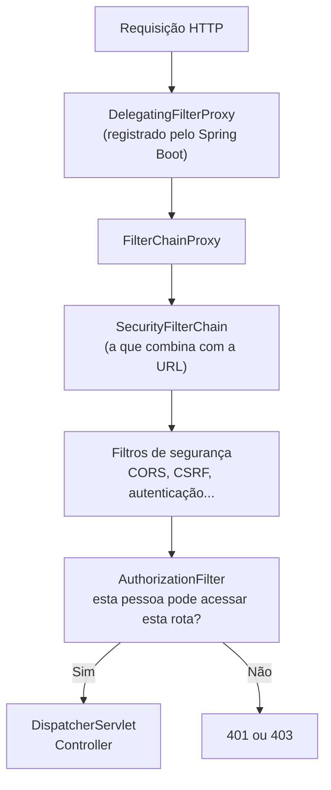
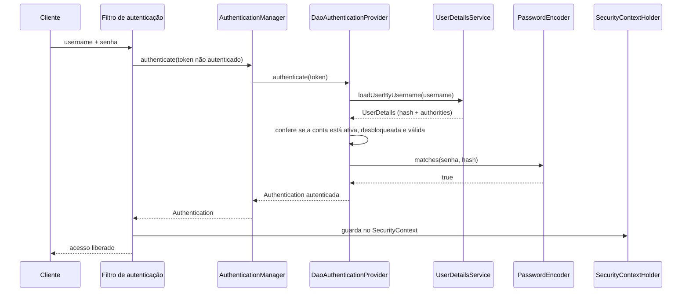
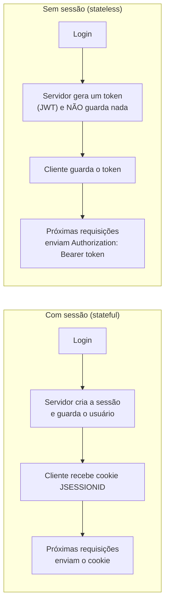
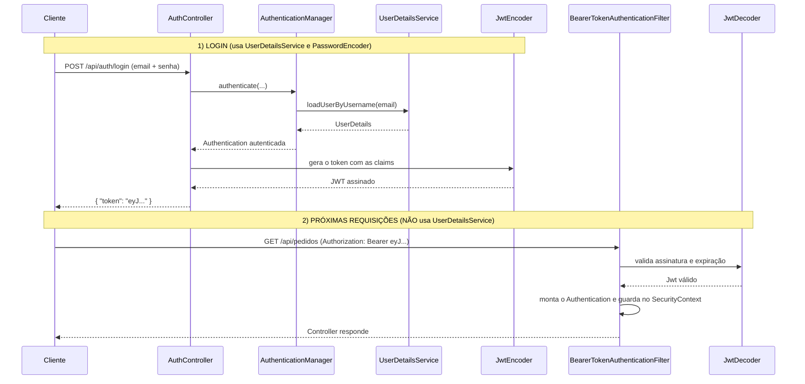

## Spring Security: UserDetails, UserDetailsService e a arquitetura atual


Continuação do guia de autenticação com JDBC. Lá usamos o `JdbcUserDetailsManager` e o schema padrão (`users` e `authorities`). Aqui damos o próximo passo: entender **como o Spring Security funciona por dentro hoje** e construir a autenticação com um **modelo de usuário próprio**, usando `UserDetails` e `UserDetailsService`. No final, uma **breve entrada sobre JWT**, que terá um arquivo só dele.

> [!IMPORTANT]
> Este guia segue o estilo atual do Spring Security (versões 6 e 7): configuração por **bean `SecurityFilterChain`** e **lambdas**. Os exemplos que usam `WebSecurityConfigurerAdapter`, `.and()` e `authorizeRequests()` de tutoriais antigos **não funcionam mais** nas versões recentes. A parte de JWT é apenas uma apresentação; o passo a passo completo fica para o arquivo de JWT.

## 📑 Sumário

- [Do JDBC para o modelo próprio](#do-jdbc-para-o-modelo-próprio)
- [Como o Spring Security funciona hoje](#como-o-spring-security-funciona-hoje)
  - [O que o Spring Boot faz sozinho](#o-que-o-spring-boot-faz-sozinho)
  - [A cadeia de filtros](#a-cadeia-de-filtros)
  - [Os objetos principais](#os-objetos-principais)
  - [O caminho de um login](#o-caminho-de-um-login)
- [UserDetails](#userdetails)
  - [Os métodos da interface](#os-métodos-da-interface)
  - [A classe User do Spring](#a-classe-user-do-spring)
  - [Implementando o seu UserDetails](#implementando-o-seu-userdetails)
- [UserDetailsService](#userdetailsservice)
  - [O contrato](#o-contrato)
  - [Implementando com JPA](#implementando-com-jpa)
  - [O usuário padrão do Spring Boot](#o-usuário-padrão-do-spring-boot)
- [UserDetailsManager e UserDetailsPasswordService](#userdetailsmanager-e-userdetailspasswordservice)
- [AuthenticationProvider e AuthenticationManager](#authenticationprovider-e-authenticationmanager)
- [Configurando a segurança com SecurityFilterChain](#configurando-a-segurança-com-securityfilterchain)
  - [O que mudou nas versões recentes](#o-que-mudou-nas-versões-recentes)
  - [CSRF, CORS e erros 401 e 403](#csrf-cors-e-erros-401-e-403)
- [Autorização: roles, authorities e method security](#autorização-roles-authorities-e-method-security)
- [Acessando o usuário autenticado](#acessando-o-usuário-autenticado)
- [Sessão x stateless](#sessão-x-stateless)
- [Breve entrada sobre JWT](#breve-entrada-sobre-jwt)
- [Código completo](#código-completo)
- [Mapa de migração: JdbcUserDetailsManager para modelo próprio](#mapa-de-migração-jdbcuserdetailsmanager-para-modelo-próprio)
- [Testando a segurança](#testando-a-segurança)
- [Erros comuns](#erros-comuns)
- [Cuidados importantes](#cuidados-importantes)
- [Indo para produção](#indo-para-produção)
- [Referências](#-referências)

## Do JDBC para o modelo próprio

O `JdbcUserDetailsManager` é ótimo para aprender, mas ele exige o schema padrão (`users` e `authorities`). Em projetos reais, o usuário costuma ter **nome, e-mail, perfis, datas, relacionamentos com outras tabelas**. É aí que entra o modelo próprio: você cria as suas **entidades** e ensina o Spring Security a usá-las.

| Etapa | Guia | Onde ficam os usuários | Peça principal |
|---|---|---|---|
| 1 | Configuração inicial | Memória da aplicação | `InMemoryUserDetailsManager` |
| 2 | Autenticação com JDBC | Banco, schema padrão do Spring | `JdbcUserDetailsManager` |
| **3** | **Este guia** | **Banco, com o seu modelo (JPA)** | **`UserDetailsService` e `UserDetails` próprios** |
| 4 | JWT (próximo arquivo) | Banco + token sem sessão | `JwtEncoder` e `JwtDecoder` |

```text
Etapa 2 (JDBC)                         Etapa 3 (este guia)
──────────────                         ───────────────────
tabela users        ───────────────►   entidade Usuario
tabela authorities  ───────────────►   entidade Perfil (+ tabela de ligação)
JdbcUserDetailsManager ────────────►   UsuarioDetailsService
User.builder()      ───────────────►   UsuarioAutenticado (implements UserDetails)
```

> [!NOTE]
> A **boa notícia**: o que você aprendeu antes continua valendo. O `PasswordEncoder`, o `BCrypt`, o `SecurityFilterChain` e as roles funcionam exatamente igual. Muda apenas **de onde vêm os dados do usuário**.

## Como o Spring Security funciona hoje

### O que o Spring Boot faz sozinho

Basta adicionar o `spring-boot-starter-security` e, **sem escrever nenhuma linha**, a aplicação já fica protegida:

| Comportamento automático | Detalhe |
|---|---|
| **Todas as rotas exigem login** | Qualquer requisição sem autenticação é barrada |
| **Login por formulário e por HTTP Basic** | Página `/login` pronta e suporte a Basic Auth |
| **Usuário padrão** | Usuário `user`, com **senha gerada** a cada inicialização (aparece no log: *Using generated security password*) |
| **CSRF ativado** | `POST`, `PUT` e `DELETE` sem token CSRF são recusados com `403` |
| **Sessão** | Após o login, a sessão (`JSESSIONID`) guarda quem você é |
| **Cabeçalhos de segurança** | Cabeçalhos de proteção adicionados nas respostas |
| **Logout** | Rota `/logout` pronta |

Tudo isso é **substituído** assim que você declara os seus próprios beans (como um `SecurityFilterChain` ou um `UserDetailsService`).

### A cadeia de filtros

O Spring Security funciona como uma **fila de filtros** que toda requisição atravessa **antes** de chegar ao Controller:



Os filtros mais importantes (na ordem aproximada em que atuam):

| Filtro | O que faz |
|---|---|
| `SecurityContextHolderFilter` | Carrega o `SecurityContext` (quem está logado) no começo da requisição |
| `CorsFilter` | Aplica as regras de CORS |
| `CsrfFilter` | Valida o token CSRF em requisições que alteram dados |
| `UsernamePasswordAuthenticationFilter` | Processa o **login por formulário** |
| `BasicAuthenticationFilter` | Processa o cabeçalho `Authorization: Basic ...` |
| `BearerTokenAuthenticationFilter` | Processa o cabeçalho `Authorization: Bearer ...` (**JWT**) |
| `ExceptionTranslationFilter` | Transforma erros de segurança em respostas `401` ou `403` |
| `AuthorizationFilter` | **Decide** se a requisição pode seguir, com base nas regras do `authorizeHttpRequests` |

> [!TIP]
> Para **ver** os filtros em ação, ative o log de depuração no `application.properties`:
>
> ```properties
> logging.level.org.springframework.security=TRACE
> ```
>
> Cada requisição mostrará por quais filtros passou e por que foi aceita ou barrada.

### Os objetos principais

| Objeto | O que é |
|---|---|
| **`SecurityContextHolder`** | O "cofre" que guarda quem está logado **na requisição atual** (por padrão, por thread) |
| **`SecurityContext`** | O conteúdo do cofre: guarda o `Authentication` |
| **`Authentication`** | Representa a **autenticação**: quem é, as credenciais e as permissões |
| **`Principal`** | **Quem** está logado (normalmente o seu `UserDetails`) |
| **`GrantedAuthority`** | Uma **permissão** ou papel (`ROLE_ADMIN`, `produto:ler`) |
| **`UserDetails`** | O **usuário** na visão do Spring Security |
| **`UserDetailsService`** | O serviço que **busca** o `UserDetails` pelo username |
| **`PasswordEncoder`** | Codifica e confere senhas |
| **`AuthenticationProvider`** | Sabe **como** autenticar um tipo de credencial (ex.: usuário e senha) |
| **`AuthenticationManager`** | Coordena os providers. A implementação padrão é o `ProviderManager` |

Como as peças se encaixam depois do login:

```text
SecurityContextHolder
        └── SecurityContext
                └── Authentication
                        ├── principal    → UserDetails (o seu UsuarioAutenticado)
                        ├── credentials  → (apagada após o login, por segurança)
                        └── authorities  → [ROLE_USER, produto:ler]
```

### O caminho de um login



O `UserDetailsService` e o `PasswordEncoder` são as **duas peças que você fornece**. O resto o Spring já entrega pronto.

## UserDetails

`UserDetails` é a interface que representa **o usuário para o Spring Security**: quem é, como provar e o que pode fazer. Ele **não é** a sua entidade: é a "ficha" que o Security lê.

### Os métodos da interface

| Método | O que devolve | Para que serve |
|---|---|---|
| `getUsername()` | `String` | O **login** (e-mail, matrícula, apelido) |
| `getPassword()` | `String` | O **hash** da senha, e nunca a senha original |
| `getAuthorities()` | `Collection<? extends GrantedAuthority>` | As **permissões e papéis** do usuário |
| `isEnabled()` | `boolean` | `false` = conta **desativada** |
| `isAccountNonLocked()` | `boolean` | `false` = conta **bloqueada** |
| `isCredentialsNonExpired()` | `boolean` | `false` = **senha expirada** |
| `isAccountNonExpired()` | `boolean` | `false` = **conta expirada** |

Os quatro métodos `is...` têm implementação padrão `true` nas versões recentes: você só os sobrescreve se precisar dessa regra.

Cada flag, quando é `false`, **barra o login** com uma exceção específica:

| Flag `false` | Exceção lançada | Quando acontece |
|---|---|---|
| `isEnabled()` | `DisabledException` | Antes de conferir a senha |
| `isAccountNonLocked()` | `LockedException` | Antes de conferir a senha |
| `isAccountNonExpired()` | `AccountExpiredException` | Antes de conferir a senha |
| *(senha incorreta)* | `BadCredentialsException` | Na conferência da senha |
| `isCredentialsNonExpired()` | `CredentialsExpiredException` | **Depois** de conferir a senha |

> [!NOTE]
> Por segurança, devolva ao cliente uma **mensagem genérica** ("credenciais inválidas") para essas exceções. Dizer "conta bloqueada" ou "usuário não existe" ajuda um atacante a descobrir quais contas existem.

### A classe User do Spring

O Spring já oferece uma implementação pronta, a classe **`User`**, com um construtor fluente (*builder*). Foi a que usamos nos guias anteriores:

```java
UserDetails usuario = User.builder()
        .username("ana@email.com")
        .password(passwordEncoder.encode("Senha@123"))   // hash
        .roles("USER")                                   // vira a authority ROLE_USER
        .build();
```

| Método do builder | O que faz |
|---|---|
| `.username(...)` | Define o login |
| `.password(...)` | Define a senha (**já codificada**) |
| `.roles("USER", "ADMIN")` | Cria as authorities `ROLE_USER` e `ROLE_ADMIN` (**acrescenta o prefixo `ROLE_`**) |
| `.authorities("produto:ler")` | Cria authorities **exatamente como escritas** (sem prefixo) |
| `.disabled(true)` | Marca a conta como desativada |
| `.accountLocked(true)` | Marca a conta como bloqueada |
| `.credentialsExpired(true)` | Marca a senha como expirada |
| `User.withUserDetails(outro)` | Copia um `UserDetails` existente para alterar algo (ex.: nova senha) |

> [!WARNING]
> A classe `User` serve para o **modelo padrão**. Ela só guarda login, senha e permissões: **não tem lugar para o `id` ou o `nome`** do seu sistema. Quando precisar deles na hora de autorizar (como "este recurso é do usuário logado?"), crie o seu próprio `UserDetails`. Também existe o `User.withDefaultPasswordEncoder()`, **obsoleto e só para exemplos**: nunca o use em um projeto real.

### Implementando o seu UserDetails

A forma recomendada é uma classe na pasta **`security`** que **adapta** a sua entidade, mantendo a entidade "limpa" (só JPA):

```java
public class UsuarioAutenticado implements UserDetails {

    private final Usuario usuario;                                  // guarda a entidade

    public UsuarioAutenticado(Usuario usuario) {
        this.usuario = usuario;
    }

    // dados extras, úteis para regras como "o recurso é do usuário logado?"
    public Long getId()      { return usuario.getId(); }
    public String getNome()  { return usuario.getNome(); }

    @Override
    public Collection<? extends GrantedAuthority> getAuthorities() {
        return usuario.getPerfis().stream()                         // cada Perfil vira uma authority
                .map(perfil -> new SimpleGrantedAuthority(perfil.getNome().name()))
                .toList();
    }

    @Override public String getPassword() { return usuario.getSenha(); }   // o HASH
    @Override public String getUsername() { return usuario.getEmail(); }   // o login

    @Override public boolean isEnabled()               { return usuario.isAtivo(); }
    @Override public boolean isAccountNonLocked()      { return !usuario.isContaBloqueada(); }   // invertido!
    @Override public boolean isCredentialsNonExpired() {
        return usuario.getSenhaExpiraEm() == null
                || usuario.getSenhaExpiraEm().isAfter(Instant.now());
    }
}
```

| Linha | O que faz |
|---|---|
| `implements UserDetails` | Diz ao Spring Security: "esta classe representa um usuário" |
| `private final Usuario usuario` | Guarda a entidade que veio do banco |
| `getAuthorities()` | Converte cada `Perfil` em um `GrantedAuthority` (`ROLE_ADMIN`...) |
| `getPassword()` | Entrega o **hash** guardado no banco |
| `getUsername()` | Define qual campo é o "login" (aqui, o e-mail) |
| `isAccountNonLocked()` | **Inverte** o campo `contaBloqueada` (a pergunta do Spring é "NÃO está bloqueada?") |

> [!TIP]
> Se a entidade do usuário **é simples** e você está só estudando, a própria entidade pode `implements UserDetails`. Para projetos reais, prefira o **adaptador**: ele separa JPA e Security e evita problemas de serialização com coleções *lazy* (a sessão HTTP serializa o `UserDetails`).

## UserDetailsService

### O contrato

`UserDetailsService` é a interface mais simples de todo o Spring Security: **um único método**.

```java
public interface UserDetailsService {

    UserDetails loadUserByUsername(String username) throws UsernameNotFoundException;
}
```

| Regra do contrato | Detalhe |
|---|---|
| **Entrada** | O `username` digitado no login |
| **Saída** | Um `UserDetails` **completo**: com o **hash** da senha e as **authorities** |
| **Usuário não existe** | Lance `UsernameNotFoundException`. **Nunca devolva `null`** |
| **Não confere a senha** | Quem confere é o `PasswordEncoder`, chamado pelo Spring. O service **só busca** |

> [!IMPORTANT]
> O `UserDetailsService` é chamado **apenas quando há autenticação por usuário e senha** (login por formulário, Basic Auth ou o seu endpoint de login). Com **JWT**, as requisições seguintes **não passam por ele**: o token já prova quem a pessoa é. Veja [Breve entrada sobre JWT](#breve-entrada-sobre-jwt).

### Implementando com JPA

`security/UsuarioDetailsService.java`:

```java
@Service
public class UsuarioDetailsService implements UserDetailsService {

    private final UsuarioRepository repository;

    public UsuarioDetailsService(UsuarioRepository repository) {
        this.repository = repository;
    }

    @Override
    @Transactional(readOnly = true)                                 // só leitura: mais leve
    public UserDetails loadUserByUsername(String email) throws UsernameNotFoundException {
        return repository.findByEmailIgnoreCase(email)             // busca no banco (já com os perfis)
                .map(UsuarioAutenticado::new)                      // entidade -> UserDetails
                .orElseThrow(() ->
                        new UsernameNotFoundException("Usuário não encontrado"));
    }
}
```

E o repository, carregando os perfis **na mesma consulta** (o Security lê as authorities fora dela):

```java
public interface UsuarioRepository extends JpaRepository<Usuario, Long> {

    @EntityGraph(attributePaths = "perfis")                        // evita LazyInitializationException
    Optional<Usuario> findByEmailIgnoreCase(String email);

    boolean existsByEmailIgnoreCase(String email);
}
```

Basta declarar o `UserDetailsService` como bean (`@Service`) e ter um `PasswordEncoder`: o Spring Boot **liga os dois automaticamente** ao `DaoAuthenticationProvider`.

| Implementação de `UserDetailsService` | Onde busca | Quando usar |
|---|---|---|
| `InMemoryUserDetailsManager` | Memória | Estudo e testes |
| `JdbcUserDetailsManager` | Banco, schema padrão do Spring | Aprender JDBC e usar o schema pronto |
| **`UserDetailsService` próprio** | **Onde você quiser** (JPA, API, outro sistema) | **Projetos reais, com modelo de usuário próprio** |

### O usuário padrão do Spring Boot

Se você **não** declarar nenhum `UserDetailsService` (nem `AuthenticationProvider` ou `AuthenticationManager`), o Spring Boot cria o usuário `user` com senha aleatória. É possível fixar os valores **só para testes**:

```properties
spring.security.user.name=admin
spring.security.user.password=${ADMIN_PASSWORD}
```

Ao declarar o seu `UserDetailsService`, esse usuário padrão **deixa de existir**.

## UserDetailsManager e UserDetailsPasswordService

Duas interfaces que **ampliam** o `UserDetailsService`:

| Interface | O que acrescenta | Quem implementa |
|---|---|---|
| `UserDetailsService` | Buscar o usuário (`loadUserByUsername`) | Todos |
| **`UserDetailsManager`** | Criar, atualizar e excluir usuários, trocar senha (`createUser`, `updateUser`, `deleteUser`, `changePassword`, `userExists`) | `InMemoryUserDetailsManager`, `JdbcUserDetailsManager` |
| **`UserDetailsPasswordService`** | `updatePassword(user, novoHash)`: **atualiza o hash** quando o `PasswordEncoder` indica que ele está desatualizado | Você, se quiser migrar algoritmos (veja o guia anterior) |

No modelo próprio, **você não precisa implementar o `UserDetailsManager`**: o cadastro, a atualização e a exclusão de usuários passam a ser feitos pelo **seu Service**, com o `Repository`:

| Operação do `UserDetailsManager` | No modelo próprio |
|---|---|
| `createUser(user)` | `UsuarioService.cadastrar(...)` com `repository.save(...)` |
| `userExists(username)` | `repository.existsByEmailIgnoreCase(...)` |
| `updateUser(user)` | `UsuarioService.atualizar(...)` |
| `deleteUser(username)` | `UsuarioService.excluir(...)` |
| `changePassword(old, new)` | `UsuarioService.alterarSenha(...)`, usando `matches` e `encode` |

## AuthenticationProvider e AuthenticationManager

O **`DaoAuthenticationProvider`** é o `AuthenticationProvider` que junta as duas peças: o **`UserDetailsService`** (busca) e o **`PasswordEncoder`** (confere). Ele executa a sequência:

| Passo | O que acontece |
|---|---|
| 1 | Chama `loadUserByUsername(username)` |
| 2 | Confere as flags de **antes da senha**: ativo, desbloqueado, conta não expirada |
| 3 | Chama `passwordEncoder.matches(senhaDigitada, hash)` |
| 4 | Confere a flag de **depois da senha**: credenciais não expiradas |
| 5 | Monta o `Authentication` autenticado, com as `authorities` do `UserDetails` |

> [!NOTE]
> Quando o usuário não existe, o Spring Security **ainda executa uma conferência de senha "de mentira"**, para que a resposta demore o mesmo tempo. Isso dificulta descobrir, pelo tempo de resposta, quais e-mails existem. E, por padrão, ele devolve `BadCredentialsException` em vez de `UsernameNotFoundException`, pelo mesmo motivo.

**Normalmente você não cria o provider**: ter os beans `UserDetailsService` e `PasswordEncoder` basta.

O **`AuthenticationManager`** é o que você usa quando **você mesmo** faz o login, como em um endpoint `POST /api/auth/login` (essencial para JWT). Exponha-o como bean:

```java
@Bean
AuthenticationManager authenticationManager(AuthenticationConfiguration config) throws Exception {
    return config.getAuthenticationManager();      // o ProviderManager já configurado pelo Spring Boot
}
```

E use-o assim:

```java
Authentication autenticado = authenticationManager.authenticate(
        UsernamePasswordAuthenticationToken.unauthenticated(email, senha));   // ainda NÃO autenticado

UsuarioAutenticado usuario = (UsuarioAutenticado) autenticado.getPrincipal();  // o seu UserDetails
```

| Resultado de `authenticate(...)` | O que significa |
|---|---|
| Devolve um `Authentication` | Login válido. O `principal` é o seu `UserDetails` |
| Lança `BadCredentialsException` | Usuário ou senha incorretos (responda `401`) |
| Lança `DisabledException`, `LockedException`... | Conta com restrição (responda com mensagem genérica) |

## Configurando a segurança com SecurityFilterChain

Hoje a configuração é feita declarando um **bean `SecurityFilterChain`**, com **lambdas**:

```java
@Configuration
@EnableWebSecurity
@EnableMethodSecurity                                              // liga @PreAuthorize e @PostAuthorize
public class SecurityConfig {

    @Bean
    SecurityFilterChain filterChain(HttpSecurity http) throws Exception {

        http
            .csrf(csrf -> csrf.disable())                          // API sem cookies (veja a tabela abaixo)
            .sessionManagement(session -> session
                    .sessionCreationPolicy(SessionCreationPolicy.STATELESS))   // sem sessão
            .authorizeHttpRequests(auth -> auth
                    .requestMatchers("/api/auth/**").permitAll()               // rotas públicas
                    .requestMatchers(HttpMethod.GET, "/api/produtos/**").hasAuthority("produto:ler")
                    .requestMatchers("/api/admin/**").hasRole("ADMIN")
                    .anyRequest().authenticated())                             // o resto exige login
            .httpBasic(Customizer.withDefaults());                 // Basic Auth (será trocado por JWT)

        return http.build();
    }

    @Bean
    PasswordEncoder passwordEncoder() {
        return new BCryptPasswordEncoder();
    }
}
```

| Trecho | O que faz |
|---|---|
| `@EnableWebSecurity` | Ativa a configuração de segurança web |
| `@EnableMethodSecurity` | Ativa a segurança **por método** (`@PreAuthorize`) |
| `csrf(...)` | Liga, desliga ou ajusta a proteção CSRF |
| `sessionCreationPolicy(STATELESS)` | O Spring **não cria nem usa sessão**: cada requisição se autentica sozinha |
| `authorizeHttpRequests(...)` | Define **quem pode acessar o quê** |
| `requestMatchers(...)` | Escolhe as rotas (aceita padrões como `/api/**`) |
| `permitAll()` | Rota pública |
| `hasRole("ADMIN")` | Exige `ROLE_ADMIN` |
| `hasAuthority("produto:ler")` | Exige a authority exata |
| `authenticated()` | Exige apenas estar logado |
| `httpBasic(...)` | Habilita login por Basic Auth |

> [!IMPORTANT]
> A **ordem das regras importa**: o Spring aplica a **primeira** que combina com a requisição. Coloque as regras **mais específicas primeiro** e `anyRequest()` **por último**. Se `anyRequest().authenticated()` vier antes de uma regra mais específica, essa regra nunca será usada (e o Spring acusa erro de configuração).

### O que mudou nas versões recentes

Muito material na internet ainda usa o estilo antigo. Veja a "tradução":

| Antes (estilo antigo) | Hoje |
|---|---|
| `extends WebSecurityConfigurerAdapter` + `configure(HttpSecurity)` | Bean **`SecurityFilterChain`** (a classe foi removida no Spring Security 6) |
| `http.authorizeRequests()` | **`http.authorizeHttpRequests()`** (o antigo foi removido no 7) |
| `.and()` encadeando configurações | **Lambdas**: `.csrf(csrf -> ...)` (o `.and()` foi removido no 7) |
| `antMatchers(...)` e `mvcMatchers(...)` | **`requestMatchers(...)`** (e, no 7, `PathPatternRequestMatcher` no lugar de `AntPathRequestMatcher` e `MvcRequestMatcher`) |
| `@EnableGlobalMethodSecurity` | **`@EnableMethodSecurity`** |
| `AccessDecisionManager` e `AccessDecisionVoter` | **`AuthorizationManager`** (a API antiga foi movida para um módulo separado no 7) |
| `SecurityContextPersistenceFilter` | **`SecurityContextHolderFilter`** |
| `FilterSecurityInterceptor` | **`AuthorizationFilter`** |

Antes e depois, lado a lado:

```java
// ❌ Estilo antigo (não compila nas versões recentes)
@Configuration
public class SecurityConfig extends WebSecurityConfigurerAdapter {
    @Override
    protected void configure(HttpSecurity http) throws Exception {
        http.authorizeRequests()
                .antMatchers("/api/admin/**").hasRole("ADMIN")
                .anyRequest().authenticated()
            .and()
                .httpBasic();
    }
}

// ✅ Estilo atual
@Configuration
public class SecurityConfig {
    @Bean
    SecurityFilterChain filterChain(HttpSecurity http) throws Exception {
        http.authorizeHttpRequests(auth -> auth
                        .requestMatchers("/api/admin/**").hasRole("ADMIN")
                        .anyRequest().authenticated())
                .httpBasic(Customizer.withDefaults());
        return http.build();
    }
}
```

O Spring Security 7 também trouxe novidades, que vale conhecer sem se aprofundar agora:

| Novidade | Para que serve |
|---|---|
| **Autenticação multifator (MFA)** | Exigir mais de um fator (senha + código) de forma nativa |
| **`csrf.spa()`** | Configuração de CSRF pensada para aplicações de página única |
| **Encoders baseados em Password4j** | Alternativas para Argon2, BCrypt, SCrypt, PBKDF2 e Balloon Hashing |
| **Authorization Server integrado** | O servidor de autorização OAuth 2.0 passou a fazer parte do projeto |

### CSRF, CORS e erros 401 e 403

**CSRF** protege aplicações que se autenticam por **cookie de sessão**. Se a API usa **token no cabeçalho** e não usa cookies de autenticação, o ataque não se aplica:

| Situação | CSRF |
|---|---|
| Site com **sessão e cookie** (login por formulário, páginas renderizadas no servidor) | ✅ **Mantenha ligado** |
| API **stateless** com token no cabeçalho `Authorization` e sem cookies de autenticação | Pode ser desligado |
| Front-end SPA que usa **cookies** | Mantenha, com `csrf.spa()` (Spring Security 7) ou configuração equivalente |

> [!WARNING]
> Se você receber `403` em todo `POST`, `PUT` e `DELETE` logo depois de adicionar o Security, a causa quase sempre é o **CSRF ligado** em uma API sem token CSRF. Mas **não desligue por reflexo**: entenda se a sua API usa cookies de autenticação.

**CORS** (quando o front-end está em outra origem) precisa ser habilitado **no Security**, senão as requisições de pré-verificação (`OPTIONS`) são barradas:

```java
http.cors(Customizer.withDefaults());       // usa o bean CorsConfigurationSource abaixo

@Bean
CorsConfigurationSource corsConfigurationSource() {
    CorsConfiguration config = new CorsConfiguration();
    config.setAllowedOrigins(List.of("http://localhost:5173"));       // origem do front-end
    config.setAllowedMethods(List.of("GET", "POST", "PUT", "DELETE", "OPTIONS"));
    config.setAllowedHeaders(List.of("Authorization", "Content-Type"));

    UrlBasedCorsConfigurationSource source = new UrlBasedCorsConfigurationSource();
    source.registerCorsConfiguration("/**", config);
    return source;
}
```

**401 ou 403?** São respostas diferentes, tratadas por componentes diferentes:

| Status | Significa | Quando acontece | Quem trata |
|---|---|---|---|
| **401 Unauthorized** | "Não sei **quem** você é" | Sem login, token ausente, inválido ou expirado | `AuthenticationEntryPoint` |
| **403 Forbidden** | "Sei quem você é, mas **não pode**" | Logado, mas sem a role necessária | `AccessDeniedHandler` |

```java
http.exceptionHandling(erros -> erros
        .authenticationEntryPoint(new HttpStatusEntryPoint(HttpStatus.UNAUTHORIZED))   // 401 simples, sem corpo
        .accessDeniedHandler((request, response, ex) ->
                response.setStatus(HttpServletResponse.SC_FORBIDDEN)));                // 403 simples
```

## Autorização: roles, authorities e method security

**Autenticação** responde "quem é você?". **Autorização** responde "o que você pode fazer?". A segunda usa as `GrantedAuthority` do `UserDetails`.

| Conceito | Exemplo guardado | Como autorizar |
|---|---|---|
| **Role** (papel) | `ROLE_ADMIN` | `hasRole("ADMIN")` |
| **Authority** (permissão) | `produto:ler`, `pedido:apagar` | `hasAuthority("produto:ler")` |

> [!IMPORTANT]
> `hasRole("ADMIN")` procura a authority **`ROLE_ADMIN`** (o Spring acrescenta o prefixo). Guarde `ROLE_ADMIN` no banco. `hasAuthority("ROLE_ADMIN")` usa o texto exatamente como está.

Há **três lugares** para aplicar regras de acesso:

| Onde | Como | Para que serve |
|---|---|---|
| **Por rota (URL)** | `authorizeHttpRequests(...)` | Regras gerais: "tudo em `/api/admin/**` é ADMIN" |
| **Por método** | `@PreAuthorize` e `@PostAuthorize` | Regras finas, perto da regra de negócio |
| **Por dados (dono do recurso)** | Consultas como `findByIdAndUsuarioId` | Garantir que a pessoa só acesse **os seus** dados |

### Method security

Exige `@EnableMethodSecurity` na configuração:

```java
@Service
public class ProdutoService {

    @PreAuthorize("hasRole('ADMIN')")                                  // antes de executar
    public void excluir(Long id) { ... }

    @PreAuthorize("hasAuthority('produto:ler')")
    public List<ProdutoResponse> listar() { ... }

    @PreAuthorize("hasRole('ADMIN') or #id == authentication.principal.id")   // admin, ou o próprio usuário
    public UsuarioResponse buscarUsuario(Long id) { ... }

    @PostAuthorize("returnObject.usuarioId == authentication.principal.id")   // depois: confere o dono do resultado
    public PedidoResponse buscarPedido(Long id) { ... }
}
```

| Expressão | Significado |
|---|---|
| `hasRole('ADMIN')` / `hasAnyRole('ADMIN','GERENTE')` | Tem o papel |
| `hasAuthority('produto:ler')` | Tem a permissão |
| `isAuthenticated()` | Está logado |
| `#id` | Valor do parâmetro `id` do método |
| `authentication.principal` | O `UserDetails` (no nosso caso, o `UsuarioAutenticado`) |
| `returnObject` | O valor retornado (só em `@PostAuthorize`) |

> [!NOTE]
> Em `authentication.principal.id`, o Spring chama `getId()` do **seu** `UsuarioAutenticado`. Isso é um dos motivos para criar um `UserDetails` próprio, em vez de usar a classe `User` do Spring.

### Hierarquia de roles

Para que `ADMIN` **herde** tudo que `USER` pode (sem repetir as regras), declare uma hierarquia:

```java
@Bean
RoleHierarchy roleHierarchy() {
    return RoleHierarchyImpl.withDefaultRolePrefix()
            .role("ADMIN").implies("USER")                 // ADMIN também é USER
            .build();
}
```

> [!NOTE]
> A forma de declarar a hierarquia mudou entre versões. Confira a documentação do Spring Security que você usa.

## Acessando o usuário autenticado

Dentro de um Controller ou Service, há três formas de saber **quem está logado**:

```java
// 1) Direto do SecurityContextHolder (funciona em qualquer lugar)
Authentication auth = SecurityContextHolder.getContext().getAuthentication();
String email = auth.getName();                                     // o username

// 2) Como parâmetro do método do Controller
@GetMapping("/me")
public String eu(Authentication authentication) {
    return authentication.getName();
}

// 3) @AuthenticationPrincipal: já entrega o SEU UserDetails (a forma mais prática)
@GetMapping("/api/pedidos")
public List<PedidoResponse> meusPedidos(@AuthenticationPrincipal UsuarioAutenticado logado) {
    return pedidoService.listarDoUsuario(logado.getId());          // usa o id do usuário logado
}
```

| Forma | Quando usar |
|---|---|
| `SecurityContextHolder` | Em Service ou classes sem acesso ao parâmetro (ex.: auditoria) |
| `Authentication` / `Principal` como parâmetro | Quando só precisa do nome |
| **`@AuthenticationPrincipal`** | Quando precisa de dados do seu `UserDetails` (`id`, `nome`...) |

> [!IMPORTANT]
> **Nunca** receba o "id do usuário" ou o "dono do recurso" **do corpo da requisição**. Pegue-o do usuário autenticado. Caso contrário, qualquer pessoa pode agir em nome de outra.

> [!NOTE]
> Por padrão, o `SecurityContext` fica em uma `ThreadLocal`: vale para a thread que atende a requisição. Em tarefas assíncronas (`@Async`, outras threads), o contexto **não é propagado** automaticamente.

## Sessão x stateless

Depois do login, o servidor precisa **lembrar** quem você é nas próximas requisições. Há duas estratégias:



| | **Sessão** (cookie) | **Stateless** (token) |
|---|---|---|
| Onde fica a identidade | No **servidor** (memória, banco, Redis) | No **token**, com o cliente |
| Cabeçalho ou cookie | `Cookie: JSESSIONID=...` | `Authorization: Bearer ...` |
| Revogar o acesso | **Fácil**: apague a sessão | **Mais difícil**: o token vale até expirar |
| Escalar para vários servidores | Exige compartilhar a sessão | **Simples**: qualquer servidor valida o token |
| CSRF | **Precisa** de proteção | Em geral, não se aplica (sem cookies de autenticação) |
| Indicado para | Sites com páginas no servidor | APIs, front-ends separados, aplicativos móveis |

## Breve entrada sobre JWT

> [!NOTE]
> Esta seção é só uma **apresentação**, para você ver onde o JWT se encaixa no que aprendemos. O passo a passo (emitir, validar, refresh token, filtro) fica para o arquivo de JWT.

### O que é

**JWT** (*JSON Web Token*) é um **texto compacto e assinado** que carrega informações sobre quem é o usuário. Em vez de o servidor guardar uma sessão, ele entrega o token ao cliente após o login, e o cliente o envia em cada requisição.

Um JWT tem **três partes** separadas por ponto: `cabeçalho.corpo.assinatura`.

```text
eyJhbGciOiJIUzI1NiJ9 . eyJzdWIiOiJhbmFAZW1haWwuY29tIn0 . 3k9Qx...
└────── header ─────┘   └───────── payload ──────────┘   └ assinatura ┘
```

Decodificado:

```json
// header: como foi assinado
{ "alg": "HS256", "typ": "JWT" }

// payload: as informações (claims)
{
  "iss": "minha-api",
  "sub": "ana@email.com",
  "roles": ["ROLE_USER"],
  "iat": 1767225600,
  "exp": 1767226500
}
```

| Parte | Conteúdo |
|---|---|
| **Header** | O algoritmo de assinatura (`HS256`, `RS256`...) e o tipo do token |
| **Payload** | As *claims*: dados sobre o usuário e o token |
| **Assinatura** | Garante que o token **não foi alterado** e foi emitido por quem tem a chave |

Claims mais comuns:

| Claim | Significado |
|---|---|
| `sub` (*subject*) | Quem é o dono do token (o username ou o id) |
| `iss` (*issuer*) | Quem emitiu |
| `iat` (*issued at*) | Quando foi emitido |
| `exp` (*expiration*) | Quando **expira** |
| `roles` / `scope` | As permissões (claims que você define ou segue o padrão OAuth2) |

> [!WARNING]
> O payload é só **codificado em Base64**, **não criptografado**: qualquer pessoa que tenha o token consegue **ler** o conteúdo. **Nunca coloque senha ou dados sensíveis no JWT.** A assinatura impede **alterar**, não impede **ler**.

### O fluxo



### Onde o UserDetails e o UserDetailsService entram

| Momento | O que acontece | Peças usadas |
|---|---|---|
| **Login** | Confere e-mail e senha | `AuthenticationManager` → `UserDetailsService` → `UserDetails` → `PasswordEncoder` |
| **Emissão do token** | O sistema coloca no JWT o `sub` e as `roles` do `UserDetails` | `JwtEncoder` |
| **Requisições seguintes** | O token é validado pela **assinatura**, sem consultar o banco | `JwtDecoder` |

> [!IMPORTANT]
> Com o **Resource Server** do Spring, o `principal` das requisições seguintes é um objeto **`Jwt`** (com as claims), **e não** o seu `UsuarioAutenticado`. Se precisar do `id` ou de outros dados do usuário, coloque-os **como claims** no token ou use um conversor que carregue o usuário. O arquivo de JWT mostra as duas formas.

### O que o Spring oferece

| Peça | Função |
|---|---|
| **Resource Server** | Valida tokens `Bearer` automaticamente (`http.oauth2ResourceServer(...)`) |
| **`JwtDecoder`** | Lê, valida a assinatura e a expiração e devolve um `Jwt` |
| **`JwtEncoder`** | Gera e assina tokens. Implementação: `NimbusJwtEncoder` |
| **`JwtAuthenticationConverter`** | Transforma as claims do `Jwt` em `GrantedAuthority` (por padrão, lê `scope` e usa o prefixo `SCOPE_`) |

> [!NOTE]
> O Spring Security **valida** tokens e oferece o `JwtEncoder`, mas **não traz pronto um endpoint de login** que emita tokens. O seu `AuthController` faz essa parte, como no diagrama acima.

Configuração mínima do lado que **valida** tokens:

```java
http
    .csrf(csrf -> csrf.disable())
    .sessionManagement(s -> s.sessionCreationPolicy(SessionCreationPolicy.STATELESS))
    .authorizeHttpRequests(auth -> auth
            .requestMatchers("/api/auth/**").permitAll()
            .anyRequest().authenticated())
    .oauth2ResourceServer(oauth2 -> oauth2.jwt(Customizer.withDefaults()));   // valida o Bearer token
```

E a ideia de como o token é **emitido** depois do login:

```java
Instant agora = Instant.now();

JwtClaimsSet claims = JwtClaimsSet.builder()
        .issuer("minha-api")
        .subject(autenticado.getName())                                   // o e-mail
        .issuedAt(agora)
        .expiresAt(agora.plus(15, ChronoUnit.MINUTES))                    // vida curta
        .claim("roles", autenticado.getAuthorities().stream()
                .map(GrantedAuthority::getAuthority).toList())
        .build();

String token = jwtEncoder.encode(JwtEncoderParameters.from(claims)).getTokenValue();
```

### Dependências

| Versão do Spring Boot | Starter para validar JWT |
|---|---|
| **3.x** | `spring-boot-starter-oauth2-resource-server` |
| **4.x** | `spring-boot-starter-security-oauth2-resource-server` (o nome mudou com a modularização dos starters) |

```xml
<!-- Spring Boot 3.x -->
<dependency>
    <groupId>org.springframework.boot</groupId>
    <artifactId>spring-boot-starter-oauth2-resource-server</artifactId>
</dependency>
```

> [!NOTE]
> Os nomes dos starters mudam entre versões do Spring Boot. Confira o nome exato na documentação da versão que você usa. Também é possível trabalhar com JWT por bibliotecas independentes, como **JJWT** (`io.jsonwebtoken`) e **java-jwt** (Auth0), mas o Resource Server do Spring é o caminho mais integrado.

### Cuidados básicos com JWT

| Cuidado | Por quê |
|---|---|
| **Vida curta** (minutos) para o *access token* | Um token roubado vale até expirar |
| **Chave de assinatura fora do código** | Em variável de ambiente. Quem tem a chave **emite tokens válidos** |
| **Não colocar dados sensíveis** no payload | O conteúdo é legível |
| **HTTPS** sempre | O token trafega no cabeçalho |
| **Refresh token** para renovar o acesso | Evita pedir a senha toda hora (tema do arquivo de JWT) |

## Código completo

A evolução do exemplo JDBC, agora com o **modelo próprio**. Estrutura:

```text
src/main/java/br/com/exemplo/demo/
├── controller/
│   └── AuthController.java
├── dto/
│   ├── CadastroRequest.java
│   └── UsuarioResponse.java
├── entities/
│   ├── BaseEntity.java
│   ├── Usuario.java
│   ├── Perfil.java
│   └── enums/NomePerfil.java
├── repository/
│   ├── UsuarioRepository.java
│   └── PerfilRepository.java
├── security/
│   ├── SecurityConfig.java
│   ├── UsuarioAutenticado.java
│   └── UsuarioDetailsService.java
└── service/
    └── UsuarioService.java
```

### 1. Entidades (resumo)

Os detalhes de cada campo estão no arquivo de **Entities**. Aqui, só o essencial para a segurança:

```java
public enum NomePerfil { ROLE_ADMIN, ROLE_USER }

@Entity
@Table(name = "perfis")
public class Perfil {

    @Id @GeneratedValue(strategy = GenerationType.IDENTITY)
    private Long id;

    @Enumerated(EnumType.STRING)
    @Column(nullable = false, unique = true, length = 30)
    private NomePerfil nome;

    protected Perfil() { }
    public Perfil(NomePerfil nome) { this.nome = nome; }
    public NomePerfil getNome() { return nome; }
}

@Entity
@Table(name = "usuarios")
public class Usuario extends BaseEntity {

    @Id @GeneratedValue(strategy = GenerationType.IDENTITY)
    private Long id;

    @Column(nullable = false, length = 100)
    private String nome;

    @Column(nullable = false, unique = true, length = 150)
    private String email;                                  // é o login

    @Column(name = "senha_hash", nullable = false, length = 255)
    private String senha;                                  // SÓ o hash

    @Column(nullable = false)
    private boolean ativo = true;

    @Column(nullable = false)
    private boolean contaBloqueada = false;

    private Instant senhaExpiraEm;

    @ManyToMany(fetch = FetchType.LAZY)
    @JoinTable(name = "usuarios_perfis",
            joinColumns = @JoinColumn(name = "usuario_id"),
            inverseJoinColumns = @JoinColumn(name = "perfil_id"))
    private Set<Perfil> perfis = new HashSet<>();

    protected Usuario() { }

    public Usuario(String nome, String email, String senhaHash) {
        this.nome = nome;
        this.email = email;
        this.senha = senhaHash;
    }

    public void adicionarPerfil(Perfil perfil) { perfis.add(perfil); }

    // getters omitidos
}
```

Schema equivalente (para uma migration do Flyway):

```sql
CREATE TABLE perfis (
    id   BIGSERIAL PRIMARY KEY,
    nome VARCHAR(30) NOT NULL UNIQUE
);

CREATE TABLE usuarios (
    id                BIGSERIAL PRIMARY KEY,
    nome              VARCHAR(100) NOT NULL,
    email             VARCHAR(150) NOT NULL UNIQUE,
    senha_hash        VARCHAR(255) NOT NULL,
    ativo             BOOLEAN NOT NULL DEFAULT TRUE,
    conta_bloqueada   BOOLEAN NOT NULL DEFAULT FALSE,
    senha_expira_em   TIMESTAMP,
    criado_em         TIMESTAMP NOT NULL,
    atualizado_em     TIMESTAMP NOT NULL
);

CREATE TABLE usuarios_perfis (
    usuario_id BIGINT NOT NULL REFERENCES usuarios (id),
    perfil_id  BIGINT NOT NULL REFERENCES perfis (id),
    PRIMARY KEY (usuario_id, perfil_id)
);

INSERT INTO perfis (nome) VALUES ('ROLE_USER'), ('ROLE_ADMIN');
```

### 2. Repositories

```java
public interface PerfilRepository extends JpaRepository<Perfil, Long> {
    Optional<Perfil> findByNome(NomePerfil nome);
}
```

O `UsuarioRepository` é o mostrado em [Implementando com JPA](#implementando-com-jpa).

### 3. Camada de segurança

`UsuarioAutenticado` e `UsuarioDetailsService` são os já mostrados em [Implementando o seu UserDetails](#implementando-o-seu-userdetails) e [Implementando com JPA](#implementando-com-jpa). A configuração:

`security/SecurityConfig.java`:

```java
@Configuration
@EnableWebSecurity
@EnableMethodSecurity
public class SecurityConfig {

    @Bean
    PasswordEncoder passwordEncoder() {
        return new BCryptPasswordEncoder();
    }

    @Bean
    AuthenticationManager authenticationManager(AuthenticationConfiguration config) throws Exception {
        return config.getAuthenticationManager();
    }

    @Bean
    SecurityFilterChain filterChain(HttpSecurity http) throws Exception {
        http
            .csrf(csrf -> csrf.disable())
            .sessionManagement(session -> session
                    .sessionCreationPolicy(SessionCreationPolicy.STATELESS))
            .authorizeHttpRequests(auth -> auth
                    .requestMatchers("/api/auth/**").permitAll()
                    .requestMatchers("/api/admin/**").hasRole("ADMIN")
                    .anyRequest().authenticated())
            .httpBasic(Customizer.withDefaults());

        return http.build();
    }
}
```

> [!NOTE]
> Não há nenhuma referência ao `UsuarioDetailsService` aqui. Como ele é um bean e existe um `PasswordEncoder`, o Spring Boot os conecta ao `DaoAuthenticationProvider` **sozinho**.

### 4. Cadastro

```java
public record CadastroRequest(
        @NotBlank String nome,
        @NotBlank @Email String email,
        @NotBlank @Size(min = 8, max = 64) String senha     // 64: respeita o limite de 72 bytes do BCrypt
) { }
```

```java
@Service
public class UsuarioService {

    private final UsuarioRepository usuarioRepository;
    private final PerfilRepository perfilRepository;
    private final PasswordEncoder passwordEncoder;

    public UsuarioService(UsuarioRepository usuarioRepository,
                          PerfilRepository perfilRepository,
                          PasswordEncoder passwordEncoder) {
        this.usuarioRepository = usuarioRepository;
        this.perfilRepository = perfilRepository;
        this.passwordEncoder = passwordEncoder;
    }

    @Transactional
    public UsuarioResponse cadastrar(CadastroRequest request) {
        String email = request.email().trim().toLowerCase();

        if (usuarioRepository.existsByEmailIgnoreCase(email)) {
            throw new EmailJaCadastradoException(email);                 // vira 409 no GlobalExceptionHandler
        }

        Perfil perfilPadrao = perfilRepository.findByNome(NomePerfil.ROLE_USER)   // o perfil NUNCA vem da requisição
                .orElseThrow(() -> new IllegalStateException("Perfil ROLE_USER não cadastrado"));

        Usuario usuario = new Usuario(
                request.nome(),
                email,
                passwordEncoder.encode(request.senha()));                // senha -> hash
        usuario.adicionarPerfil(perfilPadrao);

        return UsuarioResponse.de(usuarioRepository.save(usuario));
    }
}
```

```java
@RestController
@RequestMapping("/api/auth")
public class AuthController {

    private final UsuarioService usuarioService;

    public AuthController(UsuarioService usuarioService) {
        this.usuarioService = usuarioService;
    }

    @PostMapping("/register")
    public ResponseEntity<UsuarioResponse> cadastrar(@Valid @RequestBody CadastroRequest request) {
        return ResponseEntity.status(HttpStatus.CREATED).body(usuarioService.cadastrar(request));
    }
}
```

> [!WARNING]
> No cadastro público, **todo usuário novo nasce com `ROLE_USER`**. O perfil `ADMIN` **jamais** pode vir do corpo da requisição, senão qualquer pessoa se cadastra como administrador. Crie o primeiro admin por um *seed* controlado (veja o guia anterior) ou por uma rota protegida.

> [!NOTE]
> Há uma pequena janela entre `existsByEmailIgnoreCase` e o `save`: duas requisições simultâneas com o mesmo e-mail podem passar pela verificação. A restrição `UNIQUE` do banco é a **proteção final**: trate a `DataIntegrityViolationException` também como `409`.

## Mapa de migração: JdbcUserDetailsManager para modelo próprio

| No guia de JDBC | Neste guia |
|---|---|
| Tabela `users` (`username`, `password`, `enabled`) | Entidade `Usuario` (`email`, `senha_hash`, `ativo`, mais o que o sistema precisar) |
| Tabela `authorities` (`username`, `authority`) | Entidade `Perfil` + tabela de ligação `usuarios_perfis` |
| `JdbcUserDetailsManager` | `UsuarioDetailsService` + `UsuarioRepository` |
| `User.builder()` | `UsuarioAutenticado` (`implements UserDetails`) |
| `.roles("USER")` (prefixo `ROLE_` automático) | `Perfil` com `NomePerfil.ROLE_USER` (prefixo **gravado**) |
| `userDetailsManager.createUser(...)` | `UsuarioService.cadastrar(...)` com `repository.save(...)` |
| `userDetailsManager.userExists(...)` | `repository.existsByEmailIgnoreCase(...)` |
| `passwordEncoder.encode(...)` | **Igual**: continua no Service, antes de gravar |
| `SecurityFilterChain` | **Igual** |
| Hash `$2a$...` em `users.password` | **Igual**: o mesmo `BCryptPasswordEncoder` e o mesmo formato |

> [!TIP]
> Se você já tem usuários na tabela `users` do guia de JDBC, **não precisa refazer as senhas**: o hash BCrypt é o mesmo. Basta copiar `username` para `email`, `password` para `senha_hash` e converter cada `authority` em um registro de `perfis` e `usuarios_perfis`.

## Testando a segurança

### No Postman ou em um arquivo `.http`

```http
### Cadastro (rota pública)
POST http://localhost:8080/api/auth/register
Content-Type: application/json

{
  "nome": "Ana",
  "email": "ana@email.com",
  "senha": "Senha@123"
}

### Rota protegida, SEM login: deve devolver 401
GET http://localhost:8080/api/produtos

### Rota protegida COM Basic Auth: 200
GET http://localhost:8080/api/produtos
Authorization: Basic ana@email.com Senha@123

### Rota de ADMIN com usuário comum: deve devolver 403
GET http://localhost:8080/api/admin/relatorios
Authorization: Basic ana@email.com Senha@123
```

> [!NOTE]
> A forma `Authorization: Basic usuario senha` é um atalho do cliente HTTP do IntelliJ, que codifica em Base64 para você. No Postman, use a aba **Authorization** com o tipo **Basic Auth**.

### Com testes automatizados

Adicione a dependência `spring-security-test`. Ela oferece anotações que **simulam um usuário logado** sem precisar de banco ou senha:

```java
@WebMvcTest(ProdutoController.class)
@Import(SecurityConfig.class)
class ProdutoControllerSecurityTest {

    @Autowired
    MockMvc mockMvc;

    @Test
    void semLoginDeveRetornar401() throws Exception {
        mockMvc.perform(get("/api/produtos"))
               .andExpect(status().isUnauthorized());
    }

    @Test
    @WithMockUser(roles = "USER")
    void usuarioLogadoDeveAcessarProdutos() throws Exception {
        mockMvc.perform(get("/api/produtos"))
               .andExpect(status().isOk());
    }

    @Test
    @WithMockUser(roles = "USER")
    void usuarioComumNaoDeveAcessarAdmin() throws Exception {
        mockMvc.perform(get("/api/admin/relatorios"))
               .andExpect(status().isForbidden());
    }

    @Test
    @WithMockUser(roles = "ADMIN")
    void adminDeveAcessarAdmin() throws Exception {
        mockMvc.perform(get("/api/admin/relatorios"))
               .andExpect(status().isOk());
    }
}
```

| Anotação | O que faz |
|---|---|
| `@WithMockUser(roles = "ADMIN")` | Simula um usuário logado com a role informada (não passa pelo `UserDetailsService`) |
| `@WithUserDetails("ana@email.com")` | Carrega o usuário **de verdade** pelo seu `UserDetailsService` |
| `@WithAnonymousUser` | Simula alguém sem login |

> [!NOTE]
> Imports omitidos de propósito. Os pacotes de algumas classes de teste (como `@WebMvcTest`) mudaram entre versões do Spring Boot, então confira os imports na versão que você usa.

## Erros comuns

| Problema | Sintoma | Causa e solução |
|---|---|---|
| Código antigo copiado de tutorial | `WebSecurityConfigurerAdapter`, `antMatchers` ou `.and()` não compilam | Usar o bean `SecurityFilterChain` com lambdas ([tabela de mudanças](#o-que-mudou-nas-versões-recentes)) |
| **`403` em todo `POST`/`PUT`/`DELETE`** | Leitura funciona, escrita falha | CSRF ligado em API sem token CSRF ([CSRF](#csrf-cors-e-erros-401-e-403)) |
| **`401` mesmo com a senha certa** | Login sempre falha | Formato do hash incompatível com o `PasswordEncoder` (prefixo `{bcrypt}`), `encode` duplicado ou conta desativada |
| **`403` para quem deveria acessar** | Admin é barrado | Role gravada como `ADMIN` em vez de `ROLE_ADMIN`, ou usada com `hasAuthority` |
| `@PreAuthorize` é ignorado | Qualquer um executa o método | Falta `@EnableMethodSecurity` |
| Regra de URL "não funciona" | Rota continua liberada ou bloqueada | Ordem errada: `anyRequest()` antes de regras específicas |
| `LazyInitializationException` no login | Erro ao ler `getAuthorities()` | Perfis não carregados: use `@EntityGraph` ou `JOIN FETCH` |
| `UsernameNotFoundException` virando `500` | Erro estranho no login | Lançada fora do fluxo do Spring (como em uma chamada direta): trate no endpoint de login |
| Dois `UserDetailsService` | Erro de bean ambíguo ou o usuário errado é usado | Mantenha **um** bean ou use `@Primary` |
| Preflight `OPTIONS` barrado | Front-end recebe erro de CORS | Habilite `http.cors(...)` com um `CorsConfigurationSource` |
| `principal` não é o `UsuarioAutenticado` | `ClassCastException` ao usar `@AuthenticationPrincipal` | Com JWT (Resource Server), o `principal` é um `Jwt` |
| Senha ou hash em log ou JSON | Vazamento | Nunca exponha o `UserDetails` ou a entidade: use DTOs |
| Perfil vindo do corpo da requisição | Qualquer um vira admin | O perfil é definido **pelo servidor** |

## Cuidados importantes

- [ ] Não armazene senhas em texto puro: use sempre o `PasswordEncoder`.
- [ ] Devolva **mensagens genéricas** de login ("credenciais inválidas").
- [ ] Nunca receba `perfis`, `roles` ou o dono do recurso do corpo da requisição.
- [ ] Pegue o usuário logado do `SecurityContext` (`@AuthenticationPrincipal`), e não da requisição.
- [ ] Nunca devolva a entidade `Usuario` ou o `UserDetails` na API: use DTOs.
- [ ] Guarde as roles com o prefixo `ROLE_` quando usar `hasRole`.
- [ ] Declare as regras **específicas primeiro** e `anyRequest()` por último.
- [ ] Não desligue o CSRF sem saber se a API usa cookies de autenticação.
- [ ] Use `@EnableMethodSecurity` quando usar `@PreAuthorize`.
- [ ] Tenha uma restrição `UNIQUE` no e-mail (a verificação no código não basta).
- [ ] Carregue os perfis junto do usuário (`@EntityGraph`).
- [ ] Use HTTPS em ambientes reais, especialmente com Basic Auth ou tokens.
- [ ] Limite tentativas de login (*rate limiting*) e considere bloquear a conta após várias falhas.
- [ ] Mantenha as dependências do Spring Security atualizadas (correções de segurança).

## Indo para produção

- [x] Entender a arquitetura: cadeia de filtros, `SecurityContext` e `Authentication`.
- [x] Entender `UserDetails` e implementar um `UserDetails` próprio.
- [x] Entender e implementar o `UserDetailsService` com JPA.
- [x] Conhecer `AuthenticationProvider` e `AuthenticationManager`.
- [x] Configurar a segurança com `SecurityFilterChain` e lambdas.
- [x] Diferenciar roles, authorities e method security.
- [x] Ter uma visão geral de JWT e de onde ele se encaixa.
- [ ] Criar o endpoint de login (`/api/auth/login`) com o `AuthenticationManager`.
- [ ] Emitir e validar tokens JWT (arquivo de JWT).
- [ ] Implementar refresh token, expiração e revogação.
- [ ] Tratar erros de segurança com respostas JSON padronizadas (`ProblemDetail`).
- [ ] Configurar CORS para o front-end.
- [ ] Registrar eventos de segurança (logins, falhas, bloqueios).
- [ ] Estudar autenticação multifator (MFA) e OAuth 2.0.

## 📚 Referências

- [Spring Security — Servlet Authentication Architecture](https://docs.spring.io/spring-security/reference/servlet/authentication/architecture.html)
- [Spring Security — UserDetails](https://docs.spring.io/spring-security/reference/servlet/authentication/passwords/user-details.html)
- [Spring Security — UserDetailsService](https://docs.spring.io/spring-security/reference/servlet/authentication/passwords/user-details-service.html)
- [Spring Security — DaoAuthenticationProvider](https://docs.spring.io/spring-security/reference/servlet/authentication/passwords/dao-authentication-provider.html)
- [Spring Security — Authorize HttpServletRequests](https://docs.spring.io/spring-security/reference/servlet/authorization/authorize-http-requests.html)
- [Spring Security — Method Security](https://docs.spring.io/spring-security/reference/servlet/authorization/method-security.html)
- [Spring Security — OAuth 2.0 Resource Server (JWT)](https://docs.spring.io/spring-security/reference/servlet/oauth2/resource-server/jwt.html)
- [Spring Security — What's New in 7.0](https://docs.spring.io/spring-security/reference/whats-new.html)
- [Spring Security — Password Storage](https://docs.spring.io/spring-security/reference/features/authentication/password-storage.html)
- [jwt.io — Introduction to JSON Web Tokens](https://jwt.io/introduction)
- [OWASP — Authentication Cheat Sheet](https://cheatsheetseries.owasp.org/cheatsheets/Authentication_Cheat_Sheet.html)
- [spring-projects/spring-security no GitHub](https://github.com/spring-projects/spring-security)
