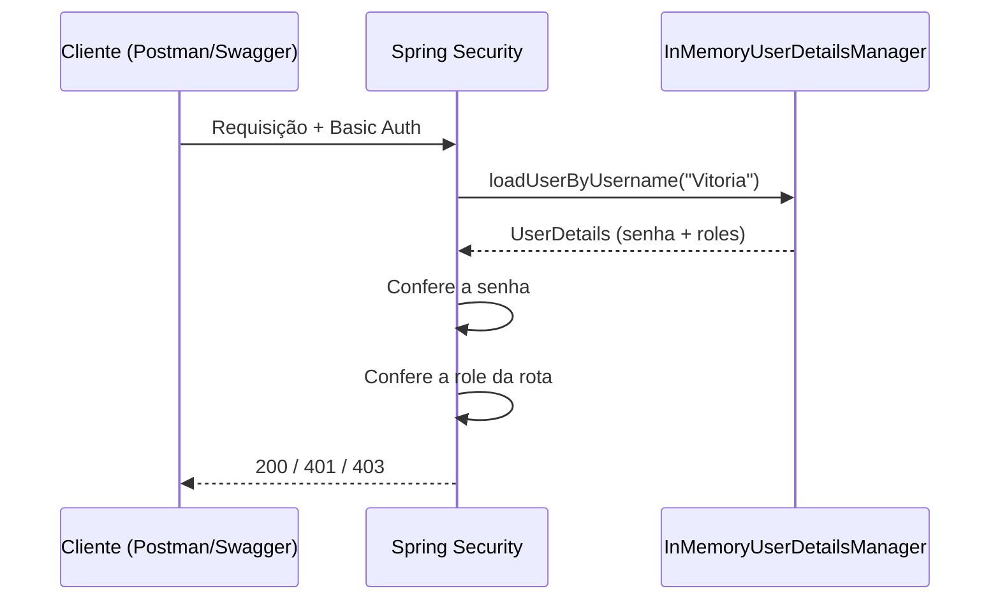

#  Spring Security: configuração inicial


Uma base inicial para quem está começando no Spring Security: usuários em memória, roles e autenticação com **Basic Auth**.

> [!WARNING]
> Esta configuração é **APENAS PARA ESTUDOS**. Os usuários ficam na memória e as senhas estão sem criptografia (`{noop}`).

## Sumário

- [Passo a passo](#-passo-a-passo)
- [Código completo](#-código-completo)
- [Como testar](#-como-testar)
- [UserDetails](#-userdetails)
- [InMemoryUserDetailsManager](#-inmemoryuserdetailsmanager)
- [UserDetailsService](#-userdetailsservice)
- [PasswordEncoder](#-passwordencoder)
- [Indo para produção](#-indo-para-produção)

##  Passo a passo

1. Crie uma pasta (pacote) chamada `security`.
2. Dentro dela, crie a classe `DemoSecurityConfig`.
3. Anote a classe com `@Configuration`.
4. Crie um `@Bean` que retorna um `InMemoryUserDetailsManager` com os usuários.
5. Crie um `@Bean` do tipo `SecurityFilterChain` para definir **quais roles acessam quais rotas**.

> [!IMPORTANT]
> Os usuários (passo 4) dizem **quem** pode entrar. O `SecurityFilterChain` (passo 5) diz **o que cada um pode acessar**. Sem ele, qualquer usuário autenticado acessa qualquer rota, e as roles não servem de nada.

## Código completo

`security/DemoSecurityConfig.java`

```java
@Configuration
public class DemoSecurityConfig {

    @Bean
    public InMemoryUserDetailsManager userDetailsManager() {

        UserDetails gabriel = User.builder()
                .username("Gabriel")
                .password("{noop}test123")
                .roles("EMPLOYEE")
                .build();

        UserDetails vitoria = User.builder()
                .username("Vitoria")
                .password("{noop}test123")
                .roles("EMPLOYEE", "MANAGER")
                .build();

        UserDetails grasi = User.builder()
                .username("Grasi")
                .password("{noop}test123")
                .roles("EMPLOYEE", "MANAGER", "ADMIN")
                .build();

        return new InMemoryUserDetailsManager(gabriel, vitoria, grasi);
    }

    @Bean
    public SecurityFilterChain filterChain(HttpSecurity http) throws Exception {

        http.authorizeHttpRequests(auth -> auth
                .requestMatchers(HttpMethod.GET, "/employees/**").hasRole("EMPLOYEE")
                .requestMatchers("/managers/**").hasRole("MANAGER")
                .requestMatchers("/admin/**").hasRole("ADMIN")
                .anyRequest().authenticated()
        );

        http.httpBasic(Customizer.withDefaults());

        http.csrf(csrf -> csrf.disable());

        return http.build();
    }
}
```

### Quem acessa o quê

| Usuário | Roles | `/employees` | `/managers` | `/admin` |
|---|---|:---:|:---:|:---:|
| Gabriel | EMPLOYEE | ✅ | ❌ | ❌ |
| Vitoria | EMPLOYEE, MANAGER | ✅ | ✅ | ❌ |
| Grasi | EMPLOYEE, MANAGER, ADMIN | ✅ | ✅ | ✅ |

> [!NOTE]
> Ao usar `.roles("EMPLOYEE")`, o Spring guarda internamente a authority `ROLE_EMPLOYEE`. Por isso `hasRole("EMPLOYEE")` funciona sem escrever o prefixo.

## 🧪 Como testar

**Postman**

1. Abra a requisição e vá na aba **Authorization**.
2. Em *Auth Type*, escolha **Basic Auth**.
3. Preencha *Username* e *Password* com um dos usuários acima (ex.: `Vitoria` / `test123`).

**Swagger**

1. Clique no botão **Authorize**.
2. Informe o *username* e o *password* do usuário.

**Resultados esperados**

| Código | Significado |
|---|---|
| `200` | Autenticado e com a role necessária |
| `401` | Sem credenciais ou credenciais inválidas |
| `403` | Autenticado, mas **sem a role** exigida pela rota |



## 👤 UserDetails

É a **interface que representa o usuário** dentro do Spring Security. O framework não conhece a sua classe de usuário, ele só conhece o `UserDetails`.

| Método | Descrição |
|---|---|
| `getUsername()` | Login do usuário |
| `getPassword()` | Senha (no formato esperado pelo `PasswordEncoder`) |
| `getAuthorities()` | Roles e permissões |
| `isEnabled()` | Conta ativa? |
| `isAccountNonLocked()` | Conta não bloqueada? |
| `isAccountNonExpired()` | Conta não expirada? |
| `isCredentialsNonExpired()` | Senha não expirada? |

No exemplo, usamos o `User.builder()`, uma implementação pronta de `UserDetails` que monta o usuário de forma simples:

```java
UserDetails gabriel = User.builder()
        .username("Gabriel")
        .password("{noop}test123")
        .roles("EMPLOYEE")
        .build();
```

> [!TIP]
> Em projetos reais, é comum fazer a própria entidade `Usuario` implementar `UserDetails`, ou converter a entidade em um `UserDetails` dentro do `UserDetailsService`.

## 🧠 InMemoryUserDetailsManager

É uma implementação pronta que **guarda os usuários na memória da aplicação**, sem precisar de banco de dados. Você entrega os `UserDetails` no construtor e ele cuida da busca durante o login:

```java
return new InMemoryUserDetailsManager(gabriel, vitoria, grasi);
```

Ele também permite gerenciar usuários em tempo de execução (`createUser`, `updateUser`, `deleteUser`, `userExists`, `changePassword`), mas tudo é perdido quando a aplicação reinicia.

| Vantagens | Limitações |
|---|---|
| Zero configuração de banco | Usuários somem ao reiniciar |
| Ótimo para estudo e testes | Não escala para vários usuários |
| Fácil de entender | Senhas e usuários ficam no código |

##  UserDetailsService

Interface com **um único método**, usada pelo Spring Security para buscar o usuário durante a autenticação:

```java
UserDetails loadUserByUsername(String username) throws UsernameNotFoundException;
```

O `InMemoryUserDetailsManager` **é** um `UserDetailsService` (ele implementa `UserDetailsManager`, que estende `UserDetailsService`). Por isso o Spring o usa automaticamente quando ele é declarado como `@Bean`.

| Implementação | Onde busca os usuários |
|---|---|
| `InMemoryUserDetailsManager` | Memória |
| `JdbcUserDetailsManager` | Banco, via JDBC (tabelas padrão) |
| Sua própria classe | Banco com JPA, API externa, etc. |

<details>
<summary>Exemplo: UserDetailsService próprio com JPA</summary>

```java
@Service
public class UsuarioDetailsService implements UserDetailsService {

    private final UsuarioRepository repository;

    public UsuarioDetailsService(UsuarioRepository repository) {
        this.repository = repository;
    }

    @Override
    public UserDetails loadUserByUsername(String username) {
        Usuario usuario = repository.findByUsername(username)
                .orElseThrow(() -> new UsernameNotFoundException("Usuário não encontrado"));

        return User.withUsername(usuario.getUsername())
                .password(usuario.getPassword())
                .roles(usuario.getRole())
                .build();
    }
}
```

</details>

## PasswordEncoder

Interface responsável por **codificar (hash)** e **verificar** senhas:

```java
String encode(CharSequence senhaPura);
boolean matches(CharSequence senhaPura, String senhaCodificada);
```

### O que significa o `{noop}`?

Sem um bean de `PasswordEncoder`, o Spring usa o `DelegatingPasswordEncoder`, que lê o **prefixo** da senha para saber qual algoritmo aplicar:

| Prefixo | Algoritmo |
|---|---|
| `{noop}` | Nenhum (texto puro) ⚠️ |
| `{bcrypt}` | BCrypt |
| `{argon2}` | Argon2 |

Neste exemplo, `{noop}test123` significa "senha em texto puro: `test123`". Sem esse prefixo, ocorre o erro:

```text
java.lang.IllegalArgumentException: There is no PasswordEncoder mapped for the id "null"
```

### Versão com BCrypt

```java
@Bean
public PasswordEncoder passwordEncoder() {
    return new BCryptPasswordEncoder();
}

@Bean
public InMemoryUserDetailsManager userDetailsManager(PasswordEncoder encoder) {

    UserDetails gabriel = User.builder()
            .username("Gabriel")
            .password(encoder.encode("test123"))
            .roles("EMPLOYEE")
            .build();

    return new InMemoryUserDetailsManager(gabriel);
}
```

> [!TIP]
> O BCrypt gera um hash **diferente a cada chamada** (salt aleatório). Por isso a verificação é sempre feita com `matches()`, nunca com `equals()`.


## 🚦 Restrição de rotas

Agora veremos como **restringir rotas** para que apenas usuários com a **role** correta possam acessar determinados recursos.

### Sintaxe

Para liberar o acesso a **uma única role**, usamos o `hasRole`:

```java
requestMatchers(HttpMethod.MÉTODO, "/url")
    .hasRole("ROLE_AUTORIZADA")
```

Para liberar para **várias roles**, usamos o `hasAnyRole`:

```java
requestMatchers(HttpMethod.MÉTODO, "/url")
    .hasAnyRole("ROLE_1", "ROLE_2", "ROLE_3")
```

| Parte | O que significa |
|---|---|
| `HttpMethod.MÉTODO` | Método HTTP da requisição (`GET`, `POST`, `PUT`, `DELETE`...). É opcional: sem ele, a regra vale para **todos** os métodos |
| `"/url"` | Caminho da requisição, que pode usar `*` e `**` |
| `hasRole(...)` | Exige **uma** role específica |
| `hasAnyRole(...)` | Exige **pelo menos uma** das roles listadas |

> [!NOTE]
> Escreva a role **sem** o prefixo `ROLE_`. O `hasRole("MANAGER")` já procura pela authority `ROLE_MANAGER`.

### Exemplo

```java
http.authorizeHttpRequests(auth -> auth
        .requestMatchers(HttpMethod.GET, "/api/employee/**").hasRole("EMPLOYEE")    // listar e buscar por id
        .requestMatchers(HttpMethod.POST, "/api/employee/**").hasRole("MANAGER")    // criar
        .requestMatchers(HttpMethod.PUT, "/api/employee/**").hasRole("MANAGER")     // atualizar
        .requestMatchers(HttpMethod.DELETE, "/api/employee/**").hasRole("ADMIN")    // deletar
        .anyRequest().authenticated()                                               // qualquer outra rota exige login
);
```

| Método | Rota | Quem acessa |
|---|---|---|
| `GET` | `/api/employee/**` | EMPLOYEE |
| `POST` | `/api/employee/**` | MANAGER |
| `PUT` | `/api/employee/**` | MANAGER |
| `DELETE` | `/api/employee/**` | ADMIN |
| qualquer outro | outras rotas | qualquer usuário autenticado |

> [!IMPORTANT]
> **A ordem importa.** O Spring aplica a **primeira** regra que casar com a requisição. Coloque as regras mais específicas primeiro e deixe o `anyRequest()` sempre por último.

### 🌟 O que são os asteriscos (`*`)?

Eles definem **quanto do caminho** a regra cobre:

| Padrão | Casa com | Não casa com |
|---|---|---|
| `"/api/employee"` | `/api/employee` | `/api/employee/1`, `/api/employee/1/orders` |
| `"/api/employee/**"` | `/api/employee`, `/api/employee/1`, `/api/employee/1/orders` | `/api/employees` |

- **Sem `/**`**: o padrão casa **apenas com aquele caminho exato**. É útil para proteger um endpoint específico, como o `GET /api/employee` que lista todos.
- **Com `/**`**: o padrão casa com o caminho **e com tudo que vem depois**, em qualquer profundidade. Inclui o próprio `/api/employee`, porque o `**` aceita zero ou mais segmentos.

#### E o `*` simples?

Um asterisco cobre **somente um nível**:

| Padrão | `/api/employee` | `/api/employee/1` | `/api/employee/1/orders` |
|:---|:---:|:---:|:---:|
| `/api/employee` | ✅ | ❌ | ❌ |
| `/api/employee/*` | ❌ | ✅ | ❌ |
| `/api/employee/**` | ✅ | ✅ | ✅ |

<details>
<summary>Quando separar <code>/api/employee</code> e <code>/api/employee/**</code>?</summary>

Só quando o **caminho base** e os **subcaminhos** precisam de **regras diferentes**. Por exemplo, listar todos exige mais permissão do que buscar um por id:

```java
http.authorizeHttpRequests(auth -> auth
        .requestMatchers(HttpMethod.GET, "/api/employee").hasRole("MANAGER")       // listar todos: só gerente
        .requestMatchers(HttpMethod.GET, "/api/employee/**").hasRole("EMPLOYEE")   // buscar por id: funcionário
        .anyRequest().authenticated()
);
```

O matcher exato precisa vir **antes** do `/**`. Se a ordem for invertida, o `/**` casa primeiro com `/api/employee` e a regra do gerente nunca é aplicada.

</details>

### Outro Exemplo

```java
http.authorizeHttpRequests(auth -> auth
        .requestMatchers("/api/auth/**", "/actuator/health").permitAll()
        .anyRequest().authenticated())	                                              // qualquer outra rota exige login
);
```
Onde o `requestMatcher` é usado sem passarmos os metodos http (**POST,GET,PUT,DELETE**) e ele passa a comportar-se como se fosse todos os metodos http neste parametro. Também
podemos passar varios caminho para a mesma permissão, como fizemos acima 
passando 2 caminhos em 2 parametros no mesmo metodo.
O `.permitAll()` deixa passar **qualquer um mesmo que não esteja
autenticado**.

### SecurityFilterChain

Todas essas regras ficam dentro do **`SecurityFilterChain`**, a cadeia de filtros que define as regras de autorização dos endpoints. Ele é explicado com mais detalhes no [SECURITY-RESUMO.md](SECURITY-RESUMO.md).

Exemplo completo, no mesmo arquivo `DemoSecurityConfig`:

```java
@Bean
public SecurityFilterChain filterChain(HttpSecurity http) throws Exception {

    http.authorizeHttpRequests(auth -> auth
            .requestMatchers(HttpMethod.GET, "/employees/**").hasRole("EMPLOYEE")
            .requestMatchers("/managers/**").hasRole("MANAGER")
            .requestMatchers("/admin/**").hasRole("ADMIN")
            .anyRequest().authenticated()
    );

    // Permite usar o HTTP Basic Authentication no Swagger e no Postman
    http.httpBasic(Customizer.withDefaults());

    // Desativado apenas para facilitar testes de POST/PUT/DELETE em projetos de estudo
    http.csrf(csrf -> csrf.disable());

    return http.build();
}
```

| Linha | Função |
|---|---|
| `authorizeHttpRequests` | Define quem pode acessar cada rota |
| `httpBasic` | Ativa a autenticação **Basic Auth** |
| `csrf.disable()` | Desativa a proteção CSRF (somente para estudo) |
| `http.build()` | Constrói e devolve a cadeia de filtros |

### 🚨 Respostas esperadas

| Código | Significado |
|:---:|---|
| `200` | Autenticado e com a role necessária |
| `401` | Sem credenciais ou credenciais inválidas |
| `403` | Autenticado, mas **sem a role** exigida pela rota |

## 📚 Referências

- [Documentação do Spring Security](https://docs.spring.io/spring-security/reference/)
- [Password Storage](https://docs.spring.io/spring-security/reference/features/authentication/password-storage.html)
- [spring-projects/spring-security no GitHub](https://github.com/spring-projects/spring-security)
