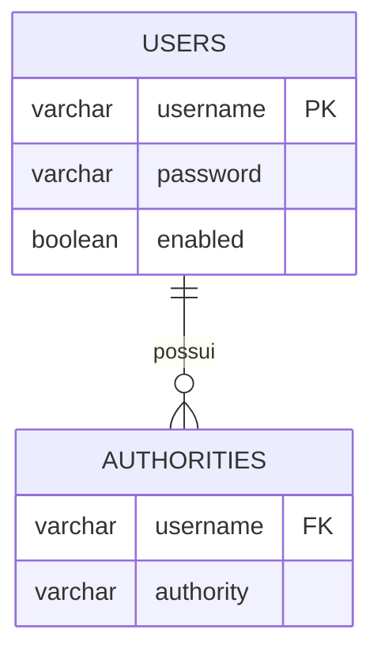
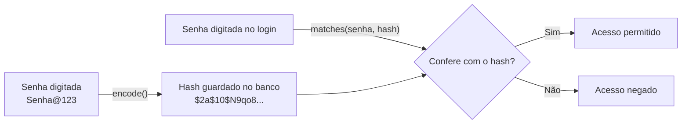
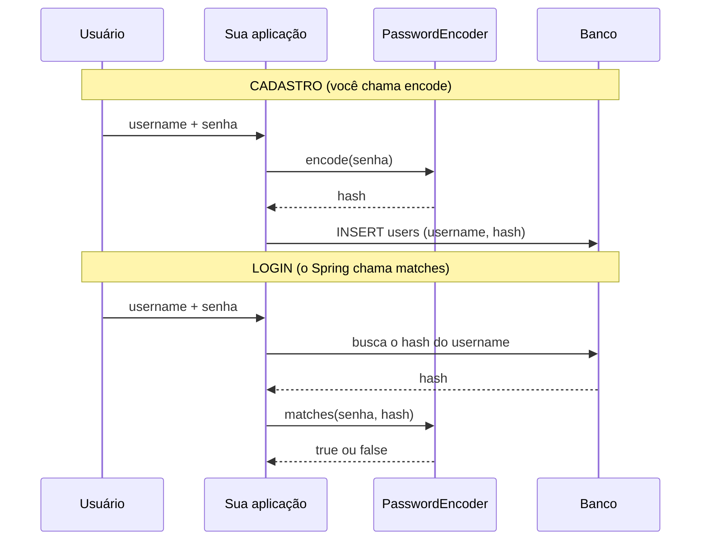
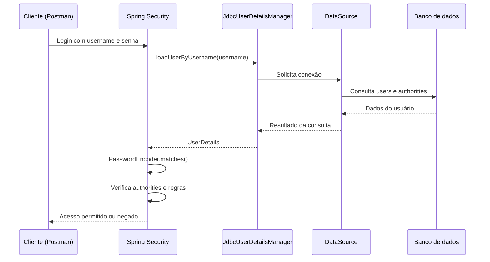

## Spring Security: autenticação com JDBC e banco de dados


Continuação do guia de configuração inicial do Spring Security. Aqui saímos do `InMemoryUserDetailsManager` e passamos a buscar e gerenciar usuários em um banco relacional usando JDBC.

> [!IMPORTANT]
> Este guia apresenta o schema JDBC padrão do Spring Security e `JdbcUserDetailsManager`. É uma alternativa ao modelo personalizado com JPA; não é obrigatório utilizar essas tabelas em todos os projetos.

## 📑 Sumário

- [Do InMemory para o banco](#do-inmemory-para-o-banco)
- [DataSource](#datasource)
- [UserDetailsManager](#userdetailsmanager)
- [JdbcUserDetailsManager](#jdbcuserdetailsmanager)
- [Default Spring Security Database Schema](#default-spring-security-database-schema)
- [SQL para PostgreSQL](#sql-para-postgresql)
- [Configuração do projeto](#configuração-do-projeto)
- [Codificação de senha (PasswordEncoder)](#codificação-de-senha-passwordencoder)
  - [Codificar, criptografar e fazer hash](#codificar-criptografar-e-fazer-hash)
  - [Como o BCrypt guarda a senha](#como-o-bcrypt-guarda-a-senha)
  - [A interface PasswordEncoder e seus métodos](#a-interface-passwordencoder-e-seus-métodos)
  - [Quando usar cada método](#quando-usar-cada-método)
  - [Implementações disponíveis](#implementações-disponíveis)
  - [Qual formato gravar no banco](#qual-formato-gravar-no-banco)
  - [Exemplos práticos](#exemplos-práticos)
  - [Migrando de algoritmo](#migrando-de-algoritmo)
  - [Erros comuns](#erros-comuns)
  - [Testando o PasswordEncoder](#testando-o-passwordencoder)
- [Código completo](#código-completo)
- [Gerenciando usuários](#gerenciando-usuários)
- [Fluxo de autenticação](#fluxo-de-autenticação)
- [JDBC x JPA](#jdbc-x-jpa)
- [Cuidados importantes](#cuidados-importantes)
- [Indo para produção](#indo-para-produção)
- [Referências](#-referências)

## Do InMemory para o banco

No material anterior, usamos `InMemoryUserDetailsManager`. Ele guarda os usuários na memória da aplicação. Ao reiniciar a aplicação, os usuários cadastrados em memória são perdidos.

Agora, vamos armazenar os usuários no banco:

```text
Requisição de login
       |
       v
Spring Security
       |
       v
JdbcUserDetailsManager
       |
       v
DataSource
       |
       v
Banco de dados (users + authorities)
```

| Implementação | Onde busca os usuários |
|---|---|
| `InMemoryUserDetailsManager` | Memória da aplicação |
| `JdbcUserDetailsManager` | Banco relacional, via JDBC |
| `UserDetailsService` próprio | Onde sua implementação consultar (JPA, API etc.) |

## DataSource

`DataSource` é uma interface Java (`javax.sql.DataSource`) que representa uma **fonte de conexões com o banco de dados**.

Em vez de cada classe abrir conexões manualmente, o Spring injeta um `DataSource` configurado para a aplicação.

Exemplo em `application.properties`:

```properties
spring.datasource.url=jdbc:postgresql://localhost:5432/minha_aplicacao
spring.datasource.username=postgres
spring.datasource.password=${DB_PASSWORD}
spring.datasource.driver-class-name=org.postgresql.Driver
```

Quando as dependências e propriedades estão corretas, o Spring Boot configura automaticamente o `DataSource`.

O fluxo é:

1. A aplicação lê as propriedades `spring.datasource.*`.
2. O Spring Boot configura o acesso ao banco.
3. O `DataSource` disponibiliza conexões.
4. O `JdbcUserDetailsManager` usa essas conexões para executar SQL.

> [!NOTE]
> `DataSource` não é uma tabela, entidade ou repositório. É o objeto que fornece conexões. Em uma aplicação Spring Boot, normalmente você não precisa instanciá-lo manualmente.

## UserDetailsManager

`UserDetailsManager` é uma interface do Spring Security que **estende `UserDetailsService`**.

- `UserDetailsService` define como buscar um usuário pelo username.
- `UserDetailsManager` acrescenta operações para gerenciar usuários.

| Método | O que faz |
|---|---|
| `loadUserByUsername(username)` | Busca o usuário pelo login (herdado de `UserDetailsService`) |
| `createUser(user)` | Cria um usuário |
| `updateUser(user)` | Atualiza um usuário |
| `deleteUser(username)` | Exclui um usuário |
| `changePassword(oldPassword, newPassword)` | Altera a senha do usuário autenticado |
| `userExists(username)` | Verifica se o usuário existe |

A interface define as operações, mas não determina onde os dados serão armazenados. Isso depende da implementação.

- `InMemoryUserDetailsManager`: gerenciamento em memória.
- `JdbcUserDetailsManager`: gerenciamento com JDBC.

## JdbcUserDetailsManager

É uma implementação pronta de `UserDetailsManager` que consulta e gerencia usuários em um banco relacional por meio de JDBC.

Ele já oferece operações para buscar usuário e authorities durante o login, criar, atualizar e excluir usuários, alterar senhas e verificar se um usuário existe.

```java
@Bean
public JdbcUserDetailsManager userDetailsManager(DataSource dataSource) {
    return new JdbcUserDetailsManager(dataSource);
}
```

Você fornece um `DataSource`, e o manager utiliza as conexões disponibilizadas por ele.

> [!IMPORTANT]
> `JdbcUserDetailsManager` não cria automaticamente as tabelas em qualquer configuração. Você precisa disponibilizar o schema esperado (por exemplo, com Flyway ou `schema.sql`) ou configurar consultas SQL próprias.

## Default Spring Security Database Schema

O Spring Security disponibiliza um schema JDBC padrão. O modelo básico utiliza duas tabelas:

### 1. `users`

Armazena os dados necessários para autenticar o usuário.

| Coluna | Função |
|---|---|
| `username` | Nome utilizado no login |
| `password` | Senha codificada (hash) |
| `enabled` | Indica se a conta está habilitada |

### 2. `authorities`

Armazena as permissões associadas aos usuários.

| Coluna | Função |
|---|---|
| `username` | Usuário ao qual a permissão pertence |
| `authority` | Role ou authority do usuário |

Exemplo:

**users**

| username | password | enabled |
|---|---|---|
| gabriel | `$2a$...` | true |
| maria | `$2a$...` | true |

**authorities**

| username | authority |
|---|---|
| gabriel | ROLE_USER |
| gabriel | produto:ler |
| maria | ROLE_ADMIN |

Um usuário pode possuir várias authorities. Por isso, `authorities` possui várias linhas para o mesmo `username`.

### Relacionamento



A tabela `authorities` possui uma chave estrangeira para `users.username`. A combinação `username + authority` deve ser única para evitar repetir a mesma permissão para o mesmo usuário.

### Tabelas opcionais de grupos

O schema JDBC também prevê tabelas opcionais para trabalhar com grupos:

| Tabela | Responsabilidade |
|---|---|
| `groups` | Cadastro dos grupos |
| `group_members` | Associação de usuários aos grupos |
| `group_authorities` | Authorities associadas aos grupos |

Esse modelo permite associar usuários a grupos e conceder authorities ao grupo, em vez de cadastrar cada authority individualmente para cada usuário.

> [!NOTE]
> As tabelas de grupos são opcionais. Para começar, `users` e `authorities` são suficientes. Não confunda o modelo de grupos com a tabela `authorities`: são recursos diferentes.

## SQL para PostgreSQL

A documentação do Spring Security apresenta o schema padrão com tipos específicos do HSQLDB, como `varchar_ignorecase`. Para PostgreSQL, use tipos compatíveis, como `VARCHAR`.

Exemplo adaptado:

```sql
CREATE TABLE users (
    username VARCHAR(50) PRIMARY KEY,
    password VARCHAR(500) NOT NULL,
    enabled BOOLEAN NOT NULL
);

CREATE TABLE authorities (
    username VARCHAR(50) NOT NULL,
    authority VARCHAR(100) NOT NULL,

    CONSTRAINT fk_authorities_users
        FOREIGN KEY (username)
        REFERENCES users(username),

    CONSTRAINT uk_authorities
        UNIQUE (username, authority)
);
```

**Por que `password` tem tamanho 500?** Para comportar o hash produzido pelo algoritmo de codificação de senha. Nunca armazene a senha original em texto puro. Um hash BCrypt tem 60 caracteres (68 com o prefixo `{bcrypt}`), e outros algoritmos geram hashes maiores. Veja [Codificação de senha](#codificação-de-senha-passwordencoder).

**Por que existe uma chave estrangeira?** Para impedir que uma authority seja associada a um username inexistente.

**Por que existe `UNIQUE (username, authority)`?** Para impedir que a mesma permissão seja cadastrada duas vezes para o mesmo usuário.

### Inserindo dados para teste

```sql
INSERT INTO users (username, password, enabled)
VALUES (
    'gabriel',
    '$2a$10$HASH_BCRYPT_GERADO_PELA_APLICACAO',
    TRUE
);

INSERT INTO authorities (username, authority)
VALUES
    ('gabriel', 'ROLE_USER'),
    ('gabriel', 'produto:ler');
```

> [!WARNING]
> O hash acima é ilustrativo. Gere o valor com `PasswordEncoder.encode()` na aplicação (veja [Como gerar um hash para colocar no SQL](#como-gerar-um-hash-para-colocar-no-sql)). Não copie esse texto como se fosse uma senha BCrypt válida.

## Configuração do projeto

### 1. Dependências

Exemplo Maven para PostgreSQL:

```xml
<dependencies>
    <dependency>
        <groupId>org.springframework.boot</groupId>
        <artifactId>spring-boot-starter-security</artifactId>
    </dependency>

    <dependency>
        <groupId>org.springframework.boot</groupId>
        <artifactId>spring-boot-starter-jdbc</artifactId>
    </dependency>

    <dependency>
        <groupId>org.postgresql</groupId>
        <artifactId>postgresql</artifactId>
        <scope>runtime</scope>
    </dependency>
</dependencies>
```

> [!NOTE]
> O exemplo usa os starters do Spring Boot. Se o projeto utiliza o parent ou BOM do Spring Boot, deixe que ele gerencie as versões compatíveis.

### 2. Configure o banco

`src/main/resources/application.properties`:

```properties
spring.datasource.url=jdbc:postgresql://localhost:5432/minha_aplicacao
spring.datasource.username=postgres
spring.datasource.password=${DB_PASSWORD}
spring.datasource.driver-class-name=org.postgresql.Driver
```

Defina `DB_PASSWORD` no ambiente em que a aplicação será executada. Não versione senhas reais no Git.

### 3. Crie o schema

Uma opção é utilizar Flyway:

```text
src/main/resources/
└── db/
    └── migration/
        └── V1__create_security_tables.sql
```

Coloque o SQL de criação de `users` e `authorities` nesse arquivo. Adicione a dependência do Flyway compatível com a versão do Spring Boot e do banco.

Outra opção é utilizar `schema.sql` com a inicialização SQL do Spring Boot. Evite manter duas ferramentas tentando criar as mesmas tabelas.

## Codificação de senha (PasswordEncoder)

Toda senha guardada no banco precisa estar **codificada**. No Spring Security, quem faz isso é a interface **`PasswordEncoder`**. Sem ela, a coluna `users.password` guardaria a senha original, e qualquer vazamento do banco expõe todas as contas (e as pessoas costumam reaproveitar a mesma senha em outros sites).



### Codificar, criptografar e fazer hash

O nome `PasswordEncoder` ("codificador") pode confundir. Na prática, ele faz **hash**:

| Técnica | Reversível? | Para que serve | Serve para senhas? |
|---|---|---|---|
| **Codificação** (ex.: Base64) | Sim, por qualquer pessoa | Mudar o formato dos dados | ❌ **Não**. Não protege nada |
| **Criptografia** (ex.: AES) | Sim, **com a chave** | Proteger dados que você precisa **ler de volta** (um documento, um token) | ❌ Não. Quem roubar a chave lê todas as senhas |
| **Hash simples** (ex.: MD5, SHA-256) | Não | Verificar integridade de arquivos | ❌ Não. É rápido demais e permite ataques de força bruta |
| **Hash de senha** (BCrypt, Argon2, PBKDF2, SCrypt) | **Não** | **Guardar senhas** | ✅ **Sim** |

O que torna esses algoritmos adequados para senhas:

| Característica | O que significa |
|---|---|
| **Sem volta** (*one-way*) | Não existe "descriptografar". A aplicação nunca sabe a senha original: ela só confere se a senha digitada gera o mesmo hash |
| **Salt aleatório** | Um valor aleatório, **diferente para cada senha**, misturado antes do hash. Duas pessoas com a mesma senha têm hashes diferentes, e tabelas pré-calculadas (*rainbow tables*) deixam de funcionar |
| **Lento de propósito** (*work factor*) | O custo é ajustável. Para você, calcular um hash por login é imperceptível. Para um atacante testando bilhões de palpites, é inviável |

### Como o BCrypt guarda a senha

O resultado do BCrypt é um texto de **60 caracteres**, que já carrega **tudo** o que é preciso para conferir a senha depois (versão, custo e salt). Por isso não existe uma coluna separada para o salt.

```text
$2a$10$N9qo8uLOickgx2ZMRZoMyeIjZAgcfl7p92ldGxad68LJZdL17lhWy
└┬─┘└┬┘└─────────┬──────────┘└──────────────┬──────────────┘
 │   │           │                          │
 │   │           │                          └─ hash (31 caracteres)
 │   │           └─ salt aleatório (22 caracteres)
 │   └─ custo (strength): 2^10 = 1.024 rodadas
 └─ versão do algoritmo
```

| Parte | Exemplo | Significado |
|---|---|---|
| Versão | `$2a$` | Versão do BCrypt |
| Custo | `10` | Fator de trabalho (padrão do Spring). **Cada +1 dobra o tempo** de cálculo |
| Salt | `N9qo8uLOickgx2ZMRZoMye` | 22 caracteres aleatórios, gerados a cada `encode()` |
| Hash | `IjZAgcfl7p92...` | O resultado do cálculo (31 caracteres) |

> [!NOTE]
> O hash do exemplo é apenas ilustrativo. Cada chamada de `encode()` gera um valor diferente.

### A interface PasswordEncoder e seus métodos

```java
public interface PasswordEncoder {

    String encode(CharSequence rawPassword);

    boolean matches(CharSequence rawPassword, String encodedPassword);

    default boolean upgradeEncoding(String encodedPassword) {
        return false;
    }
}
```

| Método | O que recebe | O que devolve | O que faz |
|---|---|---|---|
| **`encode(rawPassword)`** | A senha **em texto puro** | O **hash** (`String`) | Gera o hash com um salt novo. **Cada chamada devolve um resultado diferente**, mesmo para a mesma senha |
| **`matches(rawPassword, encodedPassword)`** | A senha digitada **e** o hash guardado | `true` ou `false` | Extrai o salt e o custo do hash guardado, calcula o hash da senha digitada e compara. **É a única forma correta de comparar** |
| **`upgradeEncoding(encodedPassword)`** | O hash guardado | `true` ou `false` | Diz se o hash está **desatualizado** (custo menor que o atual, ou algoritmo antigo) e deveria ser refeito. O padrão é `false` |

```java
PasswordEncoder encoder = new BCryptPasswordEncoder();

String hash1 = encoder.encode("Senha@123");     // ex.: $2a$10$N9qo8uLOickgx2ZMRZoMyeIj...
String hash2 = encoder.encode("Senha@123");     // OUTRO valor (salt diferente), mesma senha

encoder.matches("Senha@123", hash1);            // true
encoder.matches("Senha@123", hash2);            // true  (os dois hashes são válidos para a mesma senha)
encoder.matches("senha@123", hash1);            // false (maiúsculas e minúsculas contam)

boolean desatualizado = new BCryptPasswordEncoder(12).upgradeEncoding(hash1);
                                                // true: hash1 foi feito com custo 10 e o encoder atual usa 12
```

> [!IMPORTANT]
> **Nunca compare com `equals`.** `encoder.encode(senhaDigitada).equals(hashGuardado)` é **sempre `false`**, porque cada `encode()` usa um salt novo. Use sempre `matches(...)`.

### Quando usar cada método

#### `encode()`: sempre que uma senha **vai ser gravada**

| Situação | Exemplo |
|---|---|
| **Cadastro** de usuário | `createUser(...)` com `passwordEncoder.encode(senha)` |
| **Troca de senha** | Antes de gravar a nova senha |
| **Redefinição** ("esqueci a senha") | Depois de validar o token enviado por e-mail |
| **Criar o primeiro administrador** | Um *seed* na inicialização da aplicação |
| **Migração de dados** | Ao importar usuários de um sistema que guardava senhas em texto puro |

#### `matches()`: sempre que uma senha **precisa ser conferida**

| Situação | Quem chama |
|---|---|
| **Login** | **O Spring Security**, sozinho (`DaoAuthenticationProvider`). Você **não** precisa chamar |
| **Trocar a senha** (pedir a senha atual antes) | **Você** |
| **Operação sensível** (excluir conta, mudar e-mail) com confirmação de senha | **Você** |

#### `upgradeEncoding()`: para manter os hashes sempre atualizados

Chamado **depois de um login bem-sucedido**, quando você ainda tem a senha original em mãos. Se devolver `true`, o hash é refeito com a configuração atual e gravado de novo. O Spring faz isso automaticamente se existir um bean `UserDetailsPasswordService` (veja [Migrando de algoritmo](#migrando-de-algoritmo)).

#### Resumo



| Método | Você chama? | O Spring chama? |
|---|---|---|
| `encode` | ✅ Cadastro, troca e redefinição de senha | Não. Só indiretamente, se você usar `.passwordEncoder(...)` no `User.builder()` |
| `matches` | ✅ Confirmação de senha em operações sensíveis | ✅ **No login** |
| `upgradeEncoding` | Raramente | ✅ Após o login, se houver `UserDetailsPasswordService` |

### Implementações disponíveis

Todas ficam no pacote `org.springframework.security.crypto...` e implementam `PasswordEncoder`.

| Implementação | Algoritmo | Observações |
|---|---|---|
| **`BCryptPasswordEncoder`** | BCrypt | ✅ **O mais usado.** Simples, sem dependências extras. Custo padrão `10` |
| `Argon2PasswordEncoder` | Argon2 | Moderno, consome memória (mais resistente a hardware especializado). Exige a biblioteca **Bouncy Castle** |
| `Pbkdf2PasswordEncoder` | PBKDF2 | Aceito em ambientes que exigem conformidade com **FIPS**. Mais fraco que BCrypt contra hardware especializado |
| `SCryptPasswordEncoder` | SCrypt | Consome memória. Exige **Bouncy Castle** |
| **`DelegatingPasswordEncoder`** | Vários, escolhidos por um **prefixo** | ✅ Permite **trocar de algoritmo** sem invalidar as senhas antigas. Veja abaixo |
| `NoOpPasswordEncoder` (`{noop}`) | Nenhum (texto puro) | ❌ **Só para testes e estudo.** Obsoleto |
| `StandardPasswordEncoder`, `MessageDigestPasswordEncoder` | SHA-256, MD5... | ❌ **Legados e inseguros.** Não use |

#### BCryptPasswordEncoder

```java
PasswordEncoder encoder = new BCryptPasswordEncoder();      // custo padrão: 10
PasswordEncoder forte   = new BCryptPasswordEncoder(12);    // custo 12: cerca de 4 vezes mais lento que o 10
```

| Custo (`strength`) | Rodadas | Tempo relativo |
|---|---|---|
| 10 (padrão) | 2¹⁰ = 1.024 | 1× |
| 11 | 2¹¹ | 2× |
| 12 | 2¹² | 4× |
| 14 | 2¹⁴ | 16× |

> [!TIP]
> O custo é um equilíbrio: alto o bastante para frear ataques e baixo o bastante para não pesar no login. A própria documentação do Spring Security recomenda **ajustar o custo ao seu servidor**, de forma que verificar uma senha leve um tempo perceptível (da ordem de algumas centenas de milissegundos). Meça no seu ambiente e lembre que o custo vale para **cada** tentativa de login.

> [!WARNING]
> O BCrypt considera só os **primeiros 72 bytes** da senha. Limite o tamanho máximo da senha na validação do cadastro (por exemplo, 64 caracteres) para não gerar surpresas.

#### Argon2, PBKDF2 e SCrypt

```java
PasswordEncoder argon2 = Argon2PasswordEncoder.defaultsForSpringSecurity_v5_8();
PasswordEncoder pbkdf2 = Pbkdf2PasswordEncoder.defaultsForSpringSecurity_v5_8();
PasswordEncoder scrypt = SCryptPasswordEncoder.defaultsForSpringSecurity_v5_8();
```

> [!NOTE]
> O Argon2 e o SCrypt do Spring usam a biblioteca Bouncy Castle (`org.bouncycastle:bcpkix-jdk18on`), que precisa estar no projeto. Os métodos `defaultsForSpringSecurity_...` trazem parâmetros recomendados, mas os nomes podem variar entre versões: confira a documentação da versão que você usa.

#### DelegatingPasswordEncoder: o hash carrega o nome do algoritmo

```java
PasswordEncoder encoder = PasswordEncoderFactories.createDelegatingPasswordEncoder();

String hash = encoder.encode("Senha@123");
// {bcrypt}$2a$10$N9qo8uLOickgx2ZMRZoMyeIj...
//  └─┬──┘
//    └─ prefixo: diz qual algoritmo gerou este hash
```

| Prefixo no banco | Algoritmo usado para conferir |
|---|---|
| `{bcrypt}` | BCrypt (padrão para **novas** senhas) |
| `{argon2}` | Argon2 |
| `{pbkdf2}` | PBKDF2 |
| `{scrypt}` | SCrypt |
| `{noop}` | Texto puro (somente testes) |

O `matches()` lê o prefixo, escolhe o algoritmo certo e confere. Assim, o banco pode ter senhas de algoritmos diferentes ao mesmo tempo, e você troca o algoritmo padrão sem forçar ninguém a redefinir a senha.

### Qual formato gravar no banco

O formato guardado em `users.password` **precisa ser compatível com o `PasswordEncoder` do seu `@Bean`**. Esta é a causa mais comum de "a senha está certa, mas o login não funciona".

| Seu bean | O que gravar em `users.password` | Exemplo |
|---|---|---|
| `new BCryptPasswordEncoder()` (como no [Código completo](#código-completo)) | **Só o hash**, sem prefixo | `$2a$10$N9qo8...` |
| `PasswordEncoderFactories.createDelegatingPasswordEncoder()` | O hash **com** prefixo | `{bcrypt}$2a$10$N9qo8...` |

| Combinação errada | O que acontece |
|---|---|
| Bean `BCryptPasswordEncoder` + hash com `{bcrypt}` | O BCrypt não reconhece o formato, registra um aviso (*Encoded password does not look like BCrypt*) e **o login falha** |
| Bean `Delegating` + hash **sem** prefixo | `IllegalArgumentException: There is no PasswordEncoder mapped for the id "null"` |

> [!TIP]
> Se você já tem hashes sem prefixo e quer usar o `DelegatingPasswordEncoder`, configure o algoritmo padrão para hashes sem prefixo:
>
> ```java
> DelegatingPasswordEncoder encoder =
>         (DelegatingPasswordEncoder) PasswordEncoderFactories.createDelegatingPasswordEncoder();
> encoder.setDefaultPasswordEncoderForMatches(new BCryptPasswordEncoder());
> ```

### Exemplos práticos

#### 1. Cadastro (`encode`)

Já usado em [Gerenciando usuários](#gerenciando-usuários). A senha original **nunca** é gravada:

```java
UserDetails usuario = User.builder()
        .username(username)
        .password(passwordEncoder.encode(senha))     // codifica ANTES de criar o usuário
        .roles("USER")
        .build();

userDetailsManager.createUser(usuario);
```

Alternativa, deixando o `User.builder()` aplicar o codificador:

```java
UserDetails usuario = User.builder()
        .username(username)
        .passwordEncoder(passwordEncoder::encode)    // o builder chama encode() ao montar
        .password(senha)                             // aqui vai a senha em TEXTO PURO
        .roles("USER")
        .build();
```

> [!WARNING]
> Use **uma** das duas formas, nunca as duas ao mesmo tempo. Combinar `.password(passwordEncoder.encode(senha))` com `.passwordEncoder(passwordEncoder::encode)` codifica **duas vezes**, e o login nunca mais funciona.

#### 2. Troca de senha (`matches` + `encode`)

```java
public void alterarSenha(String senhaAtual, String novaSenha) {

    // O usuário vem da AUTENTICAÇÃO, e não do corpo da requisição
    String username = SecurityContextHolder.getContext().getAuthentication().getName();

    UserDetails usuario = userDetailsManager.loadUserByUsername(username);

    // 1) confere a senha atual com matches()
    if (!passwordEncoder.matches(senhaAtual, usuario.getPassword())) {
        throw new IllegalArgumentException("Senha atual incorreta");
    }

    // 2) codifica a nova senha com encode() e grava
    UserDetails atualizado = User.withUserDetails(usuario)
            .password(passwordEncoder.encode(novaSenha))
            .build();

    userDetailsManager.updateUser(atualizado);
}
```

> [!IMPORTANT]
> Pegue o `username` de quem está **autenticado**. Se ele vier do corpo da requisição, qualquer usuário consegue trocar a senha de outro.

#### 3. Criar o administrador inicial (`encode`)

```java
@Bean
@Profile("dev")                                                   // só em desenvolvimento
CommandLineRunner criarAdmin(UserDetailsManager manager,
                             PasswordEncoder encoder,
                             @Value("${ADMIN_PASSWORD}") String senha) {   // a senha vem do ambiente, e não do código

    return args -> {
        if (!manager.userExists("admin")) {
            manager.createUser(User.builder()
                    .username("admin")
                    .password(encoder.encode(senha))
                    .roles("ADMIN")
                    .build());
        }
    };
}
```

#### Como gerar um hash para colocar no SQL

Para as inserções de teste (ou uma migration do Flyway), você precisa de um hash **real**. Gere-o com uma classe temporária:

```java
public class GeradorDeHash {
    public static void main(String[] args) {
        System.out.println(new BCryptPasswordEncoder().encode("Senha@123"));
    }
}
```

Cole o valor impresso na coluna `password`. Lembre-se do [formato correto](#qual-formato-gravar-no-banco) para o seu bean.

> [!WARNING]
> Não faça migrations com senhas reais de produção. Para usuários de verdade, o cadastro deve passar pela aplicação, que chama `encode()`.

### Migrando de algoritmo

Com o tempo, o custo ideal sobe e algoritmos novos surgem. O `DelegatingPasswordEncoder` permite migrar **sem pedir que todos redefinam a senha**:

```java
@Bean
public PasswordEncoder passwordEncoder() {
    String idPadrao = "bcrypt";                                   // usado para NOVAS senhas

    Map<String, PasswordEncoder> encoders = new HashMap<>();
    encoders.put("bcrypt", new BCryptPasswordEncoder(12));        // novas senhas: custo 12
    encoders.put("argon2", Argon2PasswordEncoder.defaultsForSpringSecurity_v5_8());
    encoders.put("noop", NoOpPasswordEncoder.getInstance());      // SÓ se ainda existirem senhas {noop} de teste. Remova em produção

    return new DelegatingPasswordEncoder(idPadrao, encoders);
}
```

Como a atualização acontece:

1. O usuário faz login. O Spring chama `matches()` (usando o algoritmo indicado pelo prefixo do hash guardado).
2. Se der certo, o Spring chama `upgradeEncoding()` no hash guardado.
3. Se devolver `true` (custo antigo ou algoritmo diferente do padrão), o Spring chama `updatePassword(...)` de um bean **`UserDetailsPasswordService`**, que grava o hash novo.

```java
@Service
public class SenhaUpgradeService implements UserDetailsPasswordService {

    private final JdbcTemplate jdbcTemplate;

    public SenhaUpgradeService(JdbcTemplate jdbcTemplate) {
        this.jdbcTemplate = jdbcTemplate;
    }

    @Override
    public UserDetails updatePassword(UserDetails user, String novoHash) {
        jdbcTemplate.update("UPDATE users SET password = ? WHERE username = ?",
                novoHash, user.getUsername());
        return User.withUserDetails(user).password(novoHash).build();
    }
}
```

> [!NOTE]
> Esse upgrade é feito **no login**, porque só nesse momento a aplicação conhece a senha em texto puro (o hash antigo não pode ser convertido para outro). Quem nunca mais fizer login continua com o hash antigo.

### Erros comuns

| Problema | Sintoma | Solução |
|---|---|---|
| **Guardar a senha em texto puro** | Vazamento expõe todas as contas | Sempre `encode()` antes de gravar |
| **Codificar duas vezes** | O login sempre falha | Codifique **uma** vez (veja o [exemplo 1](#1-cadastro-encode)) |
| **Comparar com `equals`** | A comparação é sempre `false` | Use `matches()` |
| **Hash sem prefixo com `DelegatingPasswordEncoder`** | `There is no PasswordEncoder mapped for the id "null"` | Grave o prefixo `{bcrypt}` ou use `setDefaultPasswordEncoderForMatches` |
| **Hash com prefixo e `BCryptPasswordEncoder` direto** | Aviso *does not look like BCrypt* e login negado | Tire o prefixo, ou use o `DelegatingPasswordEncoder` |
| **Coluna `password` pequena** | Erro de tamanho ou hash cortado | `VARCHAR(255)` ou mais (o schema deste guia usa 500) |
| **`{noop}` ou `NoOpPasswordEncoder` em produção** | Senhas em texto puro | Use BCrypt, Argon2... |
| **Trocar o algoritmo sem planejamento** | Usuários antigos não conseguem logar | `DelegatingPasswordEncoder` + `upgradeEncoding` |
| **Usar SHA-256 ou MD5 "feito à mão"** | Hash rápido demais, vulnerável a força bruta | Use um algoritmo de hash de senha |
| **Senha maior que 72 bytes no BCrypt** | O que passa do limite é ignorado | Limite o tamanho da senha na validação |
| **Registrar a senha ou o hash em logs** | Vazamento pelos logs | Nunca imprima senhas, hashes ou o corpo de requisições de login |
| **Criar `PasswordEncoder` com `new` em cada método** | Código repetido e configurações diferentes | Declare **um** `@Bean` e injete |

#### O que NÃO codificar com `PasswordEncoder`

| Dado | Por quê | O que fazer |
|---|---|---|
| **Dados que você precisa ler de volta** (CPF, documentos) | Hash não tem volta | Criptografia (AES) ou guardar sem codificar, com controle de acesso |
| **JWT, chave de assinatura, segredo da aplicação** | Não são senhas | Variáveis de ambiente |
| **Tokens e chaves de API de alta entropia** | Já são aleatórios e longos, e um algoritmo lento não é necessário | Guarde um hash simples (SHA-256) |
| **E-mail e `username`** | Você consulta por eles | Guarde como texto |

#### Além do hash: regras para boas senhas

- Defina um **tamanho mínimo** (por exemplo, 8 a 12 caracteres) e **máximo** (por causa do limite de 72 bytes do BCrypt).
- Prefira senhas longas a regras complicadas de caracteres.
- Considere recusar senhas **vazadas ou muito comuns**. Versões recentes do Spring Security oferecem o `CompromisedPasswordChecker` para consultar bases de senhas vazadas (confira a documentação da versão que você usa).
- Bloqueie ou atrase tentativas repetidas de login (*rate limiting*).

### Testando o PasswordEncoder

```java
class PasswordEncoderTest {

    private final PasswordEncoder encoder = new BCryptPasswordEncoder();

    @Test
    void deveGerarHashDiferenteACadaChamada() {
        String hash1 = encoder.encode("Senha@123");
        String hash2 = encoder.encode("Senha@123");

        assertNotEquals(hash1, hash2);                       // salts diferentes
    }

    @Test
    void deveConferirASenhaCorreta() {
        String hash = encoder.encode("Senha@123");

        assertTrue(encoder.matches("Senha@123", hash));
        assertFalse(encoder.matches("OutraSenha", hash));
    }

    @Test
    void naoDeveGuardarASenhaEmTextoPuro() {
        String hash = encoder.encode("Senha@123");

        assertFalse(hash.contains("Senha@123"));
        assertEquals(60, hash.length());                     // BCrypt: sempre 60 caracteres
    }
}
```

## Código completo

Exemplo de configuração com `JdbcUserDetailsManager` e BCrypt.

`security/DatabaseSecurityConfig.java`:

```java
@Configuration
public class DatabaseSecurityConfig {

    @Bean
    public PasswordEncoder passwordEncoder() {
        return new BCryptPasswordEncoder();
    }

    @Bean
    public JdbcUserDetailsManager userDetailsManager(
            DataSource dataSource) {

        return new JdbcUserDetailsManager(dataSource);
    }

    @Bean
    public SecurityFilterChain filterChain(
            HttpSecurity http) throws Exception {

        http.authorizeHttpRequests(auth -> auth
                .requestMatchers("/api/auth/**").permitAll()
                .requestMatchers("/api/admin/**").hasRole("ADMIN")
                .anyRequest().authenticated()
        );

        http.httpBasic(Customizer.withDefaults());

        return http.build();
    }
}
```

### Entendendo a configuração

| Código | Responsabilidade |
|---|---|
| `PasswordEncoder` | Codifica e verifica senhas |
| `BCryptPasswordEncoder` | Implementação de hash BCrypt |
| `DataSource` | Fornece conexões com o banco |
| `JdbcUserDetailsManager` | Busca e gerencia usuários com JDBC |
| `SecurityFilterChain` | Define regras de acesso às rotas |
| `permitAll()` | Libera as rotas públicas |
| `hasRole("ADMIN")` | Exige a role ADMIN |
| `authenticated()` | Exige autenticação |

O Spring injeta o `DataSource` configurado pelo Spring Boot no `JdbcUserDetailsManager`.

> [!IMPORTANT]
> O `JdbcUserDetailsManager` utiliza as consultas e o schema JDBC esperados pelo Spring Security. Se você mudar nomes de tabelas ou colunas, precisará adaptar as consultas do manager.

> [!NOTE]
> Com o `BCryptPasswordEncoder` acima, os hashes em `users.password` devem estar **sem prefixo** (`$2a$10$...`). Se você trocar para o `DelegatingPasswordEncoder`, passe a gravar `{bcrypt}$2a$10$...`. Veja [Qual formato gravar no banco](#qual-formato-gravar-no-banco).

## Gerenciando usuários

O `JdbcUserDetailsManager` implementa `UserDetailsManager`, então podemos utilizar os métodos de gerenciamento.

Exemplo de serviço para cadastrar um usuário:

```java
@Service
public class UsuarioService {

    private final UserDetailsManager userDetailsManager;
    private final PasswordEncoder passwordEncoder;

    public UsuarioService(
            UserDetailsManager userDetailsManager,
            PasswordEncoder passwordEncoder) {

        this.userDetailsManager = userDetailsManager;
        this.passwordEncoder = passwordEncoder;
    }

    public void cadastrar(String username, String senha) {

        if (userDetailsManager.userExists(username)) {
            throw new IllegalArgumentException("Usuário já cadastrado");
        }

        UserDetails usuario = User.builder()
                .username(username)
                .password(passwordEncoder.encode(senha))
                .roles("USER")
                .build();

        userDetailsManager.createUser(usuario);
    }
}
```

### O que acontece no cadastro?

1. `userExists(username)` verifica se o login já está cadastrado.
2. `passwordEncoder.encode(senha)` gera o hash da senha.
3. `User.builder()` cria um objeto que implementa `UserDetails`.
4. `.roles("USER")` adiciona a authority `ROLE_USER`.
5. `createUser(usuario)` persiste o usuário e suas authorities no banco.

> [!WARNING]
> O `JdbcUserDetailsManager` não substitui a validação de entrada da API. Em um cadastro real, valide os campos, trate duplicidade, defina regras de senha e retorne respostas HTTP adequadas.

### Outros métodos disponíveis

```java
// Verifica se existe
boolean existe = userDetailsManager.userExists("gabriel");

// Busca os dados para autenticação
UserDetails usuario =
        userDetailsManager.loadUserByUsername("gabriel");

// Atualiza os dados do usuário
userDetailsManager.updateUser(usuario);

// Exclui o usuário
userDetailsManager.deleteUser("gabriel");

// Altera a senha do usuário autenticado
userDetailsManager.changePassword(
        senhaAtual,
        novaSenhaCodificada
);
```

> [!NOTE]
> `changePassword` foi pensado para a alteração da senha do usuário autenticado no contexto de segurança. Para um fluxo administrativo de redefinição de senha, implemente a verificação de autorização e a atualização de forma apropriada. Observe que a nova senha deve ser passada **já codificada** (`passwordEncoder.encode(novaSenha)`). Para um exemplo completo de troca de senha, veja [Troca de senha](#2-troca-de-senha-matches--encode).

## Fluxo de autenticação



O `JdbcUserDetailsManager` busca o usuário e suas authorities. O Spring Security utiliza o `PasswordEncoder` para comparar a senha recebida com o hash armazenado.

## JDBC x JPA

| Característica | JDBC (`JdbcUserDetailsManager`) | JPA (`UserDetailsService` próprio) |
|---|---|---|
| Acesso ao banco | SQL/JDBC | ORM, normalmente Hibernate |
| Modelo de tabelas | Schema esperado ou consultas customizadas | Modelo definido pelo projeto |
| Gerenciamento de usuário | Implementação pronta | Você implementa |
| Flexibilidade | Menor no modelo padrão | Maior |
| Bom para | Aprender JDBC e usar o schema padrão | Sistemas com domínio e regras próprias |

### Quando escolher cada um?

**Use `JdbcUserDetailsManager` quando:**

- Quiser aprender a integração JDBC com Spring Security.
- Seu projeto puder utilizar o modelo de tabelas padrão.
- Precisar de uma implementação pronta para buscar e gerenciar usuários.

**Use JPA com `UserDetailsService` próprio quando:**

- Já tiver entidades e relacionamentos próprios.
- Precisar integrar usuário, perfil, permissões e outras informações de domínio.
- Quiser controlar completamente as consultas e regras de cadastro.

> [!TIP]
> Em um sistema maior, com entidades próprias e regras de negócio, JPA costuma oferecer mais flexibilidade. `JdbcUserDetailsManager` é excelente para entender a integração do Spring Security com banco relacional.

> [!NOTE]
> O `PasswordEncoder` funciona **da mesma forma** nos dois modelos: em JDBC ou em JPA, você chama `encode()` ao gravar e o Spring chama `matches()` no login.

## Cuidados importantes

- [ ] Não armazene senhas em texto puro.
- [ ] Utilize `BCryptPasswordEncoder` ou outro algoritmo apropriado de hash de senha.
- [ ] Compare senhas **somente** com `matches()`, nunca com `equals`.
- [ ] Codifique a senha **uma única vez** (cuidado com `encode()` duplicado).
- [ ] Confira se o formato do hash no banco (com ou sem prefixo) combina com o seu `PasswordEncoder`.
- [ ] Limite o tamanho máximo da senha (o BCrypt considera só os 72 primeiros bytes).
- [ ] Nunca registre senhas ou hashes em logs.
- [ ] Não versione credenciais do banco.
- [ ] Crie as tabelas com Flyway ou outra ferramenta de migração.
- [ ] Garanta que cada usuário tenha authorities válidas.
- [ ] Trate usuários duplicados e erros de persistência.
- [ ] Utilize HTTPS em ambientes reais, especialmente ao usar Basic Auth.
- [ ] Não desative CSRF sem entender o modelo de autenticação e o tipo de cliente.
- [ ] Não exponha endpoints de cadastro e gerenciamento sem autorização adequada.

## Indo para produção

- [x] Entender `UserDetails` e `UserDetailsService`.
- [x] Conhecer `UserDetailsManager`.
- [x] Entender `DataSource`.
- [x] Conhecer `JdbcUserDetailsManager`.
- [x] Entender o schema JDBC padrão (`users` e `authorities`).
- [x] Entender a codificação de senha (`PasswordEncoder`: `encode`, `matches` e `upgradeEncoding`).
- [ ] Criar um cadastro com validação e tratamento de erros.
- [ ] Planejar a migração de algoritmo com `DelegatingPasswordEncoder`.
- [ ] Implementar autenticação com JPA e modelo de usuário próprio.
- [ ] Estudar autenticação stateless com JWT.
- [ ] Estudar refresh token, expiração e revogação de tokens.
- [ ] Revisar autorização por roles e authorities.

## 📚 Referências

- [Spring Security — JDBC Authentication](https://docs.spring.io/spring-security/reference/servlet/authentication/passwords/jdbc.html)
- [Spring Security — UserDetailsManager API](https://docs.spring.io/spring-security/site/docs/current/api/org/springframework/security/provisioning/UserDetailsManager.html)
- [Spring Security — JdbcUserDetailsManager API](https://docs.spring.io/spring-security/site/docs/current/api/org/springframework/security/provisioning/JdbcUserDetailsManager.html)
- [Spring Security — PasswordEncoder API](https://docs.spring.io/spring-security/site/docs/current/api/org/springframework/security/crypto/password/PasswordEncoder.html)
- [Spring Boot — SQL Databases](https://docs.spring.io/spring-boot/reference/data/sql.html)
- [Spring Security — Password Storage](https://docs.spring.io/spring-security/reference/features/authentication/password-storage.html)
- [OWASP — Password Storage Cheat Sheet](https://cheatsheetseries.owasp.org/cheatsheets/Password_Storage_Cheat_Sheet.html)
- [spring-projects/spring-security no GitHub](https://github.com/spring-projects/spring-security)
