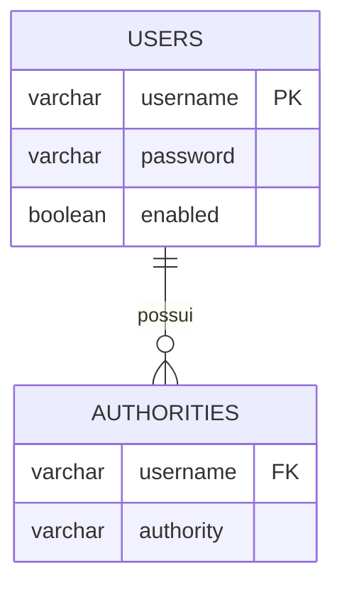
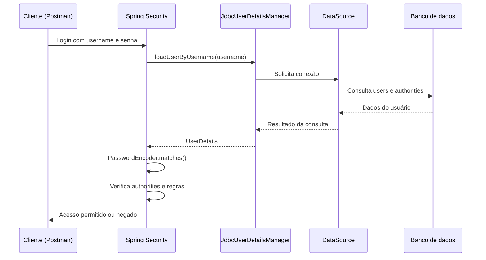

import pypandoc

markdown = r'''# 🗄️ Spring Security: autenticação com JDBC e banco de dados


Continuação do guia de configuração inicial do Spring Security. Aqui saímos do `InMemoryUserDetailsManager` e passamos a buscar e gerenciar usuários em um banco relacional usando JDBC.

> [!IMPORTANT]
> Este guia apresenta o schema JDBC padrão do Spring Security e `JdbcUserDetailsManager`. É uma alternativa ao modelo personalizado com JPA; não é obrigatório utilizar essas tabelas em todos os projetos.

## 📑 Sumário

- [Do InMemory para o banco](#-do-inmemory-para-o-banco)
- [DataSource](#-datasource)
- [UserDetailsManager](#-userdetailsmanager)
- [JdbcUserDetailsManager](#-jdbcuserdetailsmanager)
- [Default Spring Security Database Schema](#-default-spring-security-database-schema)
- [SQL para PostgreSQL](#-sql-para-postgresql)
- [Configuração do projeto](#-configuração-do-projeto)
- [Código completo](#-código-completo)
- [Gerenciando usuários](#-gerenciando-usuários)
- [Fluxo de autenticação](#-fluxo-de-autenticação)
- [JDBC x JPA](#-jdbc-x-jpa)
- [Cuidados importantes](#-cuidados-importantes)
- [Referências](#-referências)

## Do InMemory para o banco

No material anterior, usamos `InMemoryUserDetailsManager`. Ele guarda os usuários na memória da aplicação. Ao reiniciar a aplicação, os usuários cadastrados em memória são perdidos.

Agora, vamos armazenar os usuários no banco:

```text
Requisição de login
       |
       v
Spring Security
       |
       v
JdbcUserDetailsManager
       |
       v
DataSource
       |
       v
Banco de dados (users + authorities)
```

| Implementação | Onde busca os usuários |
|---|---|
| `InMemoryUserDetailsManager` | Memória da aplicação |
| `JdbcUserDetailsManager` | Banco relacional, via JDBC |
| `UserDetailsService` próprio | Onde sua implementação consultar (JPA, API etc.) |

## DataSource

`DataSource` é uma interface Java (`javax.sql.DataSource`) que representa uma **fonte de conexões com o banco de dados**.

Em vez de cada classe abrir conexões manualmente, o Spring injeta um `DataSource` configurado para a aplicação.

Exemplo em `application.properties`:

```properties
spring.datasource.url=jdbc:postgresql://localhost:5432/minha_aplicacao
spring.datasource.username=postgres
spring.datasource.password=${DB_PASSWORD}
spring.datasource.driver-class-name=org.postgresql.Driver
```

Quando as dependências e propriedades estão corretas, o Spring Boot configura automaticamente o `DataSource`.

O fluxo é:

1. A aplicação lê as propriedades `spring.datasource.*`.
2. O Spring Boot configura o acesso ao banco.
3. O `DataSource` disponibiliza conexões.
4. O `JdbcUserDetailsManager` usa essas conexões para executar SQL.

> [!NOTE]
> `DataSource` não é uma tabela, entidade ou repositório. É o objeto que fornece conexões. Em uma aplicação Spring Boot, normalmente você não precisa instanciá-lo manualmente.

## UserDetailsManager

`UserDetailsManager` é uma interface do Spring Security que **estende `UserDetailsService`**.

- `UserDetailsService` define como buscar um usuário pelo username.
- `UserDetailsManager` acrescenta operações para gerenciar usuários.

| Método | O que faz |
|---|---|
| `loadUserByUsername(username)` | Busca o usuário pelo login (herdado de `UserDetailsService`) |
| `createUser(user)` | Cria um usuário |
| `updateUser(user)` | Atualiza um usuário |
| `deleteUser(username)` | Exclui um usuário |
| `changePassword(oldPassword, newPassword)` | Altera a senha do usuário autenticado |
| `userExists(username)` | Verifica se o usuário existe |

A interface define as operações, mas não determina onde os dados serão armazenados. Isso depende da implementação.

- `InMemoryUserDetailsManager`: gerenciamento em memória.
- `JdbcUserDetailsManager`: gerenciamento com JDBC.

## JdbcUserDetailsManager

É uma implementação pronta de `UserDetailsManager` que consulta e gerencia usuários em um banco relacional por meio de JDBC.

Ele já oferece operações para buscar usuário e authorities durante o login, criar, atualizar e excluir usuários, alterar senhas e verificar se um usuário existe.

```java
@Bean
public JdbcUserDetailsManager userDetailsManager(DataSource dataSource) {
    return new JdbcUserDetailsManager(dataSource);
}
```

Você fornece um `DataSource`, e o manager utiliza as conexões disponibilizadas por ele.

> [!IMPORTANT]
> `JdbcUserDetailsManager` não cria automaticamente as tabelas em qualquer configuração. Você precisa disponibilizar o schema esperado (por exemplo, com Flyway ou `schema.sql`) ou configurar consultas SQL próprias.

## Default Spring Security Database Schema

O Spring Security disponibiliza um schema JDBC padrão. O modelo básico utiliza duas tabelas:

### 1. `users`

Armazena os dados necessários para autenticar o usuário.

| Coluna | Função |
|---|---|
| `username` | Nome utilizado no login |
| `password` | Senha codificada (hash) |
| `enabled` | Indica se a conta está habilitada |

### 2. `authorities`

Armazena as permissões associadas aos usuários.

| Coluna | Função |
|---|---|
| `username` | Usuário ao qual a permissão pertence |
| `authority` | Role ou authority do usuário |

Exemplo:

**users**

| username | password | enabled |
|---|---|---|
| gabriel | `$2a$...` | true |
| maria | `$2a$...` | true |

**authorities**

| username | authority |
|---|---|
| gabriel | ROLE_USER |
| gabriel | produto:ler |
| maria | ROLE_ADMIN |

Um usuário pode possuir várias authorities. Por isso, `authorities` possui várias linhas para o mesmo `username`.

### Relacionamento



A tabela `authorities` possui uma chave estrangeira para `users.username`. A combinação `username + authority` deve ser única para evitar repetir a mesma permissão para o mesmo usuário.

### Tabelas opcionais de grupos

O schema JDBC também prevê tabelas opcionais para trabalhar com grupos:

| Tabela | Responsabilidade |
|---|---|
| `groups` | Cadastro dos grupos |
| `group_members` | Associação de usuários aos grupos |
| `group_authorities` | Authorities associadas aos grupos |

Esse modelo permite associar usuários a grupos e conceder authorities ao grupo, em vez de cadastrar cada authority individualmente para cada usuário.

> [!NOTE]
> As tabelas de grupos são opcionais. Para começar, `users` e `authorities` são suficientes. Não confunda o modelo de grupos com a tabela `authorities`: são recursos diferentes.

## SQL para PostgreSQL

A documentação do Spring Security apresenta o schema padrão com tipos específicos do HSQLDB, como `varchar_ignorecase`. Para PostgreSQL, use tipos compatíveis, como `VARCHAR`.

Exemplo adaptado:

```sql
CREATE TABLE users (
    username VARCHAR(50) PRIMARY KEY,
    password VARCHAR(500) NOT NULL,
    enabled BOOLEAN NOT NULL
);

CREATE TABLE authorities (
    username VARCHAR(50) NOT NULL,
    authority VARCHAR(100) NOT NULL,

    CONSTRAINT fk_authorities_users
        FOREIGN KEY (username)
        REFERENCES users(username),

    CONSTRAINT uk_authorities
        UNIQUE (username, authority)
);
```

**Por que `password` tem tamanho 500?** Para comportar o hash produzido pelo algoritmo de codificação de senha. Nunca armazene a senha original em texto puro.

**Por que existe uma chave estrangeira?** Para impedir que uma authority seja associada a um username inexistente.

**Por que existe `UNIQUE (username, authority)`?** Para impedir que a mesma permissão seja cadastrada duas vezes para o mesmo usuário.

### Inserindo dados para teste

```sql
INSERT INTO users (username, password, enabled)
VALUES (
    'gabriel',
    '$2a$10$HASH_BCRYPT_GERADO_PELA_APLICACAO',
    TRUE
);

INSERT INTO authorities (username, authority)
VALUES
    ('gabriel', 'ROLE_USER'),
    ('gabriel', 'produto:ler');
```

> [!WARNING]
> O hash acima é ilustrativo. Gere o valor com `PasswordEncoder.encode()` na aplicação. Não copie esse texto como se fosse uma senha BCrypt válida.

## Configuração do projeto

### 1. Dependências

Exemplo Maven para PostgreSQL:

```xml
<dependencies>
    <dependency>
        <groupId>org.springframework.boot</groupId>
        <artifactId>spring-boot-starter-security</artifactId>
    </dependency>

    <dependency>
        <groupId>org.springframework.boot</groupId>
        <artifactId>spring-boot-starter-jdbc</artifactId>
    </dependency>

    <dependency>
        <groupId>org.postgresql</groupId>
        <artifactId>postgresql</artifactId>
        <scope>runtime</scope>
    </dependency>
</dependencies>
```

> [!NOTE]
> O exemplo usa os starters do Spring Boot. Se o projeto utiliza o parent ou BOM do Spring Boot, deixe que ele gerencie as versões compatíveis.

### 2. Configure o banco

`src/main/resources/application.properties`:

```properties
spring.datasource.url=jdbc:postgresql://localhost:5432/minha_aplicacao
spring.datasource.username=postgres
spring.datasource.password=${DB_PASSWORD}
spring.datasource.driver-class-name=org.postgresql.Driver
```

Defina `DB_PASSWORD` no ambiente em que a aplicação será executada. Não versione senhas reais no Git.

### 3. Crie o schema

Uma opção é utilizar Flyway:

```text
src/main/resources/
└── db/
    └── migration/
        └── V1__create_security_tables.sql
```

Coloque o SQL de criação de `users` e `authorities` nesse arquivo. Adicione a dependência do Flyway compatível com a versão do Spring Boot e do banco.

Outra opção é utilizar `schema.sql` com a inicialização SQL do Spring Boot. Evite manter duas ferramentas tentando criar as mesmas tabelas.

## Código completo

Exemplo de configuração com `JdbcUserDetailsManager` e BCrypt.

`security/DatabaseSecurityConfig.java`:

```java
@Configuration
public class DatabaseSecurityConfig {

    @Bean
    public PasswordEncoder passwordEncoder() {
        return new BCryptPasswordEncoder();
    }

    @Bean
    public JdbcUserDetailsManager userDetailsManager(
            DataSource dataSource) {

        return new JdbcUserDetailsManager(dataSource);
    }

    @Bean
    public SecurityFilterChain filterChain(
            HttpSecurity http) throws Exception {

        http.authorizeHttpRequests(auth -> auth
                .requestMatchers("/api/auth/**").permitAll()
                .requestMatchers("/api/admin/**").hasRole("ADMIN")
                .anyRequest().authenticated()
        );

        http.httpBasic(Customizer.withDefaults());

        return http.build();
    }
}
```

### Entendendo a configuração

| Código | Responsabilidade |
|---|---|
| `PasswordEncoder` | Codifica e verifica senhas |
| `BCryptPasswordEncoder` | Implementação de hash BCrypt |
| `DataSource` | Fornece conexões com o banco |
| `JdbcUserDetailsManager` | Busca e gerencia usuários com JDBC |
| `SecurityFilterChain` | Define regras de acesso às rotas |
| `permitAll()` | Libera as rotas públicas |
| `hasRole("ADMIN")` | Exige a role ADMIN |
| `authenticated()` | Exige autenticação |

O Spring injeta o `DataSource` configurado pelo Spring Boot no `JdbcUserDetailsManager`.

> [!IMPORTANT]
> O `JdbcUserDetailsManager` utiliza as consultas e o schema JDBC esperados pelo Spring Security. Se você mudar nomes de tabelas ou colunas, precisará adaptar as consultas do manager.

## Gerenciando usuários

O `JdbcUserDetailsManager` implementa `UserDetailsManager`, então podemos utilizar os métodos de gerenciamento.

Exemplo de serviço para cadastrar um usuário:

```java
@Service
public class UsuarioService {

    private final UserDetailsManager userDetailsManager;
    private final PasswordEncoder passwordEncoder;

    public UsuarioService(
            UserDetailsManager userDetailsManager,
            PasswordEncoder passwordEncoder) {

        this.userDetailsManager = userDetailsManager;
        this.passwordEncoder = passwordEncoder;
    }

    public void cadastrar(String username, String senha) {

        if (userDetailsManager.userExists(username)) {
            throw new IllegalArgumentException("Usuário já cadastrado");
        }

        UserDetails usuario = User.builder()
                .username(username)
                .password(passwordEncoder.encode(senha))
                .roles("USER")
                .build();

        userDetailsManager.createUser(usuario);
    }
}
```

### O que acontece no cadastro?

1. `userExists(username)` verifica se o login já está cadastrado.
2. `passwordEncoder.encode(senha)` gera o hash da senha.
3. `User.builder()` cria um objeto que implementa `UserDetails`.
4. `.roles("USER")` adiciona a authority `ROLE_USER`.
5. `createUser(usuario)` persiste o usuário e suas authorities no banco.

> [!WARNING]
> O `JdbcUserDetailsManager` não substitui a validação de entrada da API. Em um cadastro real, valide os campos, trate duplicidade, defina regras de senha e retorne respostas HTTP adequadas.

### Outros métodos disponíveis

```java
// Verifica se existe
boolean existe = userDetailsManager.userExists("gabriel");

// Busca os dados para autenticação
UserDetails usuario =
        userDetailsManager.loadUserByUsername("gabriel");

// Atualiza os dados do usuário
userDetailsManager.updateUser(usuario);

// Exclui o usuário
userDetailsManager.deleteUser("gabriel");

// Altera a senha do usuário autenticado
userDetailsManager.changePassword(
        senhaAtual,
        novaSenhaCodificada
);
```

> [!NOTE]
> `changePassword` foi pensado para a alteração da senha do usuário autenticado no contexto de segurança. Para um fluxo administrativo de redefinição de senha, implemente a verificação de autorização e a atualização de forma apropriada.

## Fluxo de autenticação



O `JdbcUserDetailsManager` busca o usuário e suas authorities. O Spring Security utiliza o `PasswordEncoder` para comparar a senha recebida com o hash armazenado.

## JDBC x JPA

| Característica | JDBC (`JdbcUserDetailsManager`) | JPA (`UserDetailsService` próprio) |
|---|---|---|
| Acesso ao banco | SQL/JDBC | ORM, normalmente Hibernate |
| Modelo de tabelas | Schema esperado ou consultas customizadas | Modelo definido pelo projeto |
| Gerenciamento de usuário | Implementação pronta | Você implementa |
| Flexibilidade | Menor no modelo padrão | Maior |
| Bom para | Aprender JDBC e usar o schema padrão | Sistemas com domínio e regras próprias |

### Quando escolher cada um?

**Use `JdbcUserDetailsManager` quando:**

- Quiser aprender a integração JDBC com Spring Security.
- Seu projeto puder utilizar o modelo de tabelas padrão.
- Precisar de uma implementação pronta para buscar e gerenciar usuários.

**Use JPA com `UserDetailsService` próprio quando:**

- Já tiver entidades e relacionamentos próprios.
- Precisar integrar usuário, perfil, permissões e outras informações de domínio.
- Quiser controlar completamente as consultas e regras de cadastro.

> [!TIP]
> Em um sistema maior, com entidades próprias e regras de negócio, JPA costuma oferecer mais flexibilidade. `JdbcUserDetailsManager` é excelente para entender a integração do Spring Security com banco relacional.

## Cuidados importantes

- [ ] Não armazene senhas em texto puro.
- [ ] Utilize `BCryptPasswordEncoder` ou outro algoritmo apropriado de hash de senha.
- [ ] Não versione credenciais do banco.
- [ ] Crie as tabelas com Flyway ou outra ferramenta de migração.
- [ ] Garanta que cada usuário tenha authorities válidas.
- [ ] Trate usuários duplicados e erros de persistência.
- [ ] Utilize HTTPS em ambientes reais, especialmente ao usar Basic Auth.
- [ ] Não desative CSRF sem entender o modelo de autenticação e o tipo de cliente.
- [ ] Não exponha endpoints de cadastro e gerenciamento sem autorização adequada.

## Indo para produção

- [x] Entender `UserDetails` e `UserDetailsService`.
- [x] Conhecer `UserDetailsManager`.
- [x] Entender `DataSource`.
- [x] Conhecer `JdbcUserDetailsManager`.
- [x] Entender o schema JDBC padrão (`users` e `authorities`).
- [ ] Criar um cadastro com validação e tratamento de erros.
- [ ] Implementar autenticação com JPA e modelo de usuário próprio.
- [ ] Estudar autenticação stateless com JWT.
- [ ] Estudar refresh token, expiração e revogação de tokens.
- [ ] Revisar autorização por roles e authorities.

## 📚 Referências

- [Spring Security — JDBC Authentication](https://docs.spring.io/spring-security/reference/servlet/authentication/passwords/jdbc.html)
- [Spring Security — UserDetailsManager API](https://docs.spring.io/spring-security/site/docs/current/api/org/springframework/security/provisioning/UserDetailsManager.html)
- [Spring Security — JdbcUserDetailsManager API](https://docs.spring.io/spring-security/site/docs/current/api/org/springframework/security/provisioning/JdbcUserDetailsManager.html)
- [Spring Boot — SQL Databases](https://docs.spring.io/spring-boot/reference/data/sql.html)
- [Spring Security — Password Storage](https://docs.spring.io/spring-security/reference/features/authentication/password-storage.html)
- [spring-projects/spring-security no GitHub](https://github.com/spring-projects/spring-security)
'''

