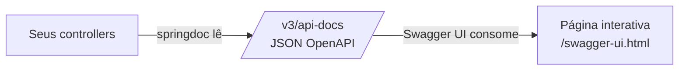

# Swagger no Spring Boot: documentando e testando sua API


Guia prático para **documentar automaticamente** uma API Spring Boot e **testá-la pelo navegador**, sem precisar do Postman.

## Sumário

- [O que é Swagger?](#-o-que-é-swagger)
- [Passo a passo](#-passo-a-passo)
- [Exemplo base: API de funcionários](#-exemplo-base-api-de-funcionários)
- [Testando pelo Swagger UI](#-testando-pelo-swagger-ui)
- [Informações gerais da API](#-informações-gerais-da-api)
- [Anotações mais usadas](#-anotações-mais-usadas)
- [Configurações no application.properties](#-configurações-no-applicationproperties)
- [Swagger com Spring Security](#-swagger-com-spring-security)
- [Erros comuns](#-erros-comuns)
- [Indo para produção](#-indo-para-produção)
- [Referências](#-referências)

## O que é Swagger?

"Swagger" é o nome popular de um conjunto de ferramentas. Na prática, você vai lidar com quatro nomes:

| Nome | O que é |
|---|---|
| **OpenAPI** | A **especificação** (o padrão) que descreve uma API REST em JSON ou YAML |
| **Swagger UI** | A **página web** que mostra a documentação e permite testar os endpoints |
| **springdoc-openapi** | A **biblioteca** que lê os seus controllers e gera o OpenAPI automaticamente |
| **Anotações** (`@Operation`, `@Schema`...) | Recursos para **enriquecer** a documentação com descrições e exemplos |



> [!NOTE]
> Você **não precisa** escrever a documentação à mão. Só de adicionar a dependência, o springdoc já gera uma documentação básica a partir dos seus controllers. As anotações servem para deixá-la mais clara.

## Passo a passo

### 1. Adicione a dependência

Escolha a versão do springdoc de acordo com a versão do seu Spring Boot:

| Spring Boot | springdoc-openapi |
|:---:|:---:|
| 3.x | `2.8.x` |
| 4.x | `3.0.x` |

> [!IMPORTANT]
> Usar a versão errada é a causa mais comum de erro na inicialização ou de Swagger UI que não abre. Confirme a **última versão disponível** no [Maven Central](https://central.sonatype.com/artifact/org.springdoc/springdoc-openapi-starter-webmvc-ui) antes de fixar.

**Maven** (exemplo para Spring Boot 4)

```xml
<dependency>
    <groupId>org.springdoc</groupId>
    <artifactId>springdoc-openapi-starter-webmvc-ui</artifactId>
    <version>3.0.3</version>
</dependency>
```

**Gradle**

```groovy
implementation 'org.springdoc:springdoc-openapi-starter-webmvc-ui:3.0.3'
```

> [!TIP]
> Se o seu projeto usa **WebFlux** (reativo), troque `webmvc` por `webflux` no nome do artefato: `springdoc-openapi-starter-webflux-ui`.

### 2. Inicie a aplicação

Rode o projeto normalmente (`./mvnw spring-boot:run` ou pela sua IDE).

### 3. Acesse as URLs

| O que | URL padrão |
|---|---|
| **Swagger UI** (página interativa) | `http://localhost:8080/swagger-ui.html` |
| **OpenAPI em JSON** | `http://localhost:8080/v3/api-docs` |
| **OpenAPI em YAML** | `http://localhost:8080/v3/api-docs.yaml` |

> [!NOTE]
> A URL `/swagger-ui.html` redireciona para `/swagger-ui/index.html`. As duas funcionam.

### 4. Veja os endpoints e teste

Você deve ver todos os seus controllers agrupados. O próximo passo é entender como usar a página: veja [Testando pelo Swagger UI](#-testando-pelo-swagger-ui).

## Exemplo base: API de funcionários

Para os exemplos deste guia, vamos usar uma API simples de funcionários, com os dados guardados em memória.

> [!NOTE]
> Este exemplo usa `@Valid` e `@NotBlank`. Se o seu projeto ainda não tem a validação, adicione a dependência `spring-boot-starter-validation`.

**`Employee.java`** (resposta)

```java
public record Employee(
        @Schema(description = "Identificador do funcionário", example = "1")
        Long id,

        @Schema(description = "Nome completo", example = "Gabriel Silva")
        String name,

        @Schema(description = "Cargo", example = "Desenvolvedor")
        String role
) {}
```

**`EmployeeRequest.java`** (entrada)

```java
public record EmployeeRequest(
        @Schema(description = "Nome completo", example = "Gabriel Silva",
                requiredMode = Schema.RequiredMode.REQUIRED)
        @NotBlank
        String name,

        @Schema(description = "Cargo", example = "Desenvolvedor",
                requiredMode = Schema.RequiredMode.REQUIRED)
        @NotBlank
        String role
) {}
```

**`EmployeeController.java`**

```java
@RestController
@RequestMapping("/api/employee")
@Tag(name = "Funcionários", description = "Cadastro e consulta de funcionários")
public class EmployeeController {

    private final Map<Long, Employee> employees = new ConcurrentHashMap<>();
    private final AtomicLong sequence = new AtomicLong();

    @GetMapping
    @Operation(summary = "Listar funcionários",
               description = "Retorna todos os funcionários cadastrados")
    @ApiResponse(responseCode = "200", description = "Lista retornada com sucesso")
    public List<Employee> findAll() {
        return List.copyOf(employees.values());
    }

    @GetMapping("/{id}")
    @Operation(summary = "Buscar funcionário por id")
    @ApiResponses({
            @ApiResponse(responseCode = "200", description = "Funcionário encontrado"),
            @ApiResponse(responseCode = "404", description = "Funcionário não encontrado", content = @Content)
    })
    public ResponseEntity<Employee> findById(
            @Parameter(description = "Id do funcionário", example = "1")
            @PathVariable Long id) {

        return Optional.ofNullable(employees.get(id))
                .map(ResponseEntity::ok)
                .orElse(ResponseEntity.notFound().build());
    }

    @PostMapping
    @Operation(summary = "Cadastrar funcionário")
    @ApiResponses({
            @ApiResponse(responseCode = "201", description = "Funcionário criado"),
            @ApiResponse(responseCode = "400", description = "Dados inválidos", content = @Content)
    })
    public ResponseEntity<Employee> create(@Valid @RequestBody EmployeeRequest request) {
        long id = sequence.incrementAndGet();
        Employee employee = new Employee(id, request.name(), request.role());
        employees.put(id, employee);

        URI location = ServletUriComponentsBuilder.fromCurrentRequest()
                .path("/{id}").buildAndExpand(id).toUri();

        return ResponseEntity.created(location).body(employee);
    }

    @DeleteMapping("/{id}")
    @Operation(summary = "Remover funcionário")
    @ApiResponses({
            @ApiResponse(responseCode = "204", description = "Funcionário removido"),
            @ApiResponse(responseCode = "404", description = "Funcionário não encontrado", content = @Content)
    })
    public ResponseEntity<Void> delete(@PathVariable Long id) {
        return employees.remove(id) != null
                ? ResponseEntity.noContent().build()
                : ResponseEntity.notFound().build();
    }
}
```

<details>
<summary>Imports usados nos exemplos</summary>

```java
import io.swagger.v3.oas.annotations.Operation;
import io.swagger.v3.oas.annotations.Parameter;
import io.swagger.v3.oas.annotations.media.Content;
import io.swagger.v3.oas.annotations.media.Schema;
import io.swagger.v3.oas.annotations.responses.ApiResponse;
import io.swagger.v3.oas.annotations.responses.ApiResponses;
import io.swagger.v3.oas.annotations.tags.Tag;
```

</details>

## Testando pelo Swagger UI

Abra `http://localhost:8080/swagger-ui.html`. Os endpoints aparecem agrupados pelo `@Tag`, cada um com uma cor por método HTTP.

| Cor | Método |
|---|---|
| 🟢 Verde | `POST` |
| 🔵 Azul | `GET` |
| 🟠 Laranja | `PUT` |
| 🔴 Vermelho | `DELETE` |

### Exemplo 1: cadastrar um funcionário (`POST`)

1. Clique em **`POST /api/employee`** para expandir.
2. Clique em **Try it out**.
3. O campo *Request body* já vem preenchido com os **exemplos** definidos no `@Schema`. Edite se quiser:

```json
{
  "name": "Gabriel Silva",
  "role": "Desenvolvedor"
}
```

4. Clique em **Execute**.
5. Role a tela até **Responses** e confira o resultado:

| Item | O que mostra |
|---|---|
| **Curl** | O comando equivalente, pronto para copiar |
| **Request URL** | A URL chamada |
| **Code** | O status HTTP (`201`) |
| **Response body** | O JSON devolvido |
| **Response headers** | Os cabeçalhos (incluindo o `Location`) |

### Exemplo 2: buscar por id (`GET`)

1. Expanda **`GET /api/employee/{id}`** e clique em **Try it out**.
2. Preencha o campo `id` com `1`.
3. Clique em **Execute** e confira o `200` com o funcionário.
4. Repita com um id que não existe (ex.: `99`) para ver o `404`.

### Exemplo 3: provocar um erro `400`

1. Em `POST /api/employee`, apague o valor de `name` (deixe `""`).
2. Clique em **Execute**.
3. Como o campo tem `@NotBlank`, a API responde **`400 Bad Request`**.

> [!TIP]
> A seção **Schemas**, no final da página, lista todos os modelos (`Employee`, `EmployeeRequest`) com os campos, tipos, exemplos e quais são obrigatórios.

## Informações gerais da API

Use `@OpenAPIDefinition` para definir o título, a versão e a descrição que aparecem no topo da página. Crie uma classe de configuração:

```java
@Configuration
@OpenAPIDefinition(
        info = @Info(
                title = "API de Funcionários",
                version = "1.0.0",
                description = "API de estudo para cadastro de funcionários",
                contact = @Contact(name = "Seu Nome", email = "seu@email.com")
        ),
        servers = @Server(url = "http://localhost:8080", description = "Ambiente local")
)
public class OpenApiConfig {
}
```

```java
import io.swagger.v3.oas.annotations.OpenAPIDefinition;
import io.swagger.v3.oas.annotations.info.Contact;
import io.swagger.v3.oas.annotations.info.Info;
import io.swagger.v3.oas.annotations.servers.Server;
```

## Anotações mais usadas

| Anotação | Onde usar | Para que serve |
|---|---|---|
| `@Tag` | Classe | Agrupa e descreve os endpoints de um controller |
| `@Operation` | Método | Título (`summary`) e descrição (`description`) do endpoint |
| `@ApiResponse` / `@ApiResponses` | Método | Documenta os códigos de resposta possíveis |
| `@Parameter` | Parâmetro | Descreve e dá exemplo para `@PathVariable` e `@RequestParam` |
| `@Schema` | Classe ou campo | Descrição, exemplo e obrigatoriedade dos campos do modelo |
| `@Hidden` | Classe ou método | **Esconde** o endpoint da documentação |
| `@SecurityRequirement` | Classe ou método | Indica que o endpoint exige autenticação |

### Documentar uma lista na resposta

```java
@ApiResponse(
        responseCode = "200",
        description = "Lista de funcionários",
        content = @Content(array = @ArraySchema(schema = @Schema(implementation = Employee.class)))
)
```

### Parâmetros de busca (`@RequestParam`)

```java
@GetMapping("/search")
@Operation(summary = "Buscar por cargo")
public List<Employee> searchByRole(
        @Parameter(description = "Cargo a filtrar", example = "Desenvolvedor")
        @RequestParam String role) {
    // ...
}
```

### Esconder um endpoint

```java
@Hidden
@GetMapping("/interno")
public String interno() {
    return "não aparece no Swagger";
}
```

> [!TIP]
> As anotações de validação (`@NotBlank`, `@Size`, `@Min`...) são lidas **automaticamente** pelo springdoc e aparecem no Swagger como regras do campo. Não é preciso repeti-las no `@Schema`.

## 🔧 Configurações no `application.properties`

```properties
# Caminho da página do Swagger UI (padrão: /swagger-ui.html)
springdoc.swagger-ui.path=/docs

# Caminho do JSON do OpenAPI (padrão: /v3/api-docs)
springdoc.api-docs.path=/api-docs

# Ordenação dos endpoints e das tags
springdoc.swagger-ui.operations-sorter=method
springdoc.swagger-ui.tags-sorter=alpha

# Mostra o tempo de cada requisição
springdoc.swagger-ui.display-request-duration=true

# Documenta apenas rotas específicas
springdoc.paths-to-match=/api/**

# Documenta apenas controllers de um pacote
springdoc.packages-to-scan=com.exemplo.controller
```

| Propriedade | Efeito |
|---|---|
| `springdoc.swagger-ui.path` | Muda a URL da página do Swagger |
| `springdoc.api-docs.path` | Muda a URL do JSON |
| `springdoc.paths-to-match` | Limita as rotas documentadas |
| `springdoc.packages-to-scan` | Limita os pacotes documentados |
| `springdoc.swagger-ui.enabled` | Liga ou desliga a página do Swagger |
| `springdoc.api-docs.enabled` | Liga ou desliga o JSON do OpenAPI |

## Swagger com Spring Security

Quando o Spring Security está ativo, o Swagger UI também fica bloqueado. São necessários **dois ajustes**: liberar as rotas do Swagger e configurar a autenticação **Basic Auth** na própria página, para poder testar endpoints protegidos.

### Passo 1: liberar as rotas do Swagger no `SecurityFilterChain`

```java
@Bean
public SecurityFilterChain filterChain(HttpSecurity http) throws Exception {

    http.authorizeHttpRequests(auth -> auth
            .requestMatchers("/swagger-ui.html", "/swagger-ui/**", "/v3/api-docs/**").permitAll()
            .requestMatchers(HttpMethod.GET, "/api/employee/**").hasRole("EMPLOYEE")
            .requestMatchers(HttpMethod.POST, "/api/employee/**").hasRole("MANAGER")
            .requestMatchers(HttpMethod.DELETE, "/api/employee/**").hasRole("ADMIN")
            .anyRequest().authenticated()
    );

    http.httpBasic(Customizer.withDefaults());
    http.csrf(csrf -> csrf.disable());

    return http.build();
}
```

> [!IMPORTANT]
> A **ordem importa**: as rotas do Swagger precisam vir **antes** das demais regras.

> [!NOTE]
> Com o `permitAll()`, qualquer pessoa **abre a página** do Swagger, mas só consegue **executar** os endpoints protegidos depois de se autenticar (passo 3). Se preferir esconder até a página, remova a linha e o navegador pedirá o login ao abrir o Swagger.

### Passo 2: declarar o esquema de autenticação

Na classe `OpenApiConfig`, acrescente o `@SecurityScheme`:

```java
@Configuration
@OpenAPIDefinition(
        info = @Info(title = "API de Funcionários", version = "1.0.0")
)
@SecurityScheme(
        name = "basicAuth",
        type = SecuritySchemeType.HTTP,
        scheme = "basic"
)
public class OpenApiConfig {
}
```

Depois, indique quais endpoints usam esse esquema com o `@SecurityRequirement`:

```java
@RestController
@RequestMapping("/api/employee")
@Tag(name = "Funcionários")
@SecurityRequirement(name = "basicAuth")   // vale para todos os métodos da classe
public class EmployeeController {
    // ...
}
```

```java
import io.swagger.v3.oas.annotations.security.SecurityRequirement;
import io.swagger.v3.oas.annotations.security.SecurityScheme;
import io.swagger.v3.oas.annotations.enums.SecuritySchemeType;
```

### Passo 3: autenticar na página

1. Abra o Swagger UI. Um botão **Authorize** 🔓 aparece no topo.
2. Clique nele.
3. Informe o *Username* e o *Password* de um usuário (ex.: `Vitoria` / `test123`).
4. Clique em **Authorize** e depois em **Close**. O cadeado passa a aparecer fechado 🔒.
5. Execute os endpoints normalmente. O Swagger envia o cabeçalho `Authorization: Basic ...` em todas as requisições.

### Resultados esperados

| Usuário | `GET` | `POST` | `DELETE` |
|---|:---:|:---:|:---:|
| Gabriel (EMPLOYEE) | `200` | `403` | `403` |
| Vitoria (EMPLOYEE, MANAGER) | `200` | `201` | `403` |
| Grasi (EMPLOYEE, MANAGER, ADMIN) | `200` | `201` | `204` |

> [!TIP]
> Sem autenticar na página, os endpoints protegidos retornam **`401`**. Autenticado, mas sem a role necessária, o retorno é **`403`**.

## 🐞 Erros comuns

| Problema | Causa provável | Solução |
|---|---|---|
| Swagger UI dá **404** | Dependência errada ou versão incompatível com o Spring Boot | Use `springdoc-openapi-starter-webmvc-ui` na versão da [tabela](#1-adicione-a-dependência) |
| Swagger UI dá **401** ou pede login | Spring Security bloqueando as rotas | Libere `/swagger-ui/**` e `/v3/api-docs/**` com `permitAll()` |
| Página abre, mas **todo endpoint dá 401** | Falta autenticar na página | Clique em **Authorize** e informe usuário e senha |
| **403** em `POST`, `PUT` ou `DELETE` | CSRF ativo | Desative o CSRF em projetos de estudo (`csrf.disable()`) |
| Endpoint **não aparece** | Fora do `paths-to-match` ou do `packages-to-scan`, ou com `@Hidden` | Revise as propriedades e as anotações |
| Botão **Authorize não aparece** | Falta o `@SecurityScheme` | Declare o esquema na classe de configuração |
| Campos sem **exemplo** | Falta o `@Schema(example = ...)` | Adicione exemplos nos campos dos modelos |
| Erro com `javax` ou `NoClassDefFoundError` | Biblioteca antiga (`springdoc-openapi-ui`) | Troque por `springdoc-openapi-starter-webmvc-ui` |

## Indo para produção

> [!WARNING]
> Deixar o Swagger aberto em produção **expõe a estrutura inteira da sua API**. Desative ou proteja.

Crie um `application-prod.properties` com:

```properties
springdoc.api-docs.enabled=false
springdoc.swagger-ui.enabled=false
```

E ative o perfil na hora de rodar:

```bash
java -jar app.jar --spring.profiles.active=prod
```

## ✅ Resumo

- [x] Adicionar a dependência `springdoc-openapi-starter-webmvc-ui` na versão certa
- [x] Acessar `/swagger-ui.html` e `/v3/api-docs`
- [x] Testar endpoints com **Try it out** e **Execute**
- [x] Documentar com `@Tag`, `@Operation`, `@ApiResponse`, `@Parameter` e `@Schema`
- [x] Configurar **Basic Auth** com `@SecurityScheme` e `@SecurityRequirement`
- [ ] Desativar o Swagger em produção

## 📚 Referências

- [springdoc-openapi: documentação oficial](https://springdoc.org/)
- [springdoc-openapi no GitHub](https://github.com/springdoc/springdoc-openapi)
- [Anotações do Swagger (swagger-core)](https://github.com/swagger-api/swagger-core/wiki/Swagger-2.X---Annotations)
- [Especificação OpenAPI](https://swagger.io/specification/)
