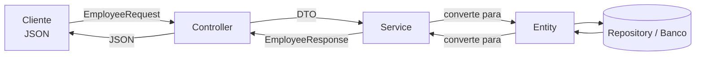

# 📦 DTO no Spring Boot: tudo o que você precisa saber


Guia prático sobre **DTO (Data Transfer Object)**: o que é, por que usar, como criar, validar, mapear e organizar no seu projeto Spring Boot.

## 📑 Sumário

- [O que é DTO?](#o-que-é-dto)
- [O caminho dos dados](#o-caminho-dos-dados)
- [Por que não expor a entidade?](#por-que-não-expor-a-entidade)
- [Passo a passo](#passo-a-passo)
- [Tipos de DTO](#tipos-de-dto)
- [Record, classe ou Lombok?](#record-classe-ou-lombok)
- [Classe com vários DTOs dentro](#classe-com-vários-dtos-dentro)
- [Validação](#-validação)
- [Mapeamento: entidade ↔ DTO](#mapeamento-entidade--dto)
- [Projeções do Spring Data](#projeções-do-spring-data)
- [Paginação](#-paginação)
- [Controlando o JSON](#controlando-o-json)
- [Atualização: PUT e PATCH](#-atualização-put-e-patch)
- [DTO, Security e Swagger](#dto-security-e-swagger)
- [Estrutura de pastas e nomes](#-estrutura-de-pastas-e-nomes)
- [Erros comuns](#-erros-comuns)
- [Boas práticas](#-boas-práticas)
- [Referências](#-referências)

## O que é DTO?

**DTO** significa *Data Transfer Object* (objeto de transferência de dados). É uma classe simples, **sem regras de negócio**, criada apenas para **transportar dados** entre camadas ou entre sistemas, normalmente entre o cliente (JSON) e a sua API.

| | Entidade (`@Entity`) | DTO |
|---|---|---|
| **Representa** | Uma tabela do banco | Um **contrato** da API (o que entra e o que sai) |
| **Ligada ao JPA?** | Sim | Não |
| **Tem todos os campos?** | Sim, inclusive os internos | Só os que **fazem sentido** para aquele caso de uso |
| **Muda quando** | O banco muda | A API muda |
| **Quantidade** | Uma por tabela | **Vários** por entidade (entrada, saída, resumo...) |

> [!NOTE]
> A ideia central é **separar o que você guarda do que você mostra**. O banco e a API evoluem em ritmos diferentes, e o DTO impede que um quebre o outro.

## O caminho dos dados



1. O cliente envia um JSON, que vira um **DTO de entrada** (`Request`).
2. O service converte o DTO em **entidade** e salva.
3. Ao responder, o service converte a entidade em um **DTO de saída** (`Response`).
4. O controller devolve o DTO. A entidade **nunca** sai da camada de serviço.

## Por que não expor a entidade?

Veja uma entidade comum:

```java
@Entity
public class Employee {

    @Id
    @GeneratedValue(strategy = GenerationType.IDENTITY)
    private Long id;

    private String name;
    private String email;
    private String password;     // hash da senha
    private BigDecimal salary;

    @ManyToOne(fetch = FetchType.LAZY)
    private Department department;

    // getters e setters
}
```

Se o controller devolver essa classe diretamente, o JSON sai assim:

```json
{
  "id": 1,
  "name": "Gabriel",
  "email": "gabriel@exemplo.com",
  "password": "{bcrypt}$2a$10$...",
  "salary": 8500.00,
  "department": { "id": 1, "name": "TI", "employees": [ ... ] }
}
```

| Problema | O que acontece |
|---|---|
| **Vazamento de dados** | `password`, `salary` e outros campos internos vão para o cliente |
| **Mass assignment** | No `POST`/`PUT`, o cliente pode enviar `id`, `salary` ou `role` e **sobrescrever** o que não devia |
| **Recursão infinita** | `Employee` → `Department` → `employees` → `Employee`... gera `StackOverflowError` ou JSON gigante |
| **`LazyInitializationException`** | O Jackson tenta ler uma relação `LAZY` depois que a transação terminou |
| **Acoplamento** | Renomear uma coluna **quebra** quem consome a API |
| **Validação única** | Criar e atualizar exigem campos diferentes, mas a entidade tem uma regra só |
| **Consultas desnecessárias** | Carrega a entidade inteira para devolver 2 campos |

> [!CAUTION]
> Usar `@JsonIgnore` na entidade resolve **um** dos problemas, mas mistura a regra de persistência com a de apresentação. O caminho mais limpo é o DTO.

## Passo a passo

O exemplo completo: um cadastro de funcionários com DTOs de entrada e de saída.

### 1. Crie os DTOs de entrada e de saída

> [!TIP]
> Os exemplos usam **records** (Java 16+), que são imutáveis e já geram construtor, getters, `equals`, `hashCode` e `toString`. O Spring Boot os suporta nativamente.

**`EmployeeRequest.java`** (o que o cliente envia para criar)

```java
public record EmployeeRequest(

        @NotBlank(message = "O nome é obrigatório")
        @Size(max = 100, message = "O nome pode ter no máximo 100 caracteres")
        String name,

        @NotBlank(message = "O e-mail é obrigatório")
        @Email(message = "E-mail inválido")
        String email,

        @NotBlank(message = "A senha é obrigatória")
        @Size(min = 8, max = 72, message = "A senha deve ter entre 8 e 72 caracteres")
        String password,

        @NotNull(message = "O salário é obrigatório")
        @Positive(message = "O salário deve ser positivo")
        BigDecimal salary,

        @NotNull(message = "O departamento é obrigatório")
        Long departmentId
) {}
```

**`EmployeeResponse.java`** (o que a API devolve)

```java
public record EmployeeResponse(
        Long id,
        String name,
        String email,
        String departmentName
) {}
```

Repare no que **não** está no `EmployeeResponse`: `password` e `salary`. O contrato da API decide o que sai.

### 2. Crie o mapper (conversão manual)

```java
@Component
public class EmployeeMapper {

    public Employee toEntity(EmployeeRequest request, Department department) {
        Employee employee = new Employee();
        employee.setName(request.name());
        employee.setEmail(request.email());
        employee.setSalary(request.salary());
        employee.setDepartment(department);
        return employee;
    }

    public EmployeeResponse toResponse(Employee employee) {
        return new EmployeeResponse(
                employee.getId(),
                employee.getName(),
                employee.getEmail(),
                employee.getDepartment().getName()
        );
    }
}
```

> [!NOTE]
> A senha **não** é copiada no mapper porque precisa ser codificada antes (próximo passo).

### 3. Use no service

A conversão acontece **dentro do service**, onde a transação ainda está aberta.

```java
@Service
public class EmployeeService {

    private final EmployeeRepository repository;
    private final DepartmentRepository departments;
    private final EmployeeMapper mapper;
    private final PasswordEncoder passwordEncoder;

    public EmployeeService(EmployeeRepository repository,
                           DepartmentRepository departments,
                           EmployeeMapper mapper,
                           PasswordEncoder passwordEncoder) {
        this.repository = repository;
        this.departments = departments;
        this.mapper = mapper;
        this.passwordEncoder = passwordEncoder;
    }

    @Transactional
    public EmployeeResponse create(EmployeeRequest request) {
        Department department = departments.findById(request.departmentId())
                .orElseThrow(() -> new ResponseStatusException(
                        HttpStatus.NOT_FOUND, "Departamento não encontrado"));

        Employee employee = mapper.toEntity(request, department);
        employee.setPassword(passwordEncoder.encode(request.password()));

        return mapper.toResponse(repository.save(employee));
    }

    @Transactional(readOnly = true)
    public List<EmployeeResponse> findAll() {
        return repository.findAll().stream()
                .map(mapper::toResponse)
                .toList();
    }

    @Transactional(readOnly = true)
    public EmployeeResponse findById(Long id) {
        return repository.findById(id)
                .map(mapper::toResponse)
                .orElseThrow(() -> new ResponseStatusException(
                        HttpStatus.NOT_FOUND, "Funcionário não encontrado"));
    }
}
```

### 4. Use no controller

O controller só conhece DTOs. Nenhuma entidade aparece aqui.

```java
@RestController
@RequestMapping("/api/employee")
public class EmployeeController {

    private final EmployeeService service;

    public EmployeeController(EmployeeService service) {
        this.service = service;
    }

    @GetMapping
    public List<EmployeeResponse> findAll() {
        return service.findAll();
    }

    @GetMapping("/{id}")
    public EmployeeResponse findById(@PathVariable Long id) {
        return service.findById(id);
    }

    @PostMapping
    public ResponseEntity<EmployeeResponse> create(@Valid @RequestBody EmployeeRequest request) {
        EmployeeResponse response = service.create(request);

        URI location = ServletUriComponentsBuilder.fromCurrentRequest()
                .path("/{id}").buildAndExpand(response.id()).toUri();

        return ResponseEntity.created(location).body(response);
    }
}
```

> [!IMPORTANT]
> O `@Valid` é o que **ativa** a validação do DTO. Sem ele, as anotações (`@NotBlank`, `@Email`...) são ignoradas.

### 5. Teste

**Requisição** `POST /api/employee`

```json
{
  "name": "Gabriel",
  "email": "gabriel@exemplo.com",
  "password": "senha1234",
  "salary": 8500.00,
  "departmentId": 1
}
```

**Resposta** `201 Created`

```json
{
  "id": 1,
  "name": "Gabriel",
  "email": "gabriel@exemplo.com",
  "departmentName": "TI"
}
```

Sem senha, sem salário, sem `Department` aninhado e sem risco de recursão.

## Tipos de DTO

Uma entidade costuma ter **vários** DTOs. Cada um atende a um caso de uso:

| Tipo | Uso | Exemplo |
|---|---|---|
| **Request de criação** | Dados do `POST` | `EmployeeRequest` |
| **Request de atualização** | Dados do `PUT`/`PATCH` (geralmente com menos campos) | `EmployeeUpdateRequest` |
| **Response** | Dados devolvidos ao cliente | `EmployeeResponse` |
| **Response resumida** | Para listagens (poucos campos) | `EmployeeSummary` |
| **Response detalhada** | Para consulta individual (mais campos) | `EmployeeDetailResponse` |
| **Filtro de busca** | Parâmetros de pesquisa | `EmployeeFilter` |
| **Erro** | Padroniza as respostas de erro | `ProblemDetail` |

**Exemplo: DTO de atualização** (não aceita `id`, `password` nem `departmentId`)

```java
public record EmployeeUpdateRequest(

        @NotBlank @Size(max = 100)
        String name,

        @NotBlank @Email
        String email,

        @NotNull @Positive
        BigDecimal salary
) {}
```

**Exemplo: DTO detalhado** (com campo sensível, para quem tem permissão)

```java
public record EmployeeDetailResponse(
        Long id,
        String name,
        String email,
        BigDecimal salary,
        String departmentName
) {}
```

**Exemplo: DTO aninhado**

```java
public record DepartmentResponse(
        Long id,
        String name,
        List<EmployeeSummary> employees
) {}

public record EmployeeSummary(Long id, String name) {}
```

> [!TIP]
> Ter vários DTOs pequenos **não é duplicação**. É o que permite que cada endpoint mude sem afetar os outros.

## Record, classe ou Lombok?

| Opção | Vantagens | Desvantagens |
|---|---|---|
| **`record`** (Java 16+) | Imutável, curto, sem biblioteca extra, suportado pelo Jackson, Bean Validation e MapStruct | Não serve para entidades JPA |
| **Classe comum** | Funciona em qualquer versão | Muito código repetitivo (getters, `equals`, `hashCode`) |
| **Classe + Lombok** (`@Data`, `@Value`) | Menos código que a classe comum | Depende do Lombok; `@Data` é mutável |

```java
// Classe + Lombok (alternativa)
@Data
@AllArgsConstructor
@NoArgsConstructor
public class EmployeeResponse {
    private Long id;
    private String name;
    private String email;
    private String departmentName;
}
```

> [!TIP]
> Em projetos novos com Java 17 ou superior, prefira **records** para DTOs.

## Classe com vários DTOs dentro

Até aqui, cada DTO ficou em um arquivo próprio (`EmployeeRequest`, `EmployeeUpdateRequest`, `EmployeeResponse`...). Uma entidade com muitos casos de uso pode gerar dezenas de arquivos pequenos. Uma alternativa é **agrupar todos os DTOs de uma entidade em uma única classe**, usando **records aninhados**.

Essa classe funciona apenas como uma "pasta": ela organiza os DTOs, mas não guarda dados nem é instanciada.

### Exemplo

`EmployeeDTO.java`

```java
public final class EmployeeDTO {

    private EmployeeDTO() {
        // classe apenas organizadora: não deve ser instanciada
    }

    // ----- Entrada -----

    public record Create(
            @NotBlank @Size(max = 100) String name,
            @NotBlank @Email String email,
            @NotBlank @Size(min = 8, max = 72) String password,
            @NotNull @Positive BigDecimal salary,
            @NotNull Long departmentId
    ) {}

    public record Update(
            @NotBlank @Size(max = 100) String name,
            @NotBlank @Email String email,
            @NotNull @Positive BigDecimal salary
    ) {}

    public record Patch(
            @Size(max = 100) String name,
            @Email String email,
            @Positive BigDecimal salary
    ) {}

    // ----- Saída -----

    public record Response(
            Long id,
            String name,
            String email,
            String departmentName
    ) {}

    public record Detail(
            Long id,
            String name,
            String email,
            BigDecimal salary,
            String departmentName
    ) {}

    public record Summary(
            Long id,
            String name
    ) {}
}
```

Os nomes ficam curtos (`Create`, `Update`, `Response`...) porque o **nome da classe externa já dá o contexto**: `EmployeeDTO.Create` é o DTO de criação do funcionário.

### Como usar

**No controller**

```java
@RestController
@RequestMapping("/api/employee")
public class EmployeeController {

    private final EmployeeService service;

    public EmployeeController(EmployeeService service) {
        this.service = service;
    }

    @GetMapping
    public List<EmployeeDTO.Summary> findAll() {
        return service.findAll();
    }

    @GetMapping("/{id}")
    public EmployeeDTO.Response findById(@PathVariable Long id) {
        return service.findById(id);
    }

    @PostMapping
    public ResponseEntity<EmployeeDTO.Response> create(@Valid @RequestBody EmployeeDTO.Create request) {
        EmployeeDTO.Response response = service.create(request);

        URI location = ServletUriComponentsBuilder.fromCurrentRequest()
                .path("/{id}").buildAndExpand(response.id()).toUri();

        return ResponseEntity.created(location).body(response);
    }

    @PutMapping("/{id}")
    public EmployeeDTO.Response update(@PathVariable Long id,
                                       @Valid @RequestBody EmployeeDTO.Update request) {
        return service.update(id, request);
    }

    @PatchMapping("/{id}")
    public EmployeeDTO.Response patch(@PathVariable Long id,
                                      @Valid @RequestBody EmployeeDTO.Patch request) {
        return service.patch(id, request);
    }
}
```

**No mapper manual**

```java
@Component
public class EmployeeMapper {

    public EmployeeDTO.Response toResponse(Employee employee) {
        return new EmployeeDTO.Response(
                employee.getId(),
                employee.getName(),
                employee.getEmail(),
                employee.getDepartment().getName()
        );
    }

    public EmployeeDTO.Summary toSummary(Employee employee) {
        return new EmployeeDTO.Summary(employee.getId(), employee.getName());
    }
}
```

**No MapStruct**

```java
@Mapper(componentModel = "spring")
public interface EmployeeMapper {

    @Mapping(source = "department.name", target = "departmentName")
    EmployeeDTO.Response toResponse(Employee employee);

    EmployeeDTO.Summary toSummary(Employee employee);

    @Mapping(target = "id", ignore = true)
    @Mapping(target = "password", ignore = true)
    @Mapping(target = "department", ignore = true)
    Employee toEntity(EmployeeDTO.Create request);
}
```

> [!NOTE]
> Tudo continua funcionando como nos DTOs separados: o `@Valid`, as anotações do Bean Validation, a serialização do Jackson e o MapStruct tratam records aninhados normalmente. Records aninhados são **implicitamente `static`**, o que o Jackson exige.

### Variação 1: usando uma interface

Em vez de uma classe `final` com construtor privado, é possível usar uma **interface**. Os tipos declarados dentro dela já são `public` e `static` automaticamente, e como interface não pode ser instanciada, o construtor privado deixa de ser necessário:

```java
public interface EmployeeDTO {

    record Create(
            @NotBlank String name,
            @NotBlank @Email String email
    ) {}

    record Response(
            Long id,
            String name,
            String email
    ) {}
}
```

O uso é idêntico: `EmployeeDTO.Create` e `EmployeeDTO.Response`.

### Variação 2: separando entrada e saída

Para entidades com muitos DTOs, dá para criar um segundo nível:

```java
public final class EmployeeDTO {

    private EmployeeDTO() {}

    public static final class Request {
        private Request() {}

        public record Create(@NotBlank String name, @NotBlank @Email String email) {}

        public record Update(@NotBlank String name, @Email String email) {}
    }

    public static final class Response {
        private Response() {}

        public record Summary(Long id, String name) {}

        public record Detail(Long id, String name, String email, BigDecimal salary) {}
    }
}
```

Uso: `EmployeeDTO.Request.Create` e `EmployeeDTO.Response.Detail`.

### Cuidado com o Swagger

O springdoc dá aos schemas o **nome simples** da classe. Como `EmployeeDTO.Create` e `DepartmentDTO.Create` têm o mesmo nome simples (`Create`), um pode **sobrescrever o outro** na documentação.

Há duas soluções.

**1. Dar um nome explícito ao schema**

```java
@Schema(name = "EmployeeCreate", description = "Dados para cadastrar um funcionário")
public record Create(
        @NotBlank String name,
        @NotBlank @Email String email
) {}
```

**2. Usar o nome completo da classe em todos os schemas**

```properties
springdoc.use-fqn=true
```

A segunda opção resolve tudo de uma vez, mas deixa os nomes longos na página do Swagger.

### Vantagens e desvantagens

| Aspecto | Um arquivo por DTO | Classe com DTOs aninhados |
|---|---|---|
| Quantidade de arquivos | Muitos | Poucos (um por entidade) |
| Visão geral dos DTOs | Espalhada pela pasta | Todos juntos, em um só lugar |
| Tamanho do arquivo | Pequeno | Cresce junto com os DTOs |
| Nomes no código | `EmployeeRequest` | `EmployeeDTO.Create` |
| Conflito de nomes no Swagger | Não ocorre | Pode ocorrer (veja acima) |
| Imports | Um por DTO | Um só (`EmployeeDTO`) |
| Conflitos no Git | Raros | Mais prováveis, pois várias pessoas editam o mesmo arquivo |

### Quando usar

- Projetos pequenos ou médios, ou de estudo, em que a pasta `dto` está ficando cheia
- Entidades com vários DTOs curtos, de poucos campos
- Equipes que preferem ver todo o contrato de uma entidade em um único lugar

Prefira **arquivos separados** quando os DTOs forem grandes, tiverem muitos campos e validações, ou quando várias pessoas trabalham na mesma entidade ao mesmo tempo.

> [!TIP]
> As duas formas são válidas e podem ser misturadas. O essencial é **padronizar** no projeto: escolha um estilo e use em todas as entidades.

## ✅ Validação

A validação do DTO usa o **Bean Validation** (Jakarta Validation). Adicione a dependência:

```xml
<dependency>
    <groupId>org.springframework.boot</groupId>
    <artifactId>spring-boot-starter-validation</artifactId>
</dependency>
```

### Anotações mais usadas

| Anotação | Valida |
|---|---|
| `@NotNull` | Não pode ser `null` |
| `@NotBlank` | Texto não nulo e com pelo menos um caractere visível |
| `@NotEmpty` | Texto ou coleção não nulos e não vazios |
| `@Size(min, max)` | Tamanho do texto ou da coleção |
| `@Email` | Formato de e-mail |
| `@Min` / `@Max` | Valor mínimo e máximo |
| `@Positive` / `@PositiveOrZero` | Número maior que zero / maior ou igual a zero |
| `@Past` / `@Future` | Data no passado / no futuro |
| `@Pattern(regexp)` | Texto que segue uma expressão regular |
| `@Valid` | Valida também o objeto **aninhado** |

> [!WARNING]
> `@NotNull` **não** barra texto vazio (`""`). Para `String`, use `@NotBlank`.

### Validar objetos aninhados

```java
public record OrderRequest(
        @NotNull @Valid AddressRequest address,
        @NotEmpty List<@Valid ItemRequest> items
) {}
```

### Tratando os erros de validação

Quando a validação falha, o Spring lança `MethodArgumentNotValidException`. Para devolver um erro organizado, use um `@RestControllerAdvice`:

```java
@RestControllerAdvice
public class ApiExceptionHandler {

    @ExceptionHandler(MethodArgumentNotValidException.class)
    public ProblemDetail handleValidation(MethodArgumentNotValidException ex) {

        ProblemDetail problem = ProblemDetail.forStatusAndDetail(
                HttpStatus.BAD_REQUEST, "Dados inválidos");

        Map<String, String> errors = new LinkedHashMap<>();
        ex.getBindingResult().getFieldErrors()
                .forEach(error -> errors.put(error.getField(), error.getDefaultMessage()));

        problem.setProperty("errors", errors);
        return problem;
    }
}
```

**Resposta** `400 Bad Request`

```json
{
  "type": "about:blank",
  "title": "Bad Request",
  "status": 400,
  "detail": "Dados inválidos",
  "errors": {
    "email": "E-mail inválido",
    "salary": "O salário deve ser positivo"
  }
}
```

## Mapeamento: entidade ↔ DTO

Converter entidade em DTO (e vice-versa) é o trabalho mais repetitivo. Há três caminhos:

| Opção | Como funciona | Quando usar |
|---|---|---|
| **Manual** | Você escreve o código (como no passo 2) | Projetos pequenos e estudo. É claro, rápido e sem mágica |
| **MapStruct** | Gera o código **em tempo de compilação** | Projetos médios e grandes. Seguro e rápido |
| **ModelMapper** | Usa reflexão **em tempo de execução** | Evite: erros só aparecem ao rodar e é mais lento |

### MapStruct

**Dependências** (Maven)

```xml
<properties>
    <mapstruct.version>1.6.3</mapstruct.version>
</properties>

<dependencies>
    <dependency>
        <groupId>org.mapstruct</groupId>
        <artifactId>mapstruct</artifactId>
        <version>${mapstruct.version}</version>
    </dependency>
</dependencies>

<build>
    <plugins>
        <plugin>
            <groupId>org.apache.maven.plugins</groupId>
            <artifactId>maven-compiler-plugin</artifactId>
            <configuration>
                <annotationProcessorPaths>
                    <path>
                        <groupId>org.mapstruct</groupId>
                        <artifactId>mapstruct-processor</artifactId>
                        <version>${mapstruct.version}</version>
                    </path>
                </annotationProcessorPaths>
            </configuration>
        </plugin>
    </plugins>
</build>
```

> [!NOTE]
> Confira a última versão do MapStruct no [Maven Central](https://central.sonatype.com/artifact/org.mapstruct/mapstruct) antes de fixar. Se o projeto também usa **Lombok**, adicione o `lombok-mapstruct-binding` e declare o Lombok **antes** do MapStruct nos `annotationProcessorPaths`.

**Mapper**

```java
@Mapper(componentModel = "spring")
public interface EmployeeMapper {

    @Mapping(source = "department.name", target = "departmentName")
    EmployeeResponse toResponse(Employee employee);

    List<EmployeeResponse> toResponseList(List<Employee> employees);

    @Mapping(target = "id", ignore = true)
    @Mapping(target = "password", ignore = true)
    @Mapping(target = "department", ignore = true)
    Employee toEntity(EmployeeRequest request);

    @Mapping(target = "id", ignore = true)
    @Mapping(target = "password", ignore = true)
    @Mapping(target = "department", ignore = true)
    void updateEntity(EmployeeUpdateRequest request, @MappingTarget Employee employee);
}
```

| Recurso | Para que serve |
|---|---|
| `componentModel = "spring"` | Transforma o mapper em um **bean** injetável |
| `@Mapping(source, target)` | Liga campos com nomes diferentes |
| `@Mapping(target, ignore = true)` | Ignora um campo (ex.: `id`, `password`) |
| `@MappingTarget` | **Atualiza** uma entidade existente em vez de criar outra |

Os campos com **o mesmo nome** são copiados automaticamente. Em caso de campo sem correspondência, o MapStruct avisa **na compilação**.

> [!TIP]
> O código gerado fica em `target/generated-sources/annotations`. Vale abrir uma vez para entender que é um código simples, como o que você escreveria à mão.

## Projeções do Spring Data

Em listagens, carregar a entidade inteira para devolver 2 campos é desperdício. As **projeções** fazem o banco trazer **só as colunas necessárias**, já no formato do DTO.

**Projeção por record**

```java
public record EmployeeSummary(Long id, String name) {}
```

```java
public interface EmployeeRepository extends JpaRepository<Employee, Long> {

    // O nome "findAllBy" busca todos e devolve já como EmployeeSummary
    List<EmployeeSummary> findAllBy();

    // Projeção dinâmica: o chamador escolhe o tipo
    <T> Optional<T> findById(Long id, Class<T> type);
}
```

**Projeção com `@Query` (JPQL)**

```java
@Query("""
        select new com.exemplo.dto.EmployeeSummary(e.id, e.name)
        from Employee e
        where e.salary > :min
        """)
List<EmployeeSummary> findBySalaryGreaterThan(@Param("min") BigDecimal min);
```

**Projeção por interface**

```java
public interface EmployeeView {
    Long getId();
    String getName();
}
```

| Tipo | Vantagem |
|---|---|
| **Record / classe (DTO)** | Imutável e fácil de testar |
| **Interface** | Muito simples; o Spring cria um proxy |
| **JPQL com `new`** | Controle total da consulta |

## 📄 Paginação

Para listas grandes, devolva páginas, convertendo cada item para DTO com o `map`:

```java
@Transactional(readOnly = true)
public Page<EmployeeResponse> findAll(Pageable pageable) {
    return repository.findAll(pageable).map(mapper::toResponse);
}
```

```java
@GetMapping
public PagedModel<EmployeeResponse> findAll(Pageable pageable) {
    return new PagedModel<>(service.findAll(pageable));
}
```

Exemplo de chamada: `GET /api/employee?page=0&size=10&sort=name,asc`

> [!TIP]
> Envolva a página em um `PagedModel`. O Spring Data desaconselha serializar o `PageImpl` diretamente, porque o formato do JSON dele não é um contrato estável.

## Controlando o JSON

As anotações do Jackson dão forma ao JSON diretamente no DTO:

| Anotação | Efeito |
|---|---|
| `@JsonProperty("nome")` | Muda o nome do campo no JSON |
| `@JsonIgnore` | Esconde o campo |
| `@JsonFormat(pattern = "dd/MM/yyyy")` | Formata datas |
| `@JsonInclude(JsonInclude.Include.NON_NULL)` | Omite campos `null` |

```java
@JsonInclude(JsonInclude.Include.NON_NULL)
public record EmployeeResponse(
        Long id,

        @JsonProperty("nome")
        String name,

        String email,

        @JsonFormat(pattern = "dd/MM/yyyy")
        LocalDate hiredAt
) {}
```

> [!NOTE]
> O Spring Boot 4 usa o **Jackson 3** na serialização. As anotações acima continuam no pacote `com.fasterxml.jackson.annotation`, então os DTOs não precisam mudar.

## Atualização: PUT e PATCH

| Método | Semântica | DTO |
|---|---|---|
| `PUT` | Substitui o recurso **inteiro** | Todos os campos obrigatórios (`@NotBlank`, `@NotNull`) |
| `PATCH` | Altera **parte** do recurso | Campos opcionais (podem ser `null`) |

**PUT (completo)**

```java
@PutMapping("/{id}")
public EmployeeResponse update(@PathVariable Long id,
                               @Valid @RequestBody EmployeeUpdateRequest request) {
    return service.update(id, request);
}
```

```java
@Transactional
public EmployeeResponse update(Long id, EmployeeUpdateRequest request) {
    Employee employee = repository.findById(id)
            .orElseThrow(() -> new ResponseStatusException(HttpStatus.NOT_FOUND));

    employee.setName(request.name());
    employee.setEmail(request.email());
    employee.setSalary(request.salary());

    return mapper.toResponse(employee);   // o JPA grava ao final da transação
}
```

**PATCH (parcial)**: campos opcionais, aplicados só se vierem preenchidos

```java
public record EmployeePatchRequest(
        @Size(max = 100) String name,
        @Email String email,
        @Positive BigDecimal salary
) {}
```

```java
@Transactional
public EmployeeResponse patch(Long id, EmployeePatchRequest request) {
    Employee employee = repository.findById(id)
            .orElseThrow(() -> new ResponseStatusException(HttpStatus.NOT_FOUND));

    if (request.name() != null)   employee.setName(request.name());
    if (request.email() != null)  employee.setEmail(request.email());
    if (request.salary() != null) employee.setSalary(request.salary());

    return mapper.toResponse(employee);
}
```

> [!IMPORTANT]
> O DTO de atualização **não deve ter o `id`** nem campos que o cliente não pode alterar. O `id` vem da URL. Isso elimina o *mass assignment*.

## DTO, Security e Swagger

### DTOs diferentes por permissão

Use o DTO para controlar **quem vê o quê**. Combinando com a segurança por método:

```java
@GetMapping("/{id}")
public EmployeeResponse findById(@PathVariable Long id) {
    return service.findById(id);                 // sem salário
}

@GetMapping("/{id}/detail")
@PreAuthorize("hasAnyRole('MANAGER', 'ADMIN')")
public EmployeeDetailResponse findDetail(@PathVariable Long id) {
    return service.findDetail(id);               // com salário
}
```

> [!TIP]
> Em vez de um DTO com campos que ficam `null` conforme a role, crie **DTOs separados**. É mais claro e mais seguro.

### Documentando no Swagger

O `@Schema` descreve e exemplifica os campos do DTO na página do Swagger UI. As anotações do Bean Validation (`@NotBlank`, `@Size`...) também são lidas automaticamente.

```java
public record EmployeeRequest(

        @Schema(description = "Nome completo", example = "Gabriel Silva",
                requiredMode = Schema.RequiredMode.REQUIRED)
        @NotBlank
        String name,

        @Schema(description = "E-mail corporativo", example = "gabriel@exemplo.com")
        @NotBlank @Email
        String email
) {}
```

Veja o passo a passo completo no [guia do Swagger](swagger-guia.md).

## 📁 Estrutura de pastas e nomes

```text
com.exemplo.employee
├── controller
│   └── EmployeeController.java
├── service
│   └── EmployeeService.java
├── repository
│   └── EmployeeRepository.java
├── entity
│   ├── Employee.java
│   └── Department.java
├── dto
│   ├── EmployeeRequest.java
│   ├── EmployeeUpdateRequest.java
│   ├── EmployeeResponse.java
│   └── EmployeeDetailResponse.java
└── mapper
    └── EmployeeMapper.java
```

> [!NOTE]
> Outra organização comum é **por funcionalidade** (`employee/`, `department/`), com cada pasta contendo seu controller, service, DTOs e mapper. Escolha uma e mantenha em todo o projeto.

**Convenções de nome**

| Estilo | Exemplos | Observação |
|---|---|---|
| **Request / Response** | `EmployeeRequest`, `EmployeeResponse` | Diz a **direção** do dado. É o mais claro |
| **Sufixo DTO** | `EmployeeDTO`, `EmployeeCreateDTO` | Muito comum e igualmente válido |

O importante é **padronizar** no projeto inteiro.

## 🐞 Erros comuns

| Erro / mau hábito | Por que é um problema | Solução |
|---|---|---|
| Devolver a **entidade** no controller | Vaza dados, causa recursão e acopla a API ao banco | Devolva sempre um DTO |
| **Um único DTO** para criar, atualizar e responder | Campos sem sentido, validações conflitantes | Um DTO por caso de uso |
| `@Valid` **esquecido** no controller | A validação simplesmente não roda | Anote o `@RequestBody` com `@Valid` |
| `@NotNull` em `String` | Aceita texto vazio | Use `@NotBlank` |
| Converter para DTO **no controller**, fora da transação | `LazyInitializationException` | Converta dentro do service (`@Transactional`) |
| Colocar **regra de negócio** no DTO | O DTO deixa de ser só transporte | Regras ficam no service ou no domínio |
| Mapear `department.employees` de volta para o DTO | Recursão infinita | DTO de saída sem relações bidirecionais |
| DTO de atualização com `id` | Permite sobrescrever o `id` | O `id` vem só da URL |
| Mapear coleções com lazy dentro de um laço | Problema N+1 (uma consulta por item) | Use `join fetch`, `@EntityGraph` ou projeções |
| Expor a senha ou o hash no DTO de saída | Vazamento de credencial | Nunca inclua `password` em Response |

## ⭐ Boas práticas

- [x] **Nunca** exponha entidades JPA na API
- [x] Crie DTOs **separados** para entrada e saída
- [x] Use **records** para DTOs imutáveis
- [x] Valide a entrada com Bean Validation e `@Valid`
- [x] Faça a conversão **dentro do service**, na transação
- [x] Use **MapStruct** quando o número de mapeamentos crescer
- [x] Use **projeções** em listagens para buscar só o necessário
- [x] Padronize nomes e pastas no projeto inteiro
- [x] Documente os DTOs com `@Schema`
- [ ] Crie testes para os mappers e para as validações

## 📚 Referências

- [Spring Data JPA: Projections](https://docs.spring.io/spring-data/jpa/reference/repositories/projections.html)
- [Spring Framework: Validation](https://docs.spring.io/spring-framework/reference/core/validation/beanvalidation.html)
- [MapStruct: documentação oficial](https://mapstruct.org/documentation/stable/reference/html/)
- [Jakarta Bean Validation](https://beanvalidation.org/)
- [Records (Java)](https://docs.oracle.com/en/java/javase/17/language/records.html)
