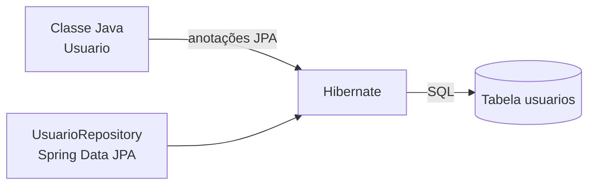
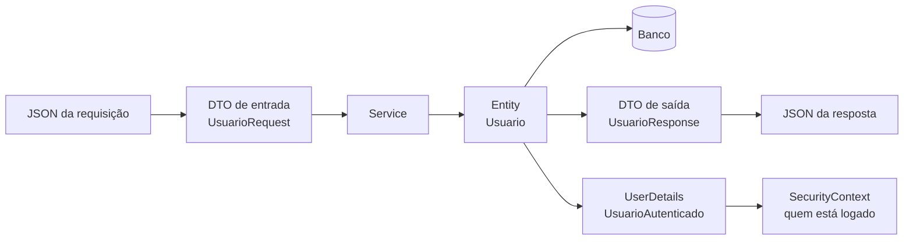
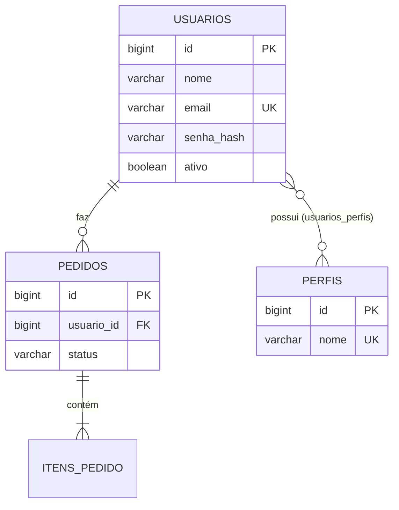

# Entities: a pasta das entidades (JPA e Security)


## Sumário

- [O que é uma Entity](#o-que-é-uma-entity)
- [Entity, DTO e UserDetails: três papéis diferentes](#entity-dto-e-userdetails-três-papéis-diferentes)
- [Onde fica a pasta entities](#onde-fica-a-pasta-entities)
- [Anatomia de uma entidade](#anatomia-de-uma-entidade)
- [As variáveis (campos) de uma entidade](#as-variáveis-campos-de-uma-entidade)
- [Relacionamentos entre entidades](#relacionamentos-entre-entidades)
- [Entidade base com auditoria](#entidade-base-com-auditoria)
- [Entities para o Spring Security](#entities-para-o-spring-security)
- [Diferenças entre a visão do JPA e a do Security](#diferenças-entre-a-visão-do-jpa-e-a-do-security)
- [Ligando JPA e Security](#ligando-jpa-e-security)
- [Armadilhas comuns](#armadilhas-comuns)
- [Boas práticas](#boas-práticas)
- [Referências](#referências)

---

## O que é uma Entity

Uma **Entity** (entidade) é uma classe Java que **representa uma tabela do banco de dados**. Cada objeto dessa classe representa **uma linha** da tabela, e cada variável (campo) representa **uma coluna**.

| No Java | No banco |
|---|---|
| Classe `Usuario` | Tabela `usuarios` |
| Objeto `new Usuario(...)` | Uma linha da tabela |
| Variável `String email` | Coluna `email` |
| Variável `Long id` (com `@Id`) | Chave primária |

Quem faz a ponte entre os dois lados é o **JPA** (a especificação, hoje chamada *Jakarta Persistence*), implementado pelo **Hibernate**. O **Spring Data JPA** fica por cima e entrega os `Repository`.



> [!NOTE]
> As anotações do JPA ficam no pacote **`jakarta.persistence`**. Em projetos antigos (Spring Boot 2), elas ficavam em `javax.persistence`. Se o seu import aparece como `javax`, o projeto está desatualizado ou você importou a classe errada.

---

## Entity, DTO e UserDetails: três papéis diferentes

Um erro muito comum é usar **a mesma classe para tudo**. Na prática, existem três papéis diferentes:

| Papel | O que é | Onde mora | Quem usa |
|---|---|---|---|
| **Entity** | Espelho da tabela. Guarda **tudo**, inclusive o hash da senha | `entities` | JPA, Repository, Service |
| **DTO** | O **contrato da API**: só os campos que entram e saem | `dto` | Controller |
| **UserDetails** | A **identidade de quem está logado**: login, senha e permissões | `security` | Spring Security |



> [!IMPORTANT]
> **Nunca receba nem devolva a entidade direto no Controller.** Se o `@RequestBody` for a entidade, o cliente pode enviar campos como `ativo`, `perfis` ou `id` e **se promover a administrador** (*mass assignment*). Se o retorno for a entidade, o `senha` (mesmo com hash) vai para o JSON. Use sempre DTOs.

---

## Onde fica a pasta entities

O nome da pasta varia de projeto para projeto: `entities`, `entity`, `model` ou `domain`. O importante é **escolher um e manter o padrão**.

```text
src/main/java/br/com/exemplo/demo/
├── controller/          ← recebe as requisições
├── service/             ← regras de negócio
├── repository/          ← acesso ao banco (JpaRepository)
├── dto/                 ← objetos de entrada e saída da API
├── entities/            ← classes mapeadas para tabelas   ◄── este arquivo
│   ├── BaseEntity.java          (campos comuns: auditoria)
│   ├── Usuario.java
│   ├── Perfil.java
│   ├── Pedido.java
│   ├── ItemPedido.java
│   ├── Endereco.java            (@Embeddable)
│   └── enums/
│       ├── NomePerfil.java
│       └── StatusPedido.java
├── security/            ← SecurityConfig, UsuarioAutenticado, UsuarioDetailsService
├── config/              ← configurações gerais (ex.: auditoria)
└── exception/           ← exceções e GlobalExceptionHandler
```

| Regra | Motivo |
|---|---|
| Nome da classe no **singular** (`Usuario`, e não `Usuarios`) | Cada objeto é **uma** linha |
| A tabela vai no **plural** (`usuarios`) | Convenção de bancos de dados |
| `UserDetails` e `SecurityConfig` ficam em **`security`**, e não em `entities` | A entidade cuida de **dados**; o Security cuida de **autenticação** |

---

## Anatomia de uma entidade

```java
@Entity                                     // diz ao JPA: "esta classe é uma tabela"
@Table(name = "usuarios")                   // nome da tabela (se omitir, usa o nome da classe)
public class Usuario {

    @Id                                     // chave primária
    @GeneratedValue(strategy = GenerationType.IDENTITY)   // o banco gera o valor (auto-incremento)
    private Long id;

    // ... demais campos

    protected Usuario() { }                 // construtor vazio: OBRIGATÓRIO para o JPA (pode ser protected)

    // getters e setters (ou Lombok @Getter / @Setter)
}
```

### Regras que o JPA exige de uma entidade

| Regra | Por quê |
|---|---|
| Ter a anotação **`@Entity`** | Sem ela, o JPA ignora a classe |
| Ter um **`@Id`** | Toda tabela precisa de uma chave primária |
| Ter um **construtor sem argumentos** (pode ser `protected`) | O Hibernate cria os objetos por reflexão |
| **Não ser `final`** | O Hibernate cria *proxies* (subclasses) para o carregamento *lazy* |
| Campos **não podem ser `final`** | O Hibernate preenche os campos depois de criar o objeto |
| **Não pode ser um `record`** | Records são imutáveis e `final`. Use records para **DTOs**, não para entidades |

### Anotações da classe

| Anotação | Para que serve |
|---|---|
| `@Entity` | Marca a classe como entidade |
| `@Table(name = "...")` | Define o nome da tabela, índices e restrições |
| `@Table(indexes = ...)` | Cria índices (`@Index(columnList = "email")`) |
| `@Table(uniqueConstraints = ...)` | Define unicidade com nome próprio |
| `@MappedSuperclass` | Classe-pai com campos comuns (veja [Entidade base](#entidade-base-com-auditoria)) |
| `@Embeddable` | Classe que vira **parte** de outra tabela (ex.: `Endereco`) |
| `@EntityListeners` | Liga *ouvintes* de ciclo de vida (ex.: auditoria) |

> [!WARNING]
> Cuidado com **palavras reservadas do SQL** nos nomes de tabela. Uma entidade `User` vira a tabela `user`, e uma entidade `Order` vira `order`, e ambas dão erro em vários bancos (PostgreSQL, H2). Por isso usamos `usuarios` e `pedidos`, ou defina um nome seguro em `@Table(name = "...")`.

---

## As variáveis (campos) de uma entidade

Veja uma entidade completa com **cada linha explicada**:

```java
@Entity
@Table(name = "usuarios")
public class Usuario extends BaseEntity {              // herda criadoEm, atualizadoEm etc. (veja a seção de auditoria)

    @Id                                                // chave primária
    @GeneratedValue(strategy = GenerationType.IDENTITY)// o banco gera o id automaticamente
    private Long id;                                   // Long (wrapper): fica null enquanto o objeto é novo

    @Column(nullable = false, length = 100)            // NOT NULL, VARCHAR(100)
    private String nome;                               // nome de exibição

    @Column(nullable = false, unique = true, length = 150)  // NOT NULL + UNIQUE: não existem dois e-mails iguais
    private String email;                              // também é o "login" do usuário

    @Column(name = "senha_hash", nullable = false, length = 255)  // guarda o HASH, nunca a senha em texto puro
    private String senha;                              // 255 cabe BCrypt, Argon2 e o prefixo {bcrypt}

    @Column(nullable = false)                          // NOT NULL
    private boolean ativo = true;                      // false = conta desativada (não consegue logar)

    @Column(nullable = false)
    private boolean contaBloqueada = false;            // true = bloqueada (ex.: muitas tentativas erradas)

    private Instant senhaExpiraEm;                     // null = a senha nunca expira

    @ManyToMany(fetch = FetchType.LAZY)                // muitos usuários <-> muitos perfis; carrega só quando precisar
    @JoinTable(name = "usuarios_perfis",               // tabela de ligação
            joinColumns = @JoinColumn(name = "usuario_id"),          // coluna que aponta para este usuário
            inverseJoinColumns = @JoinColumn(name = "perfil_id"))    // coluna que aponta para o perfil
    private Set<Perfil> perfis = new HashSet<>();      // Set: não permite perfil repetido

    @Version                                           // controle de concorrência otimista
    private Long versao;                               // o Hibernate incrementa a cada UPDATE

    protected Usuario() { }                            // construtor do JPA

    public Usuario(String nome, String email, String senhaHash) {   // construtor de uso no código
        this.nome = nome;
        this.email = email;
        this.senha = senhaHash;
    }

    // getters e setters omitidos
}
```

### Estratégias do `@GeneratedValue` (como o `id` é gerado)

| Estratégia | Como funciona | Quando usar |
|---|---|---|
| `IDENTITY` | O banco gera (auto-incremento) | Simples e comum. Desativa o *batch insert* do Hibernate |
| `SEQUENCE` | Usa uma sequência do banco | Melhor desempenho em inserções em lote (PostgreSQL, Oracle) |
| `AUTO` | O Hibernate escolhe (geralmente sequência) | Quando não há preferência |
| `UUID` | A aplicação gera um UUID | IDs **não adivinháveis** e expostos na API |

### `Long` ou `UUID` no `id`?

```java
// Opção 1: numérico sequencial
@Id @GeneratedValue(strategy = GenerationType.IDENTITY)
private Long id;

// Opção 2: UUID
@Id @GeneratedValue(strategy = GenerationType.UUID)
private UUID id;
```

| | `Long` | `UUID` |
|---|---|---|
| Tamanho e velocidade | Menor e mais rápido | Maior (16 bytes) |
| Legibilidade | `/usuarios/5` | `/usuarios/3f2a...` |
| **Segurança** | Fácil de **adivinhar e varrer** (`/usuarios/1`, `/usuarios/2`...) | Não dá para adivinhar |

> [!TIP]
> Com `Long`, **sempre verifique se o recurso pertence a quem pediu** (veja [Dono do recurso](#dono-do-recurso-como-evitar-idor)). O `UUID` dificulta a varredura, mas **não substitui** essa verificação.

### Anotação `@Column`: configurando cada coluna

| Atributo | O que faz | Exemplo |
|---|---|---|
| `name` | Nome da coluna | `@Column(name = "senha_hash")` |
| `nullable` | Aceita `NULL`? (`false` = obrigatório) | `nullable = false` |
| `unique` | Valor único na tabela | `unique = true` |
| `length` | Tamanho de textos (padrão: 255) | `length = 100` |
| `precision` / `scale` | Dígitos totais e casas decimais | `precision = 19, scale = 2` |
| `updatable` | Pode ser alterada em `UPDATE`? | `updatable = false` |
| `insertable` | Entra no `INSERT`? | `insertable = false` |
| `columnDefinition` | Tipo SQL escrito à mão | `columnDefinition = "TEXT"` |

> [!NOTE]
> Por padrão, o Spring Boot converte `criadoEm` em `criado_em` automaticamente (*snake_case*). Só use `@Column(name = "...")` quando quiser um nome diferente disso.

> [!IMPORTANT]
> `nullable` e `length` são **restrições do banco**. A validação amigável (mensagem para o usuário) deve ser feita no **DTO** com Bean Validation (`@NotBlank`, `@Size`, `@Email`). O banco é a **última linha de defesa**.

### Tipos recomendados para cada dado

| Dado | Tipo Java | Observação |
|---|---|---|
| Identificador | `Long` ou `UUID` | Prefira o wrapper (`Long`), pois ele aceita `null` em objetos novos |
| Texto | `String` | Defina o `length` |
| Dinheiro | **`BigDecimal`** | **Nunca** `double` ou `float`: eles perdem precisão. Use `precision = 19, scale = 2` |
| Data e hora (momento exato) | **`Instant`** | Sempre em UTC. Ótimo para auditoria |
| Data e hora (local) | `LocalDateTime` | Sem fuso horário |
| Só a data | `LocalDate` | Aniversário, vencimento |
| Verdadeiro/falso | `boolean` | Com valor padrão (`= true`) |
| Opções fixas | `enum` | Com **`@Enumerated(EnumType.STRING)`** |
| Texto longo | `String` | `@Column(length = 2000)` ou `columnDefinition = "TEXT"` |

> [!WARNING]
> Não use `java.util.Date` nem `Calendar`. Prefira as classes do pacote `java.time` (`Instant`, `LocalDate`, `LocalDateTime`).

### Enums: sempre `STRING`

```java
public enum StatusPedido { ABERTO, PAGO, ENVIADO, CANCELADO }

@Enumerated(EnumType.STRING)                    // grava o NOME: "PAGO"
@Column(nullable = false, length = 20)
private StatusPedido status = StatusPedido.ABERTO;
```

| | `EnumType.STRING` | `EnumType.ORDINAL` (padrão!) |
|---|---|---|
| O que grava | O nome (`PAGO`) | A posição (`1`) |
| Se você inserir um valor no meio do enum | Nada quebra | **Os dados antigos passam a significar outra coisa** |
| Legibilidade no banco | Alta | Baixa |

> [!WARNING]
> O padrão do JPA é `ORDINAL`. **Sempre** escreva `@Enumerated(EnumType.STRING)`.

### Outras anotações de campo

| Anotação | Para que serve | Exemplo |
|---|---|---|
| `@Transient` | O campo **não** vai para o banco | `@Transient private int idade;` (calculado) |
| `@Version` | Controle de concorrência otimista | Evita que duas edições simultâneas se sobrescrevam |
| `@Embedded` / `@Embeddable` | Agrupa campos em uma classe, **na mesma tabela** | `Endereco` dentro de `Usuario` |
| `@Convert` | Converte o valor ao gravar e ler | Criptografar um dado sensível |
| `@PrePersist` / `@PreUpdate` | Métodos que rodam antes de inserir ou atualizar | Normalizar o e-mail para minúsculas |

```java
@Embeddable
public class Endereco {
    private String rua;
    private String cidade;
    private String uf;
}

// dentro de Usuario:
@Embedded
private Endereco endereco;          // as colunas rua, cidade e uf ficam na tabela usuarios
```

```java
@PrePersist
@PreUpdate
private void normalizar() {
    this.email = this.email.trim().toLowerCase();   // "Ana@Email.com " vira "ana@email.com"
}
```

---

## Relacionamentos entre entidades



| Anotação | Relação | Exemplo | Carregamento padrão |
|---|---|---|---|
| `@ManyToOne` | Muitos para um | Muitos pedidos → um usuário | **EAGER** (ansioso) |
| `@OneToMany` | Um para muitos | Um pedido → muitos itens | LAZY (preguiçoso) |
| `@ManyToMany` | Muitos para muitos | Usuários ↔ perfis | LAZY |
| `@OneToOne` | Um para um | Usuário → perfil detalhado | **EAGER** |

> [!TIP]
> Declare **`fetch = FetchType.LAZY`** em todo `@ManyToOne` e `@OneToOne`. O padrão EAGER carrega dados que você talvez nem use e é uma das causas mais comuns de lentidão (problema N+1).

### `@ManyToOne`: o lado que tem a chave estrangeira

```java
@Entity
@Table(name = "pedidos")
public class Pedido extends BaseEntity {

    @Id @GeneratedValue(strategy = GenerationType.IDENTITY)
    private Long id;

    @ManyToOne(fetch = FetchType.LAZY, optional = false)   // todo pedido TEM um usuário; carrega só quando precisar
    @JoinColumn(name = "usuario_id", nullable = false)     // coluna da chave estrangeira na tabela pedidos
    private Usuario usuario;                               // o DONO do pedido (importante para a segurança)

    @Enumerated(EnumType.STRING)
    @Column(nullable = false, length = 20)
    private StatusPedido status = StatusPedido.ABERTO;

    @Column(nullable = false, precision = 19, scale = 2)
    private BigDecimal total = BigDecimal.ZERO;            // dinheiro: BigDecimal

    @OneToMany(mappedBy = "pedido",                        // "pedido" é o campo em ItemPedido que é o dono da relação
               cascade = CascadeType.ALL,                  // salvar/remover o pedido também salva/remove os itens
               orphanRemoval = true)                       // item removido da lista é apagado do banco
    private List<ItemPedido> itens = new ArrayList<>();

    public void adicionarItem(ItemPedido item) {           // método auxiliar: mantém os DOIS lados sincronizados
        itens.add(item);
        item.setPedido(this);
    }
}
```

### Conceitos importantes

| Conceito | O que significa |
|---|---|
| **Lado dono** | Quem tem a **chave estrangeira** (`@JoinColumn`). É quem o JPA usa para gravar a relação |
| **`mappedBy`** | Usado no lado **inverso**: diz "quem manda é o outro lado" e evita criar uma tabela extra |
| **`cascade`** | Propaga operações (salvar, remover) do pai para os filhos |
| **`orphanRemoval`** | Apaga do banco o filho que foi retirado da lista do pai |
| **`LAZY`** | Só carrega do banco quando você usa o campo |
| **`EAGER`** | Carrega junto, sempre |

> [!WARNING]
> **`CascadeType.REMOVE` (ou `ALL`) em `@ManyToMany` é perigoso.** Apagar um usuário apagaria os perfis, que outros usuários também usam. Em `@ManyToMany`, não use `cascade` de remoção.

---

## Entidade base com auditoria

Quase toda tabela precisa saber **quando** e **por quem** foi criada e alterada. Em vez de repetir esses campos, use uma classe-pai com `@MappedSuperclass`:

```java
@MappedSuperclass                                      // não vira tabela: seus campos são herdados pelas filhas
@EntityListeners(AuditingEntityListener.class)         // liga a auditoria automática do Spring Data
public abstract class BaseEntity {

    @CreatedDate                                       // preenchido na criação
    @Column(nullable = false, updatable = false)       // nunca muda depois de criado
    private Instant criadoEm;

    @LastModifiedDate                                  // atualizado a cada alteração
    @Column(nullable = false)
    private Instant atualizadoEm;

    @CreatedBy                                         // QUEM criou (vem do usuário logado)
    @Column(updatable = false, length = 150)
    private String criadoPor;

    @LastModifiedBy                                    // QUEM alterou por último
    @Column(length = 150)
    private String atualizadoPor;

    // getters omitidos
}
```

Ative a auditoria em uma classe de configuração **separada**:

```java
@Configuration
@EnableJpaAuditing(auditorAwareRef = "auditorProvider")   // liga a auditoria e diz de onde vem "quem"
public class JpaAuditingConfig {

    @Bean
    AuditorAware<String> auditorProvider() {              // devolve o nome de quem está logado
        return () -> Optional.ofNullable(SecurityContextHolder.getContext().getAuthentication())
                .filter(Authentication::isAuthenticated)                     // só se estiver autenticado
                .filter(auth -> !(auth instanceof AnonymousAuthenticationToken))  // ignora o "anônimo"
                .map(Authentication::getName);                               // o username (e-mail)
    }
}
```

> [!TIP]
> Coloque `@EnableJpaAuditing` numa classe de configuração própria, e **não** na classe principal (`@SpringBootApplication`). Na principal, ela costuma quebrar testes como `@WebMvcTest`.

> [!NOTE]
> Este é um ponto em que **JPA e Security se encontram**: o `@CreatedBy` pergunta ao **Security** quem está logado.

---

## Entities para o Spring Security

O Spring Security precisa saber três coisas sobre um usuário: **quem é** (login), **como provar** (senha) e **o que pode fazer** (permissões). Isso é representado por duas interfaces:

| Interface | O que representa | Principais métodos |
|---|---|---|
| **`UserDetails`** | Um usuário para o Security | `getUsername()`, `getPassword()`, `getAuthorities()`, `isEnabled()`, `isAccountNonLocked()`, `isCredentialsNonExpired()`, `isAccountNonExpired()` |
| **`GrantedAuthority`** | Uma permissão ou papel | `getAuthority()` (devolve um `String`) |

Do outro lado, o banco guarda isso em **duas entidades**: `Usuario` e `Perfil`.

### 1. A entidade `Perfil` (os papéis)

```java
public enum NomePerfil { ROLE_ADMIN, ROLE_USER }        // enum: evita erro de digitação

@Entity
@Table(name = "perfis")
public class Perfil {

    @Id @GeneratedValue(strategy = GenerationType.IDENTITY)
    private Long id;

    @Enumerated(EnumType.STRING)                        // grava "ROLE_ADMIN" no banco
    @Column(nullable = false, unique = true, length = 30)
    private NomePerfil nome;

    protected Perfil() { }

    public Perfil(NomePerfil nome) { this.nome = nome; }

    public NomePerfil getNome() { return nome; }
}
```

### 2. A entidade `Usuario`

A mesma já mostrada em [As variáveis](#as-variáveis-campos-de-uma-entidade): `email` (login), `senha` (hash), `ativo`, `contaBloqueada`, `senhaExpiraEm` e `perfis`.

### 3. Papéis (roles) e autoridades (authorities)

| Conceito | Exemplo | Como autorizar |
|---|---|---|
| **Role** (papel) | `ROLE_ADMIN` | `hasRole("ADMIN")` |
| **Authority** (permissão) | `ROLE_ADMIN`, `usuarios:ler`, `pedidos:apagar` | `hasAuthority("usuarios:ler")` |

> [!IMPORTANT]
> **O prefixo `ROLE_`.** `hasRole("ADMIN")` procura a autoridade `ROLE_ADMIN` (o Spring acrescenta o prefixo). Por isso o valor guardado no banco precisa ser `ROLE_ADMIN`, e não `ADMIN`. Já `hasAuthority("ROLE_ADMIN")` usa o texto exatamente como está.

```java
http.authorizeHttpRequests(auth -> auth
        .requestMatchers("/api/admin/**").hasRole("ADMIN")          // exige ROLE_ADMIN
        .requestMatchers("/api/relatorios/**").hasAuthority("relatorios:ler")
        .anyRequest().authenticated());
```

### 4. Ligando a entidade ao Security: duas formas

#### Forma A (recomendada): classe separada que **adapta** a entidade

A entidade fica "limpa" (só JPA), e uma classe na pasta `security` implementa `UserDetails`:

```java
public class UsuarioAutenticado implements UserDetails {

    private final Usuario usuario;                         // guarda a entidade

    public UsuarioAutenticado(Usuario usuario) { this.usuario = usuario; }

    public Long getId() { return usuario.getId(); }        // útil para checar o "dono" do recurso

    @Override
    public Collection<? extends GrantedAuthority> getAuthorities() {
        return usuario.getPerfis().stream()                // converte cada Perfil em uma autoridade
                .map(p -> new SimpleGrantedAuthority(p.getNome().name()))
                .toList();
    }

    @Override public String getPassword() { return usuario.getSenha(); }     // o HASH
    @Override public String getUsername() { return usuario.getEmail(); }     // o login

    @Override public boolean isEnabled() { return usuario.isAtivo(); }
    @Override public boolean isAccountNonLocked() { return !usuario.isContaBloqueada(); }   // invertido!
    @Override public boolean isCredentialsNonExpired() {
        return usuario.getSenhaExpiraEm() == null || usuario.getSenhaExpiraEm().isAfter(Instant.now());
    }
    // isAccountNonExpired() tem implementação padrão (true)
}
```

E o serviço que o Spring Security usa para buscar o usuário no login:

```java
@Service
public class UsuarioDetailsService implements UserDetailsService {

    private final UsuarioRepository repository;

    public UsuarioDetailsService(UsuarioRepository repository) { this.repository = repository; }

    @Override
    @Transactional(readOnly = true)
    public UserDetails loadUserByUsername(String email) throws UsernameNotFoundException {
        return repository.findByEmailIgnoreCase(email)                      // busca no banco
                .map(UsuarioAutenticado::new)                               // entidade -> UserDetails
                .orElseThrow(() -> new UsernameNotFoundException("Usuário não encontrado"));
    }
}
```

No repository, carregue os perfis **junto**, para evitar `LazyInitializationException` (o Security lê as autoridades fora da consulta):

```java
public interface UsuarioRepository extends JpaRepository<Usuario, Long> {

    @EntityGraph(attributePaths = "perfis")                // traz os perfis na MESMA consulta
    Optional<Usuario> findByEmailIgnoreCase(String email);

    boolean existsByEmailIgnoreCase(String email);
}
```

#### Forma B (mais simples): a própria entidade implementa `UserDetails`

```java
@Entity
@Table(name = "usuarios")
public class Usuario implements UserDetails {
    // ... campos iguais aos anteriores ...

    @Override public String getUsername() { return email; }
    @Override public String getPassword() { return senha; }
    @Override public Collection<? extends GrantedAuthority> getAuthorities() { ... }
    @Override public boolean isEnabled() { return ativo; }
    // ...
}
```

| | Forma A (adaptador) | Forma B (entidade = `UserDetails`) |
|---|---|---|
| Separação de responsabilidades | ✅ Entidade só com JPA | ❌ Mistura JPA e Security na mesma classe |
| Quantidade de código | Um pouco mais | Menos |
| Sessão HTTP | A entidade não precisa ser serializada | A entidade pode ser serializada para a sessão, e coleções *lazy* podem dar problema |
| Trocar o Security no futuro | Fácil | Difícil |
| Indicação | Projetos reais | Estudo e protótipos |

### 5. A senha: como guardar

| Regra | Detalhe |
|---|---|
| Guarde **só o hash** | Nunca a senha em texto puro |
| Gere o hash com **`PasswordEncoder`** | BCrypt, Argon2, etc. |
| Coluna com **`length = 255`** | O hash do BCrypt tem 60 caracteres, e com o prefixo `{bcrypt}` do `DelegatingPasswordEncoder` chega a 68. Outros algoritmos são maiores |
| **Nunca** devolva a senha na API | Nem como hash. Use DTO de saída sem esse campo |
| Faça o hash no **Service** | Antes de chamar `repository.save(...)` |

```java
@Service
public class UsuarioService {

    private final UsuarioRepository repository;
    private final PasswordEncoder passwordEncoder;         // o mesmo bean da SecurityConfig

    public UsuarioService(UsuarioRepository repository, PasswordEncoder passwordEncoder) {
        this.repository = repository;
        this.passwordEncoder = passwordEncoder;
    }

    @Transactional
    public UsuarioResponse criar(UsuarioRequest request) {
        Usuario usuario = new Usuario(
                request.nome(),
                request.email().trim().toLowerCase(),
                passwordEncoder.encode(request.senha()));  // senha em texto puro -> hash
        return UsuarioResponse.de(repository.save(usuario));
    }
}
```

### 6. Do usuário em memória para o usuário no banco

Em estudos de Spring Security, é comum começar com usuários **em memória**. Veja como cada parte vira uma entidade:

```java
// Em memória (só para estudo)
User.withUsername("ana")
    .password("{noop}123")               // ❌ senha em texto puro
    .roles("USER")                       // ✅ vira a autoridade ROLE_USER
    .build();
```

| Em memória | No banco |
|---|---|
| `withUsername("ana")` | Coluna `email` (ou `username`) da entidade `Usuario` |
| `.password("{noop}123")` | Coluna `senha_hash`, com o resultado de `passwordEncoder.encode(...)` |
| `.roles("USER")` | Linha em `perfis` (`ROLE_USER`) ligada pela tabela `usuarios_perfis` |
| `InMemoryUserDetailsManager` | `UsuarioDetailsService` + `UsuarioRepository` |

> [!NOTE]
> `.roles("USER")` acrescenta o prefixo `ROLE_` sozinho. Já `.authorities("ROLE_USER")` usa o texto exatamente como está.

---

## Diferenças entre a visão do JPA e a do Security

O **mesmo campo** da entidade é visto de formas diferentes pelo JPA e pelo Security:

| Campo | Visão do **JPA** | Visão do **Security** |
|---|---|---|
| `id` | Chave primária | Não é usado no login. Útil só para checar o "dono" do recurso |
| `email` | Coluna `UNIQUE NOT NULL` | `getUsername()`: o login |
| `senha` | Coluna com o **hash** (`length = 255`) | `getPassword()`: comparado pelo `PasswordEncoder` |
| `ativo` | Coluna `boolean` | `isEnabled()` |
| `contaBloqueada` | Coluna `boolean` | `isAccountNonLocked()` (**valor invertido**) |
| `senhaExpiraEm` | Coluna `Instant` (aceita `null`) | `isCredentialsNonExpired()` |
| `perfis` | `@ManyToMany` com tabela de ligação | `getAuthorities()` |
| `criadoPor` | `@CreatedBy` | Preenchido a partir do `SecurityContext` |
| `versao` | `@Version` (concorrência otimista) | Não participa |

E as **preocupações** de cada lado:

| Pergunta | JPA | Security |
|---|---|---|
| **Qual é o papel da classe?** | Espelhar uma tabela | Representar **quem está autenticado** |
| **Que pacotes usa?** | `jakarta.persistence.*` | `org.springframework.security.*` |
| **Qual o ciclo de vida?** | Gerenciada pelo `EntityManager` (*managed* → *detached*) | Guardada no `SecurityContext` durante a requisição |
| **Qual o identificador?** | `id` técnico | `username` (e-mail) |
| **O que preocupa?** | Colunas, tipos, relacionamentos, desempenho | Senha, permissões, conta ativa ou bloqueada |
| **Problema típico** | `LazyInitializationException`, N+1 | `AccessDenied`, senha vazada, `ROLE_` esquecido |
| **Como valida?** | Restrições do banco + Bean Validation | `PasswordEncoder`, regras de senha, `hasRole`/`hasAuthority` |
| **Quem acessa?** | Repository e Service | Filtros do Security e `@PreAuthorize` |

### O que muda no `UserDetails` em relação à entidade

| Entidade (`Usuario`) | `UserDetails` (`UsuarioAutenticado`) |
|---|---|
| Tem **muitos** campos (nome, endereço, datas...) | Só o que o Security precisa: login, senha, permissões, estado da conta |
| Mora em **`entities`** | Mora em **`security`** |
| É persistida no banco | **Não** é persistida |
| Pode ter relacionamentos *lazy* | Precisa ter as autoridades **já carregadas** |

---

## Ligando JPA e Security

### Auditoria: quem fez a alteração

Já vista em [Entidade base com auditoria](#entidade-base-com-auditoria): o `@CreatedBy` usa o `SecurityContext` para saber quem está logado.

### Dono do recurso: como evitar IDOR

**IDOR** (*Insecure Direct Object Reference*) é quando um usuário acessa o recurso de outro só trocando o número na URL (`/api/pedidos/7` por `/api/pedidos/8`). A defesa depende de a entidade guardar **o dono**, como o campo `usuario` em `Pedido`.

```java
public interface PedidoRepository extends JpaRepository<Pedido, Long> {

    Optional<Pedido> findByIdAndUsuarioId(Long id, Long usuarioId);   // só encontra se o pedido for DO usuário
}
```

```java
@GetMapping("/{id}")
public PedidoResponse buscar(@PathVariable Long id,
                             @AuthenticationPrincipal UsuarioAutenticado logado) {   // o usuário logado
    return service.buscarDoUsuario(id, logado.getId());
}
```

```java
// No Service: se o pedido não for dele, responde como se NÃO EXISTISSE (404)
Pedido pedido = repository.findByIdAndUsuarioId(id, usuarioId)
        .orElseThrow(() -> new PedidoNaoEncontradoException(id));
```

> [!TIP]
> Responder **404** (e não 403) quando o recurso é de outra pessoa evita que um atacante descubra **quais ids existem**.

Também é possível usar segurança por método (precisa de `@EnableMethodSecurity`):

```java
@PreAuthorize("hasRole('ADMIN') or #id == authentication.principal.id")
public UsuarioResponse buscar(Long id) { ... }
```

### Dados sensíveis na entidade

| Dado | Cuidado |
|---|---|
| Senha | Sempre em hash; fora do DTO de saída; fora de `toString()` e de logs |
| CPF, documentos, dados pessoais | Considere a LGPD: guarde só o necessário; use `@Convert` para criptografar colunas muito sensíveis |
| Tokens de renovação (*refresh tokens*) | Guarde o **hash** do token (e não o token), com data de expiração e um campo `revogado` |
| Dados de cartão | **Não guarde.** Use um gateway de pagamento |

---

## Armadilhas comuns

| Problema | Por que acontece | Solução |
|---|---|---|
| Entidade devolvida direto no JSON | Vaza campos internos (senha, ids), gera loop em relações bidirecionais e causa `LazyInitializationException` | **DTO de saída** |
| Entidade recebida direto no `@RequestBody` | O cliente preenche campos que não deveria (*mass assignment*) | **DTO de entrada** |
| `@Data` do Lombok na entidade | Gera `equals`, `hashCode` e `toString` que percorrem relações *lazy* e podem imprimir a senha | `@Getter`, `@Setter` e `equals`/`hashCode` por `id`; **nunca** `@Data` em entidade |
| `@Enumerated` ausente | O padrão é `ORDINAL`: inserir um valor no meio do enum corrompe os dados | `@Enumerated(EnumType.STRING)` |
| `LazyInitializationException` | Acessar uma relação *lazy* depois de fechar a transação | `@EntityGraph`, `JOIN FETCH` ou DTO com os dados já prontos |
| **N+1 consultas** | Carregar uma lista e, para cada item, uma consulta extra da relação | `@EntityGraph`, `JOIN FETCH` ou `@BatchSize` |
| `@ManyToOne` com EAGER (o padrão) | Carrega relações sem necessidade | `fetch = FetchType.LAZY` |
| `@OneToMany` sem `mappedBy` | O JPA cria uma **tabela de ligação extra** | `mappedBy` no lado inverso |
| `cascade = REMOVE` em `@ManyToMany` | Apagar um lado apaga registros compartilhados | Sem cascade de remoção |
| Tabela chamada `user` ou `order` | Palavra reservada do SQL | `usuarios`, `pedidos` |
| `double` para dinheiro | Erros de arredondamento | `BigDecimal` com `precision` e `scale` |
| Senha com `{noop}` ou em texto puro | Qualquer vazamento expõe todas as contas | `PasswordEncoder` (BCrypt, Argon2) |
| `ROLE_` esquecido | `hasRole("ADMIN")` não encontra a autoridade `ADMIN` | Guardar `ROLE_ADMIN` |
| E-mail duplicado em maiúsculas e minúsculas | `Ana@x.com` e `ana@x.com` viram duas contas | Normalizar para minúsculas e manter `UNIQUE` no banco |
| Alterar a entidade sem migration | O banco não acompanha, e o `ddl-auto=validate` falha | Criar uma migration (Flyway) a cada mudança |

### `equals` e `hashCode` seguros para entidades

```java
@Override
public boolean equals(Object o) {
    if (this == o) return true;
    if (!(o instanceof Usuario outro)) return false;      // instanceof funciona com proxies do Hibernate
    return id != null && id.equals(outro.id);             // dois objetos novos (sem id) nunca são iguais
}

@Override
public int hashCode() {
    return getClass().hashCode();                         // constante: não muda quando o id é gerado
}
```

---

## Boas práticas

- [x] Uma entidade por tabela, no **singular**, em `entities`
- [x] **Construtor `protected`** sem argumentos para o JPA, e um construtor com os campos obrigatórios para o seu código
- [x] `@Column` com `nullable` e `length` definidos em todos os campos
- [x] **`@Enumerated(EnumType.STRING)`** em todo enum
- [x] **`BigDecimal`** para dinheiro e **`Instant`** para momentos
- [x] **`FetchType.LAZY`** nas relações `@ManyToOne` e `@OneToOne`, e `@EntityGraph` quando precisar dos dados
- [x] Métodos auxiliares (`adicionarItem`) para manter os dois lados da relação sincronizados
- [x] **`BaseEntity`** com auditoria (`criadoEm`, `atualizadoEm`, `criadoPor`)
- [x] **Senha só em hash**, com `length = 255`, fora de DTOs de saída, de logs e de `toString()`
- [x] **`ROLE_`** nos nomes de papéis guardados no banco
- [x] `UserDetails` na pasta **`security`** (Forma A), separado da entidade
- [x] Guardar o **dono** (`usuario`) nos recursos e consultar com `findByIdAndUsuarioId`
- [x] **DTOs** na entrada e na saída da API
- [x] **Migrations** (Flyway) acompanhando cada mudança de entidade
- [x] `@Version` em entidades editadas por várias pessoas ao mesmo tempo

<details>
<summary>Exemplo do que <b>não</b> fazer</summary>

```java
@Entity
@Data                                                   // ❌ @Data em entidade
public class User {                                     // ❌ "user" é palavra reservada

    @Id
    private Long id;                                    // ❌ sem @GeneratedValue

    private String email;                               // ❌ sem unique, nullable ou length
    private String password;                            // ❌ vai para o JSON e para o toString()
    private double saldo;                               // ❌ double para dinheiro
    private Status status;                              // ❌ enum sem @Enumerated (vira ORDINAL)
    private boolean admin;                              // ❌ o cliente pode enviar admin=true

    @ManyToOne                                          // ❌ EAGER por padrão
    private Empresa empresa;
}

@PostMapping
public User criar(@RequestBody User user) {            // ❌ recebe e devolve a entidade
    return repository.save(user);                       // ❌ senha em texto puro, sem DTO
}
```

</details>

---

## Referências

- [Jakarta Persistence: especificação](https://jakarta.ee/specifications/persistence/)
- [Hibernate ORM: documentação](https://hibernate.org/orm/documentation/)
- [Spring Data JPA: documentação](https://docs.spring.io/spring-data/jpa/reference/)
- [Spring Security: documentação](https://docs.spring.io/spring-security/reference/)
- [Spring Security: Password Storage](https://docs.spring.io/spring-security/reference/features/authentication/password-storage.html)
- [OWASP: Insecure Direct Object Reference](https://owasp.org/www-community/attacks/Insecure_Direct_Object_Reference)
- [Guia de Markdown do GitHub (GFM)](https://docs.github.com/pt/get-started/writing-on-github)
