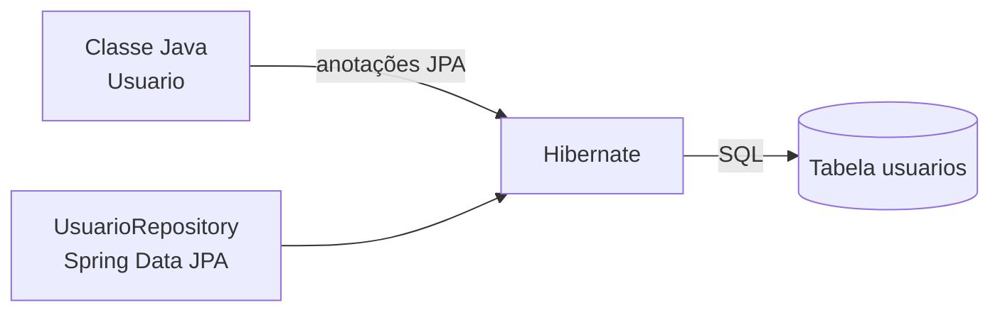
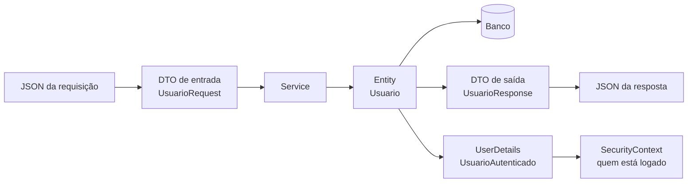
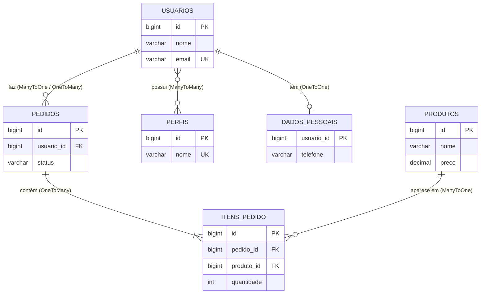
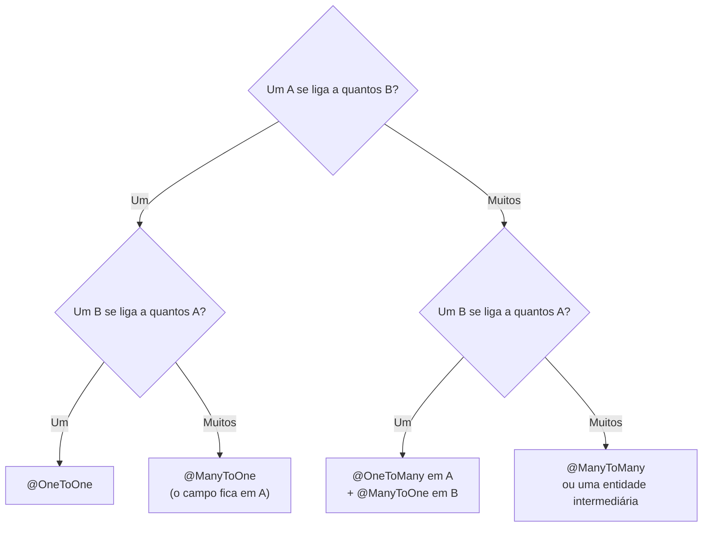
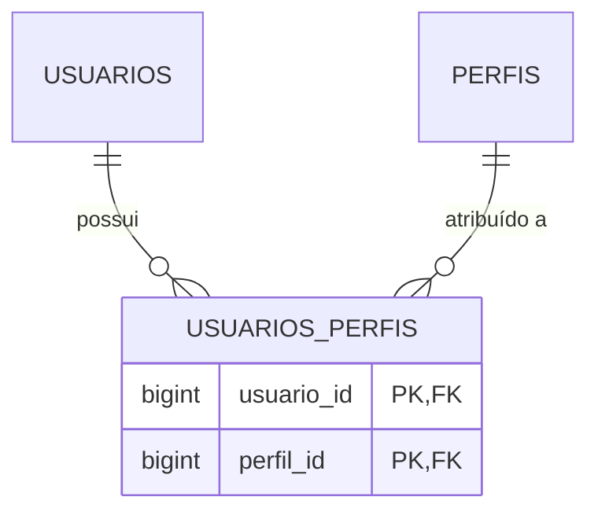
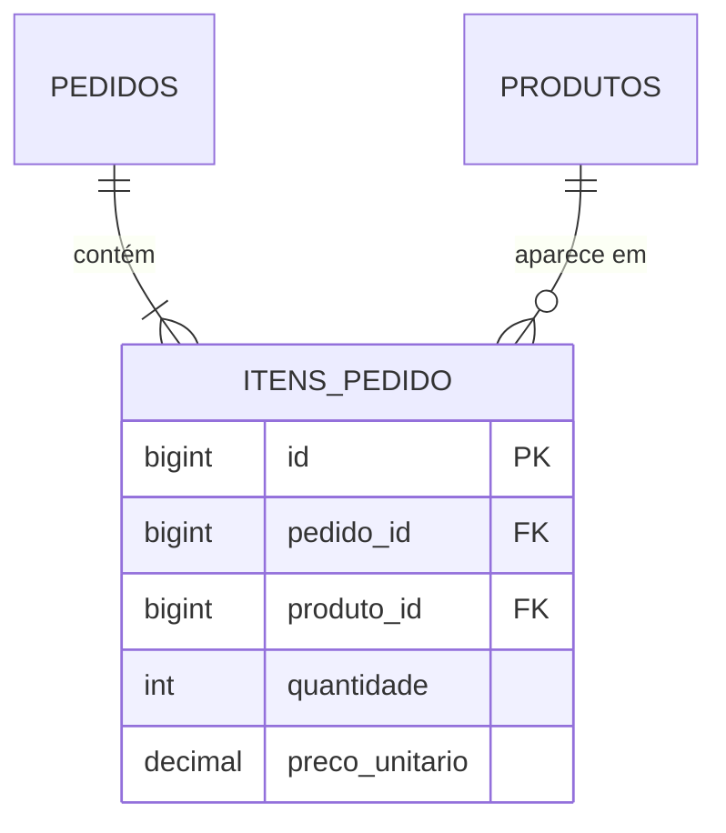

# Entities: a pasta das entidades (JPA e Security)


## Sumário

- [O que é uma Entity](#o-que-é-uma-entity)
- [Entity, DTO e UserDetails: três papéis diferentes](#entity-dto-e-userdetails-três-papéis-diferentes)
- [Onde fica a pasta entities](#onde-fica-a-pasta-entities)
- [Anatomia de uma entidade](#anatomia-de-uma-entidade)
- [As variáveis (campos) de uma entidade](#as-variáveis-campos-de-uma-entidade)
- [Relacionamentos entre entidades](#relacionamentos-entre-entidades)
  - [@ManyToOne: muitos para um](#manytoone-muitos-para-um)
  - [@OneToMany: um para muitos](#onetomany-um-para-muitos)
  - [@ManyToMany: muitos para muitos](#manytomany-muitos-para-muitos)
  - [@OneToOne: um para um](#onetoone-um-para-um)
- [Entidade base com auditoria](#entidade-base-com-auditoria)
- [Entities para o Spring Security](#entities-para-o-spring-security)
- [Diferenças entre a visão do JPA e a do Security](#diferenças-entre-a-visão-do-jpa-e-a-do-security)
- [Ligando JPA e Security](#ligando-jpa-e-security)
- [Armadilhas comuns](#armadilhas-comuns)
- [Boas práticas](#boas-práticas)
- [Referências](#referências)

---

## O que é uma Entity

Uma **Entity** (entidade) é uma classe Java que **representa uma tabela do banco de dados**. Cada objeto dessa classe representa **uma linha** da tabela, e cada variável (campo) representa **uma coluna**.

| No Java | No banco |
|---|---|
| Classe `Usuario` | Tabela `usuarios` |
| Objeto `new Usuario(...)` | Uma linha da tabela |
| Variável `String email` | Coluna `email` |
| Variável `Long id` (com `@Id`) | Chave primária |

Quem faz a ponte entre os dois lados é o **JPA** (a especificação, hoje chamada *Jakarta Persistence*), implementado pelo **Hibernate**. O **Spring Data JPA** fica por cima e entrega os `Repository`.



> [!NOTE]
> As anotações do JPA ficam no pacote **`jakarta.persistence`**. Em projetos antigos (Spring Boot 2), elas ficavam em `javax.persistence`. Se o seu import aparece como `javax`, o projeto está desatualizado ou você importou a classe errada.

---

## Entity, DTO e UserDetails: três papéis diferentes

Um erro muito comum é usar **a mesma classe para tudo**. Na prática, existem três papéis diferentes:

| Papel | O que é | Onde mora | Quem usa |
|---|---|---|---|
| **Entity** | Espelho da tabela. Guarda **tudo**, inclusive o hash da senha | `entities` | JPA, Repository, Service |
| **DTO** | O **contrato da API**: só os campos que entram e saem | `dto` | Controller |
| **UserDetails** | A **identidade de quem está logado**: login, senha e permissões | `security` | Spring Security |



> [!IMPORTANT]
> **Nunca receba nem devolva a entidade direto no Controller.** Se o `@RequestBody` for a entidade, o cliente pode enviar campos como `ativo`, `perfis` ou `id` e **se promover a administrador** (*mass assignment*). Se o retorno for a entidade, o `senha` (mesmo com hash) vai para o JSON. Use sempre DTOs.

---

## Onde fica a pasta entities

O nome da pasta varia de projeto para projeto: `entities`, `entity`, `model` ou `domain`. O importante é **escolher um e manter o padrão**.

```text
src/main/java/br/com/exemplo/demo/
├── controller/          ← recebe as requisições
├── service/             ← regras de negócio
├── repository/          ← acesso ao banco (JpaRepository)
├── dto/                 ← objetos de entrada e saída da API
├── entities/            ← classes mapeadas para tabelas   ◄── este arquivo
│   ├── BaseEntity.java          (campos comuns: auditoria)
│   ├── Usuario.java
│   ├── Perfil.java
│   ├── Pedido.java
│   ├── ItemPedido.java
│   ├── Endereco.java            (@Embeddable)
│   └── enums/
│       ├── NomePerfil.java
│       └── StatusPedido.java
├── security/            ← SecurityConfig, UsuarioAutenticado, UsuarioDetailsService
├── config/              ← configurações gerais (ex.: auditoria)
└── exception/           ← exceções e GlobalExceptionHandler
```

| Regra | Motivo |
|---|---|
| Nome da classe no **singular** (`Usuario`, e não `Usuarios`) | Cada objeto é **uma** linha |
| A tabela vai no **plural** (`usuarios`) | Convenção de bancos de dados |
| `UserDetails` e `SecurityConfig` ficam em **`security`**, e não em `entities` | A entidade cuida de **dados**; o Security cuida de **autenticação** |

---

## Anatomia de uma entidade

```java
@Entity                                     // diz ao JPA: "esta classe é uma tabela"
@Table(name = "usuarios")                   // nome da tabela (se omitir, usa o nome da classe)
public class Usuario {

    @Id                                     // chave primária
    @GeneratedValue(strategy = GenerationType.IDENTITY)   // o banco gera o valor (auto-incremento)
    private Long id;

    // ... demais campos

    protected Usuario() { }                 // construtor vazio: OBRIGATÓRIO para o JPA (pode ser protected)

    // getters e setters (ou Lombok @Getter / @Setter)
}
```

### Regras que o JPA exige de uma entidade

| Regra | Por quê |
|---|---|
| Ter a anotação **`@Entity`** | Sem ela, o JPA ignora a classe |
| Ter um **`@Id`** | Toda tabela precisa de uma chave primária |
| Ter um **construtor sem argumentos** (pode ser `protected`) | O Hibernate cria os objetos por reflexão |
| **Não ser `final`** | O Hibernate cria *proxies* (subclasses) para o carregamento *lazy* |
| Campos **não podem ser `final`** | O Hibernate preenche os campos depois de criar o objeto |
| **Não pode ser um `record`** | Records são imutáveis e `final`. Use records para **DTOs**, não para entidades |

### Anotações da classe

| Anotação | Para que serve |
|---|---|
| `@Entity` | Marca a classe como entidade |
| `@Table(name = "...")` | Define o nome da tabela, índices e restrições |
| `@Table(indexes = ...)` | Cria índices (`@Index(columnList = "email")`) |
| `@Table(uniqueConstraints = ...)` | Define unicidade com nome próprio |
| `@MappedSuperclass` | Classe-pai com campos comuns (veja [Entidade base](#entidade-base-com-auditoria)) |
| `@Embeddable` | Classe que vira **parte** de outra tabela (ex.: `Endereco`) |
| `@EntityListeners` | Liga *ouvintes* de ciclo de vida (ex.: auditoria) |

> [!WARNING]
> Cuidado com **palavras reservadas do SQL** nos nomes de tabela. Uma entidade `User` vira a tabela `user`, e uma entidade `Order` vira `order`, e ambas dão erro em vários bancos (PostgreSQL, H2). Por isso usamos `usuarios` e `pedidos`, ou defina um nome seguro em `@Table(name = "...")`.

---

## As variáveis (campos) de uma entidade

Veja uma entidade completa com **cada linha explicada**:

```java
@Entity
@Table(name = "usuarios")
public class Usuario extends BaseEntity {              // herda criadoEm, atualizadoEm etc. (veja a seção de auditoria)

    @Id                                                // chave primária
    @GeneratedValue(strategy = GenerationType.IDENTITY)// o banco gera o id automaticamente
    private Long id;                                   // Long (wrapper): fica null enquanto o objeto é novo

    @Column(nullable = false, length = 100)            // NOT NULL, VARCHAR(100)
    private String nome;                               // nome de exibição

    @Column(nullable = false, unique = true, length = 150)  // NOT NULL + UNIQUE: não existem dois e-mails iguais
    private String email;                              // também é o "login" do usuário

    @Column(name = "senha_hash", nullable = false, length = 255)  // guarda o HASH, nunca a senha em texto puro
    private String senha;                              // 255 cabe BCrypt, Argon2 e o prefixo {bcrypt}

    @Column(nullable = false)                          // NOT NULL
    private boolean ativo = true;                      // false = conta desativada (não consegue logar)

    @Column(nullable = false)
    private boolean contaBloqueada = false;            // true = bloqueada (ex.: muitas tentativas erradas)

    private Instant senhaExpiraEm;                     // null = a senha nunca expira

    @ManyToMany(fetch = FetchType.LAZY)                // muitos usuários <-> muitos perfis; carrega só quando precisar
    @JoinTable(name = "usuarios_perfis",               // tabela de ligação
            joinColumns = @JoinColumn(name = "usuario_id"),          // coluna que aponta para este usuário
            inverseJoinColumns = @JoinColumn(name = "perfil_id"))    // coluna que aponta para o perfil
    private Set<Perfil> perfis = new HashSet<>();      // Set: não permite perfil repetido

    @Version                                           // controle de concorrência otimista
    private Long versao;                               // o Hibernate incrementa a cada UPDATE

    protected Usuario() { }                            // construtor do JPA

    public Usuario(String nome, String email, String senhaHash) {   // construtor de uso no código
        this.nome = nome;
        this.email = email;
        this.senha = senhaHash;
    }

    // getters e setters omitidos
}
```

### Estratégias do `@GeneratedValue` (como o `id` é gerado)

| Estratégia | Como funciona | Quando usar |
|---|---|---|
| `IDENTITY` | O banco gera (auto-incremento) | Simples e comum. Desativa o *batch insert* do Hibernate |
| `SEQUENCE` | Usa uma sequência do banco | Melhor desempenho em inserções em lote (PostgreSQL, Oracle) |
| `AUTO` | O Hibernate escolhe (geralmente sequência) | Quando não há preferência |
| `UUID` | A aplicação gera um UUID | IDs **não adivinháveis** e expostos na API |

### `Long` ou `UUID` no `id`?

```java
// Opção 1: numérico sequencial
@Id @GeneratedValue(strategy = GenerationType.IDENTITY)
private Long id;

// Opção 2: UUID
@Id @GeneratedValue(strategy = GenerationType.UUID)
private UUID id;
```

| | `Long` | `UUID` |
|---|---|---|
| Tamanho e velocidade | Menor e mais rápido | Maior (16 bytes) |
| Legibilidade | `/usuarios/5` | `/usuarios/3f2a...` |
| **Segurança** | Fácil de **adivinhar e varrer** (`/usuarios/1`, `/usuarios/2`...) | Não dá para adivinhar |

> [!TIP]
> Com `Long`, **sempre verifique se o recurso pertence a quem pediu** (veja [Dono do recurso](#dono-do-recurso-como-evitar-idor)). O `UUID` dificulta a varredura, mas **não substitui** essa verificação.

### Anotação `@Column`: configurando cada coluna

| Atributo | O que faz | Exemplo |
|---|---|---|
| `name` | Nome da coluna | `@Column(name = "senha_hash")` |
| `nullable` | Aceita `NULL`? (`false` = obrigatório) | `nullable = false` |
| `unique` | Valor único na tabela | `unique = true` |
| `length` | Tamanho de textos (padrão: 255) | `length = 100` |
| `precision` / `scale` | Dígitos totais e casas decimais | `precision = 19, scale = 2` |
| `updatable` | Pode ser alterada em `UPDATE`? | `updatable = false` |
| `insertable` | Entra no `INSERT`? | `insertable = false` |
| `columnDefinition` | Tipo SQL escrito à mão | `columnDefinition = "TEXT"` |

> [!NOTE]
> Por padrão, o Spring Boot converte `criadoEm` em `criado_em` automaticamente (*snake_case*). Só use `@Column(name = "...")` quando quiser um nome diferente disso.

> [!IMPORTANT]
> `nullable` e `length` são **restrições do banco**. A validação amigável (mensagem para o usuário) deve ser feita no **DTO** com Bean Validation (`@NotBlank`, `@Size`, `@Email`). O banco é a **última linha de defesa**.

### Tipos recomendados para cada dado

| Dado | Tipo Java | Observação |
|---|---|---|
| Identificador | `Long` ou `UUID` | Prefira o wrapper (`Long`), pois ele aceita `null` em objetos novos |
| Texto | `String` | Defina o `length` |
| Dinheiro | **`BigDecimal`** | **Nunca** `double` ou `float`: eles perdem precisão. Use `precision = 19, scale = 2` |
| Data e hora (momento exato) | **`Instant`** | Sempre em UTC. Ótimo para auditoria |
| Data e hora (local) | `LocalDateTime` | Sem fuso horário |
| Só a data | `LocalDate` | Aniversário, vencimento |
| Verdadeiro/falso | `boolean` | Com valor padrão (`= true`) |
| Opções fixas | `enum` | Com **`@Enumerated(EnumType.STRING)`** |
| Texto longo | `String` | `@Column(length = 2000)` ou `columnDefinition = "TEXT"` |

> [!WARNING]
> Não use `java.util.Date` nem `Calendar`. Prefira as classes do pacote `java.time` (`Instant`, `LocalDate`, `LocalDateTime`).

### Enums: sempre `STRING`

```java
public enum StatusPedido { ABERTO, PAGO, ENVIADO, CANCELADO }

@Enumerated(EnumType.STRING)                    // grava o NOME: "PAGO"
@Column(nullable = false, length = 20)
private StatusPedido status = StatusPedido.ABERTO;
```

| | `EnumType.STRING` | `EnumType.ORDINAL` (padrão!) |
|---|---|---|
| O que grava | O nome (`PAGO`) | A posição (`1`) |
| Se você inserir um valor no meio do enum | Nada quebra | **Os dados antigos passam a significar outra coisa** |
| Legibilidade no banco | Alta | Baixa |

> [!WARNING]
> O padrão do JPA é `ORDINAL`. **Sempre** escreva `@Enumerated(EnumType.STRING)`.

### Outras anotações de campo

| Anotação | Para que serve | Exemplo |
|---|---|---|
| `@Transient` | O campo **não** vai para o banco | `@Transient private int idade;` (calculado) |
| `@Version` | Controle de concorrência otimista | Evita que duas edições simultâneas se sobrescrevam |
| `@Embedded` / `@Embeddable` | Agrupa campos em uma classe, **na mesma tabela** | `Endereco` dentro de `Usuario` |
| `@Convert` | Converte o valor ao gravar e ler | Criptografar um dado sensível |
| `@PrePersist` / `@PreUpdate` | Métodos que rodam antes de inserir ou atualizar | Normalizar o e-mail para minúsculas |

```java
@Embeddable
public class Endereco {
    private String rua;
    private String cidade;
    private String uf;
}

// dentro de Usuario:
@Embedded
private Endereco endereco;          // as colunas rua, cidade e uf ficam na tabela usuarios
```

```java
@PrePersist
@PreUpdate
private void normalizar() {
    this.email = this.email.trim().toLowerCase();   // "Ana@Email.com " vira "ana@email.com"
}
```

---

## Relacionamentos entre entidades

Em um banco relacional, as tabelas se ligam por **chaves estrangeiras** (*foreign keys*). No JPA, essa ligação vira uma **referência entre objetos**: em vez de um número `usuario_id` solto, o `Pedido` guarda um objeto `Usuario`.

| No banco | No Java |
|---|---|
| Coluna `usuario_id` (chave estrangeira) | Campo `Usuario usuario` |
| `JOIN` entre tabelas | `pedido.getUsuario().getNome()` |
| Tabela de ligação (`usuarios_perfis`) | Campo `Set<Perfil> perfis` |

Existem **quatro** anotações, uma para cada cardinalidade (quantos de um lado se ligam a quantos do outro):

| Anotação | Cardinalidade | Exemplo deste projeto |
|---|---|---|
| [`@ManyToOne`](#manytoone-muitos-para-um) | Muitos para um | Muitos pedidos → **um** usuário |
| [`@OneToMany`](#onetomany-um-para-muitos) | Um para muitos | **Um** pedido → muitos itens |
| [`@ManyToMany`](#manytomany-muitos-para-muitos) | Muitos para muitos | Muitos usuários ↔ muitos perfis |
| [`@OneToOne`](#onetoone-um-para-um) | Um para um | **Um** usuário ↔ **um** registro de dados pessoais |



### Como escolher a anotação certa

Faça duas perguntas: *"um A se liga a quantos B?"* e *"um B se liga a quantos A?"*.



Exemplo: *um pedido (A) tem um usuário (B), e um usuário tem muitos pedidos.* O Pedido guarda um `@ManyToOne` para o Usuário.

### Conceitos que valem para todas as relações

| Conceito | O que significa |
|---|---|
| **Lado dono** (*owning side*) | O lado que **controla a chave estrangeira**. É ele que o JPA usa para gravar a relação no banco. Em `@ManyToOne`, é sempre quem tem o `@JoinColumn` |
| **Lado inverso** (*inverse side*) | O lado que só **espelha** a relação, marcado com `mappedBy`. Alterar só o lado inverso **não grava nada** no banco |
| **`mappedBy`** | Diz "quem manda na relação é o campo `X` da outra classe". Evita criar uma tabela ou coluna duplicada |
| **Unidirecional** | Só **uma** das classes conhece a outra (`Pedido` conhece `Usuario`, mas `Usuario` não conhece `Pedido`) |
| **Bidirecional** | As **duas** classes se conhecem. Exige manter os dois lados sincronizados |
| **`@JoinColumn`** | Define a **coluna** da chave estrangeira |
| **`@JoinTable`** | Define a **tabela de ligação** (usada no `@ManyToMany`) |
| **`fetch`** | **Quando** carregar: `LAZY` (só ao usar) ou `EAGER` (sempre junto) |
| **`cascade`** | Propaga operações (salvar, remover) do pai para os filhos |
| **`orphanRemoval`** | Apaga do banco o filho que foi **retirado** da coleção do pai |
| **`optional`** | `false` = a relação é obrigatória (o campo nunca é `null`) |

> [!TIP]
> Comece sempre pela **relação unidirecional** e só torne bidirecional se realmente precisar navegar nos dois sentidos. Cada lado a mais é mais código para manter sincronizado.

### `fetch`: LAZY ou EAGER

| | `LAZY` (preguiçoso) | `EAGER` (ansioso) |
|---|---|---|
| Quando carrega | Só quando você **usa** o campo | **Sempre**, junto com a entidade |
| Custo | Uma consulta a mais, **só se precisar** | Carrega mesmo quando não precisa |
| Risco | `LazyInitializationException` fora da transação | Lentidão e o problema **N+1** |
| Padrão do JPA em | `@OneToMany`, `@ManyToMany` | `@ManyToOne`, `@OneToOne` |

> [!WARNING]
> O padrão de `@ManyToOne` e `@OneToOne` é **EAGER**. Escreva **`fetch = FetchType.LAZY`** explicitamente em todos eles.

Quando você **precisar** dos dados da relação, peça-os de forma explícita, na própria consulta:

| Técnica | Como | Quando usar |
|---|---|---|
| **`@EntityGraph`** | `@EntityGraph(attributePaths = "usuario")` no método do repository | Simples, para consultas derivadas |
| **`JOIN FETCH`** | `select p from Pedido p join fetch p.usuario` | Consultas `@Query` |
| **DTO / projeção** | Buscar só as colunas necessárias | Telas de listagem |

### `cascade`: o que cada valor faz

| Valor | Efeito |
|---|---|
| `PERSIST` | Salvar o pai (`persist`) também salva os filhos novos |
| `MERGE` | Atualizar o pai (`merge`) também atualiza os filhos |
| `REMOVE` | Apagar o pai também apaga os filhos |
| `REFRESH` | Recarregar o pai também recarrega os filhos |
| `DETACH` | Desanexar o pai também desanexa os filhos |
| `ALL` | Todos os acima |

> [!IMPORTANT]
> Use `cascade` **só quando o filho não existe sem o pai** (um *item* sem *pedido* não faz sentido). Se o outro lado tem vida própria (um *usuário*, um *perfil*, um *produto*), **não** use `REMOVE` nem `ALL`: apagar o pedido não pode apagar o usuário.

---

### @ManyToOne: muitos para um

#### O que é

Vários registros de uma tabela apontam para **um** registro de outra. **Um usuário faz muitos pedidos**, e cada pedido pertence a **um** usuário. Esta é a relação **mais comum** e a mais importante: é ela que cria a **chave estrangeira**.

> O lado `@ManyToOne` é **sempre o lado dono**: a coluna `usuario_id` fica na tabela `pedidos`.

#### Como fica no banco

```sql
CREATE TABLE pedidos (
    id          BIGSERIAL PRIMARY KEY,
    usuario_id  BIGINT NOT NULL,                       -- a chave estrangeira
    status      VARCHAR(20) NOT NULL,
    total       NUMERIC(19,2) NOT NULL,
    CONSTRAINT fk_pedidos_usuario FOREIGN KEY (usuario_id) REFERENCES usuarios (id)
);
```

#### Como fica no código

```java
@Entity
@Table(name = "pedidos")
public class Pedido extends BaseEntity {

    @Id
    @GeneratedValue(strategy = GenerationType.IDENTITY)
    private Long id;

    @ManyToOne(fetch = FetchType.LAZY, optional = false)          // muitos pedidos -> um usuário; obrigatório; carrega só quando usar
    @JoinColumn(name = "usuario_id", nullable = false,            // coluna da chave estrangeira em "pedidos"
                foreignKey = @ForeignKey(name = "fk_pedidos_usuario"))   // nome da restrição (facilita ler erros)
    private Usuario usuario;                                      // o DONO do pedido

    @Enumerated(EnumType.STRING)
    @Column(nullable = false, length = 20)
    private StatusPedido status = StatusPedido.ABERTO;

    @Column(nullable = false, precision = 19, scale = 2)
    private BigDecimal total = BigDecimal.ZERO;

    protected Pedido() { }                                        // construtor do JPA

    public Pedido(Usuario usuario) {                              // todo pedido nasce com um dono
        this.usuario = usuario;
    }

    public Usuario getUsuario() { return usuario; }
}
```

| Atributo | O que faz |
|---|---|
| `fetch = LAZY` | Não carrega o `Usuario` até alguém chamar `getUsuario()` |
| `optional = false` | O pedido **sempre** tem usuário (o Hibernate valida antes de gravar) |
| `@JoinColumn(name = ...)` | Nome da coluna da chave estrangeira |
| `nullable = false` | A coluna é `NOT NULL` no banco |

#### Como usar

```java
@Service
public class PedidoService {

    private final PedidoRepository pedidoRepository;
    private final UsuarioRepository usuarioRepository;

    public PedidoService(PedidoRepository pedidoRepository, UsuarioRepository usuarioRepository) {
        this.pedidoRepository = pedidoRepository;
        this.usuarioRepository = usuarioRepository;
    }

    @Transactional
    public PedidoResponse criar(Long usuarioId) {
        Usuario dono = usuarioRepository.getReferenceById(usuarioId);   // referência (proxy): NÃO faz SELECT agora
        Pedido pedido = new Pedido(dono);                               // liga o pedido ao usuário
        return PedidoResponse.de(pedidoRepository.save(pedido));        // INSERT em pedidos com usuario_id preenchido
    }
}
```

> [!NOTE]
> `getReferenceById` devolve uma **referência** ao usuário sem consultar o banco, o que é ótimo quando você só precisa do `id` para gravar a chave estrangeira. Se o `id` não existir, o erro só aparece ao gravar. Quando precisar **validar** que o usuário existe (e devolver um `404` amigável), use `findById(...)`.

```java
public interface PedidoRepository extends JpaRepository<Pedido, Long> {

    // WHERE usuario_id = ?   (usa a coluna da chave estrangeira, sem JOIN)
    Page<Pedido> findByUsuarioId(Long usuarioId, Pageable pageable);

    // traz o usuário na MESMA consulta (evita N+1 ao listar)
    @EntityGraph(attributePaths = "usuario")
    List<Pedido> findByStatus(StatusPedido status);
}
```

#### Cuidados

| Cuidado | Explicação |
|---|---|
| **Problema N+1** | Listar 100 pedidos e chamar `p.getUsuario().getNome()` em cada um gera **1 consulta + 100**. Use `@EntityGraph` ou `JOIN FETCH` |
| **Nunca use `cascade = REMOVE` (ou `ALL`)** | Apagar um pedido **apagaria o usuário**, com todos os seus outros pedidos |
| **`LAZY` e JSON** | Devolver a entidade direto no JSON tenta ler o proxy e quebra. Use DTO |
| **Não troque o dono sem querer** | Aceitar `usuarioId` vindo do cliente permite criar pedidos **em nome de outra pessoa**. Pegue o dono do **usuário logado** (veja [Dono do recurso](#dono-do-recurso-como-evitar-idor)) |

---

### @OneToMany: um para muitos

#### O que é

É o **outro lado** do `@ManyToOne`: **um** registro se liga a **vários**. Um pedido tem **muitos** itens, e um usuário tem **muitos** pedidos. Por si só ela **não cria coluna**: a chave estrangeira continua na tabela dos "muitos" (`itens_pedido.pedido_id`).

#### As duas formas de mapear

| | **Bidirecional com `mappedBy`** (recomendada) | Unidirecional (só `@OneToMany`) |
|---|---|---|
| Como é | O filho tem `@ManyToOne` e o pai tem `@OneToMany(mappedBy = ...)` | Só o pai conhece os filhos |
| Banco | Só a chave estrangeira no filho | Cria uma **tabela de ligação extra**, ou comandos `UPDATE` adicionais com `@JoinColumn` |
| Desempenho | ✅ Melhor | ❌ Pior |
| Código | Precisa manter os dois lados sincronizados | Mais simples |

#### Como fica no código: composição (o filho não existe sem o pai)

Um **item** só faz sentido dentro de um **pedido**. Por isso o pedido **controla o ciclo de vida** dos itens, com `cascade` e `orphanRemoval`:

```java
@Entity
@Table(name = "pedidos")
public class Pedido extends BaseEntity {

    // ... id, usuario, status e total, como na seção anterior ...

    @OneToMany(mappedBy = "pedido",                               // "pedido" é o campo de ItemPedido que é o DONO da relação
               cascade = CascadeType.ALL,                         // salvar/atualizar/apagar o pedido faz o mesmo com os itens
               orphanRemoval = true)                              // item retirado da lista é apagado do banco
    private List<ItemPedido> itens = new ArrayList<>();           // sempre inicialize: evita NullPointerException

    public void adicionarItem(ItemPedido item) {                  // método auxiliar: sincroniza os DOIS lados
        itens.add(item);                                          // lado inverso (a lista)
        item.setPedido(this);                                     // lado dono (a chave estrangeira)
    }

    public void removerItem(ItemPedido item) {
        itens.remove(item);                                       // tira da lista
        item.setPedido(null);                                     // desfaz a ligação
    }

    public List<ItemPedido> getItens() {
        return Collections.unmodifiableList(itens);               // ninguém altera a lista de fora, só pelos métodos acima
    }
}
```

```java
@Entity
@Table(name = "itens_pedido")
public class ItemPedido {

    @Id
    @GeneratedValue(strategy = GenerationType.IDENTITY)
    private Long id;

    @ManyToOne(fetch = FetchType.LAZY, optional = false)          // LADO DONO: muitos itens -> um pedido
    @JoinColumn(name = "pedido_id", nullable = false)             // a chave estrangeira fica AQUI
    private Pedido pedido;

    @ManyToOne(fetch = FetchType.LAZY, optional = false)          // muitos itens -> um produto
    @JoinColumn(name = "produto_id", nullable = false)
    private Produto produto;

    @Column(nullable = false)
    private int quantidade;

    @Column(name = "preco_unitario", nullable = false, precision = 19, scale = 2)
    private BigDecimal precoUnitario;                             // cópia do preço NA HORA da compra

    protected ItemPedido() { }

    public ItemPedido(Produto produto, int quantidade, BigDecimal precoUnitario) {
        this.produto = produto;
        this.quantidade = quantidade;
        this.precoUnitario = precoUnitario;
    }

    void setPedido(Pedido pedido) {                               // sem "public": só classes do mesmo pacote (Pedido) chamam
        this.pedido = pedido;
    }
}
```

> [!NOTE]
> O `precoUnitario` é **copiado** do produto no momento da compra. Se o preço do produto mudar depois, o pedido antigo **não pode mudar** junto.

#### Como fica no banco

```sql
CREATE TABLE itens_pedido (
    id             BIGSERIAL PRIMARY KEY,
    pedido_id      BIGINT NOT NULL REFERENCES pedidos (id),     -- a chave estrangeira está no lado "muitos"
    produto_id     BIGINT NOT NULL REFERENCES produtos (id),
    quantidade     INT NOT NULL,
    preco_unitario NUMERIC(19,2) NOT NULL
);
```

#### Como usar

```java
@Transactional
public PedidoResponse criar(Long usuarioId, List<ItemRequest> itensRequest) {
    Pedido pedido = new Pedido(usuarioRepository.getReferenceById(usuarioId));

    for (ItemRequest req : itensRequest) {
        Produto produto = produtoRepository.findById(req.produtoId())
                .orElseThrow(() -> new ProdutoNaoEncontradoException(req.produtoId()));
        pedido.adicionarItem(new ItemPedido(produto, req.quantidade(), produto.getPreco()));   // usa o método auxiliar
    }

    return PedidoResponse.de(pedidoRepository.save(pedido));   // o cascade grava o pedido E todos os itens
}
```

Sem o `cascade`, seria preciso chamar `itemRepository.save(...)` para **cada** item.

#### Como fica no código: agregação (o filho tem vida própria)

Um **pedido** tem vida própria (é consultado, pago e enviado por conta própria), então o usuário **não controla** o ciclo de vida dele. Aqui **não há `cascade`**:

```java
// dentro de Usuario (opcional)
@OneToMany(mappedBy = "usuario")                                  // o campo "usuario" de Pedido é o dono
private List<Pedido> pedidos = new ArrayList<>();                 // sem cascade: apagar o usuário não apaga pedidos aqui
```

> [!TIP]
> Se um usuário puder ter **milhares** de pedidos, **nem mapeie essa lista**. Chamar `usuario.getPedidos()` carregaria todos de uma vez. Prefira consultar pelo repository, com paginação: `pedidoRepository.findByUsuarioId(id, pageable)`.

#### Cuidados

| Cuidado | Explicação |
|---|---|
| **Esquecer o lado dono** | `pedido.getItens().add(item)` sem `item.setPedido(pedido)` **não grava** `pedido_id`. Use o método auxiliar |
| **`mappedBy` ausente** | Sem ele, o JPA cria uma **tabela de ligação extra** que você não queria |
| **`orphanRemoval` sem cuidado** | Substituir a lista inteira (`pedido.setItens(novaLista)`) pode gerar erro. Altere a lista existente |
| **`List` e `JOIN FETCH` duplo** | Buscar **duas listas** de uma vez com `JOIN FETCH` causa `MultipleBagFetchException`. Busque uma por vez, ou use `Set` |
| **`JOIN FETCH` de coleção com paginação** | O Hibernate pagina **na memória** (veja o arquivo de `Pageable`) |
| **Referência circular no JSON** | `Pedido` → `itens` → `pedido` → `itens`... Use DTOs |
| **Exposição da lista** | Devolva uma lista **não modificável** (`unmodifiableList`) para que ninguém altere de fora |

DTO de saída sem referência circular:

```java
public record PedidoResponse(Long id, Long usuarioId, String usuarioNome,
                             StatusPedido status, BigDecimal total, List<ItemPedidoResponse> itens) { }

public record ItemPedidoResponse(Long produtoId, String produtoNome, int quantidade, BigDecimal precoUnitario) { }
```

---

### @ManyToMany: muitos para muitos

#### O que é

**Vários** registros de um lado se ligam a **vários** do outro. Um usuário pode ter **vários perfis** (`ROLE_USER` e `ROLE_ADMIN`), e um perfil pode pertencer a **vários usuários**.

Um banco relacional **não consegue** representar isso com uma coluna só. É preciso uma **tabela de ligação** (também chamada de *tabela associativa*), com uma chave estrangeira para cada lado:



#### Como fica no banco

```sql
CREATE TABLE usuarios_perfis (
    usuario_id BIGINT NOT NULL REFERENCES usuarios (id),
    perfil_id  BIGINT NOT NULL REFERENCES perfis (id),
    PRIMARY KEY (usuario_id, perfil_id)                -- a mesma combinação não se repete
);
```

#### Como fica no código

```java
@Entity
@Table(name = "usuarios")
public class Usuario extends BaseEntity {

    // ... id, nome, email, senha etc. ...

    @ManyToMany(fetch = FetchType.LAZY)                       // LADO DONO: muitos usuários <-> muitos perfis
    @JoinTable(name = "usuarios_perfis",                      // nome da tabela de ligação
            joinColumns = @JoinColumn(name = "usuario_id"),             // coluna que aponta para ESTE lado (Usuario)
            inverseJoinColumns = @JoinColumn(name = "perfil_id"))       // coluna que aponta para o OUTRO lado (Perfil)
    private Set<Perfil> perfis = new HashSet<>();             // Set: não permite o mesmo perfil duas vezes

    public void adicionarPerfil(Perfil perfil) { perfis.add(perfil); }
    public void removerPerfil(Perfil perfil)   { perfis.remove(perfil); }
}
```

| Atributo | O que faz |
|---|---|
| `@JoinTable(name = ...)` | Nome da tabela de ligação |
| `joinColumns` | Coluna da tabela de ligação que aponta para **a classe onde você está** |
| `inverseJoinColumns` | Coluna da tabela de ligação que aponta para **a classe do outro lado** |
| `fetch = LAZY` | Só carrega os perfis quando você usar (é o padrão) |

##### O lado inverso (opcional)

Só crie se **precisar** navegar de `Perfil` para os usuários:

```java
@Entity
@Table(name = "perfis")
public class Perfil {

    // ... id e nome ...

    @ManyToMany(mappedBy = "perfis")                          // "perfis" é o campo de Usuario que é o DONO
    private Set<Usuario> usuarios = new HashSet<>();
}
```

> [!WARNING]
> Se você tornar a relação **bidirecional**, atualize os **dois** lados (`usuario.getPerfis().add(p)` **e** `p.getUsuarios().add(usuario)`). Mas só o **lado dono** (`Usuario`) é gravado no banco. Na dúvida, mantenha **unidirecional**.

#### Como usar

```java
@Transactional
public void promoverParaAdmin(Long usuarioId) {
    Usuario usuario = usuarioRepository.findById(usuarioId)
            .orElseThrow(() -> new UsuarioNaoEncontradoException(usuarioId));
    Perfil admin = perfilRepository.findByNome(NomePerfil.ROLE_ADMIN)
            .orElseThrow();

    usuario.adicionarPerfil(admin);        // dentro da transação, o Hibernate faz o INSERT em usuarios_perfis sozinho
}
```

```java
public interface UsuarioRepository extends JpaRepository<Usuario, Long> {

    // usuários que possuem um determinado perfil (percorre a relação: perfis.nome)
    List<Usuario> findByPerfisNome(NomePerfil nome);

    @EntityGraph(attributePaths = "perfis")                   // carrega os perfis junto
    Optional<Usuario> findByEmailIgnoreCase(String email);
}
```

#### `Set` ou `List`?

| | `Set` | `List` |
|---|---|---|
| Duplicados | Não permite | Permite |
| Ao **remover** um item | Apaga **só aquela linha** da tabela de ligação | O Hibernate **apaga todas as linhas desse dono e reinsere as restantes** |
| `JOIN FETCH` de duas coleções | Funciona | Pode causar `MultipleBagFetchException` |

Em `@ManyToMany`, **prefira `Set`**.

#### Quando a ligação precisa de colunas extras: use uma entidade intermediária

Um `@ManyToMany` puro só guarda **as duas chaves**. Se a ligação precisa de **dados próprios**, ela deixa de ser uma simples ligação e vira **uma entidade**.

Exemplo: **Pedido ↔ Produto** é "muitos para muitos" (um pedido tem vários produtos, e um produto está em vários pedidos). Mas a ligação tem `quantidade` e `precoUnitario`. Então criamos o **`ItemPedido`**, que já vimos acima:



| Situação | Solução |
|---|---|
| A ligação **só** relaciona os dois lados (usuário ↔ perfil) | `@ManyToMany` |
| A ligação tem **dados próprios** (quantidade, data, preço, status) | **Entidade intermediária**: dois `@ManyToOne` + `@OneToMany` no pai |

#### Cuidados

| Cuidado | Explicação |
|---|---|
| **`cascade = REMOVE` ou `ALL`** | Apagar um usuário apagaria os **perfis**, que outros usuários também usam. Em `@ManyToMany`, nunca use cascade de remoção |
| **`List` em vez de `Set`** | Mais comandos SQL a cada alteração |
| **Coleção grande** | Não mapeie `@ManyToMany` com milhares de itens. Consulte pelo repository |
| **`LazyInitializationException`** | Ao usar `perfis` fora da transação (como no Spring Security). Use `@EntityGraph` |
| **Esquecer o `equals`/`hashCode`** | Um `Set` precisa deles para saber o que é "o mesmo perfil" (veja [`equals` e `hashCode`](#equals-e-hashcode-seguros-para-entidades)) |

---

### @OneToOne: um para um

#### O que é

**Um** registro se liga a **exatamente um** do outro lado. Um usuário tem **um** registro de dados pessoais (telefone, data de nascimento), e esse registro pertence a **um** único usuário.

> Na prática, `@OneToOne` é **bem menos comum** do que as outras três.

#### Quando faz sentido usar

| Situação | Por quê |
|---|---|
| **Separar dados sensíveis ou protegidos** | Dados pessoais (CPF, telefone) em uma tabela separada, com acesso mais restrito (importante para a LGPD) |
| **Separar colunas pesadas ou pouco usadas** | Foto, biografia longa: não pesam na consulta principal |
| **Dados opcionais** | Nem todo usuário precisa ter esse registro |
| **Reaproveitar uma tabela existente** | Ligar uma entidade nova a uma antiga |

> [!TIP]
> Se os dados **sempre** são carregados junto e não precisam de tabela própria, use **`@Embedded`** (como o `Endereco`): as colunas ficam na mesma tabela e não há `JOIN`.

| | `@OneToOne` | `@Embedded` |
|---|---|---|
| Tabelas | **Duas** | **Uma** |
| Tem `id` próprio | Sim (é uma entidade) | Não |
| Carregamento | Pode ser `LAZY` | Sempre junto |
| Indicado para | Dados opcionais, sensíveis ou pesados | Dados que sempre andam com o dono (endereço) |

#### Forma 1: chave estrangeira com `unique`

A tabela `dados_pessoais` tem sua própria chave primária e uma coluna `usuario_id` **única** (garante o "um para um"):

```java
@Entity
@Table(name = "dados_pessoais")
public class DadosPessoais {

    @Id
    @GeneratedValue(strategy = GenerationType.IDENTITY)
    private Long id;

    @OneToOne(fetch = FetchType.LAZY, optional = false)           // um registro -> um usuário
    @JoinColumn(name = "usuario_id", nullable = false, unique = true)   // UNIQUE: o mesmo usuário não aparece duas vezes
    private Usuario usuario;

    @Column(length = 20)
    private String telefone;

    private LocalDate dataNascimento;
}
```

#### Forma 2 (recomendada): chave primária compartilhada com `@MapsId`

Aqui o `id` de `dados_pessoais` **é o mesmo** `id` do usuário. Não existe coluna extra, e a ligação é garantida pela própria chave primária:

```java
@Entity
@Table(name = "dados_pessoais")
public class DadosPessoais {

    @Id
    private Long id;                                              // SEM @GeneratedValue: o valor vem do usuário

    @OneToOne(fetch = FetchType.LAZY, optional = false)
    @MapsId                                                       // "meu id é copiado do id do usuário"
    @JoinColumn(name = "usuario_id")                              // esta coluna é, ao mesmo tempo, PK e FK
    private Usuario usuario;

    @Column(length = 20)
    private String telefone;

    private LocalDate dataNascimento;

    protected DadosPessoais() { }

    public DadosPessoais(Usuario usuario, String telefone, LocalDate dataNascimento) {
        this.usuario = usuario;
        this.telefone = telefone;
        this.dataNascimento = dataNascimento;
    }

    void setUsuario(Usuario usuario) {                            // usado pelo lado inverso (Usuario) para sincronizar
        this.usuario = usuario;
    }
}
```

```sql
CREATE TABLE dados_pessoais (
    usuario_id      BIGINT PRIMARY KEY REFERENCES usuarios (id),   -- ao mesmo tempo PK e FK
    telefone        VARCHAR(20),
    data_nascimento DATE
);
```

| | Forma 1 (FK `unique`) | Forma 2 (`@MapsId`) |
|---|---|---|
| Colunas | `id` próprio **+** `usuario_id` | Só `usuario_id` (PK e FK) |
| Buscar pelo id do usuário | Precisa de uma consulta pela coluna | `findById(usuarioId)` direto |
| Complexidade | Simples de entender | Um pouco mais sutil |

#### O lado inverso (opcional)

Para navegar de `Usuario` até os dados pessoais:

```java
// dentro de Usuario
@OneToOne(mappedBy = "usuario",                                   // "usuario" é o campo de DadosPessoais que é o DONO
          cascade = CascadeType.ALL,                              // salvar/apagar o usuário faz o mesmo com os dados pessoais
          orphanRemoval = true,                                   // se retirar os dados, o registro é apagado
          fetch = FetchType.LAZY)
private DadosPessoais dadosPessoais;

public void setDadosPessoais(DadosPessoais dados) {               // sincroniza os dois lados
    this.dadosPessoais = dados;
    if (dados != null) dados.setUsuario(this);
}
```

> [!WARNING]
> No lado **inverso** (`mappedBy`) de um `@OneToOne`, o Hibernate precisa consultar o banco para saber se o registro **existe ou é `null`**. Por isso o `LAZY` **muitas vezes não funciona** ali, e a relação é carregada na hora. Se não precisar navegar de `Usuario` para `DadosPessoais`, **não mapeie o lado inverso**: busque pelo repository.

#### Como usar

```java
@Transactional
public void cadastrarDadosPessoais(Long usuarioId, DadosPessoaisRequest req) {
    Usuario usuario = usuarioRepository.findById(usuarioId)
            .orElseThrow(() -> new UsuarioNaoEncontradoException(usuarioId));

    DadosPessoais dados = new DadosPessoais(usuario, req.telefone(), req.dataNascimento());
    dadosPessoaisRepository.save(dados);          // INSERT em dados_pessoais com usuario_id = id do usuário
}
```

```java
public interface DadosPessoaisRepository extends JpaRepository<DadosPessoais, Long> {
    // Com @MapsId, o id do registro é o id do usuário: findById(usuarioId) já resolve.
}
```

#### Cuidados

| Cuidado | Explicação |
|---|---|
| **EAGER por padrão** | Sempre declare `fetch = FetchType.LAZY` no lado dono |
| **Esquecer o `unique`** (Forma 1) | Sem ele, o banco aceita **dois** registros para o mesmo usuário e quebra o "um para um" |
| **Lado inverso e `LAZY`** | Pode ser carregado na hora mesmo assim (veja o aviso acima) |
| **`cascade` no lado errado** | O `cascade` fica no lado do **pai** (`Usuario`), e não no `DadosPessoais` |
| **Dados sensíveis** | Se separou por segurança, **não devolva** esses campos no DTO padrão do usuário |

---

### Resumo: as quatro relações lado a lado

| | `@ManyToOne` | `@OneToMany` | `@ManyToMany` | `@OneToOne` |
|---|---|---|---|---|
| **Lê-se** | Muitos → um | Um → muitos | Muitos ↔ muitos | Um ↔ um |
| **Exemplo** | Pedido → Usuario | Pedido → itens | Usuario ↔ Perfil | Usuario ↔ DadosPessoais |
| **Onde fica a chave estrangeira** | Na tabela de **quem tem a anotação** | Na tabela dos **"muitos"** (o outro lado) | Em uma **tabela de ligação** | Na tabela do **lado dono** (ou chave primária compartilhada) |
| **Lado dono** | **Sempre** ele | Nunca (usa `mappedBy`) | O que tem `@JoinTable` | O que tem `@JoinColumn` |
| **Atributo que liga** | `@JoinColumn` | `mappedBy` | `@JoinTable` (e `mappedBy` no inverso) | `@JoinColumn` (e `mappedBy` no inverso) |
| **`fetch` padrão** | **EAGER** (mude para `LAZY`) | `LAZY` | `LAZY` | **EAGER** (mude para `LAZY`) |
| **Tipo do campo** | Objeto | `List` ou `Set` | **`Set`** | Objeto |
| **`cascade` típico** | Nenhum | `ALL` + `orphanRemoval` (composição) | `PERSIST`/`MERGE` ou nenhum | `ALL` no lado do pai (se for composição) |
| **Cuidado principal** | N+1 | Sincronizar os dois lados | `cascade REMOVE` e `List` | Lado inverso e `LAZY` |

---

## Entidade base com auditoria

Quase toda tabela precisa saber **quando** e **por quem** foi criada e alterada. Em vez de repetir esses campos, use uma classe-pai com `@MappedSuperclass`:

```java
@MappedSuperclass                                      // não vira tabela: seus campos são herdados pelas filhas
@EntityListeners(AuditingEntityListener.class)         // liga a auditoria automática do Spring Data
public abstract class BaseEntity {

    @CreatedDate                                       // preenchido na criação
    @Column(nullable = false, updatable = false)       // nunca muda depois de criado
    private Instant criadoEm;

    @LastModifiedDate                                  // atualizado a cada alteração
    @Column(nullable = false)
    private Instant atualizadoEm;

    @CreatedBy                                         // QUEM criou (vem do usuário logado)
    @Column(updatable = false, length = 150)
    private String criadoPor;

    @LastModifiedBy                                    // QUEM alterou por último
    @Column(length = 150)
    private String atualizadoPor;

    // getters omitidos
}
```

Ative a auditoria em uma classe de configuração **separada**:

```java
@Configuration
@EnableJpaAuditing(auditorAwareRef = "auditorProvider")   // liga a auditoria e diz de onde vem "quem"
public class JpaAuditingConfig {

    @Bean
    AuditorAware<String> auditorProvider() {              // devolve o nome de quem está logado
        return () -> Optional.ofNullable(SecurityContextHolder.getContext().getAuthentication())
                .filter(Authentication::isAuthenticated)                     // só se estiver autenticado
                .filter(auth -> !(auth instanceof AnonymousAuthenticationToken))  // ignora o "anônimo"
                .map(Authentication::getName);                               // o username (e-mail)
    }
}
```

> [!TIP]
> Coloque `@EnableJpaAuditing` numa classe de configuração própria, e **não** na classe principal (`@SpringBootApplication`). Na principal, ela costuma quebrar testes como `@WebMvcTest`.

> [!NOTE]
> Este é um ponto em que **JPA e Security se encontram**: o `@CreatedBy` pergunta ao **Security** quem está logado.

---

## Entities para o Spring Security

O Spring Security precisa saber três coisas sobre um usuário: **quem é** (login), **como provar** (senha) e **o que pode fazer** (permissões). Isso é representado por duas interfaces:

| Interface | O que representa | Principais métodos |
|---|---|---|
| **`UserDetails`** | Um usuário para o Security | `getUsername()`, `getPassword()`, `getAuthorities()`, `isEnabled()`, `isAccountNonLocked()`, `isCredentialsNonExpired()`, `isAccountNonExpired()` |
| **`GrantedAuthority`** | Uma permissão ou papel | `getAuthority()` (devolve um `String`) |

Do outro lado, o banco guarda isso em **duas entidades**: `Usuario` e `Perfil`.

### 1. A entidade `Perfil` (os papéis)

```java
public enum NomePerfil { ROLE_ADMIN, ROLE_USER }        // enum: evita erro de digitação

@Entity
@Table(name = "perfis")
public class Perfil {

    @Id @GeneratedValue(strategy = GenerationType.IDENTITY)
    private Long id;

    @Enumerated(EnumType.STRING)                        // grava "ROLE_ADMIN" no banco
    @Column(nullable = false, unique = true, length = 30)
    private NomePerfil nome;

    protected Perfil() { }

    public Perfil(NomePerfil nome) { this.nome = nome; }

    public NomePerfil getNome() { return nome; }
}
```

### 2. A entidade `Usuario`

A mesma já mostrada em [As variáveis](#as-variáveis-campos-de-uma-entidade): `email` (login), `senha` (hash), `ativo`, `contaBloqueada`, `senhaExpiraEm` e `perfis`.

### 3. Papéis (roles) e autoridades (authorities)

| Conceito | Exemplo | Como autorizar |
|---|---|---|
| **Role** (papel) | `ROLE_ADMIN` | `hasRole("ADMIN")` |
| **Authority** (permissão) | `ROLE_ADMIN`, `usuarios:ler`, `pedidos:apagar` | `hasAuthority("usuarios:ler")` |

> [!IMPORTANT]
> **O prefixo `ROLE_`.** `hasRole("ADMIN")` procura a autoridade `ROLE_ADMIN` (o Spring acrescenta o prefixo). Por isso o valor guardado no banco precisa ser `ROLE_ADMIN`, e não `ADMIN`. Já `hasAuthority("ROLE_ADMIN")` usa o texto exatamente como está.

```java
http.authorizeHttpRequests(auth -> auth
        .requestMatchers("/api/admin/**").hasRole("ADMIN")          // exige ROLE_ADMIN
        .requestMatchers("/api/relatorios/**").hasAuthority("relatorios:ler")
        .anyRequest().authenticated());
```

### 4. Ligando a entidade ao Security: duas formas

#### Forma A (recomendada): classe separada que **adapta** a entidade

A entidade fica "limpa" (só JPA), e uma classe na pasta `security` implementa `UserDetails`:

```java
public class UsuarioAutenticado implements UserDetails {

    private final Usuario usuario;                         // guarda a entidade

    public UsuarioAutenticado(Usuario usuario) { this.usuario = usuario; }

    public Long getId() { return usuario.getId(); }        // útil para checar o "dono" do recurso

    @Override
    public Collection<? extends GrantedAuthority> getAuthorities() {
        return usuario.getPerfis().stream()                // converte cada Perfil em uma autoridade
                .map(p -> new SimpleGrantedAuthority(p.getNome().name()))
                .toList();
    }

    @Override public String getPassword() { return usuario.getSenha(); }     // o HASH
    @Override public String getUsername() { return usuario.getEmail(); }     // o login

    @Override public boolean isEnabled() { return usuario.isAtivo(); }
    @Override public boolean isAccountNonLocked() { return !usuario.isContaBloqueada(); }   // invertido!
    @Override public boolean isCredentialsNonExpired() {
        return usuario.getSenhaExpiraEm() == null || usuario.getSenhaExpiraEm().isAfter(Instant.now());
    }
    // isAccountNonExpired() tem implementação padrão (true)
}
```

E o serviço que o Spring Security usa para buscar o usuário no login:

```java
@Service
public class UsuarioDetailsService implements UserDetailsService {

    private final UsuarioRepository repository;

    public UsuarioDetailsService(UsuarioRepository repository) { this.repository = repository; }

    @Override
    @Transactional(readOnly = true)
    public UserDetails loadUserByUsername(String email) throws UsernameNotFoundException {
        return repository.findByEmailIgnoreCase(email)                      // busca no banco
                .map(UsuarioAutenticado::new)                               // entidade -> UserDetails
                .orElseThrow(() -> new UsernameNotFoundException("Usuário não encontrado"));
    }
}
```

No repository, carregue os perfis **junto**, para evitar `LazyInitializationException` (o Security lê as autoridades fora da consulta):

```java
public interface UsuarioRepository extends JpaRepository<Usuario, Long> {

    @EntityGraph(attributePaths = "perfis")                // traz os perfis na MESMA consulta
    Optional<Usuario> findByEmailIgnoreCase(String email);

    boolean existsByEmailIgnoreCase(String email);
}
```

#### Forma B (mais simples): a própria entidade implementa `UserDetails`

```java
@Entity
@Table(name = "usuarios")
public class Usuario implements UserDetails {
    // ... campos iguais aos anteriores ...

    @Override public String getUsername() { return email; }
    @Override public String getPassword() { return senha; }
    @Override public Collection<? extends GrantedAuthority> getAuthorities() { ... }
    @Override public boolean isEnabled() { return ativo; }
    // ...
}
```

| | Forma A (adaptador) | Forma B (entidade = `UserDetails`) |
|---|---|---|
| Separação de responsabilidades | ✅ Entidade só com JPA | ❌ Mistura JPA e Security na mesma classe |
| Quantidade de código | Um pouco mais | Menos |
| Sessão HTTP | A entidade não precisa ser serializada | A entidade pode ser serializada para a sessão, e coleções *lazy* podem dar problema |
| Trocar o Security no futuro | Fácil | Difícil |
| Indicação | Projetos reais | Estudo e protótipos |

### 5. A senha: como guardar

| Regra | Detalhe |
|---|---|
| Guarde **só o hash** | Nunca a senha em texto puro |
| Gere o hash com **`PasswordEncoder`** | BCrypt, Argon2, etc. |
| Coluna com **`length = 255`** | O hash do BCrypt tem 60 caracteres, e com o prefixo `{bcrypt}` do `DelegatingPasswordEncoder` chega a 68. Outros algoritmos são maiores |
| **Nunca** devolva a senha na API | Nem como hash. Use DTO de saída sem esse campo |
| Faça o hash no **Service** | Antes de chamar `repository.save(...)` |

```java
@Service
public class UsuarioService {

    private final UsuarioRepository repository;
    private final PasswordEncoder passwordEncoder;         // o mesmo bean da SecurityConfig

    public UsuarioService(UsuarioRepository repository, PasswordEncoder passwordEncoder) {
        this.repository = repository;
        this.passwordEncoder = passwordEncoder;
    }

    @Transactional
    public UsuarioResponse criar(UsuarioRequest request) {
        Usuario usuario = new Usuario(
                request.nome(),
                request.email().trim().toLowerCase(),
                passwordEncoder.encode(request.senha()));  // senha em texto puro -> hash
        return UsuarioResponse.de(repository.save(usuario));
    }
}
```

### 6. Do usuário em memória para o usuário no banco

Em estudos de Spring Security, é comum começar com usuários **em memória**. Veja como cada parte vira uma entidade:

```java
// Em memória (só para estudo)
User.withUsername("ana")
    .password("{noop}123")               // ❌ senha em texto puro
    .roles("USER")                       // ✅ vira a autoridade ROLE_USER
    .build();
```

| Em memória | No banco |
|---|---|
| `withUsername("ana")` | Coluna `email` (ou `username`) da entidade `Usuario` |
| `.password("{noop}123")` | Coluna `senha_hash`, com o resultado de `passwordEncoder.encode(...)` |
| `.roles("USER")` | Linha em `perfis` (`ROLE_USER`) ligada pela tabela `usuarios_perfis` |
| `InMemoryUserDetailsManager` | `UsuarioDetailsService` + `UsuarioRepository` |

> [!NOTE]
> `.roles("USER")` acrescenta o prefixo `ROLE_` sozinho. Já `.authorities("ROLE_USER")` usa o texto exatamente como está.

---

## Diferenças entre a visão do JPA e a do Security

O **mesmo campo** da entidade é visto de formas diferentes pelo JPA e pelo Security:

| Campo | Visão do **JPA** | Visão do **Security** |
|---|---|---|
| `id` | Chave primária | Não é usado no login. Útil só para checar o "dono" do recurso |
| `email` | Coluna `UNIQUE NOT NULL` | `getUsername()`: o login |
| `senha` | Coluna com o **hash** (`length = 255`) | `getPassword()`: comparado pelo `PasswordEncoder` |
| `ativo` | Coluna `boolean` | `isEnabled()` |
| `contaBloqueada` | Coluna `boolean` | `isAccountNonLocked()` (**valor invertido**) |
| `senhaExpiraEm` | Coluna `Instant` (aceita `null`) | `isCredentialsNonExpired()` |
| `perfis` | `@ManyToMany` com tabela de ligação | `getAuthorities()` |
| `criadoPor` | `@CreatedBy` | Preenchido a partir do `SecurityContext` |
| `versao` | `@Version` (concorrência otimista) | Não participa |

E as **preocupações** de cada lado:

| Pergunta | JPA | Security |
|---|---|---|
| **Qual é o papel da classe?** | Espelhar uma tabela | Representar **quem está autenticado** |
| **Que pacotes usa?** | `jakarta.persistence.*` | `org.springframework.security.*` |
| **Qual o ciclo de vida?** | Gerenciada pelo `EntityManager` (*managed* → *detached*) | Guardada no `SecurityContext` durante a requisição |
| **Qual o identificador?** | `id` técnico | `username` (e-mail) |
| **O que preocupa?** | Colunas, tipos, relacionamentos, desempenho | Senha, permissões, conta ativa ou bloqueada |
| **Problema típico** | `LazyInitializationException`, N+1 | `AccessDenied`, senha vazada, `ROLE_` esquecido |
| **Como valida?** | Restrições do banco + Bean Validation | `PasswordEncoder`, regras de senha, `hasRole`/`hasAuthority` |
| **Quem acessa?** | Repository e Service | Filtros do Security e `@PreAuthorize` |

### O que muda no `UserDetails` em relação à entidade

| Entidade (`Usuario`) | `UserDetails` (`UsuarioAutenticado`) |
|---|---|
| Tem **muitos** campos (nome, endereço, datas...) | Só o que o Security precisa: login, senha, permissões, estado da conta |
| Mora em **`entities`** | Mora em **`security`** |
| É persistida no banco | **Não** é persistida |
| Pode ter relacionamentos *lazy* | Precisa ter as autoridades **já carregadas** |

---

## Ligando JPA e Security

### Auditoria: quem fez a alteração

Já vista em [Entidade base com auditoria](#entidade-base-com-auditoria): o `@CreatedBy` usa o `SecurityContext` para saber quem está logado.

### Dono do recurso: como evitar IDOR

**IDOR** (*Insecure Direct Object Reference*) é quando um usuário acessa o recurso de outro só trocando o número na URL (`/api/pedidos/7` por `/api/pedidos/8`). A defesa depende de a entidade guardar **o dono**, como o campo `usuario` em `Pedido`.

```java
public interface PedidoRepository extends JpaRepository<Pedido, Long> {

    Optional<Pedido> findByIdAndUsuarioId(Long id, Long usuarioId);   // só encontra se o pedido for DO usuário
}
```

```java
@GetMapping("/{id}")
public PedidoResponse buscar(@PathVariable Long id,
                             @AuthenticationPrincipal UsuarioAutenticado logado) {   // o usuário logado
    return service.buscarDoUsuario(id, logado.getId());
}
```

```java
// No Service: se o pedido não for dele, responde como se NÃO EXISTISSE (404)
Pedido pedido = repository.findByIdAndUsuarioId(id, usuarioId)
        .orElseThrow(() -> new PedidoNaoEncontradoException(id));
```

> [!TIP]
> Responder **404** (e não 403) quando o recurso é de outra pessoa evita que um atacante descubra **quais ids existem**.

Também é possível usar segurança por método (precisa de `@EnableMethodSecurity`):

```java
@PreAuthorize("hasRole('ADMIN') or #id == authentication.principal.id")
public UsuarioResponse buscar(Long id) { ... }
```

### Dados sensíveis na entidade

| Dado | Cuidado |
|---|---|
| Senha | Sempre em hash; fora do DTO de saída; fora de `toString()` e de logs |
| CPF, documentos, dados pessoais | Considere a LGPD: guarde só o necessário; use `@Convert` para criptografar colunas muito sensíveis |
| Tokens de renovação (*refresh tokens*) | Guarde o **hash** do token (e não o token), com data de expiração e um campo `revogado` |
| Dados de cartão | **Não guarde.** Use um gateway de pagamento |

---

## Armadilhas comuns

| Problema | Por que acontece | Solução |
|---|---|---|
| Entidade devolvida direto no JSON | Vaza campos internos (senha, ids), gera loop em relações bidirecionais e causa `LazyInitializationException` | **DTO de saída** |
| Entidade recebida direto no `@RequestBody` | O cliente preenche campos que não deveria (*mass assignment*) | **DTO de entrada** |
| `@Data` do Lombok na entidade | Gera `equals`, `hashCode` e `toString` que percorrem relações *lazy* e podem imprimir a senha | `@Getter`, `@Setter` e `equals`/`hashCode` por `id`; **nunca** `@Data` em entidade |
| `@Enumerated` ausente | O padrão é `ORDINAL`: inserir um valor no meio do enum corrompe os dados | `@Enumerated(EnumType.STRING)` |
| `LazyInitializationException` | Acessar uma relação *lazy* depois de fechar a transação | `@EntityGraph`, `JOIN FETCH` ou DTO com os dados já prontos |
| **N+1 consultas** | Carregar uma lista e, para cada item, uma consulta extra da relação | `@EntityGraph`, `JOIN FETCH` ou `@BatchSize` |
| `@ManyToOne` com EAGER (o padrão) | Carrega relações sem necessidade | `fetch = FetchType.LAZY` |
| `@OneToMany` sem `mappedBy` | O JPA cria uma **tabela de ligação extra** | `mappedBy` no lado inverso |
| `cascade = REMOVE` em `@ManyToMany` | Apagar um lado apaga registros compartilhados | Sem cascade de remoção |
| Tabela chamada `user` ou `order` | Palavra reservada do SQL | `usuarios`, `pedidos` |
| `double` para dinheiro | Erros de arredondamento | `BigDecimal` com `precision` e `scale` |
| Senha com `{noop}` ou em texto puro | Qualquer vazamento expõe todas as contas | `PasswordEncoder` (BCrypt, Argon2) |
| `ROLE_` esquecido | `hasRole("ADMIN")` não encontra a autoridade `ADMIN` | Guardar `ROLE_ADMIN` |
| E-mail duplicado em maiúsculas e minúsculas | `Ana@x.com` e `ana@x.com` viram duas contas | Normalizar para minúsculas e manter `UNIQUE` no banco |
| Alterar a entidade sem migration | O banco não acompanha, e o `ddl-auto=validate` falha | Criar uma migration (Flyway) a cada mudança |

### `equals` e `hashCode` seguros para entidades

```java
@Override
public boolean equals(Object o) {
    if (this == o) return true;
    if (!(o instanceof Usuario outro)) return false;      // instanceof funciona com proxies do Hibernate
    return id != null && id.equals(outro.id);             // dois objetos novos (sem id) nunca são iguais
}

@Override
public int hashCode() {
    return getClass().hashCode();                         // constante: não muda quando o id é gerado
}
```

---

## Boas práticas

- [x] Uma entidade por tabela, no **singular**, em `entities`
- [x] **Construtor `protected`** sem argumentos para o JPA, e um construtor com os campos obrigatórios para o seu código
- [x] `@Column` com `nullable` e `length` definidos em todos os campos
- [x] **`@Enumerated(EnumType.STRING)`** em todo enum
- [x] **`BigDecimal`** para dinheiro e **`Instant`** para momentos
- [x] **`FetchType.LAZY`** nas relações `@ManyToOne` e `@OneToOne`, e `@EntityGraph` quando precisar dos dados
- [x] Métodos auxiliares (`adicionarItem`) para manter os dois lados da relação sincronizados
- [x] **`BaseEntity`** com auditoria (`criadoEm`, `atualizadoEm`, `criadoPor`)
- [x] **Senha só em hash**, com `length = 255`, fora de DTOs de saída, de logs e de `toString()`
- [x] **`ROLE_`** nos nomes de papéis guardados no banco
- [x] `UserDetails` na pasta **`security`** (Forma A), separado da entidade
- [x] Guardar o **dono** (`usuario`) nos recursos e consultar com `findByIdAndUsuarioId`
- [x] **DTOs** na entrada e na saída da API
- [x] **Migrations** (Flyway) acompanhando cada mudança de entidade
- [x] `@Version` em entidades editadas por várias pessoas ao mesmo tempo

<details>
<summary>Exemplo do que <b>não</b> fazer</summary>

```java
@Entity
@Data                                                   // ❌ @Data em entidade
public class User {                                     // ❌ "user" é palavra reservada

    @Id
    private Long id;                                    // ❌ sem @GeneratedValue

    private String email;                               // ❌ sem unique, nullable ou length
    private String password;                            // ❌ vai para o JSON e para o toString()
    private double saldo;                               // ❌ double para dinheiro
    private Status status;                              // ❌ enum sem @Enumerated (vira ORDINAL)
    private boolean admin;                              // ❌ o cliente pode enviar admin=true

    @ManyToOne                                          // ❌ EAGER por padrão
    private Empresa empresa;
}

@PostMapping
public User criar(@RequestBody User user) {            // ❌ recebe e devolve a entidade
    return repository.save(user);                       // ❌ senha em texto puro, sem DTO
}
```

</details>

---

## Referências

- [Jakarta Persistence: especificação](https://jakarta.ee/specifications/persistence/)
- [Hibernate ORM: documentação](https://hibernate.org/orm/documentation/)
- [Spring Data JPA: documentação](https://docs.spring.io/spring-data/jpa/reference/)
- [Spring Security: documentação](https://docs.spring.io/spring-security/reference/)
- [Spring Security: Password Storage](https://docs.spring.io/spring-security/reference/features/authentication/password-storage.html)
- [OWASP: Insecure Direct Object Reference](https://owasp.org/www-community/attacks/Insecure_Direct_Object_Reference)
- [Guia de Markdown do GitHub (GFM)](https://docs.github.com/pt/get-started/writing-on-github)
