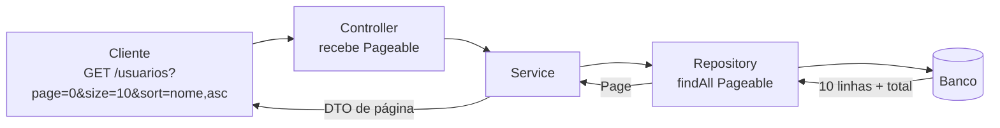
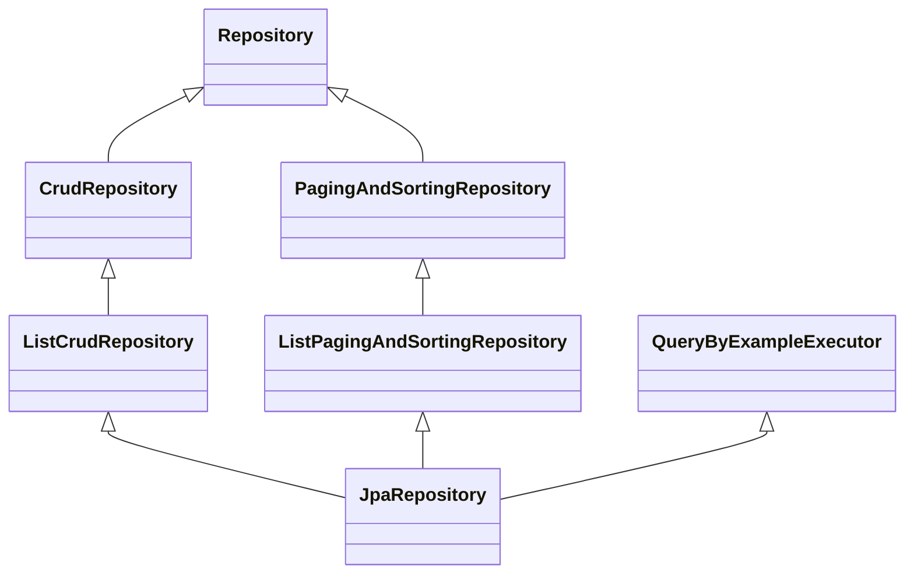
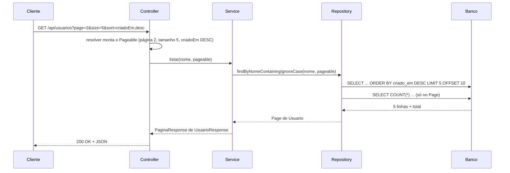

# Pageable e Sort no Spring Data JPA


## Sumário

- [Por que paginar e ordenar](#por-que-paginar-e-ordenar)
- [Sort: ordenação](#sort-ordenação)
- [Pageable: paginação](#pageable-paginação)
- [Page, Slice, List e Window: o que a consulta devolve](#page-slice-list-e-window-o-que-a-consulta-devolve)
- [Contexto no JpaRepository](#contexto-no-jparepository)
- [Usando em query methods e @Query](#usando-em-query-methods-e-query)
- [Usando no Controller](#usando-no-controller)
- [Devolvendo a página como JSON](#devolvendo-a-página-como-json)
- [Exemplo completo](#exemplo-completo)
- [Armadilhas e segurança](#armadilhas-e-segurança)
- [Como testar](#como-testar)
- [Boas práticas](#boas-práticas)
- [Referências](#referências)

---

## Por que paginar e ordenar

Imagine uma tabela `usuarios` com 500 mil linhas. Se o endpoint `GET /api/usuarios` devolver **tudo**, acontece o seguinte:

- o banco lê e transfere todas as linhas;
- a aplicação carrega tudo na memória (risco de `OutOfMemoryError`);
- o JSON gigante demora para trafegar e o front-end trava.

A solução é devolver os dados **em partes (páginas)** e **em uma ordem previsível**.

| Conceito | Responde à pergunta | Classe do Spring Data |
|---|---|---|
| **Ordenação** | "Em que ordem vêm os dados?" | `Sort` |
| **Paginação** | "Quais dados quero agora: qual página e de que tamanho?" | `Pageable` |
| **Resultado paginado** | "Os dados da página, mais informações sobre o total" | `Page`, `Slice` |



> [!NOTE]
> `Sort`, `Pageable`, `Page` e `Slice` ficam no pacote `org.springframework.data.domain`.

---

## Sort: ordenação

O **`Sort`** descreve **por quais campos** e **em qual direção** (crescente ou decrescente) os resultados devem ser ordenados.

> [!IMPORTANT]
> Os nomes usados no `Sort` são **nomes de atributos da entidade** Java (`criadoEm`), e **não** nomes de colunas do banco (`criado_em`).

### Criando um Sort

```java
import org.springframework.data.domain.Sort;

Sort porNome = Sort.by("nome");                                   // crescente (ASC é o padrão)

Sort porNomeDesc = Sort.by(Sort.Direction.DESC, "nome");          // decrescente

Sort porNomeDesc2 = Sort.by("nome").descending();                 // mesma coisa, estilo fluente

Sort porVarios = Sort.by("ativo").descending()                    // 1º critério: ativo (DESC)
        .and(Sort.by("nome").ascending());                        // desempate: nome (ASC)

Sort ordenacoes = Sort.by(                                        // lista de ordens, cada uma com sua direção
        Sort.Order.desc("criadoEm"),
        Sort.Order.asc("nome"));
```

A **ordem dos critérios importa**: o segundo só é usado quando o primeiro empata.

### Controle fino com `Sort.Order`

```java
Sort.Order ordem = Sort.Order.asc("nome")
        .ignoreCase()          // ignora maiúsculas e minúsculas ("ana" junto com "Ana")
        .nullsLast();          // valores nulos vão para o final

Sort sort = Sort.by(ordem);
```

| Método | O que faz |
|---|---|
| `Order.asc(prop)` / `Order.desc(prop)` | Cria uma ordem crescente ou decrescente |
| `.ignoreCase()` | Compara sem diferenciar maiúsculas de minúsculas |
| `.nullsFirst()` / `.nullsLast()` | Define onde ficam os valores nulos |
| `Sort.unsorted()` | Sem ordenação nenhuma |
| `sort.and(outro)` | Junta dois `Sort` |
| `sort.reverse()` | Inverte todas as direções |
| `sort.isSorted()` | Diz se há alguma ordenação definida |

### Propriedades aninhadas

Use ponto para ordenar por um atributo de outro objeto relacionado:

```java
Sort porCidade = Sort.by("endereco.cidade");   // ordena pelo campo cidade do objeto endereco
```

### Ordenação com segurança de tipos

Evita erro de digitação no nome do campo:

```java
Sort.TypedSort<Usuario> usuario = Sort.sort(Usuario.class);
Sort sort = usuario.by(Usuario::getNome).ascending();   // se renomear o atributo, o compilador avisa
```

### Ordenação por expressão (`JpaSort`)

Quando precisa ordenar por uma **função** (como `LENGTH(nome)`), use `JpaSort.unsafe`:

```java
Sort porTamanho = JpaSort.unsafe(Sort.Direction.ASC, "LENGTH(nome)");
```

> [!WARNING]
> O nome é `unsafe` por um motivo: a expressão vai direto para a query. **Nunca** monte esse texto com dados vindos do usuário.

---

## Pageable: paginação

O **`Pageable`** descreve **qual página** e **de que tamanho** você quer, e pode carregar também um `Sort`. A implementação mais usada é a **`PageRequest`**.

| Informação | Significado | Observação |
|---|---|---|
| **page** (número da página) | Qual página buscar | **Começa em 0**: `0` é a primeira página |
| **size** (tamanho) | Quantos itens por página | Ex.: `10` |
| **sort** | Ordenação | Opcional |

### Criando um Pageable

```java
import org.springframework.data.domain.PageRequest;
import org.springframework.data.domain.Pageable;

Pageable p1 = PageRequest.of(0, 10);                                  // 1ª página, 10 itens, sem ordenação

Pageable p2 = PageRequest.of(0, 10, Sort.by("nome"));                 // com ordenação

Pageable p3 = PageRequest.of(2, 10, Sort.Direction.DESC, "criadoEm"); // atalho: direção + um ou mais campos

Pageable p4 = Pageable.ofSize(20);                                    // 1ª página com 20 itens

Pageable todos = Pageable.unpaged();                                  // SEM paginação (traz tudo)
```

> [!WARNING]
> `Pageable.unpaged()` desliga a paginação e traz **todas as linhas**. Use só em tabelas pequenas.

### Como o Spring calcula a página no banco

```
offset = page × size
```

| Requisição | Cálculo | O banco pula | E devolve |
|---|---|---|---|
| `page=0, size=10` | 0 × 10 | 0 linhas | linhas 1 a 10 |
| `page=1, size=10` | 1 × 10 | 10 linhas | linhas 11 a 20 |
| `page=2, size=10` | 2 × 10 | 20 linhas | linhas 21 a 30 |

Em SQL, é algo como (a forma exata depende do banco e do dialeto):

```sql
SELECT * FROM usuarios ORDER BY nome ASC LIMIT 10 OFFSET 20;   -- page=2, size=10
```

### O que um Pageable sabe fazer

| Método | O que devolve |
|---|---|
| `getPageNumber()` | Número da página (começando em 0) |
| `getPageSize()` | Tamanho da página |
| `getOffset()` | Quantas linhas serão puladas |
| `getSort()` | O `Sort` embutido |
| `next()` / `previousOrFirst()` | O `Pageable` da próxima página e o da anterior |
| `first()` | O `Pageable` da primeira página |
| `hasPrevious()` | Se existe página anterior |
| `isPaged()` / `isUnpaged()` | Se há paginação ou não |

---

## Page, Slice, List e Window: o que a consulta devolve

O tipo de retorno do método do repository define **quanta informação** você recebe e **quanto custa** a consulta.

| Tipo | Traz | Faz `COUNT` extra? | Quando usar |
|---|---|---|---|
| **`Page<T>`** | Itens + total de elementos e de páginas | **Sim** | Telas com "página 3 de 50" e total de resultados |
| **`Slice<T>`** | Itens + se existe próxima página | Não | "Carregar mais" e rolagem infinita |
| **`List<T>`** | Só os itens | Não | Quando não precisa de metadados |
| **`Window<T>`** | Itens + posição para continuar (*scroll*) | Não | Tabelas muito grandes (paginação por *keyset*) |

### Page

```java
Page<Usuario> page = repository.findAll(PageRequest.of(0, 10));
```

| Método | O que devolve |
|---|---|
| `getContent()` | `List<T>` com os itens desta página |
| `getNumber()` | Número da página atual (começa em 0) |
| `getSize()` | Tamanho pedido da página |
| `getNumberOfElements()` | Quantos itens vieram **nesta** página (a última pode ter menos) |
| `getTotalElements()` | Total de itens em **todas** as páginas |
| `getTotalPages()` | Total de páginas |
| `hasNext()` / `hasPrevious()` | Se há próxima ou anterior |
| `isFirst()` / `isLast()` | Se é a primeira ou a última |
| `isEmpty()` | Se a página veio vazia |
| `map(funcao)` | Converte cada item (ex.: entidade → DTO) mantendo a paginação |

Exemplo com 45 usuários e `size=10`:

| `page` | Itens em `getContent()` | `isLast()` |
|---|---|---|
| 0 | 10 | não |
| 1 | 10 | não |
| 2 | 10 | não |
| 3 | 10 | não |
| 4 | **5** | **sim** |

`getTotalElements()` = 45 e `getTotalPages()` = 5 (arredonda para cima: 45 ÷ 10).

> [!NOTE]
> Pedir uma página **além do fim** (por exemplo, `page=99`) **não gera erro**. Você recebe uma página vazia, e o `totalElements` continua correto.

### Slice

O `Slice` é um `Page` **sem total**. Em vez de fazer um `COUNT(*)`, o Spring busca **1 item a mais** que o pedido (`size + 1`). Se esse item extra existir, há próxima página.

```java
Slice<Usuario> slice = repository.findByAtivoTrue(PageRequest.of(0, 10));

slice.getContent();   // até 10 itens
slice.hasNext();      // true se existir mais (o 11º item foi encontrado)
```

Em tabelas grandes, o `COUNT(*)` do `Page` pode ser **mais caro** que a própria busca. Se a tela não precisa do total, prefira `Slice`.

### Window (scroll, avançado)

Em vez de "pular N linhas" (`OFFSET`), a paginação por *keyset* continua **a partir da última linha lida**. Isso evita o custo do `OFFSET` em páginas muito profundas. O Spring Data oferece isso com `Window<T>` e `ScrollPosition` em consultas derivadas. Consulte a documentação oficial para a sintaxe da sua versão.

---

## Contexto no JpaRepository

`Sort` e `Pageable` **não funcionam sozinhos**. Eles são **parâmetros** que o repository entende. A "capacidade" de paginar e ordenar vem das interfaces que o `JpaRepository` herda:



| Interface | O que traz |
|---|---|
| `CrudRepository` / `ListCrudRepository` | `save`, `findById`, `findAll`, `deleteById`, `count`... |
| **`PagingAndSortingRepository`** | `findAll(Sort)` e `findAll(Pageable)` |
| **`ListPagingAndSortingRepository`** | O mesmo, com `List` em vez de `Iterable` na ordenação |
| `QueryByExampleExecutor` | Busca por exemplo, também aceita `Pageable` e `Sort` |
| **`JpaRepository`** | Junta tudo e acrescenta métodos próprios do JPA (`flush`, `saveAllAndFlush`...) |

> [!NOTE]
> A partir do **Spring Data 3**, o `PagingAndSortingRepository` **não estende mais** o `CrudRepository`. Por isso, se você estender **só** ele, não terá `save` nem `findById`. Estendendo `JpaRepository`, você tem tudo junto.

### Métodos prontos que já aceitam Sort e Pageable

```java
public interface UsuarioRepository extends JpaRepository<Usuario, Long> {
}
```

Sem escrever nenhum método, você já pode chamar:

| Método | Devolve | Para que serve |
|---|---|---|
| `findAll()` | `List<T>` | Tudo, sem ordem definida |
| `findAll(Sort sort)` | `List<T>` | Tudo, ordenado |
| `findAll(Pageable pageable)` | `Page<T>` | Uma página (e ordenada, se o `Pageable` tiver `Sort`) |
| `findAll(Example<S> e, Pageable p)` | `Page<S>` | Busca por exemplo, paginada |
| `findAll(Example<S> e, Sort s)` | `List<S>` | Busca por exemplo, ordenada |

```java
repository.findAll(Sort.by("nome"));                                  // todos, ordenados por nome
repository.findAll(PageRequest.of(0, 10));                            // 1ª página
repository.findAll(PageRequest.of(0, 10, Sort.by("nome").descending())); // 1ª página, nome DESC
```

### Specification (filtros dinâmicos)

Se o repository também estender `JpaSpecificationExecutor<T>`, ganha:

```java
Page<Usuario> findAll(Specification<Usuario> spec, Pageable pageable);
List<Usuario> findAll(Specification<Usuario> spec, Sort sort);
```

---

## Usando em query methods e @Query

### Query methods (consultas derivadas do nome)

Basta **acrescentar `Pageable` ou `Sort` como último parâmetro**:

```java
public interface UsuarioRepository extends JpaRepository<Usuario, Long> {

    // Paginado, com total (Page)
    Page<Usuario> findByNomeContainingIgnoreCase(String nome, Pageable pageable);

    // Paginado, sem total (Slice)
    Slice<Usuario> findByAtivoTrue(Pageable pageable);

    // Só ordenado (sem paginar)
    List<Usuario> findByAtivoTrue(Sort sort);

    // Ordenação FIXA no próprio nome do método
    List<Usuario> findByAtivoTrueOrderByNomeAsc();

    // Limitar a quantidade de resultados
    List<Usuario> findTop5ByOrderByCriadoEmDesc();
}
```

| Quero | Faço |
|---|---|
| Ordenação escolhida **pelo chamador** | Parâmetro `Sort` ou `Pageable` |
| Ordenação **sempre igual** | `OrderBy...` no nome do método |
| Só os "N primeiros" | `findTopN...` ou `findFirstN...` |

> [!WARNING]
> Use **`Sort` ou `Pageable`** em um método, e **não os dois ao mesmo tempo**. O `Pageable` já carrega um `Sort` dentro dele.

### @Query com JPQL

```java
@Query(value = """
        select u from Usuario u
        where u.ativo = true
          and lower(u.nome) like lower(concat('%', :nome, '%'))
        """,
       countQuery = """
        select count(u) from Usuario u
        where u.ativo = true
          and lower(u.nome) like lower(concat('%', :nome, '%'))
        """)
Page<Usuario> buscarAtivos(@Param("nome") String nome, Pageable pageable);
```

| Parte | O que faz |
|---|---|
| `value` | A consulta que traz os itens da página |
| `countQuery` | A consulta que conta o total (usada para montar o `Page`) |
| `Pageable pageable` | O Spring acrescenta `ORDER BY`, `LIMIT` e `OFFSET` automaticamente |

> [!TIP]
> Em consultas simples, o Spring deriva a `countQuery` sozinho. Em consultas com `JOIN`, `GROUP BY` ou `DISTINCT`, **escreva a `countQuery` à mão**, senão a contagem pode ficar errada ou lenta.

> [!NOTE]
> Em **queries nativas** (`nativeQuery = true`), a ordenação dinâmica por `Sort` é limitada e depende da versão. Para paginar, informe a `countQuery`. Quando possível, prefira JPQL. Se for nativa, escreva o `ORDER BY` fixo na própria query.

---

## Usando no Controller

O Spring MVC sabe converter os parâmetros da URL em um `Pageable` **automaticamente**, graças ao *Spring Data web support* (ativo por padrão com `spring-boot-starter-data-jpa` e web).

```java
@GetMapping
public Page<Usuario> listar(Pageable pageable) { ... }   // o Spring monta o Pageable a partir da URL
```

### Parâmetros reconhecidos

| Parâmetro | Significado | Exemplo |
|---|---|---|
| `page` | Número da página (começa em 0) | `?page=0` |
| `size` | Itens por página | `?size=10` |
| `sort` | Campo e direção (`campo,direção`) | `?sort=nome,asc` |

```http
### 1ª página, 10 itens, ordenado por nome (crescente)
GET /api/usuarios?page=0&size=10&sort=nome,asc

### Vários critérios: repita o parâmetro sort
GET /api/usuarios?sort=ativo,desc&sort=nome,asc

### Só ordenação, sem paginação (parâmetro do tipo Sort)
GET /api/usuarios/ordenados?sort=criadoEm,desc
```

### Valores padrão

Se o cliente não enviar nada, entram os valores padrão. Você pode definir os seus com `@PageableDefault`:

```java
@GetMapping
public PaginaResponse<UsuarioResponse> listar(
        @PageableDefault(size = 10, sort = "nome", direction = Sort.Direction.ASC) Pageable pageable) {
    ...
}
```

| Anotação | Para que serve |
|---|---|
| `@PageableDefault` | Define tamanho, página, ordenação e direção padrão |
| `@SortDefault` | Define só a ordenação padrão (para parâmetros do tipo `Sort`) |
| `@Qualifier("usuarios")` | Permite **dois** `Pageable` no mesmo método (prefixos `usuarios_page`, `usuarios_size`) |

### Configurações pelo `application.properties`

| Propriedade | O que controla | Padrão |
|---|---|---|
| `spring.data.web.pageable.default-page-size` | Tamanho padrão da página | `20` |
| `spring.data.web.pageable.max-page-size` | **Tamanho máximo** aceito | `2000` |
| `spring.data.web.pageable.page-parameter` | Nome do parâmetro de página | `page` |
| `spring.data.web.pageable.size-parameter` | Nome do parâmetro de tamanho | `size` |
| `spring.data.web.pageable.one-indexed-parameters` | Aceita páginas começando em 1 na URL | `false` |
| `spring.data.web.sort.sort-parameter` | Nome do parâmetro de ordenação | `sort` |

```properties
spring.data.web.pageable.default-page-size=10
spring.data.web.pageable.max-page-size=100
```

> [!IMPORTANT]
> Reduza o `max-page-size`. O padrão (2000) permite que qualquer cliente peça milhares de linhas de uma vez, o que derruba o desempenho. O Spring **corta** pedidos acima do máximo e usa o valor máximo.

> [!NOTE]
> `one-indexed-parameters=true` só muda como a **URL** é lida (`page=1` vira a primeira página). Internamente, o `Pageable` e o `Page` continuam contando a partir de 0.

### Sem o recurso automático

Também dá para receber os valores manualmente e montar o `PageRequest` você mesmo:

```java
@GetMapping
public Page<Usuario> listar(@RequestParam(defaultValue = "0") int pagina,
                            @RequestParam(defaultValue = "10") int tamanho) {
    Pageable pageable = PageRequest.of(pagina, tamanho, Sort.by("nome"));
    return repository.findAll(pageable);
}
```

---

## Devolvendo a página como JSON

Evite devolver o `Page` (na prática, um `PageImpl`) direto. Em versões recentes do Spring Data, o formato do JSON dele **não é estável**, e o Spring avisa sobre isso. Há três saídas:

| Opção | Como | Resultado |
|---|---|---|
| **DTO próprio** (recomendado) | Um `record` que você controla | Contrato fixo e claro |
| `PagedModel<T>` | `new PagedModel<>(page)` | JSON estável, com `content` e `page` |
| Modo DTO global | `@EnableSpringDataWebSupport(pageSerializationMode = PageSerializationMode.VIA_DTO)` | Todo `Page` serializado como `PagedModel` |

### DTO próprio

```java
public record PaginaResponse<T>(
        List<T> conteudo,        // itens da página
        int pagina,              // número da página atual (começa em 0)
        int tamanho,             // tamanho pedido
        long totalElementos,     // total em todas as páginas
        int totalPaginas,        // total de páginas
        boolean ultima           // se é a última página
) {
    public static <T> PaginaResponse<T> de(Page<T> page) {   // converte um Page em PaginaResponse
        return new PaginaResponse<>(
                page.getContent(),
                page.getNumber(),
                page.getSize(),
                page.getTotalElements(),
                page.getTotalPages(),
                page.isLast());
    }
}
```

Resposta em JSON:

```json
{
  "conteudo": [
    { "id": 1, "nome": "Ana", "email": "ana@email.com" },
    { "id": 2, "nome": "Bruno", "email": "bruno@email.com" }
  ],
  "pagina": 0,
  "tamanho": 10,
  "totalElementos": 45,
  "totalPaginas": 5,
  "ultima": false
}
```

### Entidade → DTO sem perder a paginação

O `Page.map(...)` converte cada item e **mantém** os dados de paginação:

```java
Page<UsuarioResponse> page = repository.findAll(pageable).map(mapper::toResponse);
```

---

## Exemplo completo

### 1. Entidade

```java
@Entity
@Table(name = "usuarios")
public class Usuario {

    @Id
    @GeneratedValue(strategy = GenerationType.IDENTITY)
    private Long id;

    private String nome;
    private String email;
    private boolean ativo;
    private LocalDateTime criadoEm;

    // getters e setters omitidos
}
```

### 2. Repository

```java
public interface UsuarioRepository extends JpaRepository<Usuario, Long> {

    // Pageable já embute página, tamanho e ordenação
    Page<Usuario> findByNomeContainingIgnoreCase(String nome, Pageable pageable);
}
```

### 3. Service

```java
@Service
public class UsuarioService {

    private final UsuarioRepository repository;
    private final UsuarioMapper mapper;

    public UsuarioService(UsuarioRepository repository, UsuarioMapper mapper) {
        this.repository = repository;
        this.mapper = mapper;
    }

    @Transactional(readOnly = true)                                    // consulta apenas leitura: mais leve
    public PaginaResponse<UsuarioResponse> listar(String nome, Pageable pageable) {
        Page<UsuarioResponse> page = repository
                .findByNomeContainingIgnoreCase(nome, pageable)       // busca a página no banco
                .map(mapper::toResponse);                              // entidade -> DTO, mantendo a paginação
        return PaginaResponse.de(page);                                // Page -> DTO de página
    }
}
```

### 4. Controller

```java
@RestController
@RequestMapping("/api/usuarios")
public class UsuarioController {

    private final UsuarioService service;

    public UsuarioController(UsuarioService service) {
        this.service = service;
    }

    @GetMapping                                                        // GET /api/usuarios
    public PaginaResponse<UsuarioResponse> listar(
            @RequestParam(defaultValue = "") String nome,              // filtro opcional: ?nome=Ana
            @PageableDefault(size = 10, sort = "nome") Pageable pageable) { // monta o Pageable a partir de page, size e sort
        return service.listar(nome, pageable);
    }
}
```

### 5. Chamando

```http
### Padrão: 1ª página, 10 itens, ordenado por nome
GET http://localhost:8080/api/usuarios

### 3ª página, 5 itens, mais novos primeiro
GET http://localhost:8080/api/usuarios?page=2&size=5&sort=criadoEm,desc

### Com filtro, ordenando por nome e depois por e-mail
GET http://localhost:8080/api/usuarios?nome=ana&sort=nome,asc&sort=email,asc
```

### O que acontece por baixo



---

## Armadilhas e segurança

### 1. Ordenação instável (itens repetidos ou sumindo entre páginas)

Se vários registros têm o **mesmo valor** no campo de ordenação (por exemplo, o mesmo `nome`), o banco pode devolvê-los em ordens diferentes a cada consulta. Resultado: um item aparece nas páginas 1 e 2, e outro some.

**Solução:** inclua sempre um **critério de desempate único**, normalmente o `id`:

```java
Sort sort = Sort.by("nome").and(Sort.by("id"));
```

### 2. Campo de ordenação inválido

Se o cliente enviar `?sort=campoInexistente,asc`, o Spring lança `PropertyReferenceException`, que vira **erro 500** se você não tratar. Trate como `400 Bad Request`:

```java
@ExceptionHandler(PropertyReferenceException.class)
public ProblemDetail campoInvalido(PropertyReferenceException ex) {
    ProblemDetail p = ProblemDetail.forStatusAndDetail(
            HttpStatus.BAD_REQUEST, "Campo de ordenação inválido: " + ex.getPropertyName());
    p.setTitle("Ordenação inválida");
    return p;
}
```

### 3. Não deixe o cliente ordenar por qualquer campo

Por padrão, o cliente pode ordenar por **qualquer atributo da entidade** (inclusive `senha`, se ela existir). Isso vaza informação (dá para deduzir valores pela ordem) e pode gerar consultas lentas em campos sem índice. Aceite só uma **lista permitida**:

```java
private static final Set<String> CAMPOS_ORDENAVEIS = Set.of("nome", "email", "criadoEm");

private void validarOrdenacao(Pageable pageable) {
    pageable.getSort().forEach(ordem -> {
        if (!CAMPOS_ORDENAVEIS.contains(ordem.getProperty())) {
            throw new IllegalArgumentException("Não é possível ordenar por: " + ordem.getProperty());
        }
    });
}
```

### 4. Limite o tamanho da página

Configure `spring.data.web.pageable.max-page-size` (veja [Configurações](#configurações-pelo-applicationproperties)).

### 5. `JOIN FETCH` de coleção com paginação

Se a sua query busca uma **coleção** com `JOIN FETCH` e usa `Pageable`, o Hibernate **não consegue paginar no banco**. Ele traz tudo e pagina **na memória**, e emite um aviso `firstResult/maxResults specified with collection fetch; applying in memory`.

**Soluções:** busque os IDs paginados primeiro e depois carregue as coleções, use `@EntityGraph` com cuidado ou use `@BatchSize` nas coleções. Para relacionamentos `@ManyToOne`, o problema não ocorre.

### 6. Páginas muito profundas ficam lentas (`OFFSET` alto)

`OFFSET 1000000` obriga o banco a **ler e descartar** um milhão de linhas antes de devolver as 10 desejadas. Para tabelas enormes, considere a paginação por *keyset* (`Window` / `ScrollPosition`).

### 7. `Page` custa uma consulta a mais

Cada `Page` executa um `SELECT COUNT(*)` adicional. Se não precisa do total, use `Slice`.

---

## Como testar

Teste de repository com paginação e ordenação:

```java
@DataJpaTest
class UsuarioRepositoryTest {

    @Autowired
    UsuarioRepository repository;

    @Test
    void devePaginarOrdenandoPorNome() {
        // 15 usuários salvos antes (omitido)
        Pageable pageable = PageRequest.of(1, 10, Sort.by("nome"));   // 2ª página

        Page<Usuario> page = repository.findAll(pageable);

        assertThat(page.getContent()).hasSize(5);         // 15 itens: sobram 5 na 2ª página
        assertThat(page.getTotalElements()).isEqualTo(15);
        assertThat(page.getTotalPages()).isEqualTo(2);
        assertThat(page.isLast()).isTrue();
    }
}
```

> [!NOTE]
> Imports omitidos de propósito. O pacote de `@DataJpaTest` pode mudar entre versões do Spring Boot, então confira na versão que você usa.

---

## Boas práticas

- [x] **Sempre paginar** endpoints de listagem
- [x] Definir um **tamanho padrão** (`@PageableDefault`) e um **tamanho máximo** (`max-page-size`)
- [x] Incluir o **`id` como desempate** na ordenação
- [x] Aceitar ordenação só por uma **lista permitida de campos**
- [x] Tratar `PropertyReferenceException` como **`400`**
- [x] Usar **`Slice`** quando não precisa do total
- [x] Escrever a **`countQuery`** à mão em consultas com `JOIN` ou `GROUP BY`
- [x] Devolver um **DTO de página** (ou `PagedModel`), não o `PageImpl` direto
- [x] Converter entidades em DTOs com **`page.map(...)`**
- [x] Marcar o método do Service como **`@Transactional(readOnly = true)`**
- [x] Criar **índices** nas colunas usadas para filtrar e ordenar

<details>
<summary>Exemplo do que <b>não</b> fazer</summary>

```java
@GetMapping
public List<Usuario> listar() {
    return repository.findAll();                       // ❌ traz a tabela inteira
}

@GetMapping("/paginado")
public Page<Usuario> paginado(Pageable pageable) {
    return repository.findAll(pageable);               // ❌ expõe a entidade e o PageImpl direto
}                                                      // ❌ sem limite de tamanho nem lista de campos ordenáveis
```

</details>

---

## Referências

- [Spring Data JPA: Paging, Iterating Large Results, Sorting & Limiting](https://docs.spring.io/spring-data/jpa/reference/repositories/query-methods-details.html)
- [Spring Data Commons: Web support (`Pageable` em Controllers)](https://docs.spring.io/spring-data/commons/reference/repositories/core-extensions.html)
- [Javadoc: `org.springframework.data.domain`](https://docs.spring.io/spring-data/commons/docs/current/api/org/springframework/data/domain/package-summary.html)
- [Guia de Markdown do GitHub (GFM)](https://docs.github.com/pt/get-started/writing-on-github)
