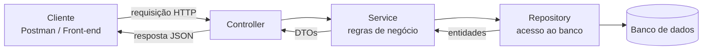
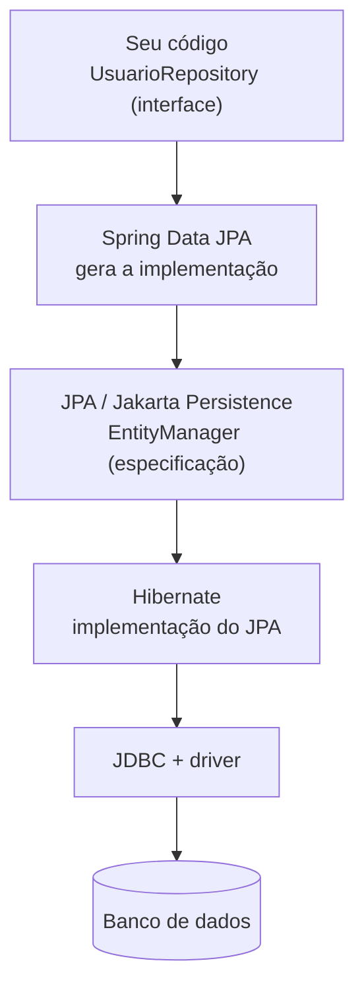
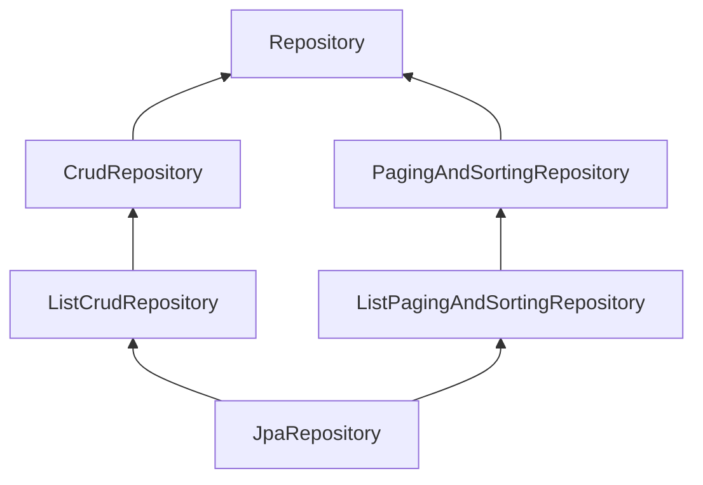
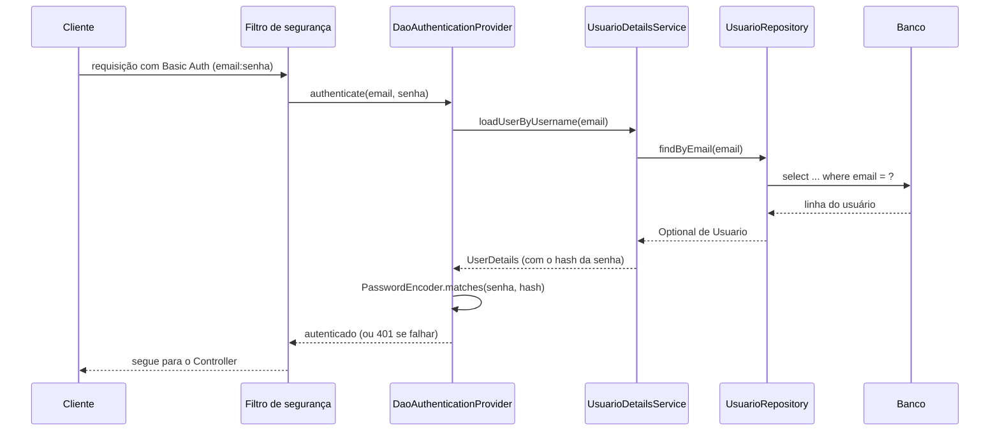

# Repository no Spring Boot


## Sumário

- [O que é um Repository](#o-que-é-um-repository)
- [Para que serve](#para-que-serve)
- [Onde ele se encaixa na aplicação](#onde-ele-se-encaixa-na-aplicação)
- [JPA, Hibernate e Spring Data JPA](#jpa-hibernate-e-spring-data-jpa)
- [Dependências e configuração](#dependências-e-configuração)
- [A entidade](#a-entidade)
- [Hierarquia de interfaces](#hierarquia-de-interfaces)
- [Métodos prontos do Spring Data](#métodos-prontos-do-spring-data)
- [Query methods](#query-methods)
- [Consultas personalizadas com Query](#consultas-personalizadas-com-query)
- [Projeções](#projeções)
- [Paginação e ordenação](#paginação-e-ordenação)
- [Relacionamentos e carregamento (LAZY e EAGER)](#relacionamentos-e-carregamento-lazy-e-eager)
- [Transações](#transações)
- [Repository e Service](#repository-e-service)
- [Spring Security e Repository](#spring-security-e-repository)
- [Testando o Repository](#testando-o-repository)
- [Exemplo completo explicado linha por linha](#exemplo-completo-explicado-linha-por-linha)
- [Erros comuns](#erros-comuns)
- [As melhores maneiras de fazer](#as-melhores-maneiras-de-fazer)
- [Boas práticas](#boas-práticas)
- [Referências](#referências)

---

## O que é um Repository

O **Repository** é a camada responsável por **acessar os dados**: salvar, buscar, atualizar e remover registros, normalmente em um banco de dados. O resto da aplicação trata o Repository como uma "coleção de objetos" e não precisa saber **como** nem **onde** os dados são guardados.

A palavra "Repository" aparece com três sentidos no mundo Java/Spring:

| Sentido | O que é |
|---|---|
| **Padrão de projeto** (*Repository Pattern*) | Uma abstração que esconde o acesso aos dados atrás de uma interface parecida com uma coleção |
| **Anotação `@Repository`** | Marca uma classe como componente de acesso a dados e traduz erros do banco em exceções do Spring (`DataAccessException`) |
| **Interfaces do Spring Data** (`JpaRepository`, `CrudRepository`...) | Interfaces em que você só **declara** os métodos, e o Spring **gera a implementação** |

> [!NOTE]
> No dia a dia com Spring Data, você cria uma **interface** e não escreve a implementação. O `@Repository` é opcional nessas interfaces, porque o Spring Data já as detecta sozinho.

## Para que serve

| Responsabilidade | Exemplo |
|---|---|
| Salvar e atualizar dados | `repository.save(usuario)` |
| Buscar dados | `findById`, `findByEmail`, `findAll` |
| Remover dados | `deleteById(5L)` |
| Montar consultas | Pelo nome do método ou com `@Query` |
| Esconder o banco | O Service não sabe se é PostgreSQL, MySQL ou H2 |

> [!IMPORTANT]
> O Repository **não** deve ter regra de negócio. Ele só **guarda e busca**. Decisões como "este e-mail pode ser usado?" ficam no **Service**.

## Onde ele se encaixa na aplicação



| Camada | Pergunta que ela responde |
|---|---|
| **Controller** | "Quem está pedindo e o que ele quer?" ([veja o arquivo do Controller](https://github.com/Gabriel-Reyes-Boanova/java-annotations/blob/main/spring/controller/controller.md)) |
| **Service** | "O que o sistema deve fazer com isso?" |
| **Repository** | "Como guardo ou busco esses dados?" |

---

## JPA, Hibernate e Spring Data JPA

Esses três nomes costumam ser confundidos, mas cada um tem um papel:

| Nome | O que é | Analogia |
|---|---|---|
| **JPA** (*Jakarta Persistence*) | **Especificação**: define anotações (`@Entity`, `@Id`) e a API (`EntityManager`) para mapear objetos em tabelas. Não tem código que faça o trabalho | O "manual" |
| **Hibernate** | **Implementação** do JPA: é quem realmente gera o SQL e conversa com o banco | O "motor" |
| **Spring Data JPA** | **Camada do Spring** sobre o JPA: gera os repositórios a partir de interfaces | O "atalho" |
| **JDBC** | API básica do Java para falar com bancos, usada pelo Hibernate por baixo | A "estrada" |



> [!NOTE]
> O pacote do JPA mudou de `javax.persistence` para **`jakarta.persistence`** a partir do Spring Boot 3. Se encontrar tutoriais com `javax`, eles são de versões antigas.

### Por baixo dos panos: o que o Spring Data substitui

Sem o Spring Data, você escreveria o Repository à mão com o `EntityManager`:

```java
@Repository
public class UsuarioRepositoryManual {

    @PersistenceContext
    private EntityManager em;                                       // porta de entrada do JPA

    public Optional<Usuario> buscarPorId(Long id) {
        return Optional.ofNullable(em.find(Usuario.class, id));     // SELECT pela chave primária
    }

    public Usuario salvar(Usuario usuario) {
        if (usuario.getId() == null) {
            em.persist(usuario);                                    // INSERT
            return usuario;
        }
        return em.merge(usuario);                                   // UPDATE
    }

    public List<Usuario> buscarPorNome(String nome) {
        return em.createQuery(
                        "select u from Usuario u where u.nome = :nome", Usuario.class)
                .setParameter("nome", nome)
                .getResultList();
    }
}
```

Com o Spring Data JPA, tudo isso vira:

```java
public interface UsuarioRepository extends JpaRepository<Usuario, Long> {
    List<Usuario> findByNome(String nome);
}
```

### Outras formas de acessar dados

| Opção | Quando considerar |
|---|---|
| **Spring Data JPA** | Padrão para a maioria dos projetos com banco relacional |
| **`JdbcClient` / `JdbcTemplate`** | SQL puro, consultas de relatório ou controle total |
| **Spring Data JDBC** | Mapeamento mais simples que o JPA, sem proxies e *lazy loading* |
| **jOOQ / MyBatis** | SQL tipado ou escrito à mão em projetos grandes |

---

## Dependências e configuração

### Maven

```xml
<dependency>
    <groupId>org.springframework.boot</groupId>
    <artifactId>spring-boot-starter-data-jpa</artifactId>
</dependency>

<!-- Driver do banco: escolha um -->
<dependency>
    <groupId>com.h2database</groupId>
    <artifactId>h2</artifactId>                  <!-- banco em memória, ótimo para estudo -->
    <scope>runtime</scope>
</dependency>
<dependency>
    <groupId>org.postgresql</groupId>
    <artifactId>postgresql</artifactId>          <!-- banco real -->
    <scope>runtime</scope>
</dependency>

<!-- Para a parte de segurança deste arquivo -->
<dependency>
    <groupId>org.springframework.boot</groupId>
    <artifactId>spring-boot-starter-security</artifactId>
</dependency>
```

### `application.properties`

**Para estudo (H2 em memória):**

```properties
spring.datasource.url=jdbc:h2:mem:testdb
spring.h2.console.enabled=true
spring.jpa.hibernate.ddl-auto=create-drop
spring.jpa.show-sql=true
```

**Para um banco real (ex.: PostgreSQL):**

```properties
spring.datasource.url=jdbc:postgresql://localhost:5432/meubanco
spring.datasource.username=postgres
spring.datasource.password=${DB_PASSWORD}
spring.jpa.hibernate.ddl-auto=validate
spring.jpa.open-in-view=false
```

> [!WARNING]
> Não coloque senhas de banco direto no arquivo versionado. Use variáveis de ambiente (`${DB_PASSWORD}`) ou outro mecanismo de segredos.

### O que faz o `ddl-auto`

| Valor | Efeito | Onde usar |
|---|---|---|
| `none` | Não mexe no banco | Produção (com migrations) |
| `validate` | Só confere se as tabelas batem com as entidades | Produção |
| `update` | Altera tabelas para acompanhar as entidades | Só em estudo |
| `create` | Apaga e recria as tabelas ao iniciar | Só em estudo |
| `create-drop` | Recria ao iniciar e apaga ao encerrar | Estudo e testes |

> [!IMPORTANT]
> Em produção, o esquema do banco deve ser controlado por **migrations** (Flyway ou Liquibase), e não pelo Hibernate.

---

## A entidade

A **entidade** é a classe Java que representa uma tabela. O Repository trabalha sempre com uma entidade.

```java
@Entity
@Table(name = "usuarios")
@Getter
@Setter
@NoArgsConstructor(access = AccessLevel.PROTECTED)
@AllArgsConstructor(access = AccessLevel.PRIVATE)
@Builder
public class Usuario {

    @Id
    @GeneratedValue(strategy = GenerationType.IDENTITY)
    private Long id;

    @Column(nullable = false, length = 100)
    private String nome;

    @Column(nullable = false, unique = true)
    private String email;

    @Column(nullable = false)
    private String senha;                       // guarda o HASH, nunca a senha pura

    @Enumerated(EnumType.STRING)                // grava o nome ("ADMIN"), não o número
    @Column(nullable = false)
    private Perfil perfil;

    @Column(nullable = false)
    private boolean ativo;
}
```

```java
public enum Perfil { USER, ADMIN }
```

| Anotação | Para que serve |
|---|---|
| `@Entity` | Marca a classe como mapeada para uma tabela |
| `@Table` | Define o nome da tabela (e índices, restrições) |
| `@Id` | Marca a chave primária |
| `@GeneratedValue` | Define como o id é gerado (`IDENTITY`, `SEQUENCE`...) |
| `@Column` | Configura a coluna (`nullable`, `unique`, `length`) |
| `@Enumerated(EnumType.STRING)` | Grava o nome do enum. Evite o `ORDINAL`: ele quebra se a ordem do enum mudar |
| `@Transient` | Campo que **não** vai para o banco |
| `@Version` | Controle de concorrência otimista |

> [!TIP]
> As anotações do Lombok (`@Getter`, `@Builder`...) estão explicadas no arquivo sobre Lombok. Para entidades JPA, **evite `@Data`**.

---

## Hierarquia de interfaces

O Spring Data oferece uma cadeia de interfaces. Cada uma acrescenta métodos à anterior:



> [!NOTE]
> A seta significa "estende". O `JpaRepository` reúne todas as outras.

| Interface | O que oferece |
|---|---|
| `Repository` | Interface vazia: só marca que é um repositório |
| `CrudRepository` | CRUD básico: `save`, `findById`, `findAll`, `deleteById`, `count`... |
| `PagingAndSortingRepository` | Paginação e ordenação |
| `ListCrudRepository` / `ListPagingAndSortingRepository` | Iguais às anteriores, mas devolvem `List` em vez de `Iterable` |
| **`JpaRepository`** | Tudo acima + recursos do JPA: `flush`, `saveAndFlush`, `deleteAllInBatch`, `getReferenceById` |
| `JpaSpecificationExecutor` | Filtros dinâmicos com `Specification` (interface extra, combinada com as outras) |

```java
public interface UsuarioRepository extends JpaRepository<Usuario, Long> {
    //                                       entidade ^    ^ tipo do id
}
```

### Qual estender?

| Situação | Escolha |
|---|---|
| Caso geral, projeto com JPA | `JpaRepository<T, ID>` |
| Quer **expor só** o que for necessário (ex.: sem `delete`) | `Repository<T, ID>` e declarar só os métodos desejados |
| Precisa de filtros dinâmicos | `JpaRepository` + `JpaSpecificationExecutor` |

```java
// Repositório somente leitura: só os métodos declarados existem
public interface PaisRepository extends Repository<Pais, Long> {
    Optional<Pais> findById(Long id);
    List<Pais> findAll();
}
```

---

## Métodos prontos do Spring Data

Estendendo `JpaRepository`, você já ganha estes métodos, sem escrever nada:

| Método | O que faz | Retorno |
|---|---|---|
| `save(entidade)` | Insere (se novo) ou atualiza (se já existe) | A entidade salva |
| `saveAll(lista)` | Salva várias de uma vez | Lista salva |
| `findById(id)` | Busca pela chave primária | `Optional<T>` |
| `findAll()` | Busca todos | `List<T>` |
| `existsById(id)` | Verifica se existe | `boolean` |
| `count()` | Conta os registros | `long` |
| `deleteById(id)` | Remove pelo id | `void` |
| `delete(entidade)` | Remove a entidade | `void` |
| `flush()` / `saveAndFlush()` | Força o envio das alterações ao banco | |
| `getReferenceById(id)` | Devolve uma referência sem consultar o banco (útil para chaves estrangeiras) | `T` |

```java
Usuario salvo = repository.save(usuario);               // use o retorno: ele traz o id gerado
Optional<Usuario> achado = repository.findById(5L);
boolean existe = repository.existsById(5L);
repository.deleteById(5L);
```

> [!IMPORTANT]
> Use sempre o **retorno** do `save()`. Em entidades que já existem, o JPA pode devolver **outra instância** (resultado do `merge`), e o objeto original pode não refletir o que foi gravado.

> [!NOTE]
> **Dirty checking:** dentro de uma transação, toda entidade carregada do banco é monitorada. Se você alterar um campo e a transação terminar, o JPA faz o `UPDATE` **mesmo sem chamar `save()`**.

---

## Query methods

O Spring Data **monta a consulta a partir do nome do método**. Basta seguir o padrão `verbo` + `By` + `propriedade`:

```java
public interface UsuarioRepository extends JpaRepository<Usuario, Long> {

    Optional<Usuario> findByEmail(String email);                       // where email = ?
    boolean existsByEmail(String email);                               // existe algum com este e-mail?
    List<Usuario> findByNomeContainingIgnoreCase(String nome);         // where lower(nome) like %?%
    List<Usuario> findByAtivoTrueOrderByNomeAsc();                     // ativos, em ordem alfabética
    long countByPerfil(Perfil perfil);                                 // quantos por perfil
    void deleteByEmail(String email);                                  // remove pelo e-mail
}
```

### Palavras-chave mais usadas

| Palavra | Exemplo | Resultado |
|---|---|---|
| `And` / `Or` | `findByNomeAndAtivo(...)` | `nome = ? and ativo = ?` |
| `Containing` | `findByNomeContaining("an")` | `nome like %an%` |
| `StartingWith` / `EndingWith` | `findByNomeStartingWith("A")` | `nome like A%` |
| `IgnoreCase` | `findByEmailIgnoreCase(...)` | Ignora maiúsculas e minúsculas |
| `GreaterThan` / `LessThan` | `findByIdadeGreaterThan(18)` | `idade > 18` |
| `Between` | `findByCriadoEmBetween(a, b)` | `criado_em between a and b` |
| `IsNull` / `IsNotNull` | `findByEmailIsNull()` | `email is null` |
| `In` | `findByPerfilIn(List.of(...))` | `perfil in (...)` |
| `True` / `False` | `findByAtivoTrue()` | `ativo = true` |
| `OrderBy...Asc/Desc` | `findByAtivoTrueOrderByNomeAsc()` | Ordenação |
| `First` / `Top` | `findFirst3ByOrderByIdDesc()` | Limita a quantidade |
| `Distinct` | `findDistinctByPerfil(...)` | Sem repetidos |
| `existsBy` / `countBy` / `deleteBy` | `existsByEmail(...)` | Em vez de `find` |

### Tipos de retorno

| Retorno | Quando usar |
|---|---|
| `Optional<T>` | **No máximo um** resultado (pode não existir) |
| `T` | Um resultado que **sempre** existe (lança exceção se não achar) |
| `List<T>` | Vários resultados (vem vazia se não achar, nunca `null`) |
| `Page<T>` / `Slice<T>` | Resultados paginados |
| `boolean`, `long` | Consultas `existsBy` e `countBy` |
| `Stream<T>` | Grandes volumes (precisa ser fechado e usado dentro de transação) |

> [!WARNING]
> Se o método retorna **um único objeto** e a consulta encontra **vários**, o Spring lança `IncorrectResultSizeDataAccessException`. Garanta que o campo é único (`unique = true`) ou retorne `List`.

> [!TIP]
> Nomes muito longos ficam ilegíveis (`findByNomeContainingIgnoreCaseAndAtivoTrueAndPerfilOrderByNomeAsc`). Quando passar de 3 condições, prefira `@Query`.

---

## Consultas personalizadas com Query

Para consultas complexas, use `@Query` com **JPQL** (linguagem de consulta do JPA, que usa os nomes das **classes** e **campos**, não das tabelas e colunas):

```java
public interface UsuarioRepository extends JpaRepository<Usuario, Long> {

    // JPQL com parâmetro nomeado
    @Query("select u from Usuario u where lower(u.email) = lower(:email)")
    Optional<Usuario> buscarPorEmail(@Param("email") String email);

    // SQL nativo (usa nomes de tabela e coluna do banco)
    @Query(value = "select * from usuarios where ativo = true", nativeQuery = true)
    List<Usuario> listarAtivosNativo();

    // Atualização em massa
    @Modifying(clearAutomatically = true)
    @Transactional
    @Query("update Usuario u set u.ativo = false where u.id = :id")
    int desativar(@Param("id") Long id);
}
```

| Tipo | Quando usar |
|---|---|
| **Query method** (pelo nome) | Consultas simples, até 2 ou 3 condições |
| **`@Query` JPQL** | Consultas com `join`, agrupamentos ou condições complexas |
| **`@Query` nativa** | Recursos específicos do banco; perde a portabilidade |
| **`Specification`** | Filtros **dinâmicos** (ex.: tela de busca com vários campos opcionais) |

> [!IMPORTANT]
> Sempre use **parâmetros** (`:email` com `@Param`) e nunca concatene texto na consulta. Concatenar permite **SQL Injection**.

> [!NOTE]
> O `@Modifying` é obrigatório em consultas de `update` e `delete`, e elas precisam rodar dentro de uma transação. O `clearAutomatically = true` limpa o cache do JPA depois, para que as próximas leituras enxerguem o dado atualizado.

---

## Projeções

Buscar a entidade inteira quando você só precisa de dois campos é desperdício. **Projeções** fazem o Spring buscar **apenas as colunas necessárias**.

```java
// Projeção por interface
public interface UsuarioResumo {
    Long getId();
    String getNome();
}

// Projeção por record (DTO)
public record UsuarioNomeEmail(String nome, String email) {}
```

```java
public interface UsuarioRepository extends JpaRepository<Usuario, Long> {

    List<UsuarioResumo> findByAtivoTrue();                    // select id, nome ...
    List<UsuarioNomeEmail> findByPerfil(Perfil perfil);       // select nome, email ...

    @Query("select new com.exemplo.UsuarioNomeEmail(u.nome, u.email) from Usuario u")
    List<UsuarioNomeEmail> listarNomeEmail();                 // forma explícita em JPQL
}
```

> [!TIP]
> Projeções são ótimas para listagens. Como o resultado não é uma entidade, ele não passa pelo *dirty checking* e consome menos memória.

---

## Paginação e ordenação

Evite `findAll()` em tabelas grandes: ele carrega **tudo** na memória. Use paginação:

```java
Page<Usuario> findByNomeContainingIgnoreCase(String nome, Pageable pageable);
```

```java
Pageable pageable = PageRequest.of(0, 10, Sort.by("nome").ascending());   // página 0, 10 itens, ordem por nome
Page<Usuario> pagina = repository.findByNomeContainingIgnoreCase("ana", pageable);

pagina.getContent();         // itens da página
pagina.getTotalElements();   // total de registros
pagina.getTotalPages();      // total de páginas
pagina.getNumber();          // número da página atual
```

| Tipo | O que faz | Custo |
|---|---|---|
| `Page<T>` | Traz a página **e o total** de registros | Faz uma consulta extra (`count`) |
| `Slice<T>` | Traz a página e só informa se **existe próxima** | Mais barato, sem `count` |
| `List<T>` + `Pageable` | Traz só a página, sem metadados | O mais barato |

Para devolver a página pela API, converta para um DTO (como explicado no arquivo do Controller):

```java
public PaginaResponse<UsuarioResponse> listar(String nome, int pagina, int tamanho) {
    Pageable pageable = PageRequest.of(pagina, tamanho, Sort.by("nome"));

    Page<UsuarioResponse> resultado = repository
            .findByNomeContainingIgnoreCase(nome, pageable)
            .map(mapper::toResponse);                         // entidade -> DTO

    return new PaginaResponse<>(resultado.getContent(), resultado.getNumber(),
                                resultado.getSize(), resultado.getTotalElements());
}
```

> [!WARNING]
> Sempre limite o tamanho da página (ex.: máximo de 100). Sem limite, o cliente pode pedir `?tamanho=1000000`.

---

## Relacionamentos e carregamento (LAZY e EAGER)

Os relacionamentos entre entidades usam `@OneToMany`, `@ManyToOne`, `@OneToOne` e `@ManyToMany`.

```java
@Entity
public class Pedido {

    @Id
    @GeneratedValue(strategy = GenerationType.IDENTITY)
    private Long id;

    @ManyToOne(fetch = FetchType.LAZY)          // carrega o usuário só quando for usado
    @JoinColumn(name = "usuario_id")
    private Usuario usuario;
}
```

### LAZY e EAGER

| Tipo | Comportamento |
|---|---|
| **`LAZY`** | Carrega o relacionamento **só quando você acessa** |
| **`EAGER`** | Carrega **junto** com a entidade, sempre |

Os padrões do JPA são:

| Relacionamento | Padrão |
|---|---|
| `@OneToMany`, `@ManyToMany` | `LAZY` |
| `@ManyToOne`, `@OneToOne` | **`EAGER`** (por isso é comum trocar para `LAZY`) |

### O problema N+1

```java
List<Pedido> pedidos = pedidoRepository.findAll();       // 1 consulta
for (Pedido p : pedidos) {
    System.out.println(p.getUsuario().getNome());        // +1 consulta POR pedido
}
// 100 pedidos = 101 consultas
```

**Solução:** buscar o relacionamento **junto**, em uma única consulta, com `@EntityGraph` ou `join fetch`:

```java
public interface PedidoRepository extends JpaRepository<Pedido, Long> {

    @EntityGraph(attributePaths = "usuario")             // traz o usuário no mesmo select
    List<Pedido> findAll();

    @Query("select p from Pedido p join fetch p.usuario where p.id = :id")
    Optional<Pedido> buscarComUsuario(@Param("id") Long id);
}
```

> [!WARNING]
> Não use `join fetch` em **coleções** junto com paginação: o Hibernate pagina **em memória** e emite um aviso. Para coleções, busque em duas etapas ou use projeções.

### `LazyInitializationException`

Acontece ao acessar um relacionamento `LAZY` **depois que a transação terminou**. Soluções, da melhor para a pior:

1. Buscar só o necessário com **projeção** ou DTO
2. Trazer o relacionamento na consulta (`@EntityGraph`, `join fetch`)
3. Acessar o relacionamento **dentro** de um método `@Transactional` do Service

> [!IMPORTANT]
> Evite "resolver" com `EAGER` em tudo ou deixando o `spring.jpa.open-in-view` ligado. Ambos escondem o problema e prejudicam o desempenho.

---

## Transações

Uma **transação** garante que um conjunto de operações seja gravado **por inteiro ou não seja gravado**.

| Onde | O que acontece |
|---|---|
| **Métodos herdados** do `JpaRepository` (`save`, `delete`...) | Já são transacionais |
| **Query methods** que você declara | Participam de uma transação, se houver uma aberta |
| **`@Modifying`** | **Exige** uma transação |
| **Service** | É o lugar certo para abrir a transação |

```java
@Service
@RequiredArgsConstructor
@Transactional(readOnly = true)                  // padrão da classe: só leitura
public class UsuarioService {

    private final UsuarioRepository repository;

    public UsuarioResponse buscar(Long id) { ... }          // herda: somente leitura

    @Transactional                                          // este método grava
    public UsuarioResponse criar(UsuarioRequest request) { ... }
}
```

> [!TIP]
> Use `@Transactional` do pacote `org.springframework.transaction.annotation`. O `readOnly = true` permite otimizações e deixa claro que o método não grava.

> [!WARNING]
> `@Transactional` não funciona em chamadas entre métodos **da mesma classe** (`this.outroMetodo()`), porque o Spring aplica a transação por meio de um proxy.

---

## Repository e Service

O Service é o **único cliente** do Repository. Ele aplica as regras e converte entidade em DTO:

```java
@Service
@RequiredArgsConstructor
public class UsuarioService {

    private final UsuarioRepository repository;
    private final UsuarioMapper mapper;

    @Transactional(readOnly = true)
    public UsuarioResponse buscar(Long id) {
        return repository.findById(id)
                .map(mapper::toResponse)
                .orElseThrow(() -> new UsuarioNaoEncontradoException(id));   // vira 404 no handler
    }
}
```

| Quem | Faz | Não faz |
|---|---|---|
| **Repository** | Busca e grava | Regra de negócio, DTOs, validações |
| **Service** | Regras, transações, conversão para DTO | Montar SQL |
| **Controller** | Recebe a requisição e responde | Chamar o Repository direto |

---

## Spring Security e Repository

O **Spring Security** cuida de **autenticação** (quem é você?) e **autorização** (o que você pode fazer?). Para autenticar usuários guardados no banco, ele precisa de uma ponte: é aqui que o Repository entra.

### Como as peças se conectam

| Peça | Papel |
|---|---|
| `UserDetailsService` | Interface do Spring Security com **um método**: dado um nome de usuário, devolve os dados dele |
| `UserDetails` | Representa o usuário **para o Spring Security** (login, senha com hash, perfis, conta ativa) |
| `PasswordEncoder` | Gera o hash da senha e confere se a senha digitada bate com o hash |
| **`UsuarioRepository`** | Busca o usuário **no banco** para o `UserDetailsService` |



> [!NOTE]
> Em vez dos usuários em memória (`InMemoryUserDetailsManager`), usados em exemplos simples de estudo, aqui o `UserDetailsService` consulta o banco por meio do Repository.

### 1. O Repository

```java
public interface UsuarioRepository extends JpaRepository<Usuario, Long> {
    Optional<Usuario> findByEmail(String email);     // usado no login
    boolean existsByEmail(String email);             // usado no cadastro
}
```

### 2. O `UserDetailsService`

```java
@Service
@RequiredArgsConstructor
public class UsuarioDetailsService implements UserDetailsService {

    private final UsuarioRepository repository;

    @Override
    public UserDetails loadUserByUsername(String email) throws UsernameNotFoundException {
        Usuario usuario = repository.findByEmail(email)
                .orElseThrow(() -> new UsernameNotFoundException("Usuário não encontrado"));

        return User.withUsername(usuario.getEmail())          // User do Spring Security (org.springframework.security.core.userdetails.User)
                .password(usuario.getSenha())                 // hash guardado no banco
                .roles(usuario.getPerfil().name())            // "ADMIN" vira a autoridade ROLE_ADMIN
                .disabled(!usuario.isAtivo())                 // conta inativa não consegue logar
                .build();
    }
}
```

### 3. A configuração de segurança

```java
@Configuration
@EnableWebSecurity
public class SecurityConfig {

    @Bean
    PasswordEncoder passwordEncoder() {
        return new BCryptPasswordEncoder();                   // algoritmo recomendado para senhas
    }

    @Bean
    SecurityFilterChain filterChain(HttpSecurity http) throws Exception {
        http
            .csrf(csrf -> csrf.disable())                     // API stateless de estudo; avalie antes de desativar em produção
            .authorizeHttpRequests(auth -> auth
                .requestMatchers(HttpMethod.POST, "/api/usuarios").permitAll()   // cadastro aberto
                .requestMatchers("/api/admin/**").hasRole("ADMIN")               // só ADMIN
                .anyRequest().authenticated())                                   // o resto exige login
            .httpBasic(Customizer.withDefaults());            // Basic Auth, para testar no Postman
        return http.build();
    }
}
```

> [!TIP]
> Como existe um bean `UserDetailsService` e um bean `PasswordEncoder`, o Spring Security os usa **automaticamente** para autenticar. Não é preciso montar o `AuthenticationManager` à mão.

### 4. Cadastro: guardar a senha com hash

```java
@Service
@RequiredArgsConstructor
public class UsuarioService {

    private final UsuarioRepository repository;
    private final PasswordEncoder passwordEncoder;

    @Transactional
    public UsuarioResponse criar(UsuarioRequest request) {
        if (repository.existsByEmail(request.email())) {
            throw new EmailJaCadastradoException(request.email());       // vira 409 no handler
        }

        Usuario usuario = Usuario.builder()
                .nome(request.nome())
                .email(request.email())
                .senha(passwordEncoder.encode(request.senha()))          // grava o HASH
                .perfil(Perfil.USER)
                .ativo(true)
                .build();

        Usuario salvo = repository.save(usuario);
        return new UsuarioResponse(salvo.getId(), salvo.getNome(), salvo.getEmail());   // sem a senha
    }
}
```

> [!NOTE]
> Para este cadastro funcionar, o `UsuarioRequest` do arquivo do Controller precisa de um campo `senha` (com `@NotBlank` e, de preferência, `@Size(min = 8)`).

### Entidade como `UserDetails` ou classe separada?

| Abordagem | Vantagem | Desvantagem |
|---|---|---|
| **`UserDetailsService` converte** a entidade em `User` (como acima) | A entidade não depende do Spring Security | Um pouco mais de código |
| **A entidade implementa `UserDetails`** | Menos classes | Mistura persistência com segurança; a entidade ganha métodos que não são de domínio |

A primeira abordagem é a mais indicada.

### Filtrar dados pelo usuário logado

Autenticar não basta: é preciso garantir que cada usuário só acesse **os próprios dados**. Uma forma simples é incluir o dono na consulta:

```java
public interface PedidoRepository extends JpaRepository<Pedido, Long> {
    Optional<Pedido> findByIdAndUsuarioEmail(Long id, String email);   // só acha se o pedido for do usuário
}
```

```java
@GetMapping("/{id}")
public PedidoResponse buscar(@PathVariable Long id,
                             @AuthenticationPrincipal UserDetails logado) {
    return service.buscar(id, logado.getUsername());                   // e-mail do usuário autenticado
}
```

> [!TIP]
> Quando o pedido existe mas é de outra pessoa, devolva `404` em vez de `403`. Assim você não revela que aquele id existe.

### Cuidados de segurança com o Repository

- [x] Guardar **somente o hash** da senha (`BCrypt`), nunca a senha pura
- [x] Nunca devolver a entidade `Usuario` na API: use DTOs sem o campo `senha`
- [x] Não incluir `senha` em `toString()` nem em logs
- [x] Usar **parâmetros** nas consultas (`@Param`), nunca concatenar texto
- [x] Garantir `unique` no e-mail **no banco**, e não só na verificação do Service
- [x] Mensagens de login genéricas, sem dizer se foi o e-mail ou a senha que falhou

---

## Testando o Repository

O `@DataJpaTest` sobe **apenas a camada de dados** (entidades e repositórios) com um banco em memória, e desfaz as alterações ao fim de cada teste:

```java
@DataJpaTest
class UsuarioRepositoryTest {

    @Autowired
    UsuarioRepository repository;

    @Test
    void deveBuscarPorEmail() {
        repository.save(Usuario.builder()
                .nome("Ana").email("ana@email.com").senha("hash")
                .perfil(Perfil.USER).ativo(true).build());

        Optional<Usuario> resultado = repository.findByEmail("ana@email.com");

        assertThat(resultado).isPresent();
        assertThat(resultado.get().getNome()).isEqualTo("Ana");
    }

    @Test
    void naoDeveEncontrarEmailInexistente() {
        assertThat(repository.findByEmail("nao@existe.com")).isEmpty();
    }
}
```

> [!NOTE]
> Imports omitidos de propósito. Os pacotes das anotações de teste mudaram entre versões do Spring Boot, então confira os imports na versão que você usa.

> [!TIP]
> Para testar com o **mesmo banco da produção** (ex.: PostgreSQL), use o **Testcontainers** junto com `@AutoConfigureTestDatabase(replace = Replace.NONE)`. Assim você evita diferenças entre o H2 e o banco real.

---

## Exemplo completo explicado linha por linha

### 1. O Repository

```java
import org.springframework.data.jpa.repository.EntityGraph;     // carrega relacionamentos junto, evitando o N+1
import org.springframework.data.jpa.repository.JpaRepository;   // interface base com CRUD, paginação e recursos do JPA
import org.springframework.data.jpa.repository.Query;           // consultas personalizadas em JPQL
import org.springframework.data.repository.query.Param;         // nomeia os parâmetros usados no @Query
import org.springframework.data.domain.Page;                    // resultado paginado
import org.springframework.data.domain.Pageable;                // pedido de paginação (página, tamanho, ordem)
import java.util.Optional;

public interface UsuarioRepository extends JpaRepository<Usuario, Long> {   // entidade: Usuario; tipo do id: Long

    Optional<Usuario> findByEmail(String email);                // query method: "where email = ?"; Optional porque pode não existir

    boolean existsByEmail(String email);                        // "select exists": mais leve que buscar o usuário inteiro

    Page<Usuario> findByNomeContainingIgnoreCase(               // "where lower(nome) like %?%"
            String nome, Pageable pageable);                    // Pageable: o Spring aplica limit, offset e order by

    @Query("select u from Usuario u where u.perfil = :perfil and u.ativo = true")   // JPQL: usa classe e campos, não tabela e colunas
    List<Usuario> listarAtivosPorPerfil(@Param("perfil") Perfil perfil);            // :perfil recebe o argumento do método
}
```

### 2. O Service usando o Repository

```java
@Service                                                         // o Spring gerencia esta classe
@RequiredArgsConstructor                                         // Lombok: construtor com os campos final
@Transactional(readOnly = true)                                  // por padrão, os métodos só leem
public class UsuarioService {

    private final UsuarioRepository repository;                 // injetado pelo construtor gerado
    private final UsuarioMapper mapper;                         // converte entidade em DTO

    public UsuarioResponse buscar(Long id) {
        return repository.findById(id)                          // SELECT pela chave primária; devolve Optional
                .map(mapper::toResponse)                        // se achou, converte para o DTO
                .orElseThrow(() ->                              // se não achou...
                        new UsuarioNaoEncontradoException(id)); // ...lança exceção (o handler transforma em 404)
    }

    @Transactional                                              // este método grava, então abre transação de escrita
    public UsuarioResponse atualizar(Long id, UsuarioRequest request) {
        Usuario usuario = repository.findById(id)               // carrega a entidade (agora monitorada pelo JPA)
                .orElseThrow(() -> new UsuarioNaoEncontradoException(id));

        usuario.setNome(request.nome());                        // altera um campo...
        // sem chamar save(): o dirty checking faz o UPDATE ao fim da transação

        return mapper.toResponse(usuario);                      // devolve o DTO atualizado
    }
}
```

---

## Erros comuns

| Erro | Causa | Solução |
|---|---|---|
| `PropertyReferenceException: No property X found` | Nome do método não corresponde a um campo da entidade | Conferir o nome do campo (`findByEmail` exige o campo `email`) |
| `IncorrectResultSizeDataAccessException` | Método retorna um objeto, mas a consulta achou vários | Tornar o campo `unique` ou retornar `List` |
| `LazyInitializationException` | Acessou relacionamento `LAZY` fora da transação | Projeção, `@EntityGraph` ou `join fetch` |
| `TransactionRequiredException` | `@Modifying` sem transação | Adicionar `@Transactional` |
| Muitas consultas no log (N+1) | Relacionamento `LAZY` acessado em laço | `@EntityGraph` ou `join fetch` |
| `DataIntegrityViolationException` | Violou `unique`, `not null` ou chave estrangeira | Validar antes e tratar a exceção (devolver `409`) |
| `NoSuchBeanDefinitionException` do Repository | Interface fora do pacote da aplicação principal | Mover para um subpacote da classe `@SpringBootApplication` |
| `StackOverflowError` ao serializar ou imprimir | Relacionamento bidirecional no `toString` ou no JSON | Não devolver entidades; `@ToString.Exclude` |
| Alteração "sumiu" | Esqueceu a transação ou usou o objeto retornado errado | Usar `@Transactional` e o retorno do `save()` |
| `OutOfMemoryError` | `findAll()` em tabela grande | Paginação ou *streaming* |

---

## As melhores maneiras de fazer

### 1. Estenda a interface certa e declare só o necessário

`JpaRepository` serve para o caso geral. Para expor menos operações, estenda `Repository` e declare só os métodos desejados.

### 2. Devolva `Optional` para busca única e `List` para várias

```java
// ✅ Bom
Optional<Usuario> findByEmail(String email);

// ❌ Ruim: devolve null quando não acha
Usuario findByEmail(String email);
```

### 3. Escolha a ferramenta de consulta pela complexidade

| Complexidade | Use |
|---|---|
| Simples (1 a 3 condições) | Query method |
| Média (joins, agrupamentos) | `@Query` JPQL |
| Filtros opcionais dinâmicos | `Specification` |
| Específica do banco | `@Query` nativa |

### 4. Nunca exponha a entidade na API

Converta para **DTOs** (`record`) no Service. A entidade tem senha, relacionamentos e campos internos que não devem sair.

### 5. Busque só o que precisa

```java
// ✅ Bom: só duas colunas
List<UsuarioNomeEmail> findByAtivoTrue();

// ❌ Ruim: traz a entidade inteira para usar dois campos
List<Usuario> findByAtivoTrue();
```

### 6. Pagine tudo que pode crescer

`findAll()` sem limite é uma bomba-relógio. Use `Pageable` e limite o tamanho máximo da página.

### 7. Evite o N+1 desde o começo

Deixe os relacionamentos `LAZY` e traga o que precisa com `@EntityGraph` ou `join fetch`.

### 8. Use `existsBy` para verificar existência

```java
// ✅ Bom: select simples
if (repository.existsByEmail(email)) { ... }

// ❌ Ruim: carrega o objeto inteiro só para saber se existe
if (repository.findByEmail(email).isPresent()) { ... }
```

### 9. Garanta regras de unicidade no banco

A verificação no Service falha com **duas requisições simultâneas**. Mantenha `unique = true` (ou uma *unique constraint*) e trate a exceção do banco:

```java
@ExceptionHandler(DataIntegrityViolationException.class)
public ProblemDetail conflito(DataIntegrityViolationException ex) {
    ProblemDetail problema = ProblemDetail.forStatusAndDetail(
            HttpStatus.CONFLICT, "Já existe um registro com estes dados");
    problema.setTitle("Conflito de dados");
    return problema;                                           // 409 Conflict
}
```

### 10. Controle o esquema com migrations

Use **Flyway** ou **Liquibase** e deixe `ddl-auto` em `validate` ou `none` em produção.

### 11. Desligue o *open-in-view*

```properties
spring.jpa.open-in-view=false
```

Por padrão, o Spring Boot mantém a sessão do JPA aberta até o fim da requisição, o que permite consultas escondidas na camada web e gera um aviso na inicialização. Desligá-lo força a busca de dados a acontecer no Service.

### 12. Coloque a transação no Service

Repository não abre transação para regras de negócio. O Service define o que deve ser atômico, com `@Transactional(readOnly = true)` nas leituras.

### 13. Registre quem criou e alterou (auditoria)

```java
@Configuration
@EnableJpaAuditing
public class JpaConfig {}
```

```java
@EntityListeners(AuditingEntityListener.class)
public class Usuario {

    @CreatedDate
    private Instant criadoEm;

    @LastModifiedDate
    private Instant atualizadoEm;
}
```

### 14. Teste o Repository com `@DataJpaTest`

Teste principalmente as consultas **personalizadas** (`@Query`) e os query methods mais complexos.

---

## Boas práticas

- [x] Manter o Repository **só com acesso a dados**: sem regra de negócio
- [x] Usar **`Optional`** para buscas únicas e nunca devolver `null`
- [x] Usar **DTOs e projeções** em vez de expor ou carregar entidades inteiras
- [x] **Paginar** consultas que podem crescer
- [x] Evitar o **N+1** com `LAZY` + `@EntityGraph` ou `join fetch`
- [x] Colocar `@Transactional` no **Service**, com `readOnly = true` nas leituras
- [x] Usar **parâmetros** (`@Param`) nas consultas, nunca concatenar texto
- [x] Usar `existsBy` e `countBy` em vez de carregar objetos
- [x] Garantir **unicidade no banco** e tratar `DataIntegrityViolationException`
- [x] Guardar senhas com **BCrypt** e nunca devolvê-las na API
- [x] Usar **migrations** (Flyway/Liquibase) em produção
- [x] Definir `spring.jpa.open-in-view=false`
- [x] Evitar `@Data` e `EAGER` em entidades
- [x] Testar consultas personalizadas com `@DataJpaTest`

<details>
<summary>Exemplo do que <b>não</b> fazer</summary>

```java
@Repository
public class UsuarioRepositoryRuim {

    @Autowired
    private EntityManager em;                                    // ❌ injeção por campo

    public Usuario buscar(String email) {
        return (Usuario) em.createNativeQuery(                   // ❌ SQL concatenado: SQL Injection
                "select * from usuarios where email = '" + email + "'", Usuario.class)
                .getSingleResult();                              // ❌ exceção se não achar; sem Optional
    }

    public List<Usuario> todos() {
        return em.createQuery("from Usuario", Usuario.class)     // ❌ sem paginação
                .getResultList();
    }

    public void cadastrar(Usuario u) {
        if (u.getEmail() == null) {                              // ❌ regra de negócio no Repository
            throw new RuntimeException("erro");
        }
        u.setSenha(u.getSenha());                                // ❌ senha sem hash
        em.persist(u);
    }
}
```

</details>

## Referências

- [Spring Data JPA: documentação oficial](https://docs.spring.io/spring-data/jpa/reference/)
- [Spring Data JPA: query methods](https://docs.spring.io/spring-data/jpa/reference/jpa/query-methods.html)
- [Spring Security: documentação oficial](https://docs.spring.io/spring-security/reference/)
- [Spring Security: UserDetailsService](https://docs.spring.io/spring-security/reference/servlet/authentication/passwords/user-details-service.html)
- [Jakarta Persistence (especificação do JPA)](https://jakarta.ee/specifications/persistence/)
- [Hibernate ORM: documentação](https://hibernate.org/orm/documentation/)
- [Guia de Markdown do GitHub (GFM)](https://docs.github.com/pt/get-started/writing-on-github)
