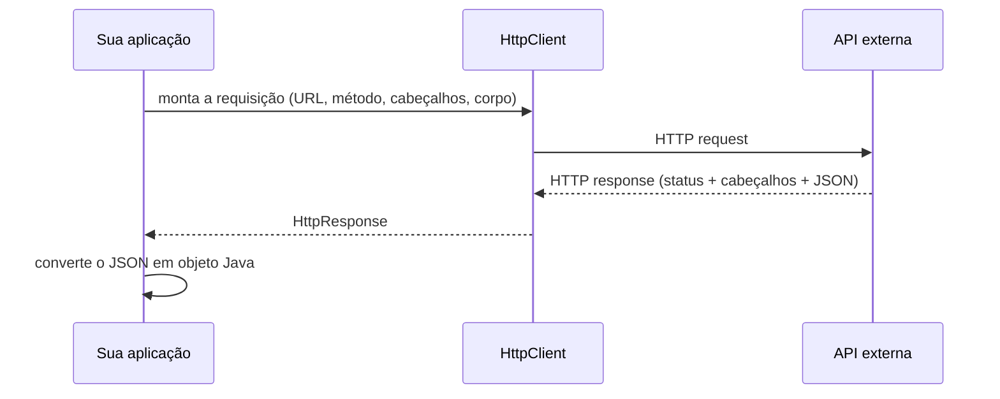
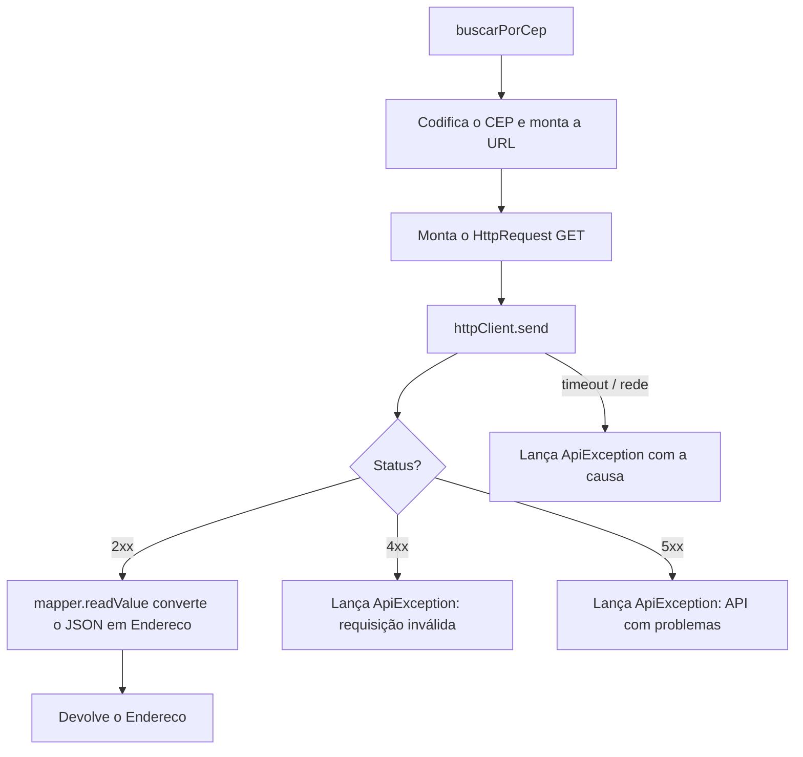

# Consumindo outras APIs em Java


## Sumário

- [O que significa consumir uma API](#o-que-significa-consumir-uma-api)
- [Opções para fazer requisições em Java](#opções-para-fazer-requisições-em-java)
- [Conceitos básicos de uma requisição HTTP](#conceitos-básicos-de-uma-requisição-http)
- [HttpClient: a forma nativa e moderna](#httpclient-a-forma-nativa-e-moderna)
- [Fazendo requisições: GET, POST, PUT, PATCH e DELETE](#fazendo-requisições-get-post-put-patch-e-delete)
- [Query string, cabeçalhos e autenticação](#query-string-cabeçalhos-e-autenticação)
- [Tratando a resposta](#tratando-a-resposta)
- [Convertendo JSON em objetos Java](#convertendo-json-em-objetos-java)
- [Tratamento de erros](#tratamento-de-erros)
- [Requisições assíncronas](#requisições-assíncronas)
- [Exemplo completo: uma classe cliente reutilizável](#exemplo-completo-uma-classe-cliente-reutilizável)
- [Boas práticas](#boas-práticas)
- [E no Spring?](#e-no-spring)
- [Referências](#referências)

---

## O que significa consumir uma API

**Consumir uma API** é fazer o seu programa **chamar outro sistema** pela internet e usar a resposta dele. É o caminho inverso de um Controller:

| | Papel da sua aplicação | Exemplo |
|---|---|---|
| **Controller** | **Servidor**: recebe requisições | O front-end chama o seu sistema |
| **Consumir uma API** | **Cliente**: faz requisições | O seu sistema consulta um CEP, um pagamento, o clima... |



---

## Opções para fazer requisições em Java

| Opção | Disponível em | Situação |
|---|---|---|
| **`java.net.http.HttpClient`** | Java 11+ (nativo, sem dependência) | ✅ **Recomendada.** Moderna, suporta HTTP/2, assíncrona e imutável |
| `HttpURLConnection` | Desde o Java 1.1 | ⚠️ Antiga e verbosa. Evite em código novo |
| Apache HttpClient, OkHttp | Bibliotecas externas | Boas, mas exigem dependência |
| `RestClient`, `WebClient` | Spring | Ótimos dentro do Spring (veja [E no Spring?](#e-no-spring)) |

> [!NOTE]
> O Java tem cliente **HTTP** nativo, mas **não tem um conversor de JSON** nativo. Para transformar JSON em objetos, é preciso uma biblioteca, como a **Jackson** ou a **Gson**. Veja [Convertendo JSON em objetos Java](#convertendo-json-em-objetos-java).

---

## Conceitos básicos de uma requisição HTTP

Toda requisição e toda resposta têm as mesmas partes:

| Parte | Requisição | Resposta |
|---|---|---|
| **Linha inicial** | Método + URL (`GET /ws/01001000/json/`) | Status (`200 OK`) |
| **Cabeçalhos (headers)** | `Accept`, `Content-Type`, `Authorization` | `Content-Type`, `Cache-Control` |
| **Corpo (body)** | JSON enviado (POST, PUT, PATCH) | JSON devolvido |

Cabeçalhos mais comuns:

| Cabeçalho | Para que serve | Exemplo |
|---|---|---|
| `Accept` | Diz qual formato você quer receber | `application/json` |
| `Content-Type` | Diz qual formato você está enviando | `application/json` |
| `Authorization` | Credenciais de acesso | `Bearer eyJhbGciOi...` |
| `User-Agent` | Identifica quem está chamando | `meu-app/1.0` |

---

## HttpClient: a forma nativa e moderna

O pacote `java.net.http` tem quatro peças principais:

| Classe | Função |
|---|---|
| `HttpClient` | O "navegador": envia as requisições e gerencia conexões |
| `HttpRequest` | A requisição (URL, método, cabeçalhos, corpo, timeout) |
| `HttpResponse<T>` | A resposta (status, cabeçalhos, corpo do tipo `T`) |
| `BodyHandlers` / `BodyPublishers` | Definem **como ler** o corpo da resposta e **como montar** o corpo da requisição |

### Criando o HttpClient

```java
import java.net.http.HttpClient;
import java.time.Duration;

HttpClient client = HttpClient.newBuilder()                  // abre o construtor do cliente
        .connectTimeout(Duration.ofSeconds(5))               // tempo máximo para ESTABELECER a conexão
        .followRedirects(HttpClient.Redirect.NORMAL)         // segue redirecionamentos (301, 302...), exceto HTTPS -> HTTP
        .build();                                            // cria o cliente (imutável e seguro para várias threads)
```

Outras opções do `HttpClient.newBuilder()`:

| Método | O que configura |
|---|---|
| `version(...)` | Versão do HTTP (por padrão tenta HTTP/2 e cai para HTTP/1.1 se preciso) |
| `proxy(...)` | Proxy da rede |
| `authenticator(...)` | Autenticação básica automática |
| `executor(...)` | Pool de threads usado nas chamadas assíncronas |
| `sslContext(...)` | Configurações de certificado e TLS |
| `cookieHandler(...)` | Gerenciamento de cookies |

> [!IMPORTANT]
> Crie o `HttpClient` **uma única vez** e reutilize. Ele gerencia o *pool* de conexões, então criar um novo a cada chamada desperdiça recursos.

### Formas de ler o corpo da resposta (`BodyHandlers`)

| Handler | Devolve | Quando usar |
|---|---|---|
| `ofString()` | `String` | JSON e texto (o caso mais comum) |
| `ofByteArray()` | `byte[]` | Imagens e dados binários pequenos |
| `ofFile(path)` | `Path` | Baixar um arquivo direto para o disco |
| `ofInputStream()` | `InputStream` | Respostas grandes, lidas aos poucos |
| `ofLines()` | `Stream<String>` | Respostas lidas linha a linha |
| `discarding()` | `Void` | Quando só importa o status |

### Formas de montar o corpo da requisição (`BodyPublishers`)

| Publisher | Quando usar |
|---|---|
| `ofString(texto)` | Enviar JSON como texto |
| `ofByteArray(bytes)` | Enviar dados binários |
| `ofFile(path)` | Enviar um arquivo |
| `noBody()` | Requisições sem corpo |

---

## Fazendo requisições: GET, POST, PUT, PATCH e DELETE

### GET: buscar dados

```java
import java.net.URI;
import java.net.http.HttpRequest;
import java.net.http.HttpResponse;

HttpRequest request = HttpRequest.newBuilder()                   // abre o construtor da requisição
        .uri(URI.create("https://viacep.com.br/ws/01001000/json/")) // endereço completo da API
        .timeout(Duration.ofSeconds(10))                         // tempo máximo para receber a resposta
        .header("Accept", "application/json")                    // pede a resposta em JSON
        .GET()                                                   // método GET (também é o padrão se omitido)
        .build();                                                // cria a requisição (imutável)

HttpResponse<String> response =
        client.send(request, HttpResponse.BodyHandlers.ofString()); // envia e ESPERA a resposta (bloqueante); corpo lido como String

int status = response.statusCode();   // ex.: 200
String body = response.body();        // o JSON, ainda como texto
```

### POST: criar um recurso

```java
String json = """
        {
          "nome": "Ana",
          "email": "ana@email.com"
        }
        """;                                                     // text block (Java 15+): JSON em várias linhas, sem escapar aspas

HttpRequest request = HttpRequest.newBuilder()
        .uri(URI.create("https://api.exemplo.com/usuarios"))
        .header("Content-Type", "application/json")              // avisa que o corpo enviado é JSON
        .header("Accept", "application/json")
        .POST(HttpRequest.BodyPublishers.ofString(json))         // método POST com o JSON no corpo
        .build();
```

### PUT: substituir um recurso

```java
HttpRequest request = HttpRequest.newBuilder()
        .uri(URI.create("https://api.exemplo.com/usuarios/5"))   // o id vai no caminho
        .header("Content-Type", "application/json")
        .PUT(HttpRequest.BodyPublishers.ofString(json))          // corpo completo do recurso
        .build();
```

### PATCH: atualizar parte de um recurso

O `HttpRequest` não tem um atalho `.PATCH()`, então usamos o método genérico `.method(...)`:

```java
HttpRequest request = HttpRequest.newBuilder()
        .uri(URI.create("https://api.exemplo.com/usuarios/5"))
        .header("Content-Type", "application/json")
        .method("PATCH", HttpRequest.BodyPublishers.ofString("{\"email\":\"novo@email.com\"}"))
        .build();
```

### DELETE: remover um recurso

```java
HttpRequest request = HttpRequest.newBuilder()
        .uri(URI.create("https://api.exemplo.com/usuarios/5"))
        .DELETE()                                                // sem corpo
        .build();

HttpResponse<Void> response =
        client.send(request, HttpResponse.BodyHandlers.discarding()); // só interessa o status (esperado: 204)
```

---

## Query string, cabeçalhos e autenticação

### Query string (parâmetros na URL)

Valores que vão na URL precisam ser **codificados**, para que espaços, acentos e símbolos não quebrem o endereço:

```java
import java.net.URLEncoder;
import java.nio.charset.StandardCharsets;

String nome = "Ana Souza";
String url = "https://api.exemplo.com/usuarios"
        + "?nome=" + URLEncoder.encode(nome, StandardCharsets.UTF_8)   // vira "Ana+Souza"
        + "&pagina=0&tamanho=10";
```

> [!WARNING]
> Nunca monte a URL concatenando texto do usuário **sem** codificar. Além de quebrar a requisição, abre espaço para injeção de parâmetros.

### Autenticação

| Tipo | Como enviar | Exemplo em Java |
|---|---|---|
| **Bearer token** (JWT, OAuth2) | Cabeçalho `Authorization` | `.header("Authorization", "Bearer " + token)` |
| **API key** | Cabeçalho próprio (ou query string, conforme a API) | `.header("X-API-Key", chave)` |
| **Basic** | `Authorization` com usuário e senha em Base64 | veja abaixo |

```java
import java.util.Base64;

String credenciais = usuario + ":" + senha;
String basic = Base64.getEncoder()
        .encodeToString(credenciais.getBytes(StandardCharsets.UTF_8));  // codifica "usuario:senha" em Base64

HttpRequest request = HttpRequest.newBuilder()
        .uri(URI.create(url))
        .header("Authorization", "Basic " + basic)
        .build();
```

> [!IMPORTANT]
> **Nunca escreva tokens, chaves ou senhas no código** (muito menos em um repositório no GitHub). Leia de variável de ambiente:
>
> ```java
> String token = System.getenv("API_TOKEN");
> ```

---

## Tratando a resposta

Antes de usar o corpo, **sempre confira o status**:

```java
HttpResponse<String> response = client.send(request, HttpResponse.BodyHandlers.ofString());

int status = response.statusCode();

if (status >= 200 && status < 300) {
    // sucesso: pode ler response.body()
} else if (status >= 400 && status < 500) {
    // erro do cliente: a requisição está errada (URL, dados, autenticação)
} else if (status >= 500) {
    // erro do servidor: o problema é da API (vale tentar de novo depois)
}
```

O que a `HttpResponse` oferece:

| Método | O que devolve |
|---|---|
| `statusCode()` | Código de status (`200`, `404`...) |
| `body()` | O corpo, no tipo definido pelo `BodyHandler` |
| `headers()` | Cabeçalhos da resposta (`headers().firstValue("Content-Type")`) |
| `uri()` | A URL final (útil depois de redirecionamentos) |
| `version()` | Versão do HTTP usada |

> [!WARNING]
> O `HttpClient` **não lança exceção** em respostas `4xx` e `5xx`. Se você não conferir o `statusCode()`, o programa vai tentar converter uma mensagem de erro como se fosse o dado esperado.
>
> Também existem APIs que devolvem `200` com o erro dentro do JSON. Leia a documentação da API que você consome.

---

## Convertendo JSON em objetos Java

O corpo chega como `String`. Para trabalhar com ele como objeto, usamos uma biblioteca de JSON. A mais comum é a **Jackson**.

### Dependência

```xml
<dependency>
    <groupId>com.fasterxml.jackson.core</groupId>
    <artifactId>jackson-databind</artifactId>
    <version>2.x.x</version> <!-- use a versão estável mais recente -->
</dependency>
```

> [!NOTE]
> O Spring Boot 4 passou a usar a **Jackson 3**, em que os pacotes de `ObjectMapper` e `JsonMapper` mudaram para `tools.jackson...` (as anotações continuam em `com.fasterxml.jackson.annotation`). Os exemplos abaixo usam a Jackson 2, ainda muito comum. Confira os imports na versão que você usa.

### JSON → objeto (desserialização)

```java
import com.fasterxml.jackson.databind.ObjectMapper;

// record que representa a resposta da API
public record Endereco(String cep, String logradouro, String bairro, String localidade, String uf) {}

ObjectMapper mapper = new ObjectMapper();                       // crie UMA vez e reutilize (é seguro para várias threads)

Endereco endereco = mapper.readValue(response.body(), Endereco.class);   // converte o JSON (String) em um Endereco
```

### Objeto → JSON (serialização)

```java
record NovoUsuario(String nome, String email) {}

String json = mapper.writeValueAsString(new NovoUsuario("Ana", "ana@email.com"));
// {"nome":"Ana","email":"ana@email.com"}
```

### Listas

Por causa do apagamento de tipos dos *generics* no Java, para listas é preciso usar `TypeReference`:

```java
import com.fasterxml.jackson.core.type.TypeReference;

List<Endereco> lista = mapper.readValue(
        response.body(),
        new TypeReference<List<Endereco>>() {});   // diz à Jackson que é uma LISTA de Endereco
```

### Situações comuns ao tratar os dados

| Situação | Solução |
|---|---|
| A API devolve **campos que você não declarou** e a Jackson dá erro | `@JsonIgnoreProperties(ignoreUnknown = true)` no record |
| O nome do campo no JSON é diferente do seu | `@JsonProperty("localidade") String cidade` |
| Campos de **data** (`LocalDate`, `LocalDateTime`) | Módulo `jackson-datatype-jsr310` + `mapper.registerModule(new JavaTimeModule())` |
| O campo pode **não vir** na resposta | Use tipos que aceitam `null` (`Integer` em vez de `int`) |
| O JSON tem **objetos aninhados** | Crie um record para cada nível |

```java
@JsonIgnoreProperties(ignoreUnknown = true)      // ignora campos extras que a API devolver
public record Endereco(
        String cep,
        String logradouro,
        String bairro,
        @JsonProperty("localidade") String cidade,   // no JSON é "localidade"; no Java usamos "cidade"
        String uf
) {}
```

### Não espalhe o formato da API externa pelo seu sistema

O formato de uma API externa **pode mudar** e não é você quem controla. Converta a resposta dela para o **seu próprio modelo** logo na entrada:

```java
// Formato da API externa (pode mudar sem aviso)
record ViaCepResponse(String cep, String logradouro, String localidade, String uf) {}

// Formato do SEU sistema (estável)
record EnderecoDto(String cep, String rua, String cidade, String estado) {}

static EnderecoDto converter(ViaCepResponse r) {
    return new EnderecoDto(r.cep(), r.logradouro(), r.localidade(), r.uf());
}
```

Assim, se a API externa mudar, você ajusta **um único lugar**.

---

## Tratamento de erros

Chamar outra API pode falhar de várias formas. Cada uma tem seu tipo de problema:

| O que deu errado | Como aparece | Como tratar |
|---|---|---|
| Sem internet, DNS ou servidor fora do ar | `IOException` | Avisar o usuário ou tentar de novo |
| Demorou demais | `HttpTimeoutException` (é um `IOException`) | Timeout curto + nova tentativa |
| Thread interrompida | `InterruptedException` | Restaurar a flag de interrupção |
| A API respondeu `4xx` | `statusCode()` entre 400 e 499 | Corrigir a requisição; **não** adianta repetir |
| A API respondeu `5xx` | `statusCode()` ≥ 500 | Tentar de novo depois (com espera) |
| JSON inesperado | `JsonProcessingException` (é um `IOException`) | Registrar o corpo recebido e falhar com mensagem clara |

```java
try {
    HttpResponse<String> response = client.send(request, HttpResponse.BodyHandlers.ofString());
    // ... confere o status e converte o JSON

} catch (HttpTimeoutException e) {                  // PRECISA vir antes do IOException, que é "pai" dele
    throw new ApiException("A API demorou demais para responder", e);

} catch (IOException e) {                           // falha de rede ou JSON inválido
    throw new ApiException("Falha ao comunicar com a API", e);

} catch (InterruptedException e) {
    Thread.currentThread().interrupt();             // restaura a flag: quem chamou precisa saber que a thread foi interrompida
    throw new ApiException("Requisição interrompida", e);
}
```

Uma exceção própria, com o status, facilita o tratamento depois:

```java
public class ApiException extends RuntimeException {

    private final int status;

    public ApiException(String mensagem, Throwable causa) {
        super(mensagem, causa);
        this.status = -1;                           // -1: não houve resposta HTTP
    }

    public ApiException(String mensagem, int status) {
        super(mensagem);
        this.status = status;
    }

    public int getStatus() {
        return status;
    }
}
```

### Tentar de novo (retry) com espera

Só repita chamadas **seguras de repetir** (GET, PUT, DELETE) e apenas em falhas **temporárias** (timeout, `429`, `5xx`):

```java
static HttpResponse<String> enviarComRetry(HttpClient client, HttpRequest request)
        throws IOException, InterruptedException {

    int tentativas = 3;
    long espera = 500;                                           // milissegundos

    for (int i = 1; ; i++) {
        try {
            HttpResponse<String> r = client.send(request, HttpResponse.BodyHandlers.ofString());
            boolean temporario = r.statusCode() == 429 || r.statusCode() >= 500;
            if (!temporario || i == tentativas) {
                return r;                                        // sucesso, erro definitivo ou últimas tentativas
            }
        } catch (HttpTimeoutException e) {
            if (i == tentativas) throw e;                        // esgotou as tentativas
        }
        Thread.sleep(espera);                                    // espera antes de tentar de novo
        espera *= 2;                                             // dobra a espera a cada falha (backoff exponencial)
    }
}
```

> [!WARNING]
> **Não repita `POST` automaticamente** sem saber se a API é idempotente. Se a primeira chamada chegou ao servidor e só a resposta se perdeu, você pode criar o mesmo recurso duas vezes (por exemplo, cobrar o cliente duas vezes).

---

## Requisições assíncronas

O `client.send(...)` **bloqueia** a thread até a resposta chegar. Para não ficar esperando, use `sendAsync`, que devolve um `CompletableFuture`:

```java
CompletableFuture<Endereco> futuro = client
        .sendAsync(request, HttpResponse.BodyHandlers.ofString())   // envia sem bloquear
        .thenApply(HttpResponse::body)                              // quando chegar, pega o corpo
        .thenApply(corpo -> converter(corpo))                       // converte o JSON em objeto (método seu)
        .exceptionally(erro -> {                                    // se algo falhar em qualquer etapa
            System.err.println("Falhou: " + erro.getMessage());
            return null;
        });

Endereco resultado = futuro.join();                                 // só aqui a thread espera pelo resultado
```

Várias chamadas **em paralelo**:

```java
CompletableFuture<String> a = client.sendAsync(reqA, BodyHandlers.ofString()).thenApply(HttpResponse::body);
CompletableFuture<String> b = client.sendAsync(reqB, BodyHandlers.ofString()).thenApply(HttpResponse::body);

CompletableFuture.allOf(a, b).join();   // espera as duas terminarem; o tempo total é o da mais lenta, não a soma
```

> [!TIP]
> No **Java 21+**, as *virtual threads* permitem escrever código **síncrono** (`send`) que escala bem sem a complexidade do `CompletableFuture`. Se você usa Java 21 ou mais recente, o `send` bloqueante costuma ser a opção mais simples.

---

## Exemplo completo: uma classe cliente reutilizável

Juntando tudo: uma classe que isola a comunicação com a API externa. O resto do sistema só chama `buscarPorCep(...)` e não conhece HTTP nem JSON.

```java
import com.fasterxml.jackson.annotation.JsonIgnoreProperties;
import com.fasterxml.jackson.databind.ObjectMapper;

import java.io.IOException;
import java.net.URI;
import java.net.URLEncoder;
import java.net.http.HttpClient;
import java.net.http.HttpRequest;
import java.net.http.HttpResponse;
import java.net.http.HttpTimeoutException;
import java.nio.charset.StandardCharsets;
import java.time.Duration;

public class ViaCepClient {

    private static final String BASE_URL = "https://viacep.com.br/ws";   // endereço base, definido uma vez

    private final HttpClient httpClient;      // reutilizado em todas as chamadas
    private final ObjectMapper mapper;        // reutilizado em todas as conversões

    public ViaCepClient() {
        this.httpClient = HttpClient.newBuilder()
                .connectTimeout(Duration.ofSeconds(5))
                .build();
        this.mapper = new ObjectMapper();
    }

    public Endereco buscarPorCep(String cep) {
        String cepCodificado = URLEncoder.encode(cep, StandardCharsets.UTF_8);   // protege a URL contra caracteres especiais

        HttpRequest request = HttpRequest.newBuilder()
                .uri(URI.create(BASE_URL + "/" + cepCodificado + "/json/"))
                .timeout(Duration.ofSeconds(10))
                .header("Accept", "application/json")
                .GET()
                .build();

        try {
            HttpResponse<String> response =
                    httpClient.send(request, HttpResponse.BodyHandlers.ofString());

            int status = response.statusCode();

            if (status >= 200 && status < 300) {                                  // 1) sucesso: converte o JSON
                return mapper.readValue(response.body(), Endereco.class);
            }
            if (status >= 400 && status < 500) {                                  // 2) erro nosso: requisição inválida
                throw new ApiException("Requisição inválida para o CEP informado", status);
            }
            throw new ApiException("A API externa está com problemas", status);   // 3) erro da API (5xx)

        } catch (HttpTimeoutException e) {
            throw new ApiException("A API demorou demais para responder", e);
        } catch (IOException e) {
            throw new ApiException("Falha ao comunicar com a API", e);
        } catch (InterruptedException e) {
            Thread.currentThread().interrupt();
            throw new ApiException("Requisição interrompida", e);
        }
    }

    @JsonIgnoreProperties(ignoreUnknown = true)                                   // ignora campos que não declaramos
    public record Endereco(String cep, String logradouro, String bairro, String localidade, String uf) {}
}
```

Uso:

```java
ViaCepClient cliente = new ViaCepClient();
ViaCepClient.Endereco endereco = cliente.buscarPorCep("01001000");
System.out.println(endereco.localidade() + " - " + endereco.uf());
```

<details>
<summary>Passo a passo do que acontece por dentro</summary>



</details>

---

## Boas práticas

- [x] **Reutilizar** o `HttpClient` e o `ObjectMapper` (crie uma vez)
- [x] Definir **timeouts** de conexão e de resposta. Sem eles, uma API lenta pode travar o seu sistema
- [x] **Conferir o status** antes de ler o corpo
- [x] Tratar `HttpTimeoutException`, `IOException` e `InterruptedException` (restaurando a interrupção)
- [x] **Codificar** valores colocados na URL com `URLEncoder`
- [x] Guardar **tokens e chaves em variáveis de ambiente**, nunca no código ou no GitHub
- [x] Usar **records** como DTOs de resposta e ignorar campos desconhecidos
- [x] **Converter** a resposta externa para o seu próprio modelo
- [x] Fazer **retry com espera crescente** só em falhas temporárias e em chamadas seguras de repetir
- [x] **Isolar** a comunicação em uma classe própria (como o `ViaCepClient`) para facilitar testes e trocas
- [x] Não registrar em *logs* dados sensíveis (tokens, senhas, dados pessoais)
- [x] Ler a **documentação da API** consumida: limites de uso (*rate limit*), formato de erro e autenticação

---

## E no Spring?

O Spring não reinventa o HTTP: ele **embrulha** a comunicação para você escrever menos código. As grandes diferenças em relação ao que vimos acima:

| O que você faz à mão no Java puro | O que o Spring faz por você |
|---|---|
| Criar e configurar o `HttpClient` | Fornece um `RestClient.Builder` já configurado para injetar |
| Converter JSON com `ObjectMapper` | Converte **automaticamente** com `.body(Classe.class)` |
| Conferir o status e lançar exceções | `.retrieve()` já lança exceção em `4xx` e `5xx` |
| Montar URL com `URLEncoder` | `.uri("/{cep}/json", cep)` substitui e codifica as variáveis |

### Clientes HTTP do Spring

| Cliente | Estilo | Situação |
|---|---|---|
| **`RestClient`** | Síncrono, com API fluente | ✅ Recomendado para código novo (Spring 6.1+) |
| **HTTP Interface** (`@HttpExchange`) | Declarativo: você escreve só uma interface | ✅ Moderno; usa o `RestClient` por baixo |
| `WebClient` | Reativo (não bloqueante) | Para aplicações reativas |
| `RestTemplate` | Síncrono | Legado; ainda funciona, mas evite em código novo |
| OpenFeign | Declarativo (Spring Cloud) | Biblioteca externa, comum em microsserviços |

### Dependências

Isso **muda entre as versões** do Spring Boot:

| Versão | Para usar `RestClient` | Para usar `WebClient` | JSON (Jackson) |
|---|---|---|---|
| **Spring Boot 3.x** | `spring-boot-starter-web` | `spring-boot-starter-webflux` | Já vem incluída |
| **Spring Boot 4.x** | `spring-boot-starter-restclient` | `spring-boot-starter-webclient` | Vem junto, via `spring-boot-starter-jackson` |

```xml
<!-- Spring Boot 3.x: o starter web já inclui RestClient e Jackson -->
<dependency>
    <groupId>org.springframework.boot</groupId>
    <artifactId>spring-boot-starter-web</artifactId>
</dependency>

<!-- Spring Boot 4.x: starter próprio para clientes HTTP bloqueantes -->
<dependency>
    <groupId>org.springframework.boot</groupId>
    <artifactId>spring-boot-starter-restclient</artifactId>
</dependency>
```

> [!NOTE]
> No Spring Boot 4, o antigo `spring-boot-starter-web` foi renomeado para `spring-boot-starter-webmvc`, e o `RestClient.Builder` só é configurado automaticamente se o `spring-boot-starter-restclient` estiver no projeto.

### Mesmo exemplo (ViaCEP) com `RestClient`

```java
@Service
public class CepService {

    private final RestClient restClient;

    public CepService(RestClient.Builder builder) {          // o builder é injetado pelo Spring
        this.restClient = builder.baseUrl("https://viacep.com.br/ws").build();
    }

    public Endereco buscarPorCep(String cep) {
        return restClient.get()                              // monta um GET
                .uri("/{cep}/json/", cep)                    // preenche e codifica a variável
                .retrieve()                                  // envia e lança exceção em 4xx/5xx
                .body(Endereco.class);                       // converte o JSON no record
    }
}
```

São cerca de 5 linhas no lugar de uma classe inteira, mas o princípio é o mesmo: **requisição → conferir status → converter JSON → tratar erros**.

### HTTP Interface: só declarar a interface

```java
@HttpExchange("/ws")
public interface ViaCepApi {

    @GetExchange("/{cep}/json/")                             // GET /ws/{cep}/json/
    Endereco buscarPorCep(@PathVariable String cep);         // o Spring gera a implementação
}
```

```java
RestClient restClient = RestClient.builder().baseUrl("https://viacep.com.br").build();

HttpServiceProxyFactory factory = HttpServiceProxyFactory
        .builderFor(RestClientAdapter.create(restClient))
        .build();

ViaCepApi api = factory.createClient(ViaCepApi.class);       // objeto pronto para usar
Endereco endereco = api.buscarPorCep("01001000");
```

---

## Referências

- [Javadoc: pacote `java.net.http`](https://docs.oracle.com/en/java/javase/21/docs/api/java.net.http/java/net/http/package-summary.html)
- [Spring Framework: REST Clients](https://docs.spring.io/spring-framework/reference/integration/rest-clients.html)
- [Jackson: documentação no GitHub](https://github.com/FasterXML/jackson-docs)
- [MDN: Códigos de status de resposta HTTP](https://developer.mozilla.org/pt-BR/docs/Web/HTTP/Status)
- [ViaCEP: API pública de CEPs, boa para praticar](https://viacep.com.br/)
