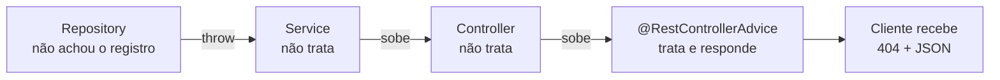
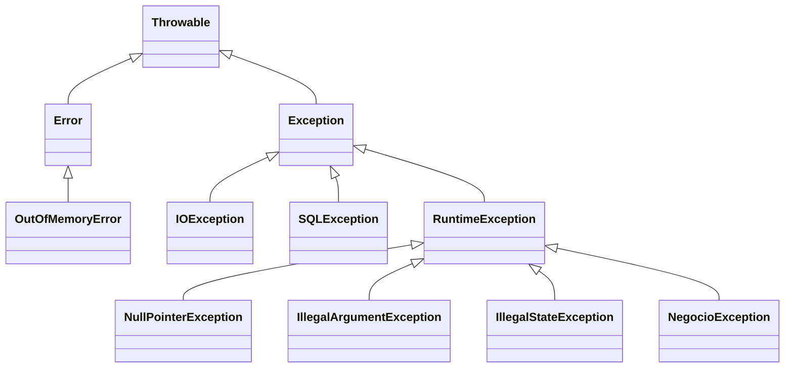
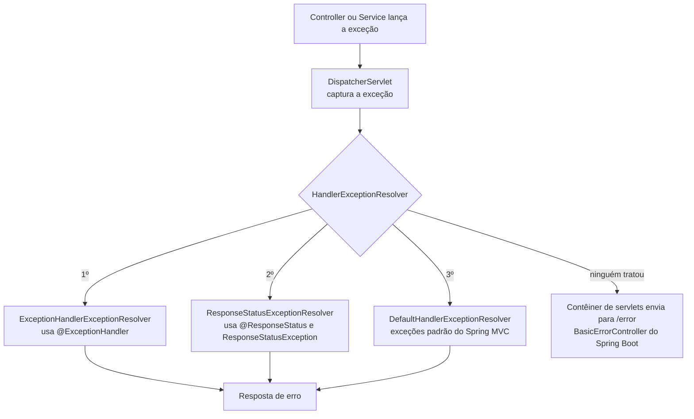
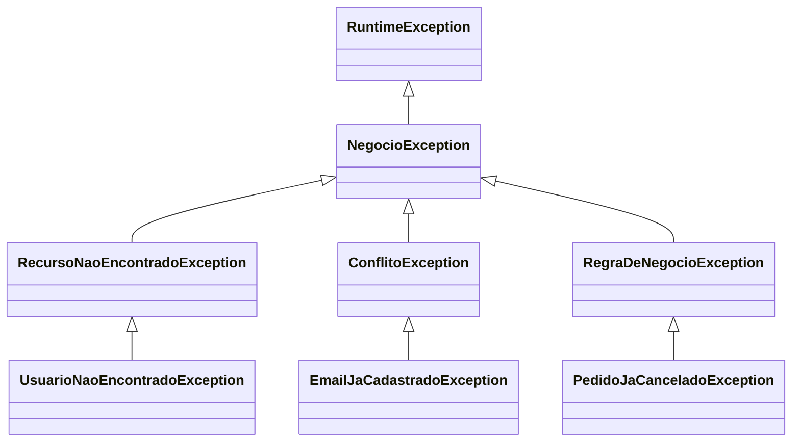

# Exceções no Spring Boot


## Sumário

- [O que é uma exceção e por que tratar](#o-que-é-uma-exceção-e-por-que-tratar)
- [Tipos de exceção em Java](#tipos-de-exceção-em-java)
- [try, catch, finally e a causa original](#try-catch-finally-e-a-causa-original)
- [Como o Spring trata exceções por dentro](#como-o-spring-trata-exceções-por-dentro)
- [Formas de tratar exceções no Spring](#formas-de-tratar-exceções-no-spring)
- [Criando as suas exceções](#criando-as-suas-exceções)
- [Exemplo completo explicado linha por linha](#exemplo-completo-explicado-linha-por-linha)
- [Exceções do Spring e o status de cada uma](#exceções-do-spring-e-o-status-de-cada-uma)
- [Exceções de validação](#exceções-de-validação)
- [Exceções de banco de dados](#exceções-de-banco-de-dados)
- [Exceções de segurança](#exceções-de-segurança)
- [Exceções ao chamar outras APIs](#exceções-ao-chamar-outras-apis)
- [Exceções fora do Controller](#exceções-fora-do-controller)
- [Exceções e transações](#exceções-e-transações)
- [Configurações do Spring Boot para erros](#configurações-do-spring-boot-para-erros)
- [Logs de exceções](#logs-de-exceções)
- [Como testar](#como-testar)
- [Boas práticas](#boas-práticas)
- [Referências](#referências)

---

## O que é uma exceção e por que tratar

Uma **exceção** é um evento que **interrompe o fluxo normal** do programa porque algo deu errado: um registro que não existe, um dado inválido, o banco fora do ar. Em Java, ela é um **objeto** (uma classe que estende `Throwable`) que é **lançado** (`throw`) no ponto do problema e sobe pela pilha de chamadas até alguém **tratar** (`catch`).



Sem tratamento, o cliente recebe um **`500` com uma resposta feia ou vazada**. Com tratamento, ele recebe um status e uma mensagem **corretos e seguros**.

| Sem tratamento | Com tratamento |
|---|---|
| `500 Internal Server Error` para tudo | `404`, `409`, `422`... conforme o caso |
| Possível vazamento de detalhes internos (SQL, classes) | Mensagem controlada e segura |
| Cada endpoint com um formato de erro | **Um único formato** para toda a API |
| Difícil de investigar | Log com contexto e um código de erro |

> [!NOTE]
> Este arquivo complementa o de **Controller**, onde o `ProblemDetail` (RFC 9457) já foi apresentado. Aqui o foco é **todo o resto**: como as exceções funcionam, como organizá-las e as boas práticas.

---

## Tipos de exceção em Java



| Tipo | Exemplos | O compilador obriga a tratar? | Quando usar |
|---|---|---|---|
| **`Error`** | `OutOfMemoryError`, `StackOverflowError` | Não | Problemas graves da JVM. **Não tente tratar** |
| **Checked** (verificada): `Exception` que não é `RuntimeException` | `IOException`, `SQLException` | **Sim** (`try/catch` ou `throws`) | Quando quem chama **consegue se recuperar** do problema |
| **Unchecked** (não verificada): `RuntimeException` | `IllegalArgumentException`, `NullPointerException` | Não | Erros de **programação** e de **regra de negócio** |

> [!IMPORTANT]
> No Spring, o padrão é usar **exceções unchecked** (`RuntimeException`) para regras de negócio. Elas não poluem as assinaturas com `throws`, funcionam bem com expressões lambda e, por padrão, **provocam rollback** em transações (as checked não, veja [Exceções e transações](#exceções-e-transações)). O próprio Spring converte as exceções verificadas do banco (`SQLException`) em unchecked (`DataAccessException`).

Exceções padrão do Java que vale usar em vez de inventar:

| Exceção | Quando lançar |
|---|---|
| `IllegalArgumentException` | Um **argumento** recebido é inválido (`idade < 0`) |
| `IllegalStateException` | O **estado** do objeto não permite a operação (pedido já cancelado) |
| `NullPointerException` | Valor nulo inesperado. Prefira `Objects.requireNonNull(x, "mensagem")` |
| `UnsupportedOperationException` | A operação não é suportada |
| `NoSuchElementException` | Elemento não encontrado (é a que o `Optional.get()` e `orElseThrow()` sem argumento lançam) |

---

## try, catch, finally e a causa original

```java
try {
    processar(arquivo);                              // código que pode falhar
} catch (FileNotFoundException e) {                  // 1º: a mais específica
    throw new RecursoNaoEncontradoException("Arquivo", arquivo.getName());
} catch (IOException | UncheckedIOException e) {     // multi-catch: dois tipos, mesmo tratamento
    throw new IntegracaoIndisponivelException("Falha ao ler o arquivo", e);   // guarda a CAUSA (o "e")
} finally {
    limparTemporarios();                             // roda SEMPRE, com ou sem erro
}
```

| Parte | O que faz |
|---|---|
| `try` | Código que pode lançar exceção |
| `catch (Tipo e)` | Trata aquele tipo. A ordem importa: **da mais específica para a mais geral** |
| `catch (A \| B e)` | Um único `catch` para vários tipos |
| `finally` | Roda sempre. Serve para liberar recursos |
| `throw` | **Lança** uma exceção |
| `throws` | Avisa na assinatura que o método pode lançar uma exceção verificada |

Para recursos que precisam ser fechados (arquivos, conexões), prefira o **`try-with-resources`**, que fecha sozinho:

```java
try (InputStream entrada = Files.newInputStream(caminho)) {   // fechado automaticamente ao sair do bloco
    return entrada.readAllBytes();
}
```

### Sempre preserve a causa

```java
// ✅ A causa original vai junto: o stack trace do log mostra o que realmente aconteceu
throw new IntegracaoIndisponivelException("Serviço de CEP indisponível", e);

// ❌ Perde a causa: no log só aparece a sua exceção, sem saber o motivo real
throw new IntegracaoIndisponivelException("Serviço de CEP indisponível");
```

---

## Como o Spring trata exceções por dentro

Quando uma exceção **escapa** de um método do Controller (ou de qualquer coisa chamada por ele), o `DispatcherServlet` a entrega a uma **cadeia de resolvedores** (`HandlerExceptionResolver`), que tentam transformá-la em uma resposta:



| Ordem | Resolvedor | Trata |
|---|---|---|
| 1º | `ExceptionHandlerExceptionResolver` | Métodos com **`@ExceptionHandler`** (no Controller ou em `@RestControllerAdvice`) |
| 2º | `ResponseStatusExceptionResolver` | Exceções com **`@ResponseStatus`** e `ResponseStatusException` |
| 3º | `DefaultHandlerExceptionResolver` | Exceções internas do Spring MVC (`405`, `415`, JSON inválido...) |
| Último recurso | `BasicErrorController` (`/error`) | O que ninguém tratou: o Spring Boot monta uma resposta padrão |

> [!WARNING]
> Esta cadeia só vale para exceções que acontecem **dentro do Spring MVC** (Controller e o que ele chama). Erros que nascem **antes** (em **filtros**, como os do Spring Security) **não passam** pelo `@RestControllerAdvice`. Veja [Exceções de segurança](#exceções-de-segurança) e [Exceções fora do Controller](#exceções-fora-do-controller).

---

## Formas de tratar exceções no Spring

| Ferramenta | O que faz | Quando usar |
|---|---|---|
| **`@ExceptionHandler`** dentro do Controller | Trata exceções **só daquele Controller** | Casos muito específicos de uma rota |
| **`@RestControllerAdvice`** + `@ExceptionHandler` | Trata exceções de **todos** os Controllers, em um só lugar | ✅ **O padrão para a API inteira** |
| **`ResponseEntityExceptionHandler`** | Classe pronta que já trata as exceções do Spring MVC (`400`, `405`, `415`...) | ✅ Estenda-a no seu advice |
| **`@ResponseStatus`** na classe da exceção | Associa um status fixo à exceção | Atalho simples, sem corpo personalizado |
| **`ResponseStatusException`** | Lança uma exceção já com status e motivo, sem criar classe | Protótipos e testes rápidos |
| **`ErrorResponseException`** | Exceção que já carrega um `ProblemDetail` | Quando a exceção deve definir sua própria resposta |
| **`HandlerExceptionResolver`** | Mecanismo de baixo nível | Reaproveitar o advice em **filtros** |
| **`/error`** (`ErrorController`) | Último recurso do Spring Boot | Erros que escapam de tudo |

### 1. `@ExceptionHandler` local (dentro do Controller)

```java
@RestController
@RequestMapping("/api/relatorios")
public class RelatorioController {

    @GetMapping("/{id}")
    public RelatorioResponse buscar(@PathVariable Long id) { ... }

    @ExceptionHandler(RelatorioEmGeracaoException.class)         // vale SÓ para este Controller
    public ProblemDetail emGeracao(RelatorioEmGeracaoException ex) {
        return ProblemDetail.forStatusAndDetail(HttpStatus.ACCEPTED, ex.getMessage());
    }
}
```

### 2. `@RestControllerAdvice` global

É o centro do tratamento de erros (o exemplo completo está [mais abaixo](#exemplo-completo-explicado-linha-por-linha)). Ele pode ser **restrito** a alguns Controllers e ter **ordem** quando houver mais de um:

```java
@RestControllerAdvice(basePackages = "br.com.exemplo.demo.controller.admin")   // só estes Controllers
@Order(Ordered.HIGHEST_PRECEDENCE)                                              // avaliado antes dos outros advices
public class AdminExceptionHandler { ... }
```

| Regra | Detalhe |
|---|---|
| Qual método é escolhido | O de exceção **mais específica** (`UsuarioNaoEncontradoException` ganha de `RuntimeException`) |
| Handler local x advice | O `@ExceptionHandler` do **próprio Controller** tem prioridade sobre o do advice |
| Vários advices | Use `@Order` para definir a ordem |
| Parâmetros aceitos no método | A exceção, `HttpServletRequest`, `WebRequest`, `Locale`, `Principal`... |
| Retornos aceitos | `ProblemDetail`, `ResponseEntity`, `void` com `@ResponseStatus`... |

### 3. `@ResponseStatus` na exceção

```java
@ResponseStatus(HttpStatus.NOT_FOUND)                            // lançar esta classe resulta em 404
public class UsuarioNaoEncontradoException extends RuntimeException {
    public UsuarioNaoEncontradoException(Long id) {
        super("Não existe usuário com id " + id);
    }
}
```

Simples, mas **sem controle do corpo**: o Spring Boot devolve o formato padrão de erro. Para um formato próprio, use `@RestControllerAdvice`.

### 4. `ResponseStatusException`

```java
@GetMapping("/{id}")
public UsuarioResponse buscar(@PathVariable Long id) {
    return repository.findById(id)
            .map(mapper::toResponse)
            .orElseThrow(() -> new ResponseStatusException(HttpStatus.NOT_FOUND, "Usuário não encontrado"));
}
```

> [!WARNING]
> `ResponseStatusException` coloca um **conceito de HTTP** (`HttpStatus`) dentro do Controller ou, pior, do Service. Fica prático, mas **acopla** a regra de negócio ao protocolo. Em projetos reais, prefira **exceções de domínio** (`UsuarioNaoEncontradoException`) e deixe o `@RestControllerAdvice` decidir o status.

### 5. `ErrorResponseException`

A exceção carrega o `ProblemDetail` consigo, sem precisar de handler:

```java
public class EmailJaCadastradoException extends ErrorResponseException {

    public EmailJaCadastradoException() {
        super(HttpStatus.CONFLICT);
        setTitle("E-mail já cadastrado");
        setDetail("Já existe uma conta com este e-mail.");
    }
}
```

> [!NOTE]
> Para que o Spring MVC converta uma `ErrorResponseException` em resposta no formato `ProblemDetail` de forma automática, estenda `ResponseEntityExceptionHandler` no seu advice ou ligue `spring.mvc.problemdetails.enabled=true`.

---

## Criando as suas exceções

Para erros de **regra de negócio**, crie exceções próprias. Elas dão **nome ao problema**, e o nome aparece no código, no log e nos testes.

### Uma hierarquia enxuta

Em vez de um handler para cada exceção, crie **poucas classes-base**, uma por **categoria de erro**:



| Classe-base | Status | Exemplos de filhas |
|---|---|---|
| `RecursoNaoEncontradoException` | `404` | `UsuarioNaoEncontradoException`, `PedidoNaoEncontradoException` |
| `ConflitoException` | `409` | `EmailJaCadastradoException` |
| `RegraDeNegocioException` | `422` | `PedidoJaCanceladoException`, `SaldoInsuficienteException` |

Assim, o handler tem **3 métodos** (um por categoria), e cada exceção nova é só uma classe pequena.

### Boas práticas ao criar exceções

| Prática | Por quê |
|---|---|
| Estender **`RuntimeException`** | Unchecked: sem `throws`, com rollback automático |
| **Sem HTTP** na exceção de domínio | Ela não precisa saber do status: o advice decide |
| Nome terminado em **`Exception`** | Convenção do Java |
| Um **código de erro** (`USUARIO_NAO_ENCONTRADO`) | O front-end decide a mensagem e a tradução sem ler o texto |
| Construtor que aceita a **causa** (`Throwable`) | Não perde o erro original |
| Mensagem **útil e sem dados sensíveis** | Vai para o log e, às vezes, para o cliente |
| **Sem lógica** dentro da exceção | Ela só carrega dados |

---

## Exemplo completo explicado linha por linha

### 1. A hierarquia de exceções

```java
// Base de todas as exceções de negócio
public abstract class NegocioException extends RuntimeException {   // abstract: só as filhas são usadas; RuntimeException: unchecked

    private final String codigo;                                    // código estável do erro (ex.: USUARIO_NAO_ENCONTRADO)

    protected NegocioException(String codigo, String mensagem) {    // protected: só as filhas chamam
        super(mensagem);                                            // a mensagem vai para o log e para o campo "detail"
        this.codigo = codigo;
    }

    protected NegocioException(String codigo, String mensagem, Throwable causa) {
        super(mensagem, causa);                                     // guarda a causa original
        this.codigo = codigo;
    }

    public String getCodigo() {
        return codigo;
    }
}
```

```java
// Categoria: 404
public abstract class RecursoNaoEncontradoException extends NegocioException {
    protected RecursoNaoEncontradoException(String codigo, String mensagem) {
        super(codigo, mensagem);
    }
}

// Categoria: 409
public abstract class ConflitoException extends NegocioException {
    protected ConflitoException(String codigo, String mensagem) {
        super(codigo, mensagem);
    }
}

// Categoria: 422
public abstract class RegraDeNegocioException extends NegocioException {
    protected RegraDeNegocioException(String codigo, String mensagem) {
        super(codigo, mensagem);
    }
}
```

```java
// Exceções concretas: uma classe pequena para cada caso
public class UsuarioNaoEncontradoException extends RecursoNaoEncontradoException {
    public UsuarioNaoEncontradoException(Long id) {
        super("USUARIO_NAO_ENCONTRADO", "Não existe usuário com id " + id);
    }
}

public class EmailJaCadastradoException extends ConflitoException {
    public EmailJaCadastradoException() {
        super("EMAIL_JA_CADASTRADO", "Já existe uma conta com este e-mail");   // sem repetir o e-mail digitado
    }
}

public class PedidoJaCanceladoException extends RegraDeNegocioException {
    public PedidoJaCanceladoException(Long id) {
        super("PEDIDO_JA_CANCELADO", "O pedido " + id + " já está cancelado");
    }
}
```

### 2. O Service lança as exceções

```java
@Service
public class UsuarioService {

    private final UsuarioRepository repository;                    // dependências injetadas pelo construtor
    private final UsuarioMapper mapper;

    public UsuarioService(UsuarioRepository repository, UsuarioMapper mapper) {
        this.repository = repository;
        this.mapper = mapper;
    }

    @Transactional(readOnly = true)
    public UsuarioResponse buscar(Long id) {
        return repository.findById(id)                              // Optional<Usuario>
                .map(mapper::toResponse)                            // achou: converte em DTO
                .orElseThrow(() -> new UsuarioNaoEncontradoException(id));   // não achou: lança a exceção de domínio
    }

    @Transactional
    public UsuarioResponse criar(UsuarioRequest request) {
        if (repository.existsByEmailIgnoreCase(request.email())) {  // regra de negócio violada
            throw new EmailJaCadastradoException();                  // o Service só lança: não sabe nada de HTTP
        }
        return mapper.toResponse(repository.save(mapper.toEntity(request)));
    }
}
```

> [!NOTE]
> O Controller **não tem `try/catch`** nem `if` de erro. Ele só chama o Service. Quem transforma a exceção em resposta HTTP é o advice, em um único lugar.

### 3. O handler global

```java
@RestControllerAdvice                                               // observa TODOS os Controllers
public class GlobalExceptionHandler extends ResponseEntityExceptionHandler {   // já trata as exceções do Spring MVC (400, 405, 415...)

    private static final Logger log = LoggerFactory.getLogger(GlobalExceptionHandler.class);

    // --- Exceções de negócio: uma categoria por método ---

    @ExceptionHandler(RecursoNaoEncontradoException.class)          // pega UsuarioNaoEncontradoException e todas as filhas
    public ProblemDetail naoEncontrado(RecursoNaoEncontradoException ex) {
        return problema(HttpStatus.NOT_FOUND, "Recurso não encontrado", ex);
    }

    @ExceptionHandler(ConflitoException.class)
    public ProblemDetail conflito(ConflitoException ex) {
        return problema(HttpStatus.CONFLICT, "Conflito", ex);
    }

    @ExceptionHandler(RegraDeNegocioException.class)
    public ProblemDetail regraDeNegocio(RegraDeNegocioException ex) {
        return problema(HttpStatus.UNPROCESSABLE_ENTITY, "Regra de negócio violada", ex);
    }

    // --- Segurança: ver a seção própria ---

    @ExceptionHandler(AccessDeniedException.class)
    public ProblemDetail acessoNegado(AccessDeniedException ex) {
        return semDetalhes(HttpStatus.FORBIDDEN, "Acesso negado", "Você não tem permissão para esta operação.");
    }

    @ExceptionHandler(AuthenticationException.class)
    public ProblemDetail naoAutenticado(AuthenticationException ex) {
        return semDetalhes(HttpStatus.UNAUTHORIZED, "Não autenticado", "Credenciais inválidas.");
    }

    // --- Banco de dados: ver a seção própria ---

    @ExceptionHandler(DataIntegrityViolationException.class)
    public ProblemDetail integridade(DataIntegrityViolationException ex) {
        log.warn("Violação de integridade no banco", ex);           // o detalhe técnico fica NO LOG, nunca na resposta
        return semDetalhes(HttpStatus.CONFLICT, "Conflito de dados",
                "A operação viola uma regra de integridade dos dados.");
    }

    // --- Rede de segurança: qualquer exceção que ninguém tratou ---

    @ExceptionHandler(Exception.class)
    public ProblemDetail erroInesperado(Exception ex, HttpServletRequest request) {
        String idErro = UUID.randomUUID().toString();               // identificador para ligar a resposta ao log

        log.error("Erro inesperado [{}] em {} {}", idErro, request.getMethod(), request.getRequestURI(), ex);   // stack trace completo

        ProblemDetail problema = semDetalhes(HttpStatus.INTERNAL_SERVER_ERROR, "Erro interno",
                "Ocorreu um erro inesperado. Informe o código ao suporte.");
        problema.setProperty("idErro", idErro);                     // o cliente vê só o código, e não o motivo
        return problema;
    }

    // --- Métodos auxiliares ---

    private ProblemDetail problema(HttpStatus status, String titulo, NegocioException ex) {
        log.warn("{}: {}", ex.getCodigo(), ex.getMessage());        // 4xx: log curto, SEM stack trace

        ProblemDetail problema = ProblemDetail.forStatusAndDetail(status, ex.getMessage());
        problema.setTitle(titulo);
        problema.setProperty("codigo", ex.getCodigo());             // campo extra para o front-end
        return problema;
    }

    private ProblemDetail semDetalhes(HttpStatus status, String titulo, String detalhe) {
        ProblemDetail problema = ProblemDetail.forStatusAndDetail(status, detalhe);
        problema.setTitle(titulo);
        return problema;
    }
}
```

| Linha | O que faz |
|---|---|
| `extends ResponseEntityExceptionHandler` | Herda o tratamento de `400`, `405`, `415`... do Spring MVC, no formato `ProblemDetail` |
| `@ExceptionHandler(RecursoNaoEncontradoException.class)` | Trata essa classe **e todas as filhas** |
| `log.warn(...)` sem exceção | Erros do cliente (4xx) não precisam de stack trace |
| `log.error(..., ex)` com a exceção como **último argumento** | O SLF4J imprime o stack trace completo |
| `idErro` | Liga a resposta que o cliente viu ao log do servidor |
| `@ExceptionHandler(Exception.class)` | **Rede de segurança**: sem ela, o Spring devolveria uma resposta padrão com possível vazamento |
| Resposta do `500` sem `ex.getMessage()` | A mensagem de uma exceção inesperada pode conter SQL, caminhos ou dados internos |

Resposta de um `404` gerado por esse fluxo:

```json
{
  "type": "about:blank",
  "title": "Recurso não encontrado",
  "status": 404,
  "detail": "Não existe usuário com id 99",
  "instance": "/api/usuarios/99",
  "codigo": "USUARIO_NAO_ENCONTRADO"
}
```

Resposta de um erro inesperado:

```json
{
  "type": "about:blank",
  "title": "Erro interno",
  "status": 500,
  "detail": "Ocorreu um erro inesperado. Informe o código ao suporte.",
  "instance": "/api/usuarios",
  "idErro": "3f2a8c1e-7b64-4d0a-9e55-2c6f1a9b0d34"
}
```

### 4. O Controller fica limpo

```java
@GetMapping("/{id}")
public UsuarioResponse buscar(@PathVariable Long id) {
    return service.buscar(id);          // sem try/catch e sem if: erros viram resposta no advice
}
```

---

## Exceções do Spring e o status de cada uma

Com `ResponseEntityExceptionHandler`, o Spring já mapeia estas exceções. Você só precisa conhecê-las (e personalizar a mensagem, se quiser):

| Exceção | Quando acontece | Status |
|---|---|---|
| `HttpMessageNotReadableException` | JSON malformado ou com tipo errado no corpo | `400` |
| `MethodArgumentNotValidException` | `@Valid` falhou em um `@RequestBody` | `400` |
| `HandlerMethodValidationException` | Validação de parâmetros de método (Spring 6.1+) | `400` |
| `MissingServletRequestParameterException` | Faltou um `@RequestParam` obrigatório | `400` |
| `MethodArgumentTypeMismatchException` | Tipo errado na URL (`/usuarios/abc` onde se espera número) | `400` |
| `HttpRequestMethodNotSupportedException` | Método não aceito na rota (`DELETE` onde só há `GET`) | `405` |
| `HttpMediaTypeNotSupportedException` | `Content-Type` não aceito | `415` |
| `HttpMediaTypeNotAcceptableException` | Nenhum formato que o cliente aceita (`Accept`) | `406` |
| `NoResourceFoundException` | Rota ou arquivo estático inexistente (Spring 6.1+) | `404` |

> [!TIP]
> Para ver o formato `ProblemDetail` também nesses erros, **estenda `ResponseEntityExceptionHandler`** (como no exemplo acima) ou ligue `spring.mvc.problemdetails.enabled=true` no `application.properties`.

---

## Exceções de validação

A validação com `@Valid` e `@NotBlank` (Bean Validation) gera exceções diferentes, dependendo de **onde** a anotação está:

| Onde a validação ocorre | Exceção | Tratada pelo `ResponseEntityExceptionHandler`? |
|---|---|---|
| `@Valid @RequestBody UsuarioRequest` | `MethodArgumentNotValidException` | ✅ Sim (personalize para listar os campos) |
| `@RequestParam @Min(1) int pagina` (Spring 6.1+, sem `@Validated` na classe) | `HandlerMethodValidationException` | ✅ Sim |
| Classe anotada com `@Validated` e `@Min` em parâmetros | `ConstraintViolationException` | ❌ **Não**: trate você |
| Validação dentro de um Service (`@Validated`) | `ConstraintViolationException` | ❌ **Não**: trate você |

Listar os campos inválidos de um `@RequestBody`:

```java
@Override
protected ResponseEntity<Object> handleMethodArgumentNotValid(
        MethodArgumentNotValidException ex, HttpHeaders headers,
        HttpStatusCode status, WebRequest request) {

    Map<String, String> erros = new LinkedHashMap<>();                      // mantém a ordem dos campos
    ex.getBindingResult().getFieldErrors()
            .forEach(e -> erros.putIfAbsent(e.getField(), e.getDefaultMessage()));   // 1 mensagem por campo

    ProblemDetail problema = ex.getBody();                                  // já vem com status 400
    problema.setTitle("Dados inválidos");
    problema.setProperty("erros", erros);

    return handleExceptionInternal(ex, problema, headers, status, request);
}
```

Tratar o `ConstraintViolationException`:

```java
@ExceptionHandler(ConstraintViolationException.class)
public ProblemDetail violacoes(ConstraintViolationException ex) {
    Map<String, String> erros = ex.getConstraintViolations().stream()
            .collect(Collectors.toMap(
                    v -> v.getPropertyPath().toString(),               // ex.: "buscar.pagina"
                    ConstraintViolation::getMessage,
                    (primeira, segunda) -> primeira));                  // se o mesmo campo repetir, fica a primeira

    ProblemDetail problema = ProblemDetail.forStatus(HttpStatus.BAD_REQUEST);
    problema.setTitle("Dados inválidos");
    problema.setProperty("erros", erros);
    return problema;
}
```

> [!NOTE]
> Um erro de validação é **esperado**: a pessoa digitou algo errado. Não é um bug, então registre no log em nível baixo (ou nem registre) e **nunca** como `error`.

---

## Exceções de banco de dados

O Spring converte as exceções de cada tecnologia de banco (JDBC, JPA, Hibernate) em uma hierarquia própria e **unchecked**, a **`DataAccessException`**. Assim, o Service não depende de qual banco ou ORM está por baixo.

| Exceção | Quando acontece | Status sugerido |
|---|---|---|
| `DataIntegrityViolationException` | Violação de `UNIQUE`, `NOT NULL`, chave estrangeira | `409` (ou `400`) |
| `ObjectOptimisticLockingFailureException` | Duas pessoas editaram o mesmo registro (campo `@Version`) | `409` |
| `EmptyResultDataAccessException` | Esperava um resultado e veio nada | `404` |
| `IncorrectResultSizeDataAccessException` | Esperava 1 resultado e vieram vários | `500` (é um bug) |
| `jakarta.persistence.EntityNotFoundException` | Referência (`getReferenceById`) para um registro que não existe | `404` |
| `LazyInitializationException` | Leu uma relação *lazy* depois de fechar a transação | `500` (é um bug: use `@EntityGraph` ou DTO) |
| `CannotAcquireLockException`, `QueryTimeoutException` | Banco sobrecarregado ou bloqueado | `503` |

```java
@ExceptionHandler(ObjectOptimisticLockingFailureException.class)
public ProblemDetail editadoPorOutraPessoa(ObjectOptimisticLockingFailureException ex) {
    return semDetalhes(HttpStatus.CONFLICT, "Registro desatualizado",
            "O registro foi alterado por outra pessoa. Recarregue e tente novamente.");
}
```

Pontos importantes:

| Ponto | Explicação |
|---|---|
| **Corrida no `UNIQUE`** | Verificar `existsByEmail` antes de salvar **não basta**: duas requisições simultâneas passam pela verificação. A restrição `UNIQUE` do banco é a proteção final, e você deve tratar a `DataIntegrityViolationException` como `409` |
| **Nunca devolva a mensagem do banco** | Ela traz nome de tabela, de restrição e até valores. Deixe no log |
| **`deleteById` de um id inexistente** | No Spring Data JPA 3 ele **não lança exceção** (ignora em silêncio). Se quiser `404`, confira antes com `existsById` |
| **`@Version`** | Habilita o controle de concorrência otimista: veja o arquivo de **Entities** |

---

## Exceções de segurança

O Spring Security tem duas exceções principais:

| Exceção | Significa | Status |
|---|---|---|
| `AuthenticationException` (e filhas, como `BadCredentialsException`) | "Não sei quem você é" | `401` |
| `AccessDeniedException` | "Sei quem você é, mas não pode" | `403` |

Elas podem nascer em **dois lugares diferentes**, e cada um é tratado por um mecanismo:

| Onde nasce | Exemplo | Quem trata |
|---|---|---|
| **Na cadeia de filtros** (antes do Controller) | Requisição sem token; URL protegida por `authorizeHttpRequests` | `AuthenticationEntryPoint` (`401`) e `AccessDeniedHandler` (`403`), configurados no `SecurityConfig` |
| **Dentro do Controller ou Service** | Falha no `authenticationManager.authenticate(...)` do login; `@PreAuthorize` negando | Seu **`@RestControllerAdvice`** |

> [!WARNING]
> **A armadilha mais comum:** um `@ExceptionHandler(Exception.class)` genérico **engole** o `AccessDeniedException` lançado por `@PreAuthorize` e devolve **`500`** em vez de `403`, porque o erro nunca chega ao filtro do Spring Security. Por isso o exemplo acima declara handlers **específicos** para `AccessDeniedException` e `AuthenticationException`: o mais específico vence o genérico.

> [!IMPORTANT]
> Para falha de login, devolva sempre **a mesma resposta genérica** ("Credenciais inválidas"). Dizer "e-mail não cadastrado" ou "senha incorreta" ajuda um atacante a descobrir quais contas existem. Os guias de **Spring Security** mostram o `AuthenticationEntryPoint` e o `AccessDeniedHandler` que devolvem `ProblemDetail` também para os erros dos filtros.

---

## Exceções ao chamar outras APIs

Quando a sua aplicação chama outro sistema (guia de **consumo de APIs externas**), o `RestClient` lança exceções próprias:

| Exceção | Quando acontece |
|---|---|
| `HttpClientErrorException` (e `.NotFound`, `.BadRequest`...) | A API de destino respondeu `4xx` |
| `HttpServerErrorException` | A API de destino respondeu `5xx` |
| `ResourceAccessException` | Falha de rede: servidor fora do ar, **timeout** |
| `RestClientException` | Classe-base de todas as acima |

**Traduza** essas exceções para as **suas**, preservando a causa. Assim, o resto do sistema (e o cliente) não depende de detalhes do parceiro:

```java
public Endereco buscarPorCep(String cep) {
    try {
        return restClient.get()
                .uri("/{cep}/json/", cep)
                .retrieve()
                .body(Endereco.class);

    } catch (HttpClientErrorException.NotFound e) {                  // 404 do parceiro
        throw new CepNaoEncontradoException(cep);

    } catch (HttpClientErrorException e) {                           // outro 4xx: provavelmente o nosso pedido está errado
        throw new RegraDeNegocioDoCepException("CEP em formato inválido");

    } catch (HttpServerErrorException | ResourceAccessException e) { // 5xx, rede ou timeout
        throw new IntegracaoIndisponivelException("Serviço de CEP indisponível", e);   // guarda a causa
    }
}
```

| Situação com a API externa | Status que a sua API devolve |
|---|---|
| O parceiro respondeu `5xx` ou algo inválido | `502 Bad Gateway` |
| O parceiro está inacessível ou sobrecarregado | `503 Service Unavailable` |
| O parceiro demorou demais (timeout) | `504 Gateway Timeout` |

```java
@ExceptionHandler(IntegracaoIndisponivelException.class)
public ProblemDetail integracao(IntegracaoIndisponivelException ex) {
    log.error("Falha na integração", ex);                            // aqui sim: erro nosso, com stack trace
    return semDetalhes(HttpStatus.SERVICE_UNAVAILABLE, "Serviço indisponível",
            "Um serviço de que dependemos está indisponível. Tente novamente em instantes.");
}
```

> [!TIP]
> Defina **timeouts** nas chamadas externas. Sem eles, uma API lenta trava as suas threads, e o resultado é uma cascata de erros. Para proteção maior, bibliotecas como **Resilience4j** oferecem *retry* e *circuit breaker*.

---

## Exceções fora do Controller

O `@RestControllerAdvice` só enxerga o que passa pelo Spring MVC. Veja o que fazer nos outros lugares:

| Onde | O problema | Solução |
|---|---|---|
| **Filtros** (`OncePerRequestFilter`) | O erro nasce antes do `DispatcherServlet` | Delegar ao advice com o `HandlerExceptionResolver` (abaixo) |
| **Filtros do Spring Security** | Idem | `AuthenticationEntryPoint` e `AccessDeniedHandler` |
| **`@Async` com retorno `void`** | A exceção se perde (ninguém está esperando) | `AsyncUncaughtExceptionHandler` |
| **`@Async` com `CompletableFuture`** | A exceção fica dentro do futuro | `.exceptionally(...)` ou `.handle(...)` |
| **`@Scheduled`** | O Spring só registra no log e agenda a próxima execução | `try/catch` dentro do método, com log útil |
| **`CommandLineRunner`** (na inicialização) | A exceção derruba a aplicação | Decida se deve derrubar ou tratar |

### Reaproveitando o advice em um filtro

```java
@Component
public class MeuFiltro extends OncePerRequestFilter {

    private final HandlerExceptionResolver resolver;

    public MeuFiltro(@Qualifier("handlerExceptionResolver") HandlerExceptionResolver resolver) {
        this.resolver = resolver;                                       // o mesmo mecanismo que o DispatcherServlet usa
    }

    @Override
    protected void doFilterInternal(HttpServletRequest request, HttpServletResponse response,
                                    FilterChain chain) throws ServletException, IOException {
        try {
            chain.doFilter(request, response);
        } catch (NegocioException ex) {
            resolver.resolveException(request, response, null, ex);     // entrega a exceção ao @RestControllerAdvice
        }
    }
}
```

### Exceções em `@Async`

```java
@Configuration
@EnableAsync
public class AsyncConfig implements AsyncConfigurer {

    private static final Logger log = LoggerFactory.getLogger(AsyncConfig.class);

    @Override
    public AsyncUncaughtExceptionHandler getAsyncUncaughtExceptionHandler() {
        return (ex, metodo, parametros) ->
                log.error("Erro no método assíncrono {}", metodo.getName(), ex);   // sem isto, o erro some em silêncio
    }
}
```

### Exceções em `@Scheduled`

```java
@Scheduled(cron = "0 0 3 * * *")
public void limparExpirados() {
    try {
        repository.deleteByExpiraEmBefore(Instant.now());
    } catch (RuntimeException e) {
        log.error("Falha ao limpar tokens expirados", e);               // o próximo agendamento continua normalmente
    }
}
```

---

## Exceções e transações

Com `@Transactional`, a exceção decide se a transação faz **commit** (confirma) ou **rollback** (desfaz):

| O que acontece no método | Resultado |
|---|---|
| Termina normalmente | **Commit** |
| Lança `RuntimeException` (unchecked) ou `Error` | **Rollback** |
| Lança exceção **checked** (`IOException`, `Exception`) | **Commit!** (por padrão, **não** desfaz) |
| Captura a exceção com `try/catch` e **não relança** | **Commit**: o Spring nem soube do erro |
| Outro método `@Transactional` chamado por ele lança exceção e você a captura | `UnexpectedRollbackException` no fim: a transação já estava marcada para rollback |

```java
@Transactional(rollbackFor = Exception.class)               // agora exceções checked também desfazem
public void processar() throws IOException { ... }

@Transactional(noRollbackFor = TokenInvalidoException.class)   // esta exceção NÃO desfaz (foi usado no guia de JWT)
public TokenResponse renovar(String refreshToken) { ... }
```

> [!WARNING]
> Um `catch (Exception e) { log.error(...); }` dentro de um método `@Transactional` **impede o rollback**: os dados parcialmente gravados são confirmados. Se capturar, **relance**.

> [!NOTE]
> A anotação `@Transactional` também **não funciona** em métodos `private` nem quando um método chama outro **da mesma classe** (`this.metodo()`), porque ela depende de proxy.

---

## Configurações do Spring Boot para erros

Quando nenhum handler trata a exceção, o Spring Boot monta uma resposta padrão no endpoint `/error`. Estas propriedades controlam o **que ela revela**:

| Propriedade | O que controla | Padrão |
|---|---|---|
| `server.error.include-message` | Inclui a mensagem da exceção | `never` |
| `server.error.include-stacktrace` | Inclui o stack trace | `never` |
| `server.error.include-binding-errors` | Inclui erros de validação | `never` |
| `server.error.include-exception` | Inclui o nome da classe da exceção | `false` |
| `server.error.whitelabel.enabled` | Página HTML de erro padrão | `true` |
| `spring.mvc.problemdetails.enabled` | Erros do Spring MVC no formato `ProblemDetail` | `false` |

Valores aceitos nas opções `include-...`: `never`, `always` e `on_param` (só quando a requisição leva um parâmetro, como `?trace=true`).

```properties
# application.properties (valores seguros para produção)
server.error.include-message=never
server.error.include-stacktrace=never
server.error.include-exception=false
spring.mvc.problemdetails.enabled=true
```

```properties
# application-dev.properties (só no desenvolvimento)
server.error.include-message=always
server.error.include-stacktrace=on_param
```

> [!IMPORTANT]
> **Nunca** deixe `include-stacktrace=always` em produção. O stack trace revela nomes de classes, bibliotecas e versões, tudo o que um atacante precisa para procurar vulnerabilidades.

---

## Logs de exceções

O log é onde o **detalhe técnico** mora. A resposta ao cliente tem o mínimo; o log tem tudo.

| Tipo de erro | Nível | Stack trace? | Por quê |
|---|---|---|---|
| Validação (`400`) | `DEBUG` (ou nenhum) | Não | Esperado: a pessoa errou |
| Não encontrado (`404`), conflito (`409`), regra de negócio (`422`) | `INFO` ou `WARN` | Não | Esperado e já explicado pela mensagem |
| Não autenticado (`401`), sem permissão (`403`) | `INFO` ou `WARN` | Não | Pode indicar tentativa de ataque: observe a frequência |
| Erro de integração, banco, bug (`5xx`) | **`ERROR`** | **Sim** | Algo está errado do nosso lado: alguém precisa investigar |

```java
// ✅ O stack trace só aparece se a exceção for o ÚLTIMO argumento
log.error("Falha ao processar o pedido {}", pedidoId, ex);

// ❌ Só a mensagem: perde o stack trace e a causa
log.error("Falha: " + ex.getMessage());

// ❌ Vai para a saída padrão, fora do sistema de logs
ex.printStackTrace();
```

| Regra | Detalhe |
|---|---|
| **Registre uma única vez**, na borda (no advice) | `log + throw` no meio do caminho gera a mesma exceção repetida em cinco linhas de log |
| Use **SLF4J** (`LoggerFactory`) | `System.out.println` e `printStackTrace` não têm nível, formato nem destino configurável |
| **Contexto** na mensagem | O id do pedido, a rota, o usuário (sem dados sensíveis) |
| **Não registre dados sensíveis** | Senhas, tokens, números de cartão, corpo de requisições de login |
| **`idErro` / `traceId`** | O mesmo código na resposta e no log liga o relato do usuário à investigação |

> [!TIP]
> Com **Micrometer Tracing** e o Actuator, o Spring Boot coloca o `traceId` no log automaticamente. Você pode devolvê-lo também no `ProblemDetail` (`problema.setProperty("traceId", ...)`) em vez de gerar um `UUID` à mão.

---

## Como testar

### Teste unitário do Service

```java
@Test
void deveLancarExcecaoQuandoUsuarioNaoExiste() {
    when(repository.findById(99L)).thenReturn(Optional.empty());     // o Repository (mock) não acha

    assertThrows(UsuarioNaoEncontradoException.class,                // o Service deve lançar a exceção de domínio
            () -> service.buscar(99L));
}
```

### Teste do Controller com o handler (formato da resposta)

Em um `@WebMvcTest`, os `@RestControllerAdvice` fazem parte do teste, então dá para verificar **status e corpo** do erro:

```java
@WebMvcTest(UsuarioController.class)
class UsuarioControllerErroTest {

    @Autowired
    MockMvc mockMvc;

    @MockitoBean
    UsuarioService service;

    @Test
    void deveRetornar404ComProblemDetail() throws Exception {
        when(service.buscar(99L)).thenThrow(new UsuarioNaoEncontradoException(99L));

        mockMvc.perform(get("/api/usuarios/99"))
               .andExpect(status().isNotFound())
               .andExpect(jsonPath("$.title").value("Recurso não encontrado"))
               .andExpect(jsonPath("$.codigo").value("USUARIO_NAO_ENCONTRADO"));
    }

    @Test
    void naoDeveVazarDetalhesEmErrosInesperados() throws Exception {
        when(service.buscar(1L)).thenThrow(new IllegalStateException("senha do banco: 123456"));

        mockMvc.perform(get("/api/usuarios/1"))
               .andExpect(status().isInternalServerError())
               .andExpect(jsonPath("$.detail").value(not(containsString("senha"))))   // a mensagem interna NÃO vai para o cliente
               .andExpect(jsonPath("$.idErro").exists());
    }

    @Test
    void deveRetornar400ParaJsonInvalido() throws Exception {
        mockMvc.perform(post("/api/usuarios")
                        .contentType(MediaType.APPLICATION_JSON)
                        .content("{ nome: sem aspas"))
               .andExpect(status().isBadRequest());
    }
}
```

> [!NOTE]
> Imports omitidos de propósito. Os pacotes de algumas classes de teste mudaram entre versões do Spring Boot, então confira os imports na versão que você usa. Em versões recentes, `@MockitoBean` substitui o antigo `@MockBean`.

---

## Boas práticas

- [x] Usar **exceções unchecked** (`RuntimeException`) para regras de negócio
- [x] Criar **exceções de domínio com nomes claros**, organizadas em **poucas categorias** (`404`, `409`, `422`)
- [x] **Sem HTTP no Service**: ele lança a exceção, e o `@RestControllerAdvice` decide o status
- [x] Centralizar tudo em **um `@RestControllerAdvice`** que estende `ResponseEntityExceptionHandler`
- [x] Ter um **handler genérico (`Exception`)** como rede de segurança, devolvendo mensagem **genérica**
- [x] Declarar handlers **específicos** para `AccessDeniedException` e `AuthenticationException`, para que o genérico não os transforme em `500`
- [x] **Preservar a causa** (`new X("msg", e)`) ao traduzir exceções
- [x] **Nunca devolver** stack trace, SQL, nomes de classe ou `getMessage()` de exceções inesperadas
- [x] Devolver um **código de erro estável** (`codigo`) e um **`idErro`** que ligue a resposta ao log
- [x] **Registrar uma única vez**, na borda, com o **nível certo** (4xx em `WARN`/`INFO` sem stack trace; 5xx em `ERROR` com stack trace)
- [x] **Traduzir** exceções de APIs externas para as suas (`502`, `503`, `504`) e definir **timeouts**
- [x] Tratar `DataIntegrityViolationException` como proteção final do `UNIQUE`
- [x] Usar `@Transactional(rollbackFor = ...)` quando usar exceções verificadas, e **relançar** ao capturar
- [x] Manter `server.error.include-stacktrace=never` e `include-message=never` em produção
- [x] **Testar** os caminhos de erro (status, `title`, `codigo` e a ausência de vazamentos)

<details>
<summary>Exemplo do que <b>não</b> fazer</summary>

```java
@PostMapping
public Usuario criar(@RequestBody Usuario usuario) {
    try {
        return repository.save(usuario);
    } catch (Exception e) {                                        // ❌ captura tudo, inclusive bugs
        e.printStackTrace();                                       // ❌ fora do sistema de logs
        return null;                                               // ❌ devolve 200 com corpo vazio: o erro some
    }
}

public void processar() {
    try {
        enviarEmail();
    } catch (Exception e) {
        // ❌ catch vazio: ninguém nunca vai saber que falhou
    }
}

public UsuarioResponse buscar(Long id) {
    return repository.findById(id)
            .map(mapper::toResponse)
            .orElseThrow(() -> new RuntimeException("erro"));      // ❌ exceção genérica e sem informação
}

@ExceptionHandler(Exception.class)
public ResponseEntity<String> tratar(Exception e) {
    log.error("falha");                                            // ❌ sem a exceção: sem stack trace
    return ResponseEntity.ok(e.getMessage());                      // ❌ 200 com a mensagem interna vazando
}

try {
    chamarParceiro();
} catch (IOException e) {
    throw new RuntimeException(e.getMessage());                    // ❌ perdeu a causa e o tipo originais
}
```

</details>

---

## Referências

- [Spring Framework: Error Responses (`ProblemDetail`, `ErrorResponse`)](https://docs.spring.io/spring-framework/reference/web/webmvc/mvc-ann-rest-exceptions.html)
- [Spring Framework: Exceptions (`@ExceptionHandler`)](https://docs.spring.io/spring-framework/reference/web/webmvc/mvc-controller/ann-exceptionhandler.html)
- [Spring Framework: Controller Advice](https://docs.spring.io/spring-framework/reference/web/webmvc/mvc-controller/ann-advice.html)
- [Spring Boot: Error Handling](https://docs.spring.io/spring-boot/reference/web/servlet.html#web.servlet.spring-mvc.error-handling)
- [Spring Framework: Data Access Exceptions](https://docs.spring.io/spring-framework/reference/data-access/dao.html)
- [Spring Framework: Transaction Rollback](https://docs.spring.io/spring-framework/reference/data-access/transaction/declarative/rolling-back.html)
- [RFC 9457: Problem Details for HTTP APIs](https://www.rfc-editor.org/rfc/rfc9457.html)
- [Oracle: The Java Tutorials, Exceptions](https://docs.oracle.com/javase/tutorial/essential/exceptions/)
- [OWASP: Error Handling Cheat Sheet](https://cheatsheetseries.owasp.org/cheatsheets/Error_Handling_Cheat_Sheet.html)
- [Guia de Markdown do GitHub (GFM)](https://docs.github.com/pt/get-started/writing-on-github)
